# S2.5 · Round 1: three art directions

> Visual direction comparison for [S2.5](../docs/architecture/22-implementation-plan.md#s25--game-theme-and-visual-design-gate-before-s3). Prototypes only: nothing here is production code or final art. The owner chooses; this document recommends but does not decide.

Open [`index.html`](index.html) to see all three directions side by side, or open any page directly from disk (`a-corporate-arcade/race.html`, …). The screenshots are in [`screenshots/round-1/`](screenshots/round-1/).

## The same moment, three times

Every prototype renders exactly the same moment of the same run, from [`shared/scenario.js`](shared/scenario.js), so the comparison is about style only.

| | |
|---|---|
| Player | **Ricardo** · Senior Fullstack Developer · Node.js · PHP · React · PostgreSQL · Redis |
| Company | Kestrel Pay (fictional), its HQ always visible in the background |
| Race | Sofia 1st, Mateo 2nd, **Ricardo 3rd**, Alex 4th |
| CV | CV Health **80%**, and the CV Ricardo carries is visibly damaged |
| Technical question | Hiring Manager 1/3 · *Which Redis structure fits a real-time leaderboard?* · A List · B Set · **C Sorted set** · D String · 9 s |
| Recruiter | 2/3 · "Hi Ricardo! Got 15 minutes? Quick one…" · *Where is the role based?* · **A Barcelona** · B Lima · C Berlin · D Austin · 7 s |
| ATS 9000 | Match **82%** (pass line 70%) · collected Node.js, React, Redis · ahead PHP, PostgreSQL · buzzwords Ninja, 10x, Synergy, Spark · 14 s |
| Background humor | Quick 15-minute call (running for 01:47:12) · 237 applicants · Culture Fit · Take-home assignment · We'll get back to you · Salary: competitive · auto-rejected CVs |

Things kept identical on purpose:

- **Score and CV Health are the same on every screen.** In a real run they would change between stages; here they stay fixed so only the style differs.
- **Same layout:** runners at the same positions, four answers stacked A (top) → D (ground) and taken physically, the HQ ahead, the same HUD content, and light animation (run cycle, parallax, the bots moving, ATS scanning, the selected door, the damaged CV shedding bits).
- **No named bot is rejected by the ATS.** Failing the ATS ends a run, so if Alex were rejected he couldn't be running in the Hiring Manager race. The ATS screens show anonymous applicant CVs being auto-rejected instead.
- **Same mobile rules** (see [Mobile](#mobile-portrait-vs-landscape)).

## A · Corporate Arcade

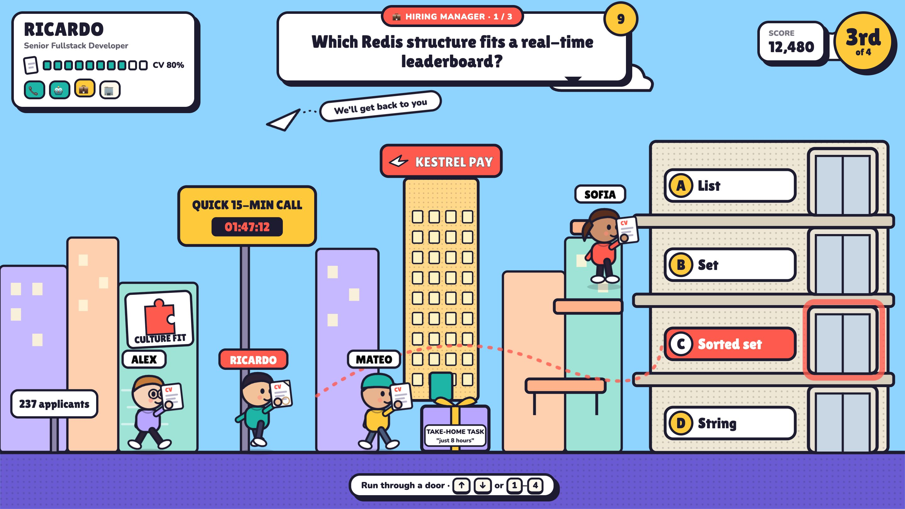

| ATS 9000 | Recruiter | Phone, landscape 844×390 |
|---|---|---|
| 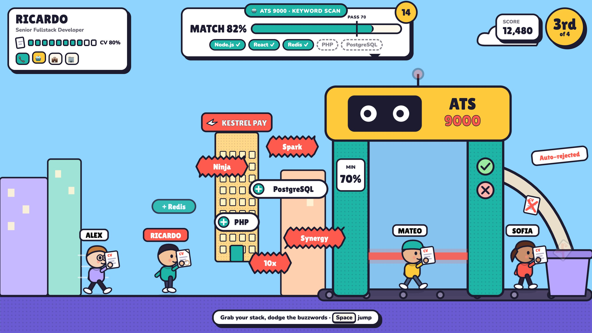 | 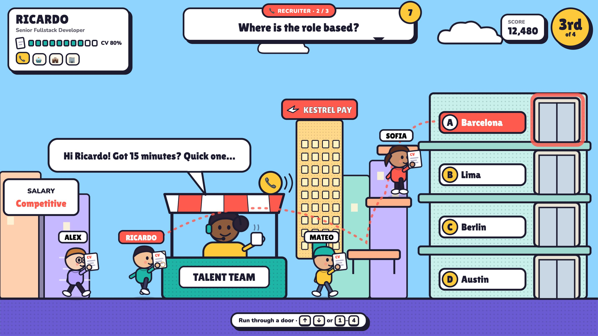 | 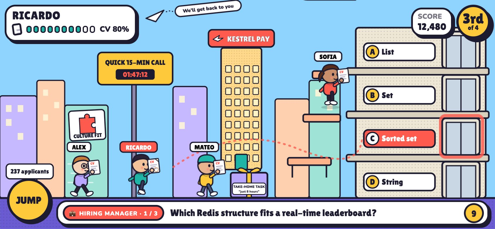 |

**Concept.** The office as a bright cartoon arcade. Thick ink outlines, flat colors and hard offset shadows; chibi developers about three heads tall who hold their CV up like a trophy. It's an exaggerated office world: desks are the platforms, the answers are elevator doors in a tower, the take-home task is a gift box ("just 8 hours"), and the ATS is a friendly scanning gate with googly eyes.

- **Palette:** ink `#1D1B2F`, paper `#FFF8EC`, tomato `#FF5A4E`, sunflower `#FFC93C`, teal `#1FB5A6`, sky `#8FD3FF`, lilac `#B9A6FF`, peach `#FFB38A`, carpet `#6B5BD2`.
- **Typography:** Lilita One (display, prompts, labels) + Nunito 800/900 (body, HUD details).
- **Characters:** big heads, round bodies, readable faces. Bots differ by silhouette as well as color: Sofia has a ponytail, Mateo a cap, Alex glasses. The CV is a sheet in a clear sleeve, held high; when damaged it gets a coffee ring and a folded corner and sheds scraps.
- **Environment:** daylight city of pastel blocks, the Kestrel Pay tower in the middle, desks as platforms, the elevator tower for the answers.
- **HUD:** "stickers": white cards with ink borders and offset shadows. The question is a speech bubble with a stage tab and a round timer. CV Health is ten chunky cells. The position sits in a big yellow circle, stage progress in emoji chips.
- **Motion:** a bobbing run cycle with swinging limbs, parallax clouds, a breathing selected door that opens, the ATS beam sweeping the gate, rejected CVs sliding down a chute.

| | |
|---|---|
| Visual identity | Friendly and immediately readable; appealing to a broad audience. The risk is looking like many other casual web games: the distinctive part has to come from the satire, not the style. |
| Play feel | Bouncy, fast, arcade. Expressive characters make boosts, hits and wins easy to sell. |
| Humor capacity | Highest. Faces and exaggerated props carry gags (gift-box take-home, googly-eyed ATS, chute of rejected CVs) without much text. |
| Growth to new worlds | Easy: any place (startup garage, bank, conference, remote work) can be cartoonized with the same rules. |
| Ease of animation | Easy. Characters are part rigs (head, body, limbs, CV) animated by transforms, so new actions are tweens, not new drawings. Suits Phaser tweens. |
| Performance | Cheap: flat fills, few large shapes. In Phaser the parts would be baked to a texture atlas. |
| Asset production | Lowest effort. Vector shapes with one stroke style; a developer can extend it following the rules. |
| Mobile | Best legibility: thick outlines and large type survive the 844×390 downscale; the tightest HUD of the three at the same sizes. |
| Accessibility & legibility | Strong: dark ink on light colors, large type. Selected and good/bad states are shown by shape as well as color: the chosen sign is filled, its door glows and opens, buzzwords are spiky, keywords are round with a "+". |

**Pros:** most readable, most expressive, cheapest to produce and animate, broad appeal, shareable on LinkedIn without explanation.
**Risks:** generic if the satire is weak; bright daylight palette on every world could get monotonous (mitigation: a palette per world).
**Estimated production (MVP art set, one person following these conventions):** about 8–12 days for 4 runners + recruiter + ATS + HQ + 4 hiring-stage scenes + doors, obstacles, power-ups + HUD. A rough estimate, not a commitment.

## B · Neon Pixel Campus

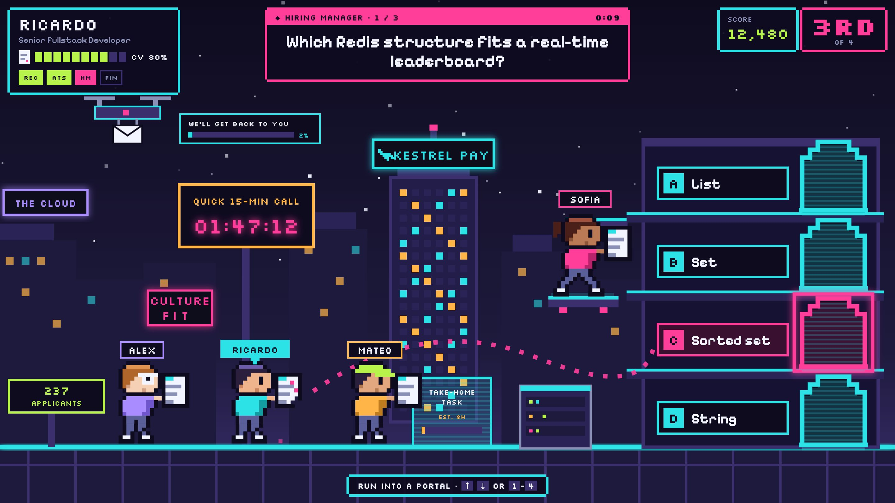

| ATS 9000 | Recruiter | Phone, landscape 844×390 |
|---|---|---|
| 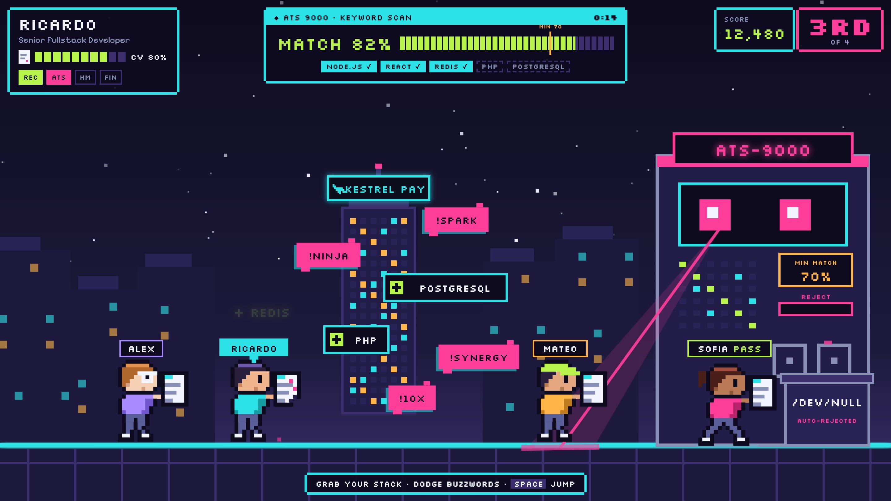 | 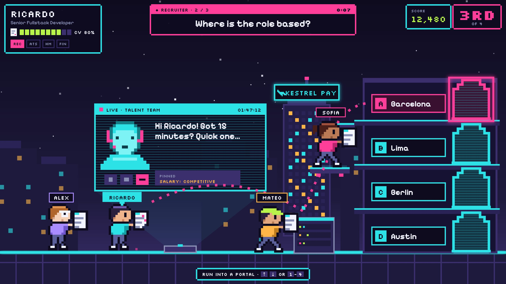 | 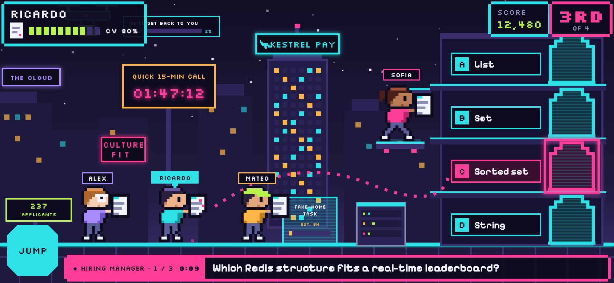 |

**Concept.** A tech campus at night, in modern pixel art. Every sprite is a pixel map (one map pixel = 7 scene units) rendered crisp, with neon signs, server racks and hover pads as platforms, and holographic portals for the answers. The ATS 9000 is a mainframe whose laser sweeps the lane, and rejected CVs are shredded into `/dev/null`. The recruiter is a flickering hologram video call that has been "live" for 01:47:12. It avoids CRT clichés: no scanline filter over the screen, no curvature.

- **Palette:** night `#0E0B1F`, indigo `#1E1A3D`, violet `#3B2F6E`, cyan `#2DE2E6`, magenta `#FF3E9A`, lime `#B7F34B`, amber `#FFB547`, steel `#8A8FB5`, white `#F2F4FF`.
- **Typography:** Silkscreen (labels, HUD numbers) + Pixelify Sans (questions and readable text).
- **Characters:** 20×21 pixel sprites with a big paper CV held in front. Bots are the same map with another palette plus overlays (ponytail, cap, glasses). The damaged CV shows glitch pixels, a bitten-off corner and pixels falling off. Two-frame run cycle in `steps()`.
- **Environment:** dark skyline with lit windows and pixel stars, a neon "THE CLOUD" data center, a dying "CULTURE FIT" sign, a delivery drone forever "sending" *We'll get back to you* (2%), an LED counter of 237 applicants.
- **HUD:** dark panels with notched pixel corners, magenta title bars, segmented bars (CV, ATS match), stage chips REC / ATS / HM / FIN, and the position as a large "3RD".
- **Motion:** stepped animation everywhere (run frames, twinkling stars, LED blinks, flicker, a laser sweeping in steps, portal scanlines rolling).

| | |
|---|---|
| Visual identity | Strongest "this is a video game" signal and very close to developer culture. But the neon-night pixel look is a crowded aesthetic in indie games, so originality depends on the details. |
| Play feel | Crisp and snappy; precise platforming; the most "gamer" of the three. |
| Humor capacity | Good, through signage and tech jokes (`/dev/null`, THE CLOUD, a drone at 2%). Tiny faces carry little expression, so character-driven gags are harder. |
| Growth to new worlds | A palette per world is easy (dawn, rain, office daylight), but "night tech" is the core; other worlds risk losing the identity, and every new tileset needs pixel-art skill. |
| Ease of animation | Frame by frame: every new action means drawing new frames. Frames are small and quick to draw, and stepped motion hides jank, but it needs a pixel artist's hand to look good. |
| Performance | Cheapest at runtime: tiny textures, nearest-neighbour scaling, no anti-aliasing; glow effects should be baked into sprites, not runtime filters. |
| Asset production | Highest skill bar. Good pixel art is a craft; contributors without it will produce inconsistent sprites. |
| Mobile | Sprites stay crisp at any integer scale, and contrast on the dark background is high. Small pixel text (Silkscreen at 8–10 px) is the weak point on phones. |
| Accessibility & legibility | Mixed. Large text has good contrast. Pixel fonts lose legibility at small sizes: in Pixelify Sans the "15" of the recruiter's line reads like "1S", and the font turned "fi" into a ligature that read like "A" (ligatures are now disabled). Blink and flicker need care for photosensitivity (kept slow, stopped with reduced motion). Buzzwords are marked by shape and a "!" prefix, not only color. |

**Pros:** strongest game identity, a dev-culture tone, very cheap at runtime, sharp at any size, great for night "boss" moments (ATS).
**Risks:** legibility of pixel fonts on mobile and for long questions; a crowded aesthetic; depends on scarce pixel-art skill; the dark palette everywhere could feel heavy.
**Estimated production:** about 12–18 days for the same MVP set, mostly frame-by-frame animation and tilesets. A rough estimate.

## C · Paper Trail

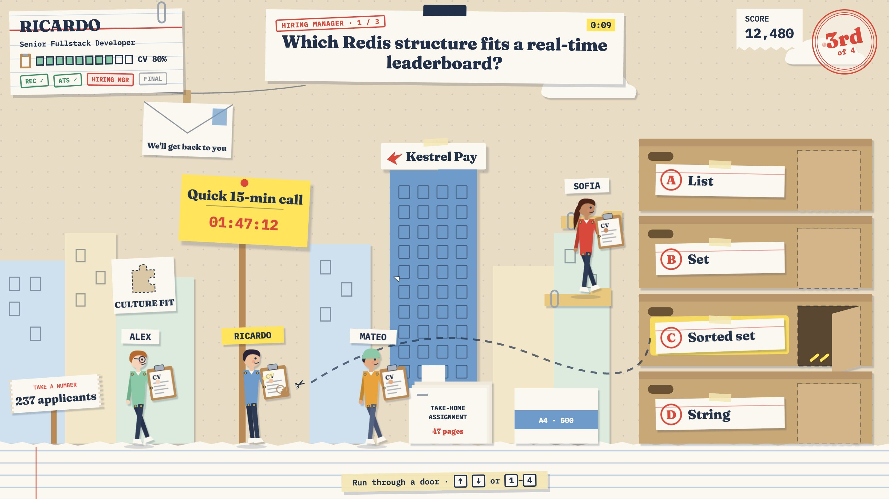

| ATS 9000 | Recruiter | Phone, landscape 844×390 |
|---|---|---|
| 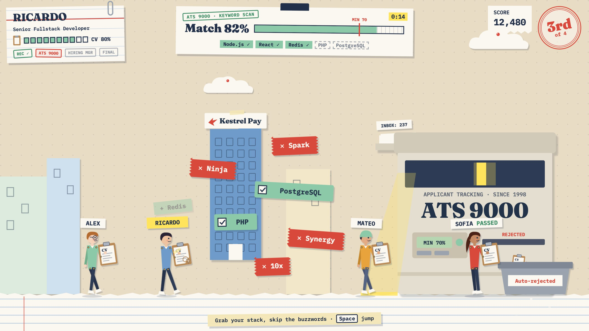 | 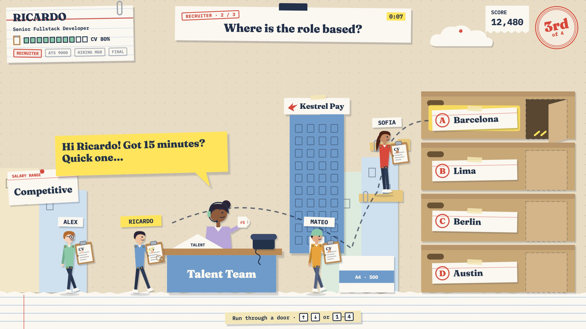 | 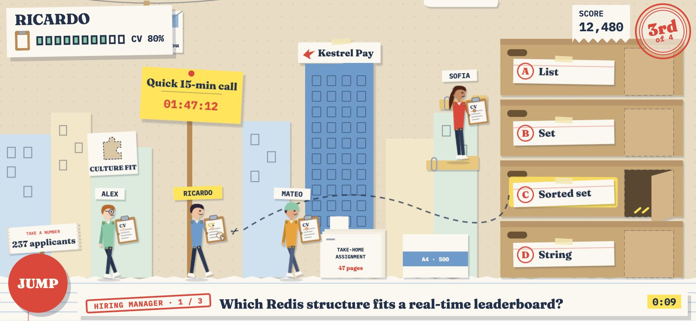 |

**Concept.** A paper-craft world made of the hiring process's own paperwork: cut card, tape, stamps, sticky notes, paper clips, folders. The ground is a strip of notebook paper with a torn edge. The answers are flap doors cut into stacked archive boxes, each with a taped index card. The ATS 9000 is a giant office copier ("since 1998") whose light bar scans the lane, feeding rejected CVs into a shredder bin. The recruiter sits at a folded-card pop-up desk with a #1 mug, talking on a sticky note.

- **Palette:** kraft `#E9DCC4`, card `#FBF8F2`, ink navy `#22304A`, stamp red `#D9483B`, highlighter `#FFE45C`, folder blue `#6E9BC9`, mint `#8CC9A8`, manila `#E8C77E`, box `#C9A878`.
- **Typography:** Fraunces (questions, names, big labels) + IBM Plex Mono (typed labels, stamps, numbers).
- **Characters:** tall paper dolls (≈6 heads) with visible brass split pins at the joints; each carries the CV on a clipboard held in front. The damaged CV has a coffee ring, a torn corner and tape, and drops paper scraps.
- **Environment:** pastel card buildings drawn with pen-line windows, clouds pinned with push pins, a giant sticky note "Quick 15-min call 01:47:12", a take-a-number ticket "237 applicants", a Culture Fit poster with a puzzle-shaped hole, an envelope on a clothespin, "Salary range: Competitive" on an index card.
- **HUD:** paper on a desk. The player card is an index card with a paper clip, the question a binder-clipped card with a rubber-stamp stage tab and a highlighter timer. The score is a receipt with a torn edge, the position a red ink stamp, and the hint masking tape.
- **Motion:** stop-motion: poses swap in steps with a slight "boil", limbs pivot on split pins, flap doors swing open, and the copier's light bar travels in steps.
- **Considered and discarded:** a clean "SaaS vector illustration" direction (flat corporate people, blobs). Too close to the websites of the companies it satirizes, and less of a game.

| | |
|---|---|
| Visual identity | The most original for this subject: the world is literally made of hiring paperwork. Editorial and premium; very shareable as "beautiful". |
| Play feel | Calm and crafty. Stop-motion reads as deliberate, which suits a tabletop more than a race: speed needs extra help (speed lines, paper streamers, faster stepping). |
| Humor capacity | Excellent for dry satire of bureaucracy (stamps, forms, "47 pages", "since 1998", take-a-number). Faces are small and calm, so there's less slapstick than A. |
| Growth to new worlds | Very good: "everything is paper" applies to any place, and each world can have its own paper (blueprints, receipts, newspaper). Building convincing paper textures per world takes effort. |
| Ease of animation | Easy: cutout characters with split pins are made for skeletal animation, and stop-motion stepping is a style that also hides cost. |
| Performance | Fine once baked: the prototype uses SVG drop-shadow filters per element (heavier in the browser DOM); in Phaser, shadows and paper texture would be baked into the textures. |
| Asset production | Medium: simple shapes, but the paper feel (shadows, edges, texture, consistent rotation) needs discipline and a style guide. |
| Mobile | Readable: navy on cream, large serif type. Thin details (pen lines, split pins) disappear at 844×390, but the CV clipboards and labels survive. |
| Accessibility & legibility | Strong contrast for text. Good and bad keywords differ in shape and icon (mint tape with ✓ vs red tape with pinked edges and ✕), and the selected answer gets highlighter and an open flap. Low saturation means fewer color cues, so state changes rely on shape. |

**Pros:** most distinctive, satire built into the world itself, elegant, easy to rig and animate, scales to many worlds.
**Risks:** slower feel for a racing game; small faces mean less expressive characters; the paper look can drift into inconsistency without strict rules.
**Estimated production:** about 10–14 days for the same MVP set. A rough estimate.

## Mobile: portrait vs landscape

Gameplay is designed for landscape; the rest of the site stays portrait-friendly.

| | A | B | C |
|---|---|---|---|
| Landscape 844×390 |  |  |  |
| Portrait, playing anyway (`?portrait=fit`) | 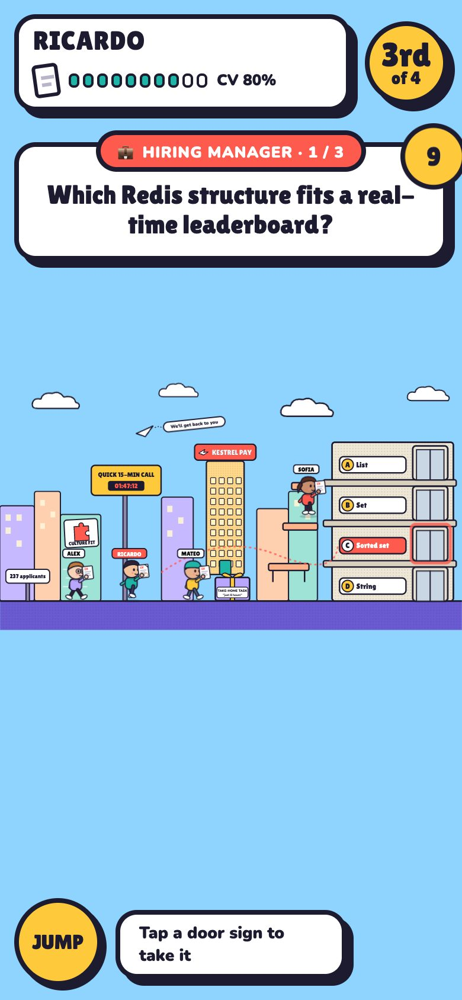 | 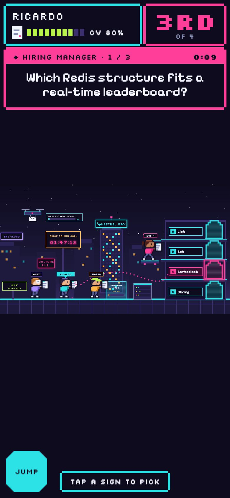 | 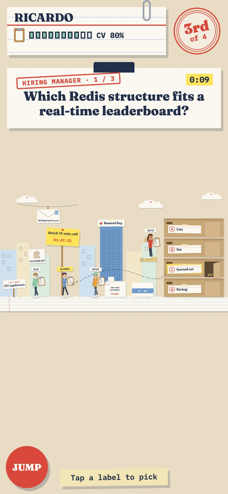 |
| Portrait, what we ship | 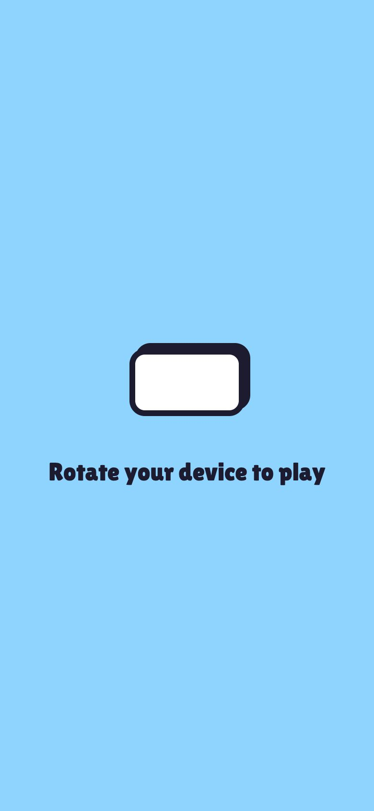 | 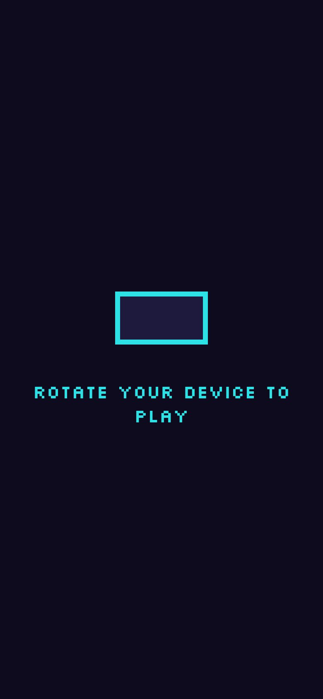 | 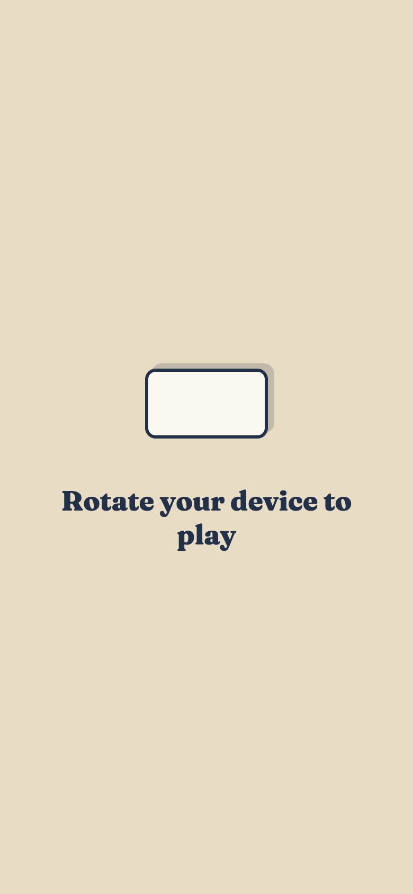 |

Why not portrait. At 844×390 landscape the level is drawn at 53% of its design size: runners are 80–95 px tall and the door labels about 14 px. In portrait the same level must fit 390 px of width, so it is drawn at 24%: runners 35–45 px tall, door labels about 6 px, and half the screen is empty or taken by the HUD. A side-scrolling race needs horizontal distance to see the doors coming, so the game shows "Rotate your device to play" in portrait. A portrait mode would need a different level design, not a different layout.

Phone HUD (all three): on short landscape screens the question moves to a strip over the ground at the bottom. The top corners keep only the player card and the position, so the HQ, the bots and all four doors stay visible. The keyboard hint gives way to a touch JUMP button; answers are taken by tapping a door's sign or running into it.

## Side by side

| | A · Corporate Arcade | B · Neon Pixel Campus | C · Paper Trail |
|---|---|---|---|
| Visual identity | Friendly, broad | Gamer, dev culture | Original, editorial |
| Play feel | Bouncy, fast | Crisp, snappy | Calm, deliberate |
| Humor capacity | Highest (slapstick + satire) | Good (tech jokes) | High (dry bureaucratic satire) |
| Growth to new worlds | Easy | Medium | Very good |
| Ease of animation | Easy (rigs + tweens) | Hardest (frame by frame) | Easy (cutout rigs, stop-motion) |
| Runtime performance | Cheap | Cheapest | Fine once baked |
| Asset production | Lowest effort | Highest skill bar | Medium, needs discipline |
| Mobile legibility | Best | Weakest for small text | Good |
| Accessibility | Strong | Mixed (pixel fonts, flicker) | Strong (shape-coded states) |
| Rough MVP art effort | 8–12 days | 12–18 days | 10–14 days |

## Recommendation (the choice is the owner's)

**A · Corporate Arcade**, with **C · Paper Trail** as a strong alternative.

Why A: CV Rush is a fast race played often on phones, with text-based questions inside the level. A is the most legible at 844×390, the most expressive (it sells boosts, hits and the satire without words), the cheapest to produce and animate, and the easiest for contributors to extend consistently. Its weakness, looking generic, is answered by the satire and the CV-carrying silhouette.

Why not B first: it has the strongest gamer identity, but it is the hardest to keep legible for long questions on phones and the hardest to produce consistently in an open-source project.

When C wins: if originality and the satire of paperwork matter more than speed and slapstick, C is the most distinctive and still very readable; it needs extra work to feel fast.

Next, once a direction is chosen: Round 2 builds it into the ten key screens with transitions and writes `docs/game-design/visual-bible.md`; S3 (Phaser) starts only after that is approved.
