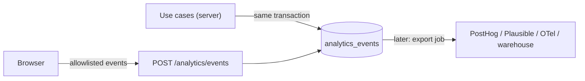

# Analytics

> Part 2 · Status: **Approved** (current decisions; they evolve through ADRs) · Decision: [ADR-023](../adr/ADR-023-analytics-events.md)
>
> Product metrics: [success metrics](../product/success-metrics.md).

## 1. Design

- **Events are defined in the domain's language**, in `packages/contracts` (name, version, allowed properties), independent of any provider.
- **Server events** are recorded by application use cases **after** domain decisions, in the same transaction (first-party `analytics_events` table). Domain logic never depends on analytics.
- **Client events** (things only the browser sees: clicks, views) go through `POST /api/v1/analytics/events`, validated against the allowlist, rate-limited, and **never used for business logic**.
- **Adapters** (later): an export job can forward events to PostHog, Plausible, OpenTelemetry or a warehouse. The catalog doesn't change.

## 2. Privacy rules

- A **pseudonymous developer reference** (keyed hash of the Developer ID), never the ID itself in exports.
- **Never:** names, emails, LinkedIn usernames, free-text comments, IP addresses, question content or answers.
- Properties are allowlisted per event (unknown properties are dropped).
- Public aggregates only above minimum group sizes.

## 3. Event catalog (v1)

| Event | Source | Properties (allowlisted) |
|---|---|---|
| `developer_created` | server | role, seniority, band, track, technologyIds, locale |
| `profile_changed` | server | changed fields (names only), band/track changed |
| `identity_contact_added` | server | type (`email`, `linkedin`, `both`), isFirstGameDone, gamesPlayed |
| `visibility_changed` | server | profileVisibility, linkedinVisibility |
| `game_session_created` | server | runType, category, source, rulesetVersion |
| `job_posting_viewed` | client | runType, readMs (bucket) |
| `application_started` (apply) | server | runType, attemptNumber |
| `race_started` | server | runType |
| `challenge_started` | server | stage (recruiter, ats, hiring_manager, final), runType |
| `question_answered` | server | slot, category, contextKind, difficulty, technologyIds, correct/grade, timedOut, responseMs bucket, locale, tier |
| `ats_passed` / `ats_failed` | server | match bucket, relevantCollected, irrelevantCollected |
| `game_finished` | server | runType, status, reasonCode, score bucket, position, durationMs bucket |
| `first_game_completed` | server | runType, status |
| `game_failed` | server | stage, reasonCode |
| `xp_awarded` | server | amount bucket, runType, reasons |
| `level_up` | server | newLevel |
| `ranking_entry_improved` | server | category, periodType, rank bucket |
| `title_awarded` | server | type, category |
| `leaderboard_viewed` | client | scope, isOwnCategory |
| `linkedin_clicked` | client | context (ranking, champion card, share page) |
| `share_clicked` | client | channel (linkedin, x, whatsapp, copy), runType |
| `result_shared_page_viewed` | server (SSR) | hasVisibleProfile |
| `play_again` | client | runType |
| `question_reported` | server | reason |
| *(Stage 3)* `job_viewed`, `play_to_apply_started`, `application_submitted` | server | job track, band |

Key funnels: `developer_created → game_session_created → first_game_completed → identity_contact_added`, and the run funnel by stage.

## 4. Retention

`analytics_events` kept 13 months (partitioned monthly when volume requires), then aggregated summaries only.
