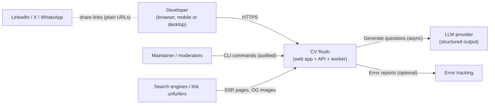
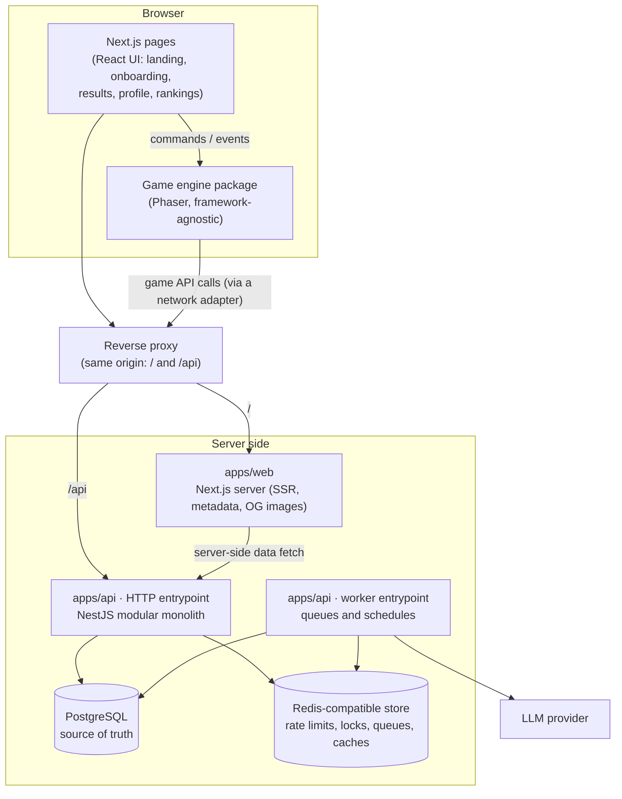

# Architecture overview

> Part 2 · Technical architecture · Status: **Draft for review**
>
> Builds on the approved product design (Part 1). The architectural north is **Developers → Games → Progress → Reputation inside CV Rush → Jobs → Applications → Recruiters**. The MVP implements the first three links; the rest must be addable without changing the center.

## 1. Architectural principles

1. **The server is the referee.** The browser is an untrusted terminal that renders and sends intents. Every outcome (correctness, score, time, position, XP, rank) is computed server-side ([ADR-003](../adr/ADR-003-server-authoritative-gameplay.md)).
2. **Security never depends on the code being secret.** The repository is public. Integrity rests on server state, runtime secrets and private data, never on obscurity.
3. **The Developer is the center.** Every fact (sessions, results, XP, titles) belongs to a server-generated Developer, which exists before any account ([ADR-007](../adr/ADR-007-provisional-developer-identity.md)).
4. **Facts are immutable; views are projections.** Game results and XP ledger entries are append-only. History, stats, rankings and profiles are rebuildable views ([ADR-016](../adr/ADR-016-immutable-results-and-xp-ledger.md), [ADR-008](../adr/ADR-008-rankings-as-projections.md)).
5. **Strong consistency where the player is looking; async only where it pays.** Finishing a run updates result, XP, level, stats and ranking entry in **one transaction**. Queues are used only for long-running, retryable or scheduled work ([ADR-015](../adr/ADR-015-async-processing-scope.md)).
6. **A modular monolith.** One deployable API (plus a worker process from the same codebase), with modules that have clear boundaries and could be extracted later ([ADR-001](../adr/ADR-001-modular-monolith.md)).
7. **The game engine is decoupled from the web app.** Phaser lives in a framework-agnostic package with a typed command/event contract ([ADR-002](../adr/ADR-002-phaser-game-engine.md)).
8. **Contracts are shared and validated.** One schema source (Zod) for API payloads, events and error codes, used by web, game and API ([ADR-022](../adr/ADR-022-shared-contracts-and-validation.md)).
9. **i18n from the domain.** The backend speaks semantic codes; clients translate ([ADR-006](../adr/ADR-006-i18n-routing.md)).
10. **Privacy by design.** The email is encrypted, never public, never in analytics or logs ([ADR-021](../adr/ADR-021-personal-data-handling.md)).
11. **Configuration over magic numbers.** Tunables live in versioned rulesets; every session records the versions it ran with ([ADR-024](../adr/ADR-024-game-configuration-and-feature-flags.md)).
12. **Brand-agnostic code.** "CV Rush" appears only in branding configuration and assets.

## 2. System context

No third-party trackers, no LinkedIn API, no social SDKs. The LLM provider is only reached by the worker, never on a player's request path.

## 3. Containers

| Container | Responsibility | Notes |
|---|---|---|
| **apps/web** (Next.js) | SSR pages (landing, rankings, share pages, legal pages), React UI, hosting the game, i18n routing, metadata and OG images | Contains **no business rules**. Talks to the API only. |
| **packages/game** (Phaser) | Rendering, physics, input, animation, audio of the runner | Framework-agnostic; receives server data through a port; contains no answer keys, no scoring |
| **apps/api – HTTP** (NestJS) | All business rules: identity, profiles, sessions, questions, scoring, progression, rankings, privacy, analytics ingestion | The only writer to PostgreSQL besides the worker |
| **apps/api – worker** | AI question generation, daily close and verification, scheduled maintenance, retryable async work | Same codebase and modules, separate process so long jobs never affect API latency |
| **PostgreSQL** | Source of truth for everything durable | |
| **Redis-compatible store** | Rate limiting, distributed locks, BullMQ queues, short-lived caches | Never the only copy of a fact |
| **Reverse proxy** | Serves web and API under **one origin** | First-party cookies, no CORS, simpler CSRF ([ADR-012](../adr/ADR-012-web-and-api-applications.md)) |

## 4. Technology choices (summary)

Each important choice has an ADR. Versions: the current stable major at implementation time unless pinned.

| Piece | Choice | Why (short) | Not chosen | ADR |
|---|---|---|---|---|
| Runtime | **Node.js 24 LTS**, pinned | One language end to end; LTS until 2028 | — | [ADR-011](../adr/ADR-011-monorepo-and-tooling.md) |
| Language | **TypeScript**, strict | Shared types across web, game and API | — | — |
| Monorepo | **pnpm workspaces** (Corepack-pinned) | Fast, strict dependency isolation, no extra tool | Nx (heavy), Turborepo (add only if CI needs caching) | [ADR-011](../adr/ADR-011-monorepo-and-tooling.md) |
| Web | **Next.js** (App Router) + React | SSR/SEO for landing, rankings and share pages; OG images; i18n routing | SPA only (bad SEO), Remix/Astro (fine, but less fit for the maintainer's preference and ecosystem) | [ADR-012](../adr/ADR-012-web-and-api-applications.md) |
| Game | **Phaser** | Scenes, arcade physics for a platformer, input, scale manager, tweens, audio, loader | PixiJS (rendering only, everything else custom), Kaplay, custom canvas | [ADR-002](../adr/ADR-002-phaser-game-engine.md) |
| API | **NestJS** (Fastify adapter) | Module system that fits a modular monolith, DI for ports/adapters, mature ecosystem | Next.js route handlers only (business logic would leak into the web app), Express/Fastify bare (structure by hand) | [ADR-001](../adr/ADR-001-modular-monolith.md), [ADR-012](../adr/ADR-012-web-and-api-applications.md) |
| Validation | **Zod** schemas in `packages/contracts` | One source of truth for runtime validation and types across all apps | class-validator (decorators, not shareable with the browser) | [ADR-022](../adr/ADR-022-shared-contracts-and-validation.md) |
| Database | **PostgreSQL** | Relational integrity, transactions, constraints, JSONB, `pg_trgm` | MongoDB (weaker constraints for this domain) | [ADR-013](../adr/ADR-013-postgresql-and-prisma.md) |
| ORM | **Prisma** (+ typed raw SQL for ranking queries) | Typed client, migrations, contributor familiarity | Drizzle/Kysely (good alternatives; Prisma preferred by the maintainer) | [ADR-013](../adr/ADR-013-postgresql-and-prisma.md) |
| Cache/locks/queues | **Redis-compatible** (Redis or Valkey) | Rate limiting, locks, BullMQ; small and well understood | Postgres-only queues (possible, but BullMQ gives retries, schedules and dashboards) | [ADR-014](../adr/ADR-014-redis-usage.md) |
| Async jobs | **BullMQ**, only for specific workloads | Retries, backoff, rate limiting, repeatable schedules | Queue everything (unneeded eventual consistency) | [ADR-015](../adr/ADR-015-async-processing-scope.md) |
| i18n | **next-intl** (web), message catalogs shared with the game | App Router support, locale-prefixed routing, ICU messages | Hand-rolled | [ADR-006](../adr/ADR-006-i18n-routing.md) |
| Styling | **Tailwind CSS** with design tokens as CSS variables | Consistency, small CSS output, contributor familiarity | CSS-in-JS (runtime cost) | — |
| Logs | **pino** (structured JSON) | Fast, redaction support | — | [observability](16-observability.md) |
| Tests | **Vitest**, **Testcontainers**, **Playwright** | Fast unit tests; real Postgres/Redis in integration; e2e on mobile viewports | Jest (slower in ESM/TS setups) | [testing](20-testing-strategy.md) |
| Containers | **Docker** + Compose for local services | The documented local path for Postgres and Redis | — | — |

## 5. Quality attributes and how the architecture addresses them

| Attribute | Target | Mechanism |
|---|---|---|
| Integrity | No client-trusted outcome | Server authority, state machine, single-use challenges, attempt commitment ([anti-cheat](../anti-cheat/README.md)) |
| Latency | p95 < 300 ms for game endpoints | Small payloads, indexed queries, no LLM on the request path, worker isolation |
| Consistency | The result screen shows final XP, level and rank immediately | One transaction for result + XP + stats + ranking entry |
| Privacy | Zero email exposure | Encryption, redaction, contract-level exclusion, tests ([ADR-021](../adr/ADR-021-personal-data-handling.md)) |
| Evolvability | Jobs and recruiters without redesign | Developer-centric model, source-agnostic Job Challenge, projections, ownership fields ([future evolution](21-future-evolution.md)) |
| Contributability | Content PRs without touching code | Content package + validators + CI ([ADR-004](../adr/ADR-004-question-engine-and-lifecycle.md)) |
| Operability | Diagnose any result | Structured logs with request/session IDs, recorded seeds and versions, audit trail per run ([observability](16-observability.md)) |
| Cost | Predictable | Single region, small footprint, batched AI generation with budgets |

## 6. Document map

See [architecture README](README.md).
