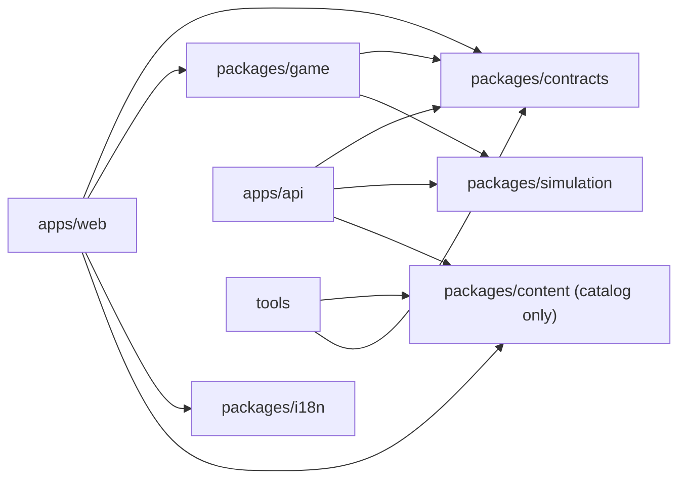

# Monorepo structure

> Part 2 · Technical architecture · Status: **Approved** (current decisions; they evolve through ADRs) · Decision: [ADR-011](../adr/ADR-011-monorepo-and-tooling.md)

## 1. Layout

```
cv-rush/
├─ apps/
│  ├─ web/                 Next.js app: pages, React UI, game host, i18n routing, SSR, OG images
│  └─ api/                 NestJS modular monolith
│     ├─ src/main.http.ts     HTTP entrypoint
│     ├─ src/main.worker.ts   Worker entrypoint (queues, schedules)
│     ├─ src/cli.ts           Maintenance commands (moderation, rebuilds), audited
│     └─ prisma/              Schema and migrations
├─ packages/
│  ├─ contracts/           Zod schemas + types: API DTOs, error codes, effect codes, analytics events
│  ├─ game/                Phaser game engine (framework-agnostic): scenes, entities, input, rendering
│  ├─ simulation/          Pure deterministic logic shared by API and game: seeded PRNG, ATS stream model,
│  │                       race timing model, bot pacing model (no secrets, no I/O)
│  ├─ content/             data/ (CC BY 4.0): catalogs, sample question pack (later: job fragments,
│  │                       bot personas, rulesets, templates); src/ (Apache-2.0): schemas and validators
│  ├─ i18n/                UI message catalogs (es, en) by namespace + helpers
│  └─ config/              Shared tsconfig, ESLint and Prettier presets
├─ tools/                  Repository tooling (documentation link checker)
├─ compose.yaml            Local PostgreSQL and Redis (Docker Compose)
├─ docs/
└─ .github/                CI workflows, issue/PR templates (Part 3)
```

## 2. What is shared, and what isn't

| Package | Used by | Must never contain |
|---|---|---|
| `contracts` | web, game, api | Business rules, secrets, answer keys |
| `simulation` | api (authoritative), game (rendering the same model) | Secrets, seeds, randomness that isn't seeded, I/O |
| `content` | api (loads at boot), tools, web (catalog for onboarding UI) | Competitive questions, answer keys of real pools, the Daily Company **schedule**, personal data |
| `i18n` | web, game (via the host) | Business rules |
| `game` | web | Network code (it receives a port), scoring, answer keys |
| `apps/api` internals | api only | — (the domain lives here, not in a shared package) |

**Why the domain isn't a shared package:** business rules must run only on the server. Sharing them with the browser would invite client-side "rules" that attackers can modify. Only `simulation` is shared, and only because the client must *render* exactly what the server *computes* (e.g. where ATS tokens are). The server never trusts the client's copy.

## 3. Dependency rules (enforced by lint)



- `packages/game` must not import from `apps/web`, React or Next.js.
- `packages/simulation` has zero runtime dependencies.
- `apps/web` must not import from `apps/api`.
- Inside `apps/api`, modules import each other only through their public entry (`index.ts`). See [backend modules](03-backend-modules.md).

## 4. Scripts (implemented in Part 3)

| Script | Does |
|---|---|
| `pnpm dev` | Runs web, api (HTTP + worker) in watch mode; expects Postgres and Redis from `docker compose up` |
| `pnpm build` | Builds all apps and packages |
| `pnpm test` | Unit tests (Vitest) across the workspace |
| `pnpm test:integration` | API integration tests with Testcontainers |
| `pnpm test:e2e` | Playwright on desktop and mobile viewports |
| `pnpm lint`, `pnpm typecheck` | Lint and strict type checks |
| `pnpm db:migrate`, `pnpm db:seed` | Prisma migrations; seeds catalogs, sample pool, fake developers and rankings |
| `pnpm content:validate` | Validates catalogs (later also rulesets, job templates, bot content) |
| `pnpm db:check` | Fails if the Prisma schema and the migrations differ |
| `pnpm docs:check` | Validates relative links and anchors in Markdown |
| `pnpm questions:validate` | Validates question files (sample pool, later community packs) |
| `pnpm translations:validate` | Missing keys, ICU syntax, unused keys, es/en parity |

## 5. Pinning

- Node 24 LTS: `.nvmrc` and `.node-version` (for nvm, fnm, asdf/mise, Volta users), plus `engines.node` in the root `package.json`.
- pnpm: `packageManager` field (Corepack), plus `engines.pnpm`. pnpm 12 blocks dependency install scripts unless they're listed in `allowBuilds` (`pnpm-workspace.yaml`) and applies a minimum release age to new versions; we keep both policies and pin versions that satisfy them.
- `engine-strict=true` in `.npmrc` so mismatched versions fail early.

## 6. Growth path

If CI time grows, add Turborepo (task graph + remote cache) without changing the layout. If a module is extracted from the monolith later, it becomes a new `apps/*` with its own entrypoint, reusing `contracts`.
