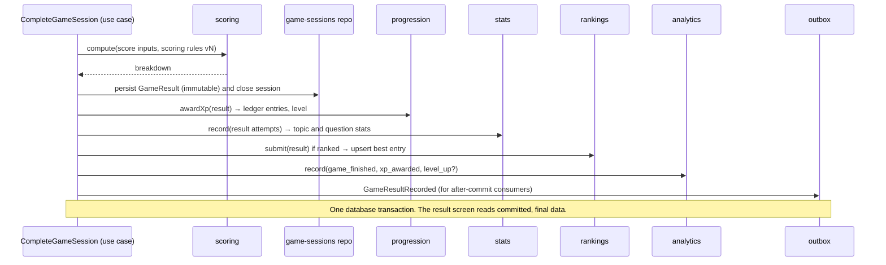
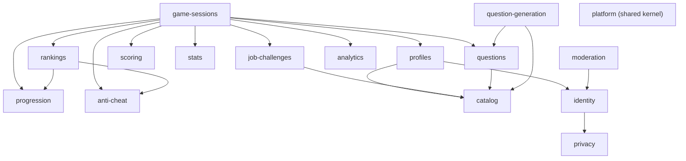

# Backend modules (modular monolith)

> Part 2 · Technical architecture · Status: **Draft for review** · Decision: [ADR-001](../adr/ADR-001-modular-monolith.md)

## 1. Modules

Each module owns its tables, exposes a small public API (`index.ts`), and never reads another module's tables directly.

| Module | Owns | Responsibilities (MVP) | Stage |
|---|---|---|---|
| **identity** | developers, device credentials, management links, contact identifiers | Create provisional Developers, authenticate requests by device credential, contact identifiers (email encrypted, LinkedIn normalized), visibility, deletion; later accounts and claims | 1 (2 adds accounts) |
| **catalog** | (loaded from `packages/content`) | Roles, seniorities, bands, tracks, technologies, compatibility rules, categories and their lifecycle | 1 |
| **profiles** | developer profiles, profile snapshots | Validate and store the current profile; create immutable snapshots; ranked daily lock | 1 |
| **privacy** | consents, data requests | Consent records, export/delete flows, PII crypto service (used by identity) | 1 |
| **job-challenges** | companies, job postings, Daily Company schedule, blueprints | Generate Job Challenges (generated/daily; later from real postings), category blueprints, applicant counts | 1 (3 adds real postings) |
| **game-sessions** | game sessions, challenges, question attempts, ranked attempts, client event logs | The session state machine, attempt commitment, challenge opening and answering, ATS re-simulation, race timing, bot simulation, completion | 1 |
| **questions** | question contexts, questions, versions, lifecycle, exposures, reports | The Question Engine (selection), lifecycle transitions, invalidation, reports, job-derived templates | 1 |
| **question-generation** | generation batches | The AI pipeline: jobs, provider port, validation stages, second check, metadata (runs in the worker) | 1 |
| **scoring** | — (pure) | The versioned scoring engine | 1 |
| **progression** | XP ledger, progression summary, discovery records | XP awards, anti-farming counters, levels, titles' XP | 1 |
| **stats** | developer topic stats, question stats | Gameplay statistics projections | 1 |
| **rankings** | ranking entries, titles, seasons, periods | Ranking upserts, queries, daily close, verification orchestration, Daily Champion titles | 1 |
| **anti-cheat** | run flags, verification results | Plausibility checks, verification rules, flags; consulted by sessions and rankings | 1 |
| **moderation** | reports (profiles), moderation actions | Name moderation, profile reports, hide/restore, audited admin actions | 1 |
| **analytics** | analytics events | Event catalog, allowlisted ingestion from the client, first-party sink | 1 |
| **platform** (shared kernel) | — | Clock, ruleset/config, feature flags, rate limiting, logging context, Prisma, Redis, queue, outbox | 1 |
| *accounts*, *public-profiles* | — | Accounts, claims, merges, public developer pages | 2 |
| *companies*, *jobs*, *applications* | — | Real companies, postings, Play to Apply, applications | 3 |
| *recruiters* | — | Recruiter accounts, discoverable search | 4 |

## 2. Layers: where they add value

Core modules with real rules use a light **domain / application / infrastructure / interfaces** split:

```
modules/game-sessions/
  domain/          entities, value objects, the state machine, policies (pure TS, no Nest, no Prisma)
  application/     use cases (one class per use case), transaction boundaries, ports (interfaces)
  infrastructure/  Prisma repositories, Redis adapters, queue producers
  interfaces/      HTTP controllers, DTO mapping (from contracts), job processors
  index.ts         the module's public API
```

Applied to: **identity, profiles, game-sessions, questions, question-generation, progression, rankings, scoring** (scoring is domain-only).

Simpler modules (**catalog, analytics, moderation, stats, privacy**) use a service + repository, without ceremony. No module gets a "god service": use cases stay small and named after what they do (`CommitRankedAttempt`, `AnswerQuestion`, `CompleteGameSession`).

## 3. How modules talk

| Need | Mechanism |
|---|---|
| A use case needs another module's capability **inside the same transaction** | Call that module's public application service, passing the transaction context (explicit orchestration) |
| A side effect that can happen **after** commit (cache invalidation, async export, future notifications) | A **domain event** recorded in an **outbox** table in the same transaction, dispatched after commit |
| Long, retryable or scheduled work | A BullMQ job (see [async processing](15-async-processing.md)) |

The most important flow, completing a run, is **explicit orchestration** in one use case, not a chain of hidden event handlers:



## 4. Dependency graph (MVP)



Rules: no cycles; `scoring` depends on nothing; `platform` is used by all and depends on none of them.

## 5. Extraction readiness

A module is extractable later if it keeps: its own tables, its public API, no cross-module joins in queries (cross-module reads go through APIs or read models), and events through the outbox. The likely first extraction candidates (only if load demands it) are **question-generation** (already in the worker) and **rankings** read paths.
