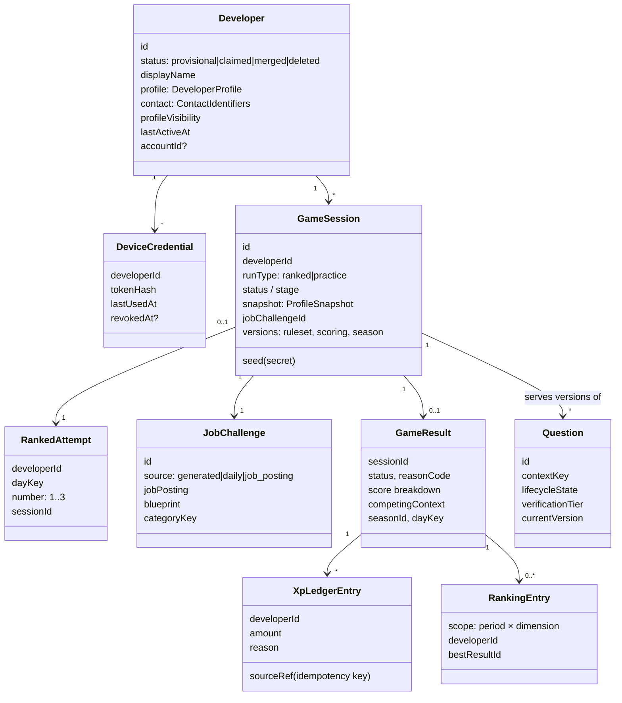

# Domain model

> Part 2 · Technical architecture · Status: **Approved** (current decisions; they evolve through ADRs)
>
> Turns the [domain concepts](../product/domain-concepts.md) into aggregates, entities, value objects and invariants. Persistence is in the [data model](05-data-model.md).

## 1. Aggregates at a glance

## 2. Aggregates and invariants

### Developer (identity)

| Element | Notes |
|---|---|
| Root | `Developer` |
| Value objects | `DisplayName` (moderated), `DeveloperProfile` (seniority, role, technologies), `ContactIdentifiers` (`EmailAddress` encrypted + lookup hash + verification status; `LinkedInUsername` normalized + verification status + `linkedinVisibility`), `ProfileVisibility` |
| Invariants | The ID is server-generated. The email has **no** visibility field (there is nothing to toggle). LinkedIn is shown only if `profileVisibility = public` and `linkedinVisibility = shown`. Unverified identifiers never authenticate anything. A `merged` Developer points to its survivor and accepts no new sessions. |
| Separate aggregates | `DeviceCredential` (many per Developer, revocable), `ManagementLink` (one active per Developer, regenerable), `Consent` records |

### Developer profile and the ranked lock (profiles)

- `DeveloperProfile` is validated against the catalog (role exists, seniority allowed, 1–12 technologies, core/allowed categories).
- `rankedLockedUntil` (a UTC instant): set when a ranked attempt is committed; while it's in the future, seniority, role and stack can't change. Practice never sets it.
- `ProfileSnapshot` is a value object copied into every `GameSession`: display name at the time, seniority, band, role, track, category, technologies (ordered), locale, catalog version.

### JobChallenge (job-challenges)

- `JobChallenge` = `JobPosting` (company, title, facts, localized texts) + `ChallengeBlueprint` (stages, slots, levels, windows, ATS composition, bot field reference) + context (run type, category, day).
- `source`: `generated` (practice, random fictional company) · `daily` (ranked, the Daily Company) · `job_posting` (Stage 3, a real company's posting).
- Invariants: the posting is generated **for the snapshot** and is deterministic given the seeds; future Daily Companies are never exposed; a `job_posting` challenge references a published posting and keeps the developer's snapshot as competing context.

### GameSession (game-sessions)

The central aggregate of the game. Contains `Challenge` entities (one per stage) and `QuestionAttempt` entities, plus the bounded `ClientEventLog`.

Invariants:

1. Exactly one active session per developer at a time (a new one expires the previous uncommitted one).
2. Transitions follow the [state machine](07-game-session.md); anything else is rejected.
3. A `QuestionAttempt` exists only after the server served it; it can be answered **once**, before its deadline (+ tolerance). The correct option is never part of what's returned to the client.
4. The next question of a challenge is created only after the previous one is resolved.
5. A checkpoint can't be reached earlier than the minimum segment duration allows.
6. Client-reported events (collisions, pickups) are bounded per segment and only accepted for entities the server spawned.
7. The seed never leaves the server.
8. Ranked sessions are committed (consuming a `RankedAttempt`) at **apply**; see [ADR-019](../adr/ADR-019-ranked-attempt-commitment.md).

### RankedAttempt (game-sessions)

- Unique `(developerId, dayKey, number)`, with `number ∈ {1, 2, 3}`; the commit is an atomic conditional insert/update, so no race can create a 4th.
- Never deleted or returned, even if the session is abandoned.

### GameResult (game-sessions → read by others)

- **Immutable.** Created once at completion (delivered or failed) or expiry (abandoned).
- Contains: status and reason code, score breakdown (per component), total score, accuracy, race time, position and field size, ATS match, CV Health, competing context (snapshot copy), Job Challenge summary (company, title, source), category, season, day, scoring and ruleset versions.
- Verification is a **separate** record (`ResultVerification`), so disqualification never mutates the result.

### XP ledger and progression (progression)

- `XpLedgerEntry`: append-only; `amount` can be negative only for audited voids; a unique `idempotencyKey` (e.g. `result:{id}:base`, `result:{id}:discovery:{questionId}`, `title:{id}`) guarantees each award exists once.
- `Progression` (cached summary): lifetime XP and level, derived from the ledger, updated in the same transaction.
- `DailyProgressCounters`: runs today, practice XP today, first-delivered-of-day awarded. These feed the anti-farming rules.
- `DiscoveryRecord`: `(developerId, questionId)` unique, created on the first correct answer. Its existence decides the discovery bonus.

### Question (questions)

- `Question` (identity, context, lifecycle state, source, verification tier, batch, exposure counters) + immutable `QuestionVersion` (localized content, option IDs, the correct option, difficulty, technologies, topics).
- Lifecycle invariants:
  - only `competitive` questions are served in ranked; only `practice` questions in practice runs;
  - `competitive` → `retired` → `practice` is one-way: a question that was visible in practice never returns to competition (a substantially rewritten question is a **new** question);
  - `invalidated` questions are never served; past attempts keep pointing to the exact version they saw.
- `QuestionContext`: target rotation size, regeneration thresholds.
- `GenerationBatch`: provider, model and prompt version, counts, cost; invalidating a batch invalidates its questions.

### Rankings, titles and seasons (rankings)

- `RankingEntry`: one per `(season, periodType, periodKey, dimension, scopeKey, developer)`, pointing to the best qualifying result. A projection.
- `Title`: e.g. Daily Champion `(category, day)`, linked to a result; revocable (audited), never deleted.
- `Season`: `season-0` (Beta) at launch; every result, XP entry and ranking entry carries a season.

## 3. Value objects (selection)

`DayKey` (UTC date, e.g. `2026-10-13`) · `WeekKey` (ISO week, e.g. `2026-W42`) · `CategoryKey` (e.g. `fullstack:senior_plus`) · `Band` · `TrackKey` · `TechnologyId` · `Locale` (`es`, `en`) · `Score` · `XpAmount` · `Level` · `Deadline` · `RunType` · `ReasonCode` · `EffectCode` · `LinkedInUsername` · `EmailAddress` (never logged; see [ADR-021](../adr/ADR-021-personal-data-handling.md)).

## 4. Domain events

Recorded in the outbox in the same transaction as the change (dispatched after commit):

`DeveloperCreated` · `ContactIdentifierAdded` · `ProfileChanged` · `GameSessionCreated` · `RankedAttemptCommitted` · `ChallengeOpened` · `QuestionAnswered` · `GameResultRecorded` · `XpAwarded` · `LevelReached` · `RankingEntryImproved` · `TitleAwarded` · `TitleRevoked` · `QuestionInvalidated` · `GenerationBatchCompleted`.

Analytics events are **derived** from these where relevant, but are a separate catalog with privacy filtering (see [analytics](../analytics/README.md)).

## 5. Future aggregates (not built; shape preserved)

| Aggregate | Attaches to | Stage |
|---|---|---|
| `UserAccount`, `AccountIdentity` (verified email, provider subject) | `Developer.accountId` | 2 |
| `PublicProfile` (slug, section toggles), `Badge`, `OpenToWork` | Developer + projections | 2 |
| `Company` (real, verified), `JobPosting` (published) | `JobChallenge.source = job_posting` | 3 |
| `Application` | Developer + JobPosting + GameResult (+ shared fields chosen by the developer) | 3 |
| `CompanyAccount`, `RecruiterAccount`, saved searches | Company; reads only discoverable profiles | 4 |
