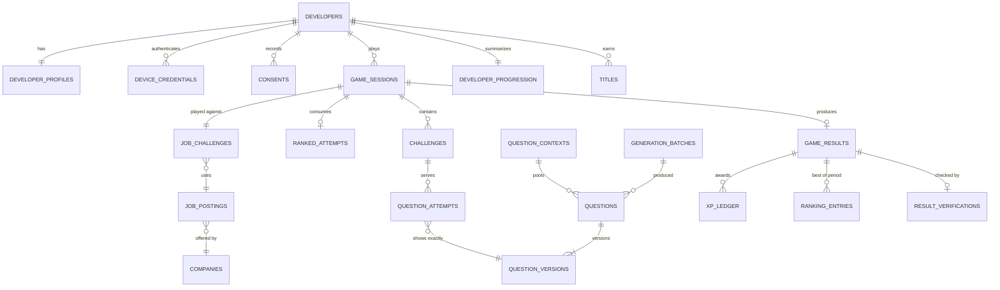

# Data model (PostgreSQL and Redis)

> Part 2 · Technical architecture · Status: **Draft for review** · Decisions: [ADR-013](../adr/ADR-013-postgresql-and-prisma.md), [ADR-014](../adr/ADR-014-redis-usage.md), [ADR-016](../adr/ADR-016-immutable-results-and-xp-ledger.md), [ADR-021](../adr/ADR-021-personal-data-handling.md)
>
> Conceptual schema: table names, key columns and constraints. The Prisma schema is written in the implementation slices. Every table belongs to exactly one module.

## 1. Core relationships

## 2. Tables by module

### identity

| Table | Key columns | Constraints and notes |
|---|---|---|
| `developers` | `id` (UUIDv7), `status`, `display_name`, `profile_visibility`, `linkedin_username`, `linkedin_verification_status`, `linkedin_visibility`, `email_ciphertext`, `email_key_version`, `email_lookup_hash`, `email_verification_status`, `created_at`, `last_active_at`, `claimed_at`, `account_id`, `merged_into_id`, `deleted_at` | Index on `email_lookup_hash` (**not unique**: unverified emails can repeat); index on `last_active_at`. No plaintext email column exists. |
| `device_credentials` | `id`, `developer_id`, `token_hash` (unique), `created_at`, `last_used_at`, `revoked_at`, `ua_family` | The raw token only exists in the cookie |
| `management_links` | `developer_id` (PK), `token_hash` (unique), `created_at`, `last_used_at` | Regenerating replaces the row |
| `consents` | `id`, `developer_id`, `purpose`, `granted`, `text_version`, `created_at` | Append-only |
| *(Stage 2)* `user_accounts`, `account_identities`, `developer_aliases` | | Claims and merges |

### profiles

| Table | Key columns | Notes |
|---|---|---|
| `developer_profiles` | `developer_id` (PK), `seniority`, `role_id`, `technology_ids` (text[]), `ranked_locked_until`, `version`, `updated_at` | GIN index on `technology_ids` (future search). Catalog IDs are stable strings from `packages/content`. |

The profile **snapshot** is not a table: it is a JSONB column copied into `game_sessions` and `game_results`.

### job-challenges

| Table | Key columns | Notes |
|---|---|---|
| `companies` | `id`, `kind` (`fictional`/`real`), `name`, `sector`, `theme`, `logo_spec`, `owner_account_id` (null until Stage 3) | |
| `daily_companies` | `day_key` (PK), `company_id`, `theme`, `scheduled_by` | Read paths filter `day_key <= today (UTC)` |
| `job_postings` | `id`, `company_id`, `origin` (`generated`/`published`), `facts` (JSONB, language-independent), `texts` (JSONB per locale), `created_at` | Generated postings are per session in the MVP |
| `daily_category_blueprints` | `(day_key, category_key)` PK, `blueprint_version`, `shared_selection` (question IDs for shared slots), `bot_field`, `ats_composition` | Created lazily under a lock on the first ranked run of the day in that category |
| `job_challenges` | `id`, `source`, `job_posting_id`, `blueprint_ref`, `category_key`, `day_key`, `run_type`, `created_at` | |

### game-sessions

| Table | Key columns | Constraints and notes |
|---|---|---|
| `game_sessions` | `id`, `developer_id`, `run_type`, `status`, `stage`, `snapshot` (JSONB), `category_key`, `job_challenge_id`, `seed` (bytea, secret), `ruleset_version`, `scoring_version`, `season_id`, `day_key`, `created_at`, `committed_at`, `started_at`, `last_activity_at`, `expires_at`, `ended_at`, `version` | Partial unique index: one session per developer in an active status. `version` for optimistic concurrency. |
| `ranked_attempts` | `(developer_id, day_key, number)` PK, `session_id` (unique), `committed_at` | `CHECK (number BETWEEN 1 AND 3)` |
| `challenges` | `id`, `session_id`, `stage`, `status`, `opened_at`, `deadline_at`, `completed_at`, `payload` (e.g. ATS stream), `outcome` | Unique `(session_id, stage)` |
| `question_attempts` | `id` (random UUID, unguessable), `session_id`, `challenge_id`, `developer_id`, `run_type`, `slot`, `question_id`, `question_version_id`, `option_order`, `served_at`, `deadline_at`, `answered_at`, `selected_option_id`, `correct`, `grade`, `response_ms`, `timed_out` | Index `(developer_id, question_id)` for unseen-first; answering is a conditional update `WHERE answered_at IS NULL` |
| `client_event_logs` | `session_id`, `segment`, `events` (JSONB, bounded), `received_at` | Retained longer for runs under verification |
| `game_results` | `id`, `session_id` (unique), `developer_id`, `run_type`, `status`, `reason_code`, `total_score`, `breakdown`, `accuracy`, counts (recruiter, technical), `ats_match`, `cv_health`, `race_time_ms`, `position`, `field_size`, `competing_context`, `job_challenge_summary`, `category_key`, `season_id`, `day_key`, `week_key`, `scoring_version`, `ruleset_version`, `created_at` | **Immutable** (no UPDATE path in code; a DB trigger can reject updates). Index `(developer_id, created_at DESC)` for history. |
| `result_verifications` | `result_id` (PK), `status`, `rules_version`, `findings`, `checked_at` | Separate from results |

### questions and question-generation

| Table | Key columns | Notes |
|---|---|---|
| `question_contexts` | `key` (PK, e.g. `tech:redis:3`, `track:fullstack:3`, `band:senior_plus:4`), `kind`, `target_competitive`, `target_practice` | |
| `questions` | `id`, `context_key`, `source`, `lifecycle_state`, `verification_tier`, `batch_id`, `current_version_id`, `ranked_exposures`, `competitive_since`, `retired_at`, `invalidated_at`, `invalidation_reason`, `review_by` | Index `(context_key, lifecycle_state)` |
| `question_versions` | `id`, `question_id`, `version`, `content` (JSONB: per-locale prompt, options, explanation), `option_ids`, `correct_option_id`, `grades`, `difficulty`, `technology_ids`, `topics`, `created_at` | Unique `(question_id, version)`. **Immutable.** `correct_option_id` is excluded from every client-facing DTO by construction (separate select). |
| `generation_batches` | `id`, `context_key`, `provider`, `model`, `prompt_version`, `requested`, `accepted`, `rejected`, `cost_micros`, `status`, `created_at`, `completed_at` | Enables batch invalidation and cost tracking |
| `question_reports` | `id`, `question_version_id`, `developer_id`, `session_id`, `reason`, `comment`, `locale`, `status`, `created_at` | |
| `developer_question_discoveries` | `(developer_id, question_id)` PK, `first_correct_at` | Drives the one-time discovery bonus |

### progression and stats

| Table | Key columns | Notes |
|---|---|---|
| `xp_ledger` | `id`, `developer_id`, `amount`, `reason`, `idempotency_key` (unique), `source_type`, `source_id`, `season_id`, `day_key`, `created_at` | Append-only; voids are negative entries |
| `developer_progression` | `developer_id` (PK), `lifetime_xp`, `level`, `games_played`, `games_delivered`, `updated_at` | Cache derived from the ledger and results, same transaction |
| `developer_daily_counters` | `(developer_id, day_key)` PK, `runs`, `practice_xp`, `first_delivered_bonus_awarded` | Anti-farming |
| `developer_topic_stats` | `(developer_id, dimension, key)` PK, `attempts`, `correct`, `total_response_ms` | Projection |
| `question_version_stats` | `(question_version_id, locale, run_type)` PK, `attempts`, `correct`, `timeouts`, `total_response_ms`, `option_counts`, `reports` | Projection for balancing |

### rankings

| Table | Key columns | Notes |
|---|---|---|
| `seasons` | `id` (e.g. `season-0`), `name`, `starts_at`, `ends_at`, `status` | |
| `ranking_entries` | PK `(season_id, period_type, period_key, dimension, scope_key, developer_id)`, `result_id`, `score`, `accuracy`, `race_time_ms`, `achieved_at`, `status` | Ordering index `(season_id, period_type, period_key, dimension, scope_key, score DESC, accuracy DESC, race_time_ms ASC, achieved_at ASC)` |
| `titles` | `id`, `type`, `developer_id`, `scope_key`, `period_key`, `result_id`, `season_id`, `awarded_at`, `revoked_at`, `revoke_reason` | Unique `(type, scope_key, period_key)` for active titles |
| `period_closures` | `(period_type, period_key)` PK, `status`, `started_at`, `completed_at` | Makes the daily close idempotent |

### moderation, analytics, platform

| Table | Notes |
|---|---|
| `profile_reports`, `audit_log` | Reports and every admin action (actor, action, target, reason, metadata) |
| `analytics_events` | `id`, `name`, `occurred_at`, `developer_ref` (pseudonymous), `session_ref`, `props` (allowlisted JSONB), `source`, `schema_version`. Partition by month when volume grows. |
| `outbox` | `id`, `type`, `payload`, `created_at`, `dispatched_at`, `attempts` |

## 3. Integrity mechanisms

| Risk | Mechanism |
|---|---|
| Double answer | Conditional update on `question_attempts` (`answered_at IS NULL`); idempotent replay returns the stored outcome |
| A 4th ranked attempt | PK on `(developer_id, day_key, number)` + `CHECK` + allocation in one statement |
| Two active sessions | Partial unique index on active statuses |
| Duplicate XP | Unique `idempotency_key` in `xp_ledger` |
| Lost update on a session | Optimistic concurrency (`version`) |
| Editing history | No update paths for `game_results`, `question_versions`, `xp_ledger` (optionally DB triggers rejecting UPDATE/DELETE) |
| Duplicate daily close | `period_closures` + a Redis lock |

## 4. Redis (never a source of truth)

| Key pattern | Purpose | TTL |
|---|---|---|
| `rl:{scope}:{id}` | Rate limits (per developer, per credential, per IP hash, per endpoint) | Window |
| `lock:{name}` | Distributed locks (daily close, lazy daily blueprint creation) | Short |
| `bull:{queue}:*` | BullMQ queues and schedules | Managed |
| `cache:rank:{season}:{period}:{scope}:top` | Top-N ranking cache, invalidated on improvement | 10–30 s |

If Redis is lost, nothing durable is lost: rate limits reset, caches rebuild, queued jobs are re-enqueued by schedulers or recovery jobs.

## 5. Retention (initial proposal, to be confirmed with the legal review)

| Data | Retention |
|---|---|
| Developers with no activity and no contact identifier | Anonymize after 24 months of inactivity |
| Game results, XP ledger | Kept (anonymized on deletion) |
| Question attempts | Kept for audit; can be compacted after 24 months |
| Client event logs | 90 days, longer for runs that hold titles |
| Analytics events | 13 months |
| Device credentials | Until revoked or 400 days unused |
