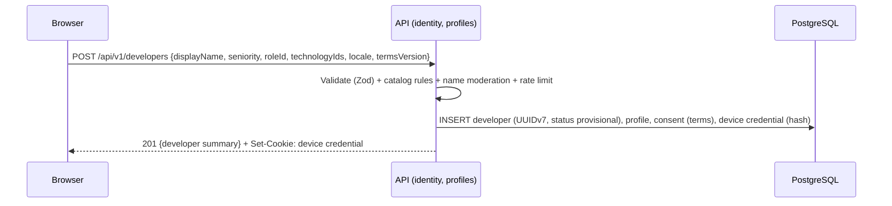

# Identity, device credentials and account claim

> Part 2 · Technical architecture · Status: **Approved** (current decisions; they evolve through ADRs) · Decisions: [ADR-007](../adr/ADR-007-provisional-developer-identity.md), [ADR-020](../adr/ADR-020-account-claim-and-merge.md), [ADR-021](../adr/ADR-021-personal-data-handling.md)
>
> Product rules: [identity and accounts](../product/identity-and-accounts.md).

## 1. Provisional Developer creation



- The Developer ID is a **UUIDv7** (time-ordered, unguessable enough for an internal identifier, and **never** used as a credential).
- Creation is rate-limited per IP hash and protected by an optional human-verification challenge when abuse signals appear (see [anti-cheat](../anti-cheat/README.md)).

## 2. Device credential

| Property | Design |
|---|---|
| Token | 32 random bytes from a CSPRNG, base64url-encoded |
| Storage | Server stores **SHA-256(token)** only (high-entropy token, so a fast hash is enough; no plaintext at rest) |
| Cookie | `__Host-dc=<token>; Secure; HttpOnly; SameSite=Lax; Path=/; Max-Age≈400 days` (browsers cap long expirations around 400 days) |
| Origin | Web and API share **one origin** (`/` and `/api`), so the cookie is first-party and works in in-app browsers without third-party cookie issues ([ADR-012](../adr/ADR-012-web-and-api-applications.md)) |
| Use | Every API request resolves `developerId` from the cookie; no request body ever carries a developer ID as proof |
| Sliding | `last_used_at` is updated at most once per hour; the cookie's Max-Age is refreshed on use |
| Revocation | Per credential (e.g. "sign out this device" from My Profile), or all at once when regenerating the management link |
| Rotation | Optional in the MVP; in V1, rotate on use after 30 days (issue a new token, keep the old one valid for a short overlap) |

### CSRF

- `SameSite=Lax` blocks cross-site POSTs with the cookie in modern browsers.
- Every state-changing request also requires a custom header (`X-CVR-Client: web`) and a JSON content type, and the API checks `Origin`/`Sec-Fetch-Site` against the allowed origin.
- No state change ever happens on GET.

## 3. Management link

- A second, independent credential for the same Developer: 32 random bytes, hashed at rest, **one active link per Developer**, regenerable (which invalidates the previous one and, optionally, all device credentials).
- The URL carries the token in the **fragment**: `https://<host>/es/manage#t=<token>`. Fragments are not sent in HTTP requests, so the token never appears in server or proxy logs, or in `Referer` headers. The page's script reads it and exchanges it (`POST /api/v1/identity/management-links/exchange`) for a fresh device credential on that device, then removes the fragment from the address bar.
- Shown once after creation, and available to regenerate from My Profile.

## 4. Contact identifiers ("Save your progress")

```
POST /api/v1/me/contact            { email?: string, linkedin?: string }
POST /api/v1/me/linkedin-visibility { visible: boolean }
```

| Identifier | Processing |
|---|---|
| **Email** | Trim → Unicode NFC → lowercase → syntax check (no MX lookup in the MVP). Stored as `email_ciphertext` (AES-256-GCM, app-level, key from secret storage, `email_key_version` for rotation) and `email_lookup_hash` = HMAC-SHA256(normalized email, server pepper) for future lookup. `email_verification_status = unverified`. Never returned in full by any endpoint except a masked form (`r••••@example.com`) to the owner. |
| **LinkedIn** | Normalization (below) → store `linkedin_username` (lowercase), `linkedin_verification_status = unverified`, `linkedin_visibility = hidden` by default. |

Adding one or both always updates **the same Developer** (the one resolved from the device credential). There is no endpoint that creates a second identity from contact data.

### LinkedIn normalization (specification)

1. Trim; reject if longer than 200 characters.
2. If the input has no `/` and no `.`, treat it as a username candidate.
3. Otherwise parse it as a URL (prefix `https://` if there's no scheme):
   - The scheme must be `http` or `https`; anything else (`javascript:`, `data:`, …) is rejected.
   - The host must be exactly `linkedin.com`, `www.linkedin.com`, or `<2-letter country>.linkedin.com`. No other hosts, no lookalikes, no userinfo (`user@host`), no ports.
   - The path must match `/in/<username>` with an optional trailing `/`. Everything else (`/company/`, `/jobs/`, `/posts/`, `/feed/`, `/pub/`, `/school/`, deeper paths) is rejected.
   - Query string and fragment are discarded.
4. Username: percent-decode once, then require 3–100 characters of letters (Unicode), digits and hyphens; lowercase it.
5. Output: the username only (example: `linkedinUsername = ricardo-vera`). The public URL is always built in its canonical form `https://www.linkedin.com/in/{encodeURIComponent(username)}/` (example: `https://www.linkedin.com/in/ricardo-vera/`), rendered with `rel="nofollow noopener noreferrer ugc"` and `target="_blank"`.
6. The server never fetches LinkedIn (no SSRF surface, no scraping).

Semantic errors: `LINKEDIN_NOT_A_PROFILE`, `LINKEDIN_INVALID_HOST`, `LINKEDIN_INVALID_USERNAME`.

## 5. Visibility

| Field | Values | Default |
|---|---|---|
| `profile_visibility` | `private`, `public` | `private` |
| `linkedin_visibility` | `hidden`, `shown` | `hidden` |
| (email) | — | No visibility field exists |

Public DTOs are built by a dedicated mapper (`toPublicCard`) that only reads allowlisted fields. Contract tests assert that no public schema contains an email field.

## 6. Account claim and merge (Stage 2, designed now)

### Tables (future)

- `user_accounts` (`id`, `created_at`, `status`)
- `account_identities` (`account_id`, `provider` (`email`, `github`, `google`, `linkedin_oidc`), `subject`, `verified_email_lookup_hash`, `verified_at`)
- `developers.account_id` (set on claim), `developers.claimed_at`
- `developer_aliases` (`alias_developer_id` → `survivor_developer_id`, `merged_at`, `merge_audit_id`)

### Claim flow

1. The person signs up and proves control of an identifier: an email OTP or magic link, or an OAuth provider with a verified email.
2. The candidates are: Developers with `email_lookup_hash = HMAC(verified email)` and `account_id IS NULL`, **plus** the Developer of the device credential present in this browser (proof of possession), **plus** one whose management link is presented.
3. The UI shows each candidate's summary (name, games, level, XP, titles, last played) with "Claim this profile" or "This isn't me".
4. Claiming sets `account_id`, `claimed_at`, marks the matching email as verified, writes an audit entry and emits `DeveloperClaimed`.
5. "This isn't me" clears that Developer's `email_ciphertext` and `email_lookup_hash` (the email was typed by someone else) and logs the event.

### Merge (several provisional Developers → one)

Run in one transaction per merge:

| Data | Operation |
|---|---|
| Survivor | The oldest Developer, or the one chosen by the user |
| `game_sessions`, `game_results`, `question_attempts`, `titles`, `xp_ledger` | Re-pointed to the survivor (`developer_id` update). Facts keep their IDs and contents. |
| XP | No new awards. Ledger entries move; `idempotency_key` uniqueness prevents duplication. Progression is recomputed from the ledger. |
| Projections (`developer_progression`, `developer_topic_stats`, discoveries) | Rebuilt for the survivor from facts |
| `ranking_entries` | Per `(period, scope)`, keep the best entry; remove the other (an audit entry records it) |
| `ranked_attempts` | Re-pointed; if both used attempts on the same day, both remain (history), but no new attempts are granted that day beyond 3 in total |
| Device credentials | Re-pointed to the survivor |
| Merged Developer | `status = merged`, `merged_into_id = survivor`; a `developer_aliases` row keeps old share links and slugs working |

Merges are audited and reversible by an admin (facts were only re-pointed, never rewritten).

## 7. Request authentication summary

| Credential | Grants | Lifetime |
|---|---|---|
| Device credential (cookie) | Full access to the Developer from this browser | ~400 days, sliding, revocable |
| Management link (fragment token) | Exchange for a device credential; manage data | Until regenerated |
| *(Stage 2)* Account session | Access to the claimed Developer from any device | Standard sessions |
| Admin | **No HTTP admin surface in the MVP**: maintenance runs through the CLI on the server, audited | — |
