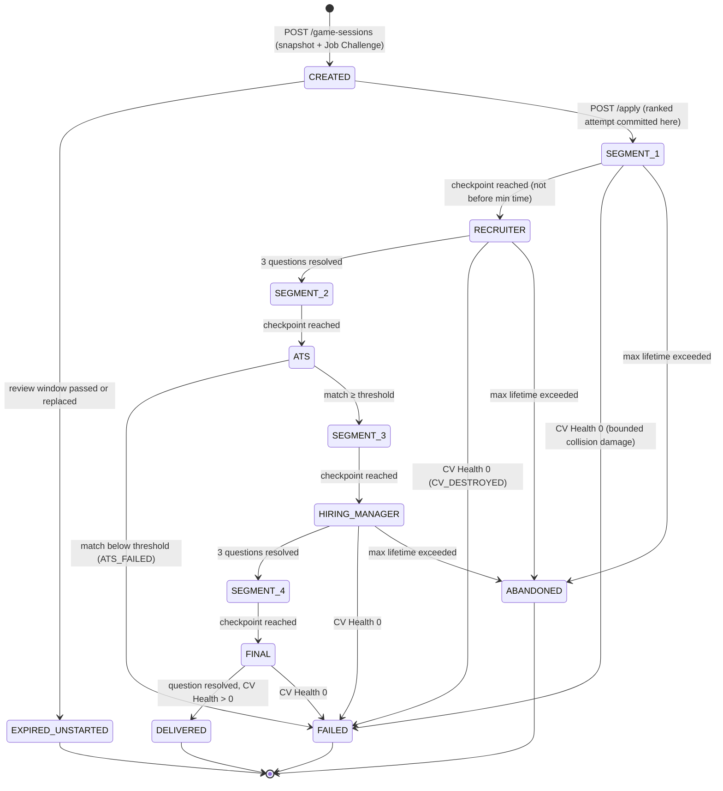
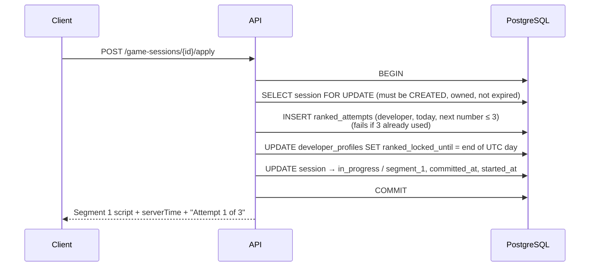
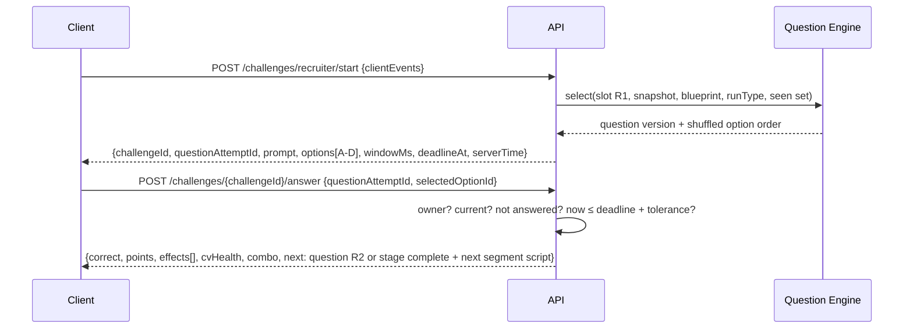

# GameSession: state machine, challenges and ranked attempts

> Part 2 · Technical architecture · Status: **Draft for review** · Decisions: [ADR-003](../adr/ADR-003-server-authoritative-gameplay.md), [ADR-019](../adr/ADR-019-ranked-attempt-commitment.md)

## 1. Lifecycle

`ABANDONED` can happen from any in-progress state (only a few arrows are drawn). Stage names map to the product's states (`CREATED`/job review, racing segments, `RECRUITER`, `ATS`, `HIRING_MANAGER`, `FINAL`, finished, failed).

Storage: `status` (`created`, `in_progress`, `delivered`, `failed`, `abandoned`, `expired_unstarted`) plus `stage` (`job_review`, `segment_1`, `recruiter`, `segment_2`, `ats`, `segment_3`, `hiring_manager`, `segment_4`, `final`). Every transition goes through **one** domain method (`session.transition(event, now)`) that rejects anything not in the table (`INVALID_TRANSITION`).

## 2. Creation

`POST /api/v1/game-sessions { runType, locale }`

1. Resolve the Developer from the device credential.
2. Load the current profile. For **ranked**, check that the category is ranked or in preview, that `ranked_attempts` for today are < 3 (a pre-check only; the real gate is at apply), and that the profile matches today's lock if one exists.
3. Expire any previous active session of this Developer (`EXPIRED_UNSTARTED` if not started, `ABANDONED` if started).
4. Freeze the **profile snapshot**.
5. Generate a **session seed** (32 random bytes, server-only).
6. Build the **Job Challenge** (see [Job Challenges](08-job-challenges.md)): the posting for the snapshot, the blueprint (the category's daily blueprint in ranked; the exact-seniority blueprint in practice).
7. Persist the session in `CREATED` with `review_expires_at` (e.g. 120 s).
8. Return the job posting DTO, the blueprint's **public shape** (stage list, number of questions, windows), the ranked attempt number that *will* be used, and `serverTime`.

Nothing about questions exists yet.

## 3. Ranked attempt commitment

**Decision:** a ranked attempt is committed at **apply**, the moment the competitive race starts ([ADR-019](../adr/ADR-019-ranked-attempt-commitment.md)).

Why at apply:

- Before apply, the client has only seen the **job posting**, whose facts are open-book by design and unique to that session. No question, ATS stream or bot outcome has been revealed. Backing out at review costs nothing and protects people who opened ranked by mistake.
- From apply on, the race clock runs and the first checkpoint leads to the first question, so **every** way out (closing the tab, losing the connection, abandoning) keeps the attempt consumed.
- **Guards against review-stage fishing:** at most one open session per Developer; at most 10 uncommitted ranked sessions per Developer per day (rate limit); the job posting of an expired uncommitted session is never reused.

Practice sessions skip the attempt allocation and never lock the profile.

## 4. Segments and checkpoints

- On apply (and after each stage), the server returns the next **segment script**: base duration, obstacle and pickup layout (IDs, positions), bot positions and events up to the next checkpoint, and the speed effects in force. It is derived from the seed, contains no future questions, and only covers **one** segment.
- `POST /game-sessions/{id}/challenges/{stage}/start { clientEvents }` (e.g. `stage = recruiter`):
  - The current stage must be the segment right before it.
  - **Minimum time:** `now - segmentStartedAt ≥ minDuration(segment, active boosts) - tolerance`. Earlier calls are rejected with `CHECKPOINT_TOO_EARLY` and the time to wait; the client's run animation is calibrated to the same model, so honest clients never hit it.
  - `clientEvents` (collisions, pickups) are validated: only entities spawned in that segment; one hit per obstacle; damage capped per segment; pickups claimable once. Accepted events update CV Health and race-time penalties; the rest are dropped and counted as anomalies.
  - The challenge is opened and its **first question** is selected **now** (just in time).

## 5. Question challenges (Recruiter, Hiring Manager, Final)

Rules:

- **Ephemeral IDs:** `challengeId` and `questionAttemptId` are random UUIDs bound to the session; guessing or reusing one fails.
- **Single answer:** a conditional update (`answered_at IS NULL`). Repeating the exact same answer returns the stored outcome (idempotent retry); a different option returns `ALREADY_ANSWERED`.
- **Deadlines:** `deadline_at = served_at + window`. Answers after `deadline + tolerance` (initial 300 ms) resolve as **timeouts**. There are no server timers: overdue questions are resolved lazily on the next request, and a sweeper finalizes abandoned sessions.
- **Response time** = `answered_at - served_at` (server clock), minus the tolerance, capped at the window.
- **What the answer response never includes:** the correct option (in ranked), the explanation (in ranked), the next slot's question before this one is resolved.
- **Practice exception:** practice answers may include the explanation after the post-run review, never inline in ranked.

## 6. ATS challenge

- `POST /challenges/ats/start` → the server generates the **token stream** from the seed (positions, levels, timing; relevance computed server-side from the job's keywords) and returns the stream plus `durationMs`. Relevance flags are **not** sent; the player must judge relevance.
- During the scan, the client records an **input log**: level changes with timestamps relative to the scan start.
- `POST /challenges/ats/complete { inputLog }` → the server validates the log (monotonic times, plausible change rates, within the duration) and **re-simulates** the scan with `packages/simulation` to compute collected tokens, match %, CV damage and pass/fail. Client claims about collected tokens are not accepted.
- Failing sets `FAILED (ATS_FAILED)`.

## 7. Completion

When the Final question resolves (or a failure happens), the `CompleteGameSession` use case runs in **one transaction** (see [backend modules](03-backend-modules.md#3-how-modules-talk)): race time and position (from the simulation), score, immutable `GameResult`, XP ledger, progression, stats, ranking entry (ranked), analytics events, outbox. The response includes the full result, XP and level, so the result screen shows final data immediately. The client then plays the final sprint and delivery animation, which is cosmetic.

## 8. Resume and expiry

- `GET /game-sessions/current` returns the active session's state: stage, the open question (with remaining time computed from the server deadline), or the next segment script. Refreshing never re-rolls a question.
- **Max lifetime:** 10 minutes from apply. A scheduled sweeper (every minute) finalizes overdue sessions as `ABANDONED`, creating a `GameResult` with status `abandoned` (no XP). Ranked attempts were already committed at apply.
- `CREATED` sessions past their review window become `EXPIRED_UNSTARTED` (no result, no attempt consumed).

## 9. Concurrency and idempotency

| Concern | Mechanism |
|---|---|
| Two tabs | The session row is locked (`SELECT … FOR UPDATE`) per mutation; optimistic `version` check; the first valid action wins |
| Network retries | Answer and checkpoint endpoints are idempotent for identical payloads |
| Double completion | The unique `game_results.session_id` and ledger idempotency keys |
| Clock skew | Only server time counts; responses include `serverTime` so the client can align its displays |
