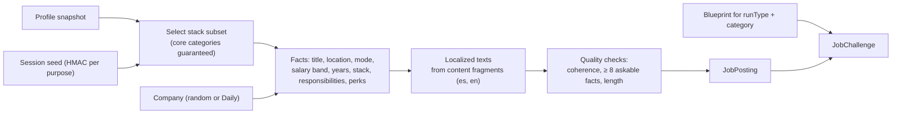

# Job Challenges

> Part 2 · Technical architecture · Status: **Draft for review** · Decision: [ADR-017](../adr/ADR-017-job-challenge-abstraction.md)
>
> Product rules: [game modes](../product/game-modes.md), [job generation](../game-design/job-generation.md).

## 1. The abstraction

A **Job Challenge** is what a game session is played against:

```
JobChallenge
  source         generated | daily | job_posting
  jobPosting     company + title + facts + localized texts
  blueprint      stages, slots (content type + level + window), ATS composition, bot field ref
  context        runType, categoryKey, dayKey, season
```

The game session, the Question Engine, scoring, XP and history don't care about the source. That's what lets **Play to Apply** (Stage 3) reuse the whole game: a real company's posting becomes a `job_posting` source, and everything downstream stays the same.

## 2. Sources

| Source | Company | Posting | Blueprint | Used by |
|---|---|---|---|---|
| `generated` | A random fictional company (generated from name parts, blocklist-checked) | Generated for the snapshot | Exact-seniority blueprint | Practice runs |
| `daily` | Today's **Daily Company** | Generated for the snapshot at that company, themed by its domain | The **daily category blueprint** | Ranked runs |
| `job_posting` *(Stage 3)* | A real, verified company | Published by the company; facts come from the posting | Derived from the posting (stack, level) and the developer's band | Play to Apply |

## 3. Generation pipeline



- **Deterministic:** the same snapshot + seed + content version produces the same posting, which matters for audit and debugging.
- **Content-driven:** templates, fragments, salary bands, locations, perks and company name parts live in `packages/content` and are validated by `pnpm content:validate`.
- **Facts are language-independent** (numbers, technology IDs, enums); texts are rendered per locale from fragments. Job-memory questions are built from facts, so their answers are identical in es and en.
- **Quality checks** run at generation (a failure regenerates with the next derived seed; it never ships an incoherent posting).

## 4. Daily Company and daily category blueprints

| Item | Design |
|---|---|
| `daily_companies` | Rows for future days are created ahead (from a reviewed pool) by a maintenance command. API reads filter `day_key <= today (UTC)`, so future companies are never exposed. |
| Daily seed | `HMAC(dailySecret, dayKey ‖ categoryKey)`: unpredictable without the server secret, identical for everyone in the category that day |
| `daily_category_blueprints` | Created **lazily** under a Redis lock on the first ranked session of the day in that category (or proactively at 00:00 by a scheduled job): the blueprint version, the **shared selection** (questions for shared slots H2, H3, F1, drawn from competitive rotation with the daily seed), the bot field, the ATS composition |
| Shared selection | Everyone in the category gets questions from the same daily selection for shared slots; per-run variation comes from which question of the selection, option order and stage order (see [Question Engine](09-question-engine.md)) |

## 5. Blueprint definition (content)

Blueprints are versioned content (`packages/content/rulesets/…`), validated with Zod:

```yaml
id: ranked-band-senior_plus
version: 1
stages:
  - stage: recruiter
    slots:
      - { id: R1, kind: job_memory, level: 2, windowMs: 10000 }
      - { id: R2, kind: job_memory_or_recruiter, level: 2, windowMs: 10000 }
      - { id: R3, kind: salary_graded, level: 2, windowMs: 10000 }
  - stage: ats
    composition: { tokens: 18, relevant: 11, durationMs: 25000 }
  - stage: hiring_manager
    slots:
      - { id: H1, kind: stack, level: 3, windowMs: 15000 }
      - { id: H2, kind: track_fundamentals, level: 3, windowMs: 15000, shared: true }
      - { id: H3, kind: seniority, level: 4, windowMs: 15000, shared: true }
  - stage: final
    slots:
      - { id: F1, kind: mixed_scenario, level: 4, windowMs: 20000, shared: true }
segments: { baseMs: [20000, 15000, 15000, 10000], finalSprintMs: 8000 }
```

Practice blueprints are generated per exact seniority with the same shape (levels from the seniority table).

## 6. Future: Play to Apply (Stage 3)

- A published `JobPosting` (real company) gets a **challenge configuration**: the stack and level from the posting, the blueprint shape, and optional company-specific scenario questions (reviewed).
- Each developer who plays it gets their own `JobChallenge` instance and session; the result references the posting.
- An `Application` (separate aggregate, explicit consent) can later reference that result.
- **Real companies are never satirized:** the humor stays in generic hiring-process elements; company-specific copy is the company's own.
