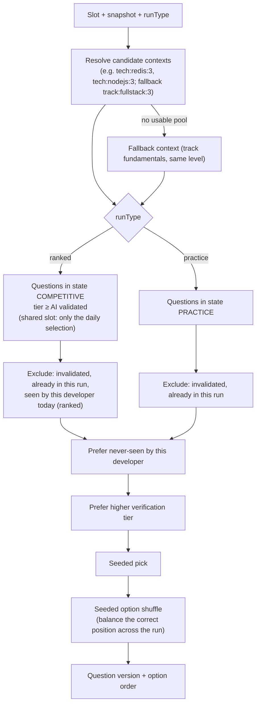
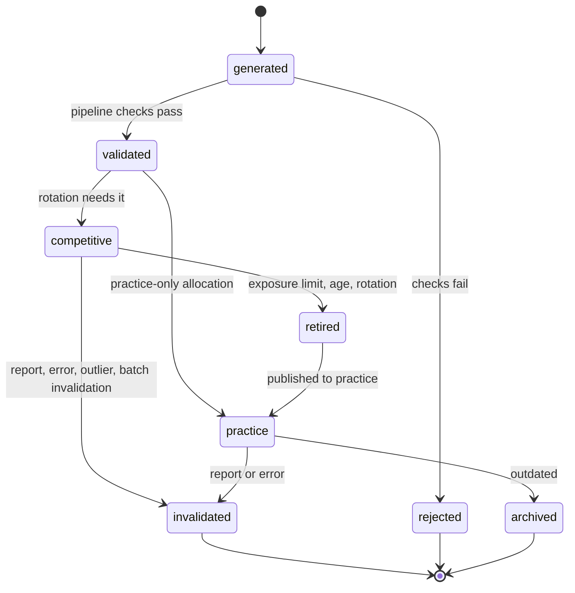

# Question Engine and question lifecycle

> Part 2 · Technical architecture · Status: **Draft for review** · Decisions: [ADR-004](../adr/ADR-004-question-engine-and-lifecycle.md), [ADR-009](../adr/ADR-009-question-localization.md)
>
> Product rules: [question strategy](../questions/question-strategy.md), [content strategy](../questions/content-strategy.md).

## 1. Responsibility

The Question Engine decides **which question a developer gets for a slot, at the moment the challenge opens**. It's a domain service inside the `questions` module, called by `game-sessions`.

```ts
selectQuestion(input: {
  slot: SlotSpec;              // kind, level, shared?
  snapshot: ProfileSnapshot;   // track, band, technologies
  runType: 'ranked' | 'practice';
  jobChallenge: JobChallengeRef;
  dailySelection?: SharedSelection;  // ranked shared slots
  developerId: DeveloperId;    // for unseen-first and discovery
  rng: SeededRng;              // derived from the session seed for this slot
  locale: Locale;
}): SelectedQuestion            // version id + shuffled option order (+ facts for templates)
```

## 2. Strategies (one per slot kind)

| Slot kind | Strategy | Source |
|---|---|---|
| `job_memory`, `job_memory_or_recruiter` | `JobMemoryStrategy` | Templates applied to the posting's facts (no pool) |
| `salary_graded` | `SalaryStrategy` | Salary template (graded options) |
| `stack` | `StackStrategy` | Pool `tech:{technology}:{level}` for one eligible technology of the snapshot |
| `track_fundamentals` | `TrackFundamentalsStrategy` | Pool `track:{track}:{level}` (Fullstack composes the Frontend and Backend pools) |
| `seniority` | `SeniorityStrategy` | Pool `band:{band}:{level}` (themed variants preferred when available) |
| `mixed_scenario` | `ScenarioStrategy` | Scenario templates + one of the developer's technologies, or the band pool |
| `humor` (practice only) | `HumorStrategy` | Practice-only humor pool |

Adding a new slot kind = a new strategy class registered by kind. Nothing else changes.

## 3. Selection algorithm (pool strategies)



- **Seeded** with `HMAC(sessionSeed, "q:" + slotId)`, so selection is reproducible for audit.
- **Unseen-first** uses `question_attempts (developer_id, question_id)`.
- **Low-unseen signal:** if the unseen candidates for a developer fall below a threshold, the engine emits `PoolExposureHigh(contextKey)`; the worker may schedule a regeneration batch (deduplicated per context).
- **Never blocks:** no generation happens inline. Without candidates, the fallback context is used.
- **Availability is checked before commitment:** at session creation, the engine verifies that every slot of the blueprint has enough eligible candidates (including fallbacks) **without selecting them**. If a ranked session can't be served, it's refused with `RANKED_CONTENT_UNAVAILABLE` before apply, so no attempt is consumed. If a question becomes unavailable mid-run (e.g. invalidated a second before), the slot is resolved as **neutral** (no points, no damage, excluded from accuracy) and the run is flagged.

## 4. Lifecycle (storage design)



Stored as `questions.lifecycle_state` with timestamps for each transition (`competitive_since`, `retired_at`, `invalidated_at`) and `ranked_exposures`.

### Rotation policy (initial values, in the ruleset)

| Parameter | Initial |
|---|---|
| Target competitive questions per context | 12 |
| Target practice questions per context (bootstrap) | 6 (allocated directly from validated) |
| Initial batch | ~20 generated → ~18 validated → 12 competitive + 6 practice |
| Retirement by exposure | Served 150 times in ranked |
| Retirement by age | 45 days in rotation |
| Regeneration trigger | Competitive count < 8, or high developer exposure |
| Review-by date | Version-sensitive questions: 12 months |

**One-way rule:** `retired → practice` is final. A question visible in practice never returns to competition. A substantially rewritten question is a new `question`, not a new version.

### Transitions are explicit commands

`allocate(contextKey)`, `retire(questionId, reason)`, `invalidate(questionId | batchId, reason)`, `publishToPractice(questionId)`. Each is a use case with an audit entry. Rotation runs in the worker (scheduled, per context).

## 5. Versioning and audit

- `question_versions` are immutable. Fixing a typo or a translation creates version *n + 1*; a question in competitive rotation that receives a **semantic** change is invalidated and replaced instead (to keep comparability within a day).
- `question_attempts` store `question_version_id` and `option_order`, so any past run can show exactly what the developer saw, in which order and language.
- A day's `daily_category_blueprints.shared_selection` pins question IDs and versions for that day.

## 6. What leaves the server

| Data | Sent to client? |
|---|---|
| Prompt, option texts (shuffled), option IDs, window, deadline | ✅ when the slot opens |
| Correct option, grades, explanation (ranked, competitive) | ❌ never |
| Explanation and correct option (practice) | ✅ only in the post-run review |
| Question ID (stable) | ❌ (the client gets the ephemeral `questionAttemptId`) |
| Lifecycle state, tier, batch, stats | ❌ |
| Topics and technology (for the review screen) | ✅ after the run |

Option IDs sent to the client are **per-attempt aliases** (`a`–`d` mapped through the shuffle), so the same question doesn't expose stable option IDs across runs.

## 7. Job-derived templates

- Templates are code + content in `packages/content` (open). Each declares the fact it uses, how to build distractors, and its localized prompt patterns.
- They operate on the session's posting facts; their "answer key" is the posting itself, which the player has read. They are safe to keep open.
- The salary template produces **graded** options (`ALIGNED`, `UNDERSELL`, `VAGUE`, `OUT_OF_RANGE`).

## 8. Localization

Questions store per-locale content with shared option IDs and the correct option ([ADR-009](../adr/ADR-009-question-localization.md)). The run's locale is fixed at session creation. Ranked requires both locales; a question missing a locale is not eligible for ranked.
