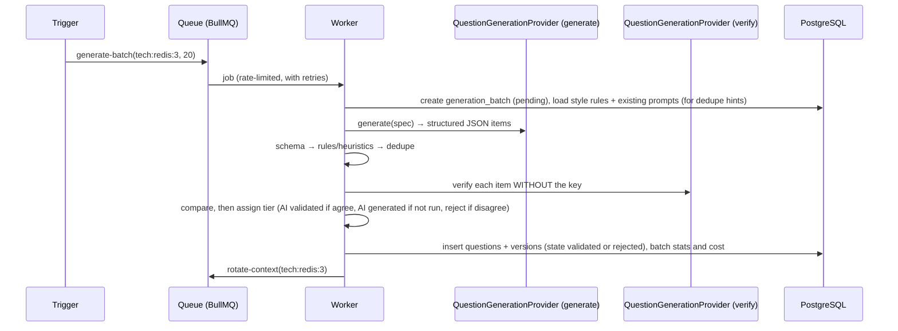

# AI question pipeline

> Part 2 · Technical architecture · Status: **Approved** (current decisions; they evolve through ADRs) · Decision: [ADR-018](../adr/ADR-018-ai-question-pipeline.md)
>
> Product rules: [content strategy](../questions/content-strategy.md#3-ai-generated-questions-the-pipeline).

## 1. Goals and non-goals

**Goals:** fill question contexts (~20 per context when first needed, then rotation refills) with bilingual, structured, validated questions; keep cost bounded; keep every question traceable to its batch; make bad content easy to invalidate.

**Non-goals:** generating questions on a player's request path; trusting model output; claiming that AI validation proves correctness.

## 2. Where it runs

Only in the **worker** process, through BullMQ jobs ([async processing](15-async-processing.md)):

| Job | Trigger | Idempotency |
|---|---|---|
| `generate-batch(contextKey, count, reason)` | Launch seeding command; a context needed but missing; competitive rotation below target; high developer exposure | `jobId = contextKey + ':' + reason + ':' + dayKey`, so concurrent triggers collapse into one job |
| `rotate-context(contextKey)` | Scheduled (hourly) and after batches | Per context |
| `invalidate-batch(batchId, reason)` | Admin CLI | Per batch |

## 3. Flow



## 4. The provider contract (provider-agnostic)

No part of the domain depends on a specific AI provider. The pipeline talks to one conceptual contract:

```ts
interface QuestionGenerationProvider {
  readonly id: string;                                   // e.g. "fake", "openai", "anthropic", "gemini"
  generate(spec: GenerationSpec): Promise<GenerationOutput>;              // structured items + usage/cost
  verify(item: ItemWithoutKey, locale: Locale): Promise<VerificationOutput>; // independent answer + confidence
}
```

- **Adapters** implement the contract, each in its own file under `question-generation/infrastructure/providers/`, for example `OpenAIQuestionProvider`, `AnthropicQuestionProvider` and `GeminiQuestionProvider`. None exists yet: concrete adapters arrive in the slice that integrates AI (S6), together with an ADR recording the choice and a small benchmark (acceptance rate, cost per accepted question, Spanish quality).
- **`FakeQuestionProvider`** (deterministic, offline, no API key) is the default for contributors, tests, CI and local development. It returns structured items from fixtures and a deterministic verification, so the whole pipeline (validation stages, lifecycle, rotation) can run anywhere.
- **Selection by configuration:** `QUESTION_GENERATION_PROVIDER` (generation) and `QUESTION_VERIFICATION_PROVIDER` (the independent second check; it can be a different provider or model). Values: `fake` (default), later `openai`, `anthropic`, `gemini`, … Provider credentials and model names are provider-specific environment variables, validated at worker boot only when that provider is selected.
- The **verifier** should differ from the generator (another provider or model, or at least another prompt and temperature) to reduce correlated errors.
- The domain and the Question Engine never import an adapter. The worker wires the configured provider through dependency injection.

Requirements any real adapter must meet: JSON-schema structured output, good es/en quality, batch or async pricing (preferred), contractual no-training on submitted data, timeouts and retries handled inside the adapter.

## 5. Generation spec and output schema

**Input spec (built only from our own content, never from user text):** context (technology or track or band, level definition, role and seniority hints), topic hints for diversity, style rules (length limits, plausible distractors, no "all/none of the above", no version trivia unless tagged), output language requirements (es and en, same option IDs and correct option), and a list of existing prompt summaries to avoid near-duplicates.

**Output schema (Zod, converted to JSON Schema for the provider):**

```ts
const GeneratedItem = z.object({
  topic: z.string().max(60),
  difficulty: z.number().int().min(1).max(5),
  seniority: z.enum(['trainee','junior','mid','senior','lead','staff','principal']),
  role: z.string(),
  technology: z.string().nullable(),
  correctOption: z.enum(['A','B','C','D']),
  translations: z.object({
    en: z.object({ question: z.string().max(140), options: z.object({ A: z.string().max(40), B: z.string().max(40), C: z.string().max(40), D: z.string().max(40) }), explanation: z.string().max(300) }),
    es: z.object({ question: z.string().max(140), options: z.object({ A: z.string().max(40), B: z.string().max(40), C: z.string().max(40), D: z.string().max(40) }), explanation: z.string().max(300) }),
  }),
});
```

## 6. Validation stages

| Stage | Checks | On failure |
|---|---|---|
| 1. Schema | Zod parse of every item | Reject the item |
| 2. Rules | 4 distinct options per locale; technology in the catalog and matching the context; difficulty equals the context level (±0); length limits per locale; no answer text inside the prompt; banned patterns ("all of the above", "none of the above"); profanity | Reject with a reason code |
| 3. Heuristics | Correct option systematically longest; options that are near-identical; negations in prompts ("Which is NOT…") above a quota; code-like content that isn't in code spans | Reject or downgrade |
| 4. Deduplication | Normalized-text hash; trigram similarity (`pg_trgm`) against the same context above a threshold | Reject |
| 5. Second check | The verification provider answers without the key, in English (and optionally in Spanish for parity) | Disagreement → reject (or keep as **AI generated** for practice-only, by configuration); agreement → **AI validated** |
| 6. Persist | Question + version 1, `lifecycle_state = validated`, tier, metadata | — |

> The second check **detects problems; it doesn't prove correctness.** Two models can share a mistake. That's why competitive content shows the "Season 0 · Beta" label, every question keeps its batch and metadata, and invalidation is one command (also per batch).

**Metadata per question:** generation provider and model, prompt version, verification provider and model, agreement and confidence, batch ID, rejection reasons for discarded siblings (in the batch record), cost share.

## 7. Model output is untrusted data

- Never rendered as HTML. Plain text with an allowlisted inline-code syntax (backticks) rendered by our own component.
- Length-capped at the schema and again at render.
- Never interpreted as instructions anywhere in the system.
- No user-provided text is ever included in generation prompts (no display names, no reports), which removes a prompt-injection path.

## 8. Cost and reliability

| Control | Initial |
|---|---|
| Daily budget (all generation) | Configured cap; jobs pause when it's reached and alert |
| Per-context limit | At most 2 batches per context per day |
| Provider rate limiting | BullMQ limiter per provider |
| Retries | Exponential backoff, max 3; then the batch is marked failed |
| Timeouts | Per call |
| Outage | The game keeps serving stored pools; contexts without pools use fallbacks |

## 9. Human review (V1)

A review queue (CLI first, admin UI later) lists questions by context and tier, with stats and reports. Actions: **promote to Human reviewed**, edit (creates a new version; semantic edits create a new question), invalidate. Later seasons can require Human reviewed for competitive slots.

## 10. Observability

Metrics: items generated, accepted, rejected by reason, checker disagreement rate, cost per accepted question, batch latency. Logs: batch ID, context, provider latency, never full prompts with secrets (there are none) and never player data (none is sent).
