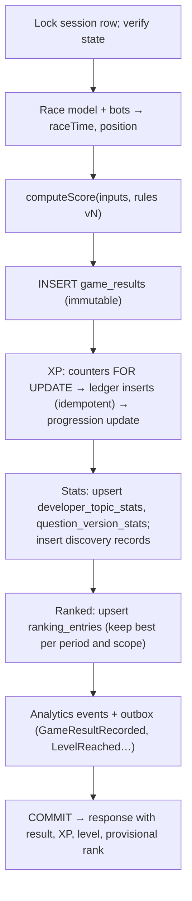

# Scoring engine, race model and progression

> Part 2 · Technical architecture · Status: **Approved** (current decisions; they evolve through ADRs) · Decisions: [ADR-005](../adr/ADR-005-score-calculation-server-side.md), [ADR-016](../adr/ADR-016-immutable-results-and-xp-ledger.md)
>
> Product rules: [scoring principles](../game-design/scoring-principles.md), [progression](../game-design/progression.md). All constants live in the versioned ruleset ([configuration](17-configuration.md)).

## 1. Scoring engine (`scoring-v1`)

A **pure function** in the `scoring` module (no I/O, no clock, no randomness):

```ts
computeScore(input: ScoringInput, rules: ScoringRules): ScoreBreakdown
```

**Inputs** (all built from server records):

| Input | Source |
|---|---|
| Slots: level (weight), outcome (`correct`, `incorrect`, `timeout`, `graded:<grade>`, `neutral`), `responseMs`, `windowMs` | `question_attempts` |
| ATS: match %, passed | Server re-simulation |
| CV Health at the end | Server-applied effects + bounded client events |
| Position, finishers | Race model + bot simulation |
| Status | `delivered` / `failed` |

**Components** (max 25,000):

| Component | Formula (v1) |
|---|---|
| Answers (11,250) | `11,250 × Σ(wᵢ·creditᵢ) / Σ wᵢ`, over non-neutral slots. `wᵢ` = slot level; `credit` = 1 correct, 0 incorrect or timeout, graded: ALIGNED 1, UNDERSELL 0.25, VAGUE 0.25, OUT_OF_RANGE 0 |
| Answer speed (3,750) | `3,750 × Σ(wᵢ·correctᵢ·bucketᵢ) / Σ wᵢ`, with `f = max(0, responseMs − tolerance) / windowMs` and `bucket = 1.0 if f ≤ 0.25; 0.75 if ≤ 0.5; 0.5 if ≤ 0.75; else 0.25` |
| Final position (3,000) | Delivered only: `3,000 × table[position]` with #1 1.0, #2 0.75, #3 0.55, #4 0.40, #5+ 0.25 |
| ATS match (2,500) | `2,500 × match / 100` |
| CV Health (2,500) | Delivered only: `2,500 × cvHealth / 100` |
| Streak (2,000) | `2,000 × longestCorrectStreak / nonNeutralSlots` |

`total = round(Σ components)`. Failed runs get a partial score (labeled "not ranked"). The breakdown (per component, with its inputs) is stored in `game_results.breakdown` and shown on the results screen.

**scoring-v0 (implemented in S2):** the same components without the race: "completion" (3,000, delivered runs only) replaces "final position" until bots exist. Unreached slots count in the denominator. Weights, speed buckets and graded credits live in `packages/content/rulesets/ruleset-v0.yaml` ([D-080](../case-study/decision-log.md#d-080--scoring-v0)).

**Tie-breakers (ranked):** score desc → accuracy desc → race time asc → `created_at` asc.

**Versioning:** results store `scoring_version`. A formula change creates `scoring-v2`; past results are never recomputed. Ranking periods never mix versions: a scoring change starts with a new season or a new period boundary.

## 2. Race model (shared `packages/simulation`)

The server computes race time; the client uses the same model only to animate.

```
raceTimeMs = Σ segments  baseMsᵢ × paceFactorᵢ
           + Σ slots     min(responseMsₛ, windowMsₛ)
           + Σ stages    transitionMs
           + atsDurationMs
           + finalSprintMs × sprintFactor
           + collisionPenaltyMs          (bounded per segment)
```

- `paceFactorᵢ = 1 / (1 + boostᵢ)`, where `boostᵢ` accumulates from correct answers (+5% each, capped at +20%) and incorrect ones (−5%, floor −15%), as active at the segment's start.
- `sprintFactor = 0.8` with the Final Boost, `1.0` otherwise.
- The **minimum checkpoint time** for a segment uses the same formula with the maximum possible boost: a client can't arrive earlier than physics allows.

### Bots

For each bot `j` in the field (the daily category field in ranked, seeded per session in practice):

- Per stage, the bot's outcome is sampled from its stats (skill vs slot level, mistake probability) with `HMAC(seed, "bot:" + j + ":" + stage)`.
- Bot eliminations follow their simulated ATS and CV outcomes.
- `botFinishMsⱼ` uses the same race model with the bot's pace and answer times.
- `position = 1 + #{surviving bots with botFinishMs < raceTimeMs}`; `finishers = 1 + #{surviving bots}`.

Bot outcomes never depend on the player's actions. Segment scripts sent to the client describe what the bots do **up to the next checkpoint only**.

## 3. Progression (`progression-v1`)

### XP computation (in `CompleteGameSession`)

```
base      = delivered ? 100 : failed ? 25 : 0
perf      = floor(score / 50)                      (partial score for failed runs)
runXp     = (base + perf)
            × (practice ? 0.5 : 1)
            × (runsToday ≥ 10 ? 0.25 : 1)
discovery = Σ over correct answers whose question has no discovery record yet: 5 × level
practice cap: runXp + discovery ≤ max(0, 1,000 − practiceXpToday)      (practice only)
firstOfDay = +50 if this is the developer's first delivered run of the UTC day
```

Titles (Daily Champion) add +250 at the daily close.

### Ledger entries (idempotency keys)

| Entry | Key |
|---|---|
| Run XP | `result:{resultId}:run` |
| Discovery bonus (aggregated per result) | `result:{resultId}:discovery` |
| First delivered run of the day | `day:{developerId}:{dayKey}:first-delivered` |
| Title | `title:{titleId}` |
| Void (verification failure) | `void:{originalEntryId}` |

### Level

`cumulativeXp(n) = 300·(n − 1) + 12.5·(n − 1)·n`. The level is the largest `n` with `cumulativeXp(n) ≤ lifetimeXp`, computed in code from the ruleset constants, stored in `developer_progression.level` (a cache, recomputable).

### Anti-farming state

`developer_daily_counters (developer_id, day_key)`: `runs`, `practice_xp`, `first_delivered_bonus_awarded`, updated in the same transaction with `SELECT … FOR UPDATE` on the counter row (no race between two quick completions).

## 4. The completion transaction



Everything a player sees on the result screen is committed in this transaction. Nothing here needs a queue.

## 5. Stats projections

| Projection | Updated | Rebuild |
|---|---|---|
| `developer_topic_stats` | In the completion transaction, from the run's attempts (excluding neutral slots) | From `question_attempts` |
| `question_version_stats` | In the completion transaction | From `question_attempts` |
| `developer_progression` | In the completion transaction | From `xp_ledger` + `game_results` |

Rebuild commands exist for each (`cli rebuild:progression`, `cli rebuild:stats`), and they're used after merges and corrections.
