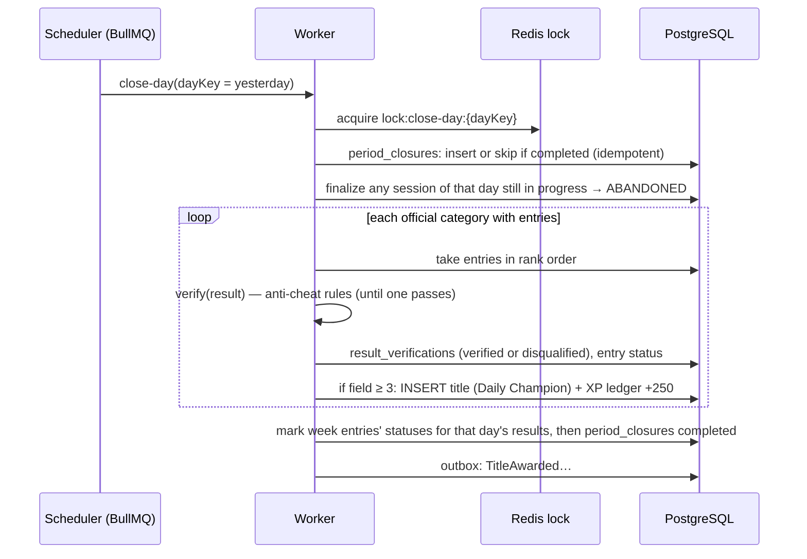

# Rankings, daily close and developer profile projections

> Part 2 · Technical architecture · Status: **Draft for review** · Decisions: [ADR-008](../adr/ADR-008-rankings-as-projections.md), [ADR-014](../adr/ADR-014-redis-usage.md), [ADR-015](../adr/ADR-015-async-processing-scope.md)
>
> Product rules: [rankings](../product/leaderboards.md), [developer profile](../product/developer-profile.md).

## 1. Rankings are projections

A ranking is a view over immutable ranked results, defined by a **scope**:

```
season × periodType (day | week | season | all) × periodKey × dimension (category | technology | xp) × scopeKey
```

MVP scopes: `category × day` and `category × week`. New scopes (technology, XP, season) are new upserts or queries over the same results.

## 2. Writing: in the completion transaction

For a **ranked** result in an **official or preview** category:

```sql
INSERT INTO ranking_entries (season_id, period_type, period_key, dimension, scope_key, developer_id,
                             result_id, score, accuracy, race_time_ms, achieved_at, status)
VALUES (…, 'provisional')
ON CONFLICT (season_id, period_type, period_key, dimension, scope_key, developer_id)
DO UPDATE SET result_id = EXCLUDED.result_id, score = EXCLUDED.score, …
WHERE (EXCLUDED.score, EXCLUDED.accuracy, -EXCLUDED.race_time_ms)
    > (ranking_entries.score, ranking_entries.accuracy, -ranking_entries.race_time_ms);
```

Run for the day entry and the week entry. Strongly consistent: the result screen can immediately show the provisional rank.

## 3. Reading

| Query | How |
|---|---|
| Top 20 of a scope | Index-ordered scan on `(season, period_type, period_key, dimension, scope_key, score DESC, accuracy DESC, race_time_ms ASC, achieved_at ASC)`; cached in Redis 10–30 s, invalidated when an entry in that scope improves |
| "My rank" | `1 + COUNT(*)` of entries ordered before mine (same index) |
| Field size | `COUNT(*)` for the scope (cached) |
| Public rows | Joined with developers through the public-card mapper: name, seniority, role, stack chips **from the result's snapshot**, LinkedIn only if `public` + `shown`, never email |

At MVP scale (hundreds to low thousands of entries per category per day), PostgreSQL alone is fast. **Redis sorted sets are an optimization to add only if measurements require it**; Postgres stays the source of truth either way.

## 4. Daily close and verification

A scheduled job in the worker (BullMQ repeatable job at **00:15 UTC**, after the 10-minute grace window):



- **Idempotent:** re-running a closed day does nothing; a crashed run resumes.
- **Retries** with backoff; an alert if a day isn't closed by 01:00 UTC.
- Verification failing for #1 checks #2, and so on, until a verified result is found or entries run out.
- Weekly ranking entries become final when all the days of the week are closed (no separate weekly titles in the MVP).

## 5. Titles

`titles` are facts (`Daily Champion · Fullstack · Senior+ · 2026-10-13`), linked to the result. Revoking (admin, audited) sets `revoked_at` and a reason; a compensating XP void entry is written. Titles appear on My Profile and later on the public developer page.

## 6. Developer profile projections

| View | Source | Freshness |
|---|---|---|
| Level, XP, games played, games delivered | `developer_progression` | Immediate (completion transaction) |
| History | `game_results` by developer (index `(developer_id, created_at DESC)`) | Immediate |
| Technology stats | `developer_topic_stats` (shown with ≥ 10 answers) | Immediate |
| Best ranks | `ranking_entries` (min rank per scope type) computed on read, cached per developer | Immediate / short cache |
| Titles | `titles` | After the daily close |
| Last active | `developers.last_active_at` (updated at run start and completion) | Immediate |
| *(Stage 2)* Public developer page | A read model assembled from the above through the public mapper and section toggles | Cached, invalidated on change |

None of these need a queue. If a projection ever becomes expensive to compute on write, it can move to an outbox consumer without changing the facts.

## 7. Seasons

- `seasons` has `season-0` (Beta) at launch; every result, ledger entry and ranking entry carries `season_id`.
- Starting a new season = inserting a season row and switching the active season in the ruleset. Rankings filter by season; lifetime XP and history ignore seasons.
- Season XP (V2) = `SUM(xp_ledger.amount) WHERE season_id = …`, cached in a season progression table.

## 8. Rebuilds

| Command | Rebuilds from facts |
|---|---|
| `cli rebuild:rankings --season --period` | `ranking_entries` from ranked `game_results` (+ verifications) |
| `cli rebuild:progression --developer` | `developer_progression` from `xp_ledger` |
| `cli rebuild:stats --developer` | `developer_topic_stats` from `question_attempts` |

Rebuilds are how merges (Stage 2), invalidations and formula-independent corrections stay consistent.
