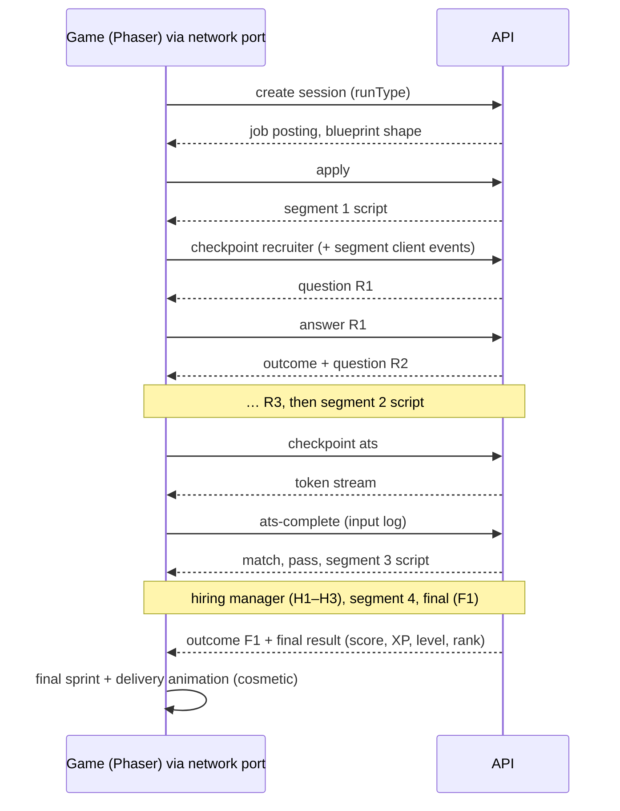

# API and client-server protocol

> Part 2 · Technical architecture · Status: **Approved** (current decisions; they evolve through ADRs) · Decisions: [ADR-003](../adr/ADR-003-server-authoritative-gameplay.md), [ADR-022](../adr/ADR-022-shared-contracts-and-validation.md)

## 1. Conventions

- Base path: `/api/v1` (same origin as the web app). Versioned in the path; breaking changes go to `/v2`.
- JSON only. Every request and response body is validated against a Zod schema from `packages/contracts`.
- Authentication: the device credential cookie (see [identity](06-identity-and-credentials.md)). State-changing requests require `X-CVR-Client: web` and pass an `Origin` check.
- Errors: `{ "error": { "code": "SEMANTIC_CODE", "params": { … }, "requestId": "…" } }`. The client translates codes; the API never sends user-facing sentences.
- Times: ISO 8601 UTC strings; responses that involve deadlines include `serverTime`.
- Rate limits per developer, per credential and per IP hash; `429` with `RATE_LIMITED` and `retryAfterMs`.

## 2. Endpoints (MVP)

### Identity and profile

> Implemented in S1: `POST /developers` (without `locale` and `termsVersion` yet), `GET /me` (without level, XP, contact or ranked fields, which arrive with their slices), `PATCH /me/profile` (the ranked daily lock arrives in S2) and `GET /catalog`.

| Method and path | Purpose |
|---|---|
| `POST /developers` | Light onboarding: create the provisional Developer (name, seniority, role, technologies, locale, terms version); sets the device credential |
| `GET /me` | The current Developer: profile, level, XP, visibility, masked email, LinkedIn status, ranked attempts left today, lock state |
| `PATCH /me/profile` | Edit name, seniority, role, technologies (rejected with `RANKED_PROFILE_LOCKED` during the daily lock) |
| `POST /me/contact` | "Save your progress": add or change email and/or LinkedIn (unverified) |
| `PUT /me/visibility` | `profileVisibility`, `linkedinVisibility` |
| `POST /me/management-link` | Create or regenerate the management link (returned once) |
| `POST /identity/management-links/exchange` | Exchange a management token for a device credential |
| `DELETE /me` | Delete my data (anonymizes results) |
| `GET /me/history?cursor` | Paginated history with competing context |
| `GET /me/stats` | Technology and topic stats (with sample sizes) |

### Catalog and content (public, cacheable)

| Method and path | Purpose |
|---|---|
| `GET /catalog?locale` | Roles, seniorities, tracks, bands, technologies, categories, recommendations, compatibility rules, ranked status per track |
| `GET /daily` | Today's company (name, sector, theme), countdown, applicant counts per category |

### Game sessions

| Method and path | Purpose |
|---|---|
| `POST /game-sessions` | `{ runType, locale }` → snapshot, Job Challenge (posting), public blueprint shape, attempt info, `serverTime` |
| `GET /game-sessions/current` | Resume: stage, open question with remaining time, or next segment script |
| `POST /game-sessions/{id}/apply` | Start the race; **commits the ranked attempt**; returns segment 1 script |
| `POST /game-sessions/{id}/challenges/{stage}/start` | `stage ∈ {recruiter, ats, hiring-manager, final}`, with bounded `clientEvents` for the previous segment → opens the challenge; returns the first question or the ATS stream |
| `POST /game-sessions/{id}/challenges/{challengeId}/answer` | `{ questionAttemptId, selectedOptionId }` → `{ correct, points, effects, cvHealth, combo, next }` |
| `POST /game-sessions/{id}/challenges/{challengeId}/ats-complete` | `{ inputLog }` → `{ match, passed, effects, cvHealth, next }` |
| `GET /game-sessions/{id}/result` | The immutable result: breakdown, competing context, XP, level, provisional rank |
| `GET /game-sessions/{id}/review` | Post-run review (practice: answers and explanations; ranked: results and topics only) |
| `POST /question-reports` | `{ questionAttemptId, reason, comment? }`, only after the session has ended |

### Rankings and sharing (public, cacheable)

| Method and path | Purpose |
|---|---|
| `GET /rankings/{periodType}/{periodKey}/{scopeKey}?limit=20` | Top N with public cards; `me` position if a credential is present |
| `GET /rankings/spotlight` | Today's leaders and champions per category (not a ranking) |
| `GET /shares/{resultId}` | Public share data (respecting current visibility; never email) |

### Analytics

| Method and path | Purpose |
|---|---|
| `POST /analytics/events` | Client-side events from an **allowlist** (`share_clicked`, `linkedin_clicked`, `leaderboard_viewed`, …) with allowlisted properties; rate-limited; never used for business logic |

## 3. Key payloads (illustrative)

```jsonc
// POST /game-sessions/{id}/challenges/recruiter/start → 200
{
  "challengeId": "7b1c…",
  "stage": "recruiter",
  "question": {
    "questionAttemptId": "e3f9…",
    "slot": "R1",
    "prompt": "What salary range did the posting offer?",
    "options": [ { "id": "a", "text": "€45,000 – €60,000" }, { "id": "b", "text": "€30,000 – €40,000" },
                 { "id": "c", "text": "€60,000 – €75,000" }, { "id": "d", "text": "€70,000 – €90,000" } ],
    "windowMs": 10000,
    "deadlineAt": "2026-10-13T18:42:10.250Z"
  },
  "serverTime": "2026-10-13T18:42:00.250Z"
}
```

```jsonc
// POST …/answer → 200
{
  "correct": true,
  "points": 1125,                      // provisional feedback; the final score comes with the result
  "effects": [ { "code": "SPEED_BOOST", "magnitude": 0.05 }, { "code": "ATS_BONUS", "value": 3 }, { "code": "XP_GAIN", "value": 10 } ],
  "cvHealth": 100,
  "combo": 2,
  "next": { "type": "question", "question": { … } }   // or { "type": "segment", "script": { … } }
}
```

## 4. Client-server events (the game's view)



## 5. What the client may know vs what stays on the server

| Information | Client | Server only |
|---|---|---|
| Own profile, snapshot, category | ✅ | |
| Job posting (personal) | ✅ | |
| Public blueprint shape (stages, number of questions, windows) | ✅ | |
| Current segment script (layout, bot moves to the next checkpoint) | ✅ | Future segments |
| Current question (prompt, options, deadline) | ✅ | Future questions; stable question IDs |
| Correct option, grades, explanations (ranked) | | ✅ |
| Explanations and correct answers (practice) | ✅ after the run | |
| ATS token stream (positions, labels) | ✅ at ATS start | Relevance flags (computed on the server) |
| Effects, CV Health, combo (as outcomes) | ✅ | |
| Score breakdown, XP, level, rank | ✅ as results | Computation |
| Session seed, daily seeds, HMAC keys | | ✅ |
| Bot outcomes for future stages | | ✅ |
| Verification thresholds, plausibility floors | | ✅ |
| Question lifecycle, tiers, batches, stats | | ✅ |
| Other developers' emails, credentials | | ✅ (never exposed) |
| Own email | Masked only | ✅ |

## 6. Error codes (selection)

`VALIDATION_FAILED` · `PROFILE_ROLE_UNKNOWN` · `PROFILE_TECHNOLOGY_INCOMPATIBLE` · `NAME_REJECTED` · `RANKED_PROFILE_LOCKED` · `RANKED_ATTEMPTS_EXHAUSTED` · `RANKED_CATEGORY_UNAVAILABLE` · `RANKED_CONTENT_UNAVAILABLE` · `SESSION_NOT_FOUND` · `SESSION_EXPIRED` · `INVALID_TRANSITION` · `CHECKPOINT_TOO_EARLY` · `QUESTION_NOT_CURRENT` · `ALREADY_ANSWERED` · `ANSWER_LATE` (resolved as timeout) · `ATS_LOG_INVALID` · `LINKEDIN_NOT_A_PROFILE` · `LINKEDIN_INVALID_HOST` · `EMAIL_INVALID` · `RATE_LIMITED` · `HUMAN_CHECK_REQUIRED`.

## 7. Future public API

A read-only, versioned, rate-limited public API (rankings, public profiles, aggregates) can be exposed later from the same contracts, under `/api/public/v1`, with its own schemas that contain **only** public fields.
