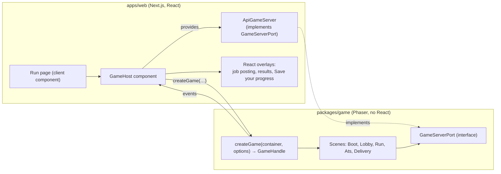

# Game engine and Next.js integration

> Part 2 · Technical architecture · Status: **Approved** (current decisions; they evolve through ADRs) · Decision: [ADR-002](../adr/ADR-002-phaser-game-engine.md)

## 1. Goal

Phaser renders the run; React renders everything else. Neither owns business rules. The game must be **embeddable without Next.js**, testable headless, and replaceable without touching the web app's pages.

## 2. Package boundary



### The public API of `packages/game`

```ts
export function createGame(container: HTMLElement, options: {
  server: GameServerPort;          // network adapter, injected
  t: Translator;                   // i18n function from the host (no catalogs inside the engine)
  locale: Locale;
  settings: { reducedMotion: boolean; muted: boolean; relaxedTimers: boolean };
  assetsBaseUrl: string;
}): GameHandle;

interface GameHandle {
  start(session: SessionStartPayload): void;     // after apply
  resume(state: ResumePayload): void;
  setSettings(settings: Partial<Settings>): void;
  pause(): void;                                  // practice only (between stages)
  destroy(): void;
  on<E extends GameEventName>(event: E, cb: (payload: GameEvents[E]) => void): Unsubscribe;
}

interface GameServerPort {                        // mirrors the API, typed by packages/contracts
  reachCheckpoint(stage: Stage, clientEvents: ClientEvent[]): Promise<CheckpointResponse>;
  answer(challengeId: string, questionAttemptId: string, optionId: string): Promise<AnswerResponse>;
  completeAts(challengeId: string, inputLog: AtsInput[]): Promise<AtsResponse>;
}
```

Events the game emits to the host (typed in `contracts`): `ready`, `stageChanged`, `questionShown`, `answerSubmitted`, `effectApplied`, `failed` (reason code), `delivered`, `networkError`, `fpsDegraded`.

### Rules

- `packages/game` imports **no** React, Next.js, `fetch`, cookies or storage APIs. All I/O goes through the injected port.
- It never holds answer keys, never computes score or XP, never decides correctness. It renders outcomes received from the server.
- It uses `packages/simulation` for deterministic rendering helpers (race timing curves, ATS layout) so that what it draws matches what the server computes.
- Strings come from the injected translator, so the engine has no catalogs and no locale logic.

## 3. Lifecycle in Next.js

- The run page is a **client component**; Phaser is loaded with a **dynamic import** (`ssr: false`) only when a run starts, so landing and profile pages stay light.
- `GameHost` creates the game in `useEffect`, subscribes to events, and calls `destroy()` on unmount (prevents leaks across navigations and React strict-mode double mounts).
- The **job posting**, **result**, **Save your progress** and **review** screens are React (accessible HTML), not canvas. The canvas is used only for the run.
- Answer paths are drawn in the canvas, but a **DOM overlay** mirrors the four options as accessible buttons (screen readers, tap targets, keys 1–4). Activating a button sends a command to the game ("move the runner to path B"), so the runner still physically walks in.

## 4. Scenes

| Scene | Responsibility |
|---|---|
| `Boot` | Load the atlas and audio; respect reduced motion |
| `Lobby` | Field intro, applicant count, 3-2-1-GO |
| `Run` | Side-scrolling segments, obstacles, pickups, bots, answer junctions, CV Health visuals, HQ on the horizon |
| `Ats` | Conveyor with four stacked levels, token stream, input log capture, match meter (server result shown at the end) |
| `Delivery` | Final sprint and CV handover |

Server-driven pacing: when a segment script arrives, `Run` lays out the segment and animates it with the shared timing model. Reaching a checkpoint calls the port; the gate stays closed until the server returns the question. When an answer is resolved, the outcome effects (boost, damage, combo) are animated.

## 5. Network resilience

- Every port call has a timeout and retries for idempotent calls (answer retries send the same payload).
- If the network drops during a question, the runner waits at the gate; the server's deadline still rules. On reconnection, `GET /game-sessions/current` resynchronizes.
- Latency is hidden by animation (slow motion at junctions), never by trusting local outcomes.

## 6. Performance budget

- Texture atlases, one per scene group; compressed audio; no runtime asset generation.
- Target 60 fps; detect sustained drops and lower effects (particles, parallax layers). The game emits `fpsDegraded` for telemetry.
- Mobile: render at device pixel ratio up to 2; Phaser's scale manager in `FIT` mode, with portrait and landscape layouts.

## 7. Testing

- **Pure logic** (input mapping, layout from scripts, timing curves) is unit-tested without a canvas.
- **Engine smoke tests** run Phaser in headless mode in CI where feasible; otherwise Playwright drives the real page with a **fake GameServerPort** that replays recorded sessions.
- **Visual checks** of key scenes with Playwright screenshots on mobile and desktop viewports.
