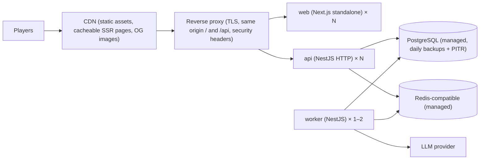

# Deployment and environments

> Part 2 · Technical architecture · Status: **Approved** (current decisions; they evolve through ADRs). **The hosting provider and region are intentionally undecided**; this document fixes the shape so the app can be deployed in the EU or the US without changing the domain.

## 1. Environments

| Environment | Purpose | Data |
|---|---|---|
| **Local** | Development | `docker compose up` (Postgres, Redis) + `pnpm dev`; seeded catalogs, the fake sample pool, fake developers and rankings; fake AI adapters |
| **CI** | Tests | GitHub Actions service containers for Postgres and Redis |
| **Preview** *(V1)* | Per pull request: UI, mechanics, translations | Ephemeral database seeded with fake data; no real AI keys (fake adapters) |
| **Production** | Public | Real data; backups; secrets from the platform |

Preview compatibility is a design constraint from day one: everything runs from container images, seeds are deterministic, and no step requires production data.

## 2. Production topology (MVP)

- **Containers:** `web`, `api` (HTTP entrypoint), `worker` (worker entrypoint; same image as `api`).
- **Migrations:** `prisma migrate deploy` as a release step before new API instances start; migrations are backward-compatible (expand → migrate → contract) so rolling deploys work.
- **Single region** in the MVP, **not chosen yet**. Nothing in the domain depends on a region: all times are UTC, data residency is a deployment choice, and every external dependency (database, Redis, AI provider, error tracking) is configured by environment. Latency fairness is handled by server-measured times and coarse speed buckets; a CDN serves static assets everywhere.

## 3. Hosting decision (deferred to the deployment slice)

When we reach deployment, the decision will weigh: **target users** (Spain, Latin America, English-speaking markets), **latency**, **privacy and GDPR** (data residency, transfers, processors), **cost**, managed **PostgreSQL** (with point-in-time recovery), **Redis-compatible** storage, **workers**, **storage** (backups, assets), and the selected **AI provider's** regions and terms. The result is recorded in an ADR.

### Options to evaluate

| Option | Pros | Cons |
|---|---|---|
| A VPS (e.g. a European provider) with Docker Compose + managed Postgres | Cheapest; full control | Ops on the maintainer (updates, monitoring) |
| A container PaaS (Railway, Render, Fly.io) + managed Postgres and Redis | Low ops, preview environments are easy | Higher cost at scale; vendor specifics |
| A cloud provider (AWS, GCP, Azure) | Credits from sponsors possible; everything managed | More setup |

Requirements for any option: managed Postgres with point-in-time recovery, Redis-compatible storage, container deploys, secrets management, TLS, logs, and a predictable monthly cost.

## 4. Security headers (at the proxy and in Next.js)

`Strict-Transport-Security` (preload when stable) · `Content-Security-Policy` with nonces for scripts, `frame-ancestors 'none'`, `connect-src 'self'` · `Referrer-Policy: strict-origin-when-cross-origin` · `X-Content-Type-Options: nosniff` · `Permissions-Policy` (no camera, microphone, geolocation) · `Cross-Origin-Opener-Policy: same-origin`.

## 5. Backups and recovery

Daily backups with point-in-time recovery (7–14 days), a restore drill before launch, and an exportable schema-only dump in the repository's docs for contributors (no data).

## 6. Cost awareness

The main variable costs are the number of API calls per run (~15), OG image renders (cached), database size (`question_attempts`, analytics) and AI generation (batched, budgeted). Metrics include cost per 1,000 runs (see [success metrics](../product/success-metrics.md)).
