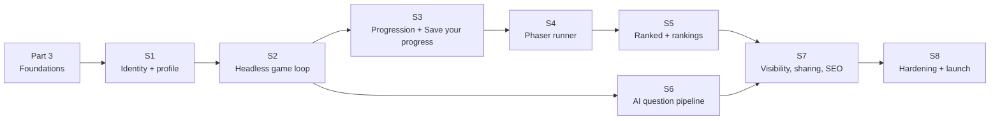

# Implementation plan: repository foundations and vertical slices

> Part 2 · Technical architecture · Status: **Approved** (current decisions; they evolve through ADRs)
>
> No implementation starts until Part 2 is reviewed. Each slice is a pull request (or a short series) that is **demoable**, tested, documented and recorded in the case study.

## Order and rationale

**Server authority before graphics:** S2 proves the whole referee loop (sessions, questions, scoring) with a plain HTML UI before any Phaser work, so the riskiest part (security and fairness) is tested early and the game is built on a stable protocol.

## Part 3 · Repository foundations

pnpm workspace, `apps/web`, `apps/api` (HTTP + worker entrypoints), `packages/{contracts,simulation,content,i18n,game,config}` skeletons; strict TypeScript, ESLint (with dependency rules), Prettier; Vitest; Docker Compose (Postgres, Redis); Prisma setup; `.env.example`; Node/pnpm pinning; CI (lint, typecheck, unit, integration, build, content/questions/translations validation, migration check); README/README.es, CONTRIBUTING, CODE_OF_CONDUCT, SECURITY, LICENSE files (per [ADR-010](../adr/ADR-010-licensing.md)), CHANGELOG, issue and PR templates, labels, FUNDING.yml (placeholder), contributor guides (add questions, technology, role, language, challenge, scene).

**Done when:** `git clone → cp .env.example .env → docker compose up -d → pnpm i → pnpm dev` shows a hello page and a healthy API; CI is green.

## S1 · Identity and profile

Catalog loading and validation; `POST /developers` with device credential; profile validation (role compatibility); name moderation; `GET /me`; es/en routing with detection and switch; light landing (SSR); onboarding UI (stack picker); "Competing as" card.

**Done when:** a new visitor creates a provisional Developer in under a minute on mobile, comes back and is recognised; tampering tests for profile validation pass.

## S2 · Headless game loop (no Phaser)

Game session state machine; Job Challenge generation (practice: generated company); Question Engine with the **sample pool** and job-derived templates; challenges (Recruiter, Hiring Manager, Final) with deadlines and single answers; ATS with input-log re-simulation (minimal UI); race model and bots in `packages/simulation`; scoring v1; `CompleteGameSession`; result endpoint; a plain HTML "debug runner" UI.

**Done when:** a full practice run works end to end in the debug UI; the tampering suite (double answers, early checkpoints, invalid transitions, late answers) passes; no answer key appears in any response.

## S3 · Progression and "Save your progress"

XP ledger, levels, daily counters and anti-farming, discovery bonus; history and stats projections; My Profile (private); "Save your progress" after the first game (email encryption + lookup hash, LinkedIn normalization, visibility); the management link; delete my data.

**Done when:** XP and level show on the result screen from the same transaction; the funnel `first_game_completed → identity_contact_added` is instrumented; email never appears outside its encrypted column (tests).

## S4 · Phaser runner

`packages/game` with Boot, Lobby, Run, Ats and Delivery scenes; side-scrolling level, jump and drop, obstacles and pickups (bounded client events), answer junctions with the DOM overlay, bots from server scripts, CV Health visuals, mobile and desktop controls, reduced motion; GameHost integration; a prototype pass on camera and readability.

**Done when:** a complete run is playable on a mid-range Android phone in an in-app browser and on desktop; 30+ fps sustained; accessibility checks pass.

## S5 · Ranked and rankings

Play Ranked / Practice entries; ranked attempt commitment at apply; the daily profile lock; Daily Company schedule and daily category blueprints (shared selection, daily bot field); category rankings (day, week); provisional ranks; the daily close job with verification and Daily Champion titles (+XP); Season 0 labels; spotlight.

**Done when:** time-travel integration tests across day and week boundaries pass; attempt re-rolling is impossible; titles are awarded idempotently.

## S6 · AI question pipeline

Worker, queues and schedulers; generator and checker ports with fake adapters; one real provider adapter (with a small benchmark and an ADR for the provider choice); validation stages; lifecycle (validated → competitive / practice → retired → practice; invalidation by question and batch); rotation; exposure-triggered regeneration; question reports; launch-context seeding command.

**Done when:** launch contexts are seeded and pass validation; a batch can be invalidated with one command; the daily budget guard works; practice never receives competitive questions.

## S7 · Visibility, sharing and SEO

Public cards in rankings (snapshot context, LinkedIn visibility), share pages and OG images, hreflang and metadata, legal and transparency pages (privacy, terms, what is public, how ranking works), reports on profiles, moderation commands.

**Done when:** sharing works from LinkedIn's in-app browser; hiding a profile updates every public surface; the legal pages exist in both languages.

## S8 · Hardening and launch

Analytics event catalog end to end, observability dashboards, rate limits and the optional human check, CSP and security headers, load test, accessibility audit, legal review (including email processing), playtests with ≥ 20 external players, the launch checklist from the [MVP definition of done](../product/mvp-scope.md#7-definition-of-done-for-the-mvp-launch).

**Done when:** every item of the MVP definition of done is checked.
