# Implementation plan: repository foundations and vertical slices

> Part 2 · Technical architecture · Status: **Approved** (current decisions; they evolve through ADRs). Slice order revised after the Part 3 review ([D-068](../case-study/decision-log.md#d-068--slice-order-the-playable-game-comes-third)).
>
> Each slice is a pull request (or a short series) that is **demoable**, tested, documented and recorded in the case study. Each one stops for review before the next starts.

## Order and rationale

```mermaid
flowchart LR
  p3["Part 3<br/>Foundations"] --> s1["S1<br/>Identity + onboarding"]
  s1 --> s2["S2<br/>Job Challenge, no Phaser"]
  s2 --> s25["S2.5<br/>Theme + visual design gate"]
  s25 --> s3["S3<br/>First playable game"]
  s3 --> s4["S4<br/>Recruiter + ATS"]
  s4 --> s5["S5<br/>Hiring Manager, Final, progression"]
  s5 --> s6["S6<br/>AI question pipeline"]
  s6 --> s7["S7<br/>Save progress + profile"]
  s7 --> s8["S8<br/>Launch hardening"]
```

1. **Rules before graphics:** S2 plays a whole run with a plain HTML UI. If that works, the rules of the game live in the server, not in the engine.
2. **Look decided before it is built:** S2.5 is a short design gate. The theme, art direction, characters, world, HUD and mobile layout are chosen from browser prototypes and written down in a visual bible before any gameplay code, so the look isn't decided while implementing it.
3. **Playable as soon as the rules hold:** S3 turns the same protocol into a short real race in Phaser, so fun, feel and readability are tested early instead of after progression and profiles.
4. **Then depth, then the network:** the hiring stages (S4, S5), real questions (S6), and the profile features that make progress worth keeping (S7), before hardening for launch (S8).

## Who decides what (S3 onward)

Phaser is a playable representation of the domain's state. It never holds a business rule.

| Phaser (`packages/game`) | API (NestJS) |
|---|---|
| Rendering, sprites, animation | GameSession and its state machine |
| Physics, collisions, camera | Which Job Challenge and which question come next |
| Input (keyboard, touch) | Answer validation (answer keys never leave the server) |
| Visual bots and level presentation | Authoritative score, ranked attempts, result, XP |

The client sends intents ("chose door B", "reached the checkpoint"); the server answers with outcomes ("boost", "slowdown and CV damage") that the engine animates. See [game client integration](14-game-client-integration.md) and [ADR-003](../adr/ADR-003-server-authoritative-gameplay.md).

## Part 3 · Repository foundations (done)

pnpm workspace, `apps/web`, `apps/api` (HTTP + worker entrypoints), `packages/{contracts,simulation,content,i18n,game,config}`; strict TypeScript, ESLint with dependency rules, Prettier; Vitest; Docker Compose (PostgreSQL, Redis); Prisma with an initial migration; `.env.example` with validation; Node/pnpm pinning; CI (format, lint, typecheck, unit and integration tests, build, content/questions/translations/docs validation, migration drift check); README/README.es, CONTRIBUTING, CODE_OF_CONDUCT, SECURITY, licenses (per [ADR-010](../adr/ADR-010-licensing.md)), CHANGELOG, issue and PR templates, labels, FUNDING.yml (placeholder), contributor guides.

**Done when:** `git clone → corepack enable → pnpm install → docker compose up -d → pnpm db:migrate → pnpm dev` shows the status page and a healthy API; CI is green. The record: [case study, foundations](../case-study/03-foundations.md).

## S1 · Developer identity and onboarding

The first real experience. Light landing (SSR) with automatic `es`/`en` detection and a language switch; onboarding: name, seniority, role and stack, with the technology picker driven by the catalog (only technologies the role allows); `POST /developers` creates a **provisional Developer** with a **device credential** (random secret in an httpOnly cookie, only its hash stored); profile validation (catalog membership, role compatibility, seniority limits) and name rules; `GET /me` recovers the Developer on the same device; a "Competing as" card. No email and no LinkedIn yet.

**Done when:** a new visitor enters as, for example, *Ricardo · Senior · Fullstack Developer · Node.js, PHP, React, PostgreSQL, Redis*, the API creates the provisional Developer, and the same device is recognised on return; profile tampering tests pass.

## S2 · Job Challenge without Phaser

The heart of the product, played without a game engine. **Play Ranked / Practice**; Job Challenge generation adapted to the frozen profile snapshot (practice: generated company); GameSession and its state machine; **apply** to the offer, which commits the ranked attempt ([ADR-019](../adr/ADR-019-ranked-attempt-commitment.md)); A/B/C/D questions selected **just in time** from the sample pool; server-authoritative answers with deadlines; a preliminary score; finishing the run; an immutable **GameResult**. A plain HTML UI.

**Done when:** a ranked and a practice run can be completed start to finish in the plain UI; the tampering suite (double answers, invalid transitions, late answers, re-rolled ranked attempts) passes; no answer key appears in any response.

## S2.5 · Game theme and visual design (gate before S3)

Not a technical slice: a short phase to decide how CV Rush looks and feels before Phaser work starts ([D-085](../case-study/decision-log.md#d-085--a-visual-design-gate-before-the-game-engine)).

1. **Three clearly different art directions**, each with a name, description, palette, typography, character, environment and HUD styles, advantages, risks, mobile behavior and production effort, shown as browser prototypes (HTML/CSS/SVG) and screenshots so they can be compared side by side. A recommendation, but the owner chooses.
2. **The chosen direction worked out** in prototypes of at least: job posting, countdown and start, normal race, an A/B/C/D question in the level, Recruiter, ATS 9000, Hiring Manager, final sprint and company, results, and mobile gameplay; plus the Apply → race and arrival → results transitions, the developer carrying a visible CV (with its damage states and `CV HEALTH`), the bots, obstacles, power-ups, and the desktop and mobile HUDs.
3. **`docs/game-design/visual-bible.md`**: art direction, tone, colors, typography, character, environment, HUD, Recruiter, ATS, Hiring Manager, visual language, responsive and mobile rules, animation principles and what not to do.

Rules: the prototypes live apart from production code and are never imported by the apps; original assets only, or assets whose license allows redistribution, with origin, license and author recorded; nothing that copies other franchises (no Mario or Nintendo characters, blocks, pipes, coins, sounds or maps). Humor targets the hiring process, never people, and never turns ranked questions into jokes.

**Done when:** the owner has chosen a direction, adjusted it, and approved the visual bible. Only then does S3 start.

## S3 · First playable game (Phaser)

Phaser inside `packages/game`, hosted by the web app. A short side-scrolling race: the player's character with their name above it, carrying their CV; run, jump, platforms, a camera that follows; one or two obstacles; several visual bots; a start line and the company as the finish; **one A/B/C/D question built into the level** as four paths, doors or platforms, answered by physically taking one; the game talks to the API through the S2 protocol; correct answer → boost, wrong answer → slowdown and CV damage (decided by the server); desktop and basic mobile controls; a responsive canvas. Original placeholder art; no final graphics.

**Done when:** you open the browser and can say "I can play CV Rush": a short race from start to company, with the question answered in the world and its outcome coming from the server.

## S4 · Recruiter and ATS

Recruiter checkpoint with questions about the job posting; **ATS 9000** with keywords and ATS Match (input-log re-simulation, [GameSession §6](07-game-session.md#6-ats-challenge)); complete CV Health; bot elimination; game over.

**Done when:** a run can be lost at the Recruiter or the ATS for reasons the result screen explains; ATS tampering tests pass.

## S5 · Hiring Manager, Final Interview and progression

Hiring Manager; Final Interview; Final Sprint; delivering the CV; the final score (scoring v1 complete, race model and bots from `packages/simulation`); the XP ledger, levels, daily counters and anti-farming; the complete GameResult.

**Done when:** a full run goes through every stage; XP and level appear on the result screen from the same transaction that stores the result.

## S6 · AI question pipeline

Worker, queues and schedulers; generator and checker ports with fake adapters; real provider adapters compared on technical quality, structured output, latency, cost and availability (OpenAI, Anthropic, Gemini or whatever is available then), with an ADR recording the choice; validation stages; lifecycle (validated → competitive / practice → retired → practice; invalidation by question and batch); rotation; exposure-triggered regeneration; launch-context seeding. The domain depends only on `QuestionGenerationProvider`: changing provider never changes the architecture ([AI pipeline](10-ai-question-pipeline.md)).

**Done when:** launch contexts are seeded and pass validation; a batch can be invalidated with one command; the daily budget guard works; practice never receives competitive questions.

## S7 · Save your progress and developer profile

"Save your progress" after the first game: optional email (encrypted, with a lookup hash) and optional LinkedIn (normalized), visibility consent; My Profile (private): history, last active, XP, level, stats; the management link; delete my data; category rankings (day, week), the Daily Company and daily category blueprints, the daily close with Daily Champion titles, Season 0 labels; public cards with snapshot context; privacy and "what is public" pages.

**Done when:** the funnel `first_game_completed → identity_contact_added` is instrumented; email never appears outside its encrypted column (tests); time-travel tests across day and week boundaries pass; hiding a profile updates every public surface.

## S8 · Launch hardening

Analytics end to end; observability dashboards; anti-cheat review; rate limits and the optional human check; SEO, OG images and share cards; question reporting; a security review (CSP and headers included); performance (load test, 30+ fps on a mid-range Android phone in an in-app browser); accessibility audit; mobile polish; deployment; playtests with ≥ 20 external players; the launch checklist from the [MVP definition of done](../product/mvp-scope.md#7-definition-of-done-for-the-mvp-launch).

**Done when:** every item of the MVP definition of done is checked.
