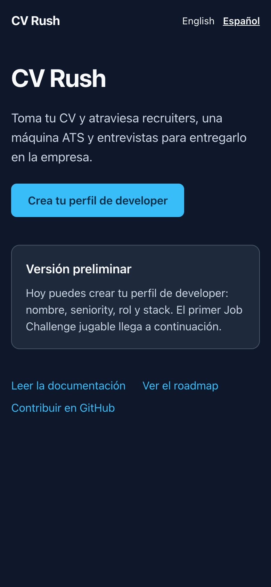
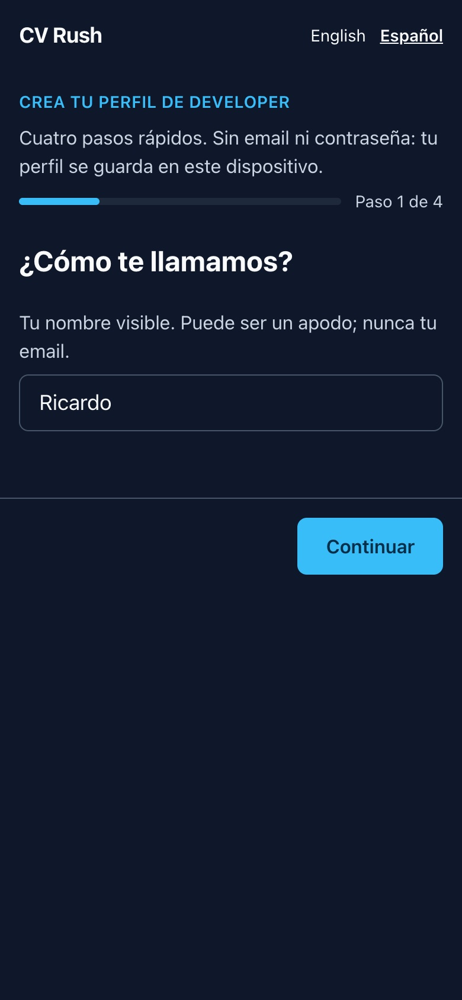
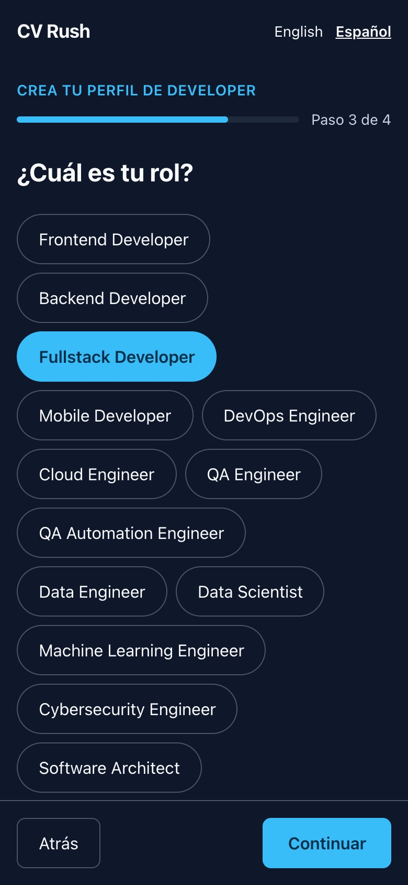
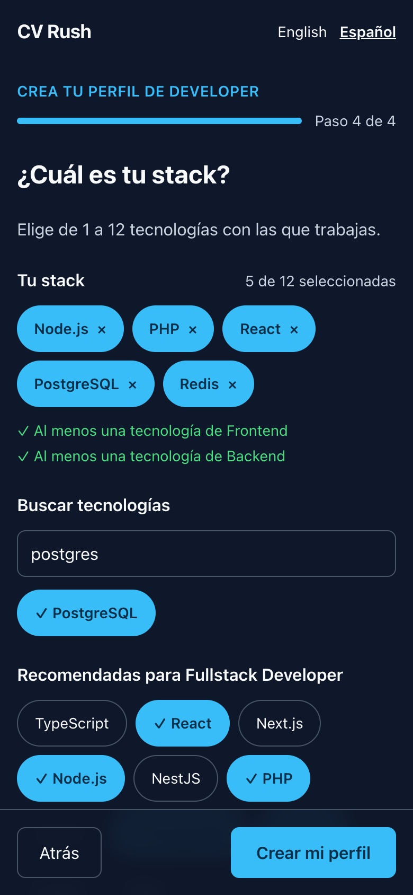
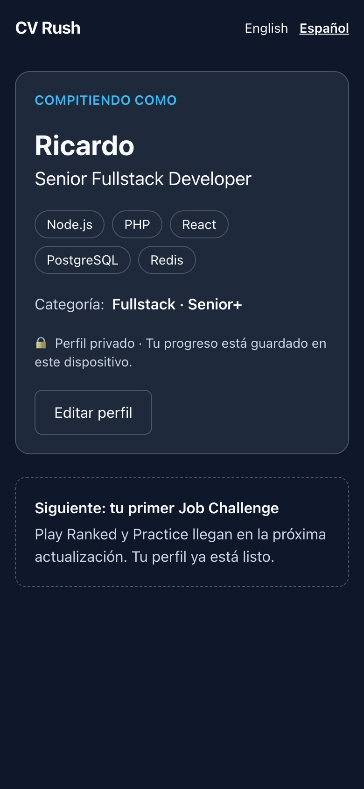
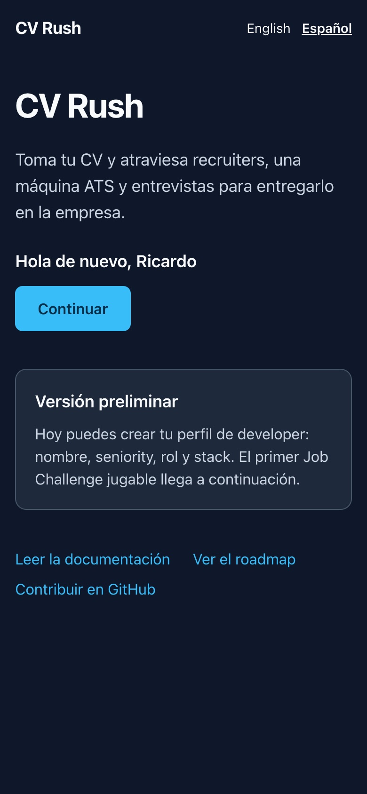
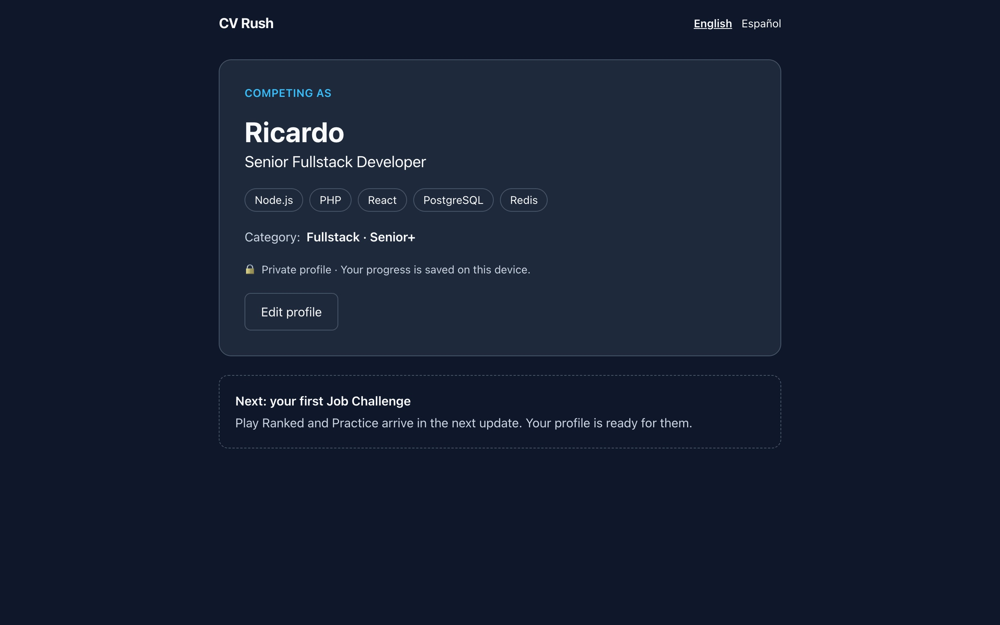

# 04 · Slice S1: developer identity and onboarding

> Case-study notes · Recorded 2026-10-13, during slice S1. Working notes, not the article.

## Goal

The first real experience: someone opens the site, is greeted in their language, says who they are as a developer (name, seniority, role, stack) and becomes a **provisional Developer** without an email or a password. Coming back on the same device, they are recognised.

Done when the API creates, for example, *Ricardo · Senior · Fullstack Developer · Node.js, PHP, React, PostgreSQL, Redis* and the same browser is recognised on return.

## What we built

- **Data:** `developers` (UUIDv7, `provisional`, `private` by default), `device_credentials` (only a SHA-256 digest of the token) and `developer_profiles` (seniority, role and technology IDs from the catalog). `CHECK` constraints for the digest length and the 1–12 technologies ([D-075](decision-log.md#d-075--database-checks-for-what-prisma-cant-express)).
- **API:** `GET /api/v1/catalog?locale`, `POST /api/v1/developers`, `GET /api/v1/me`, `PATCH /api/v1/me/profile`. A uniform error envelope with semantic codes, and a CSRF check on every state-changing request ([D-073](decision-log.md#d-073--device-cookie-and-csrf-in-practice)).
- **Shared rules:** name and profile rules live once, in `packages/contracts`, and run in the API (authority) and in the browser (instant feedback) ([D-072](decision-log.md#d-072--shared-profile-rules-server-side-moderation)).
- **Web:** a landing with language detection, a four-step onboarding (the stack picker never shows the whole catalog at once: selection, role requirements, search with aliases, recommendations, then categories) and the "Competing as" card, whose category comes from the API.

## Screenshots

Taken from a production build (`next build && next start`) driven by headless Chrome, 390×844 at 2× (mobile) and 1280×800 (desktop).

| | |
|---|---|
|  |  |
|  |  |
|  |  |

Desktop, English: 

## Problems and decisions along the way

| Problem | What happened | Decision |
|---|---|---|
| **Rewriting an applied migration** | The integrity `CHECK` constraints were first appended to the migration that had just been applied locally. Applying them meant resetting the local database, and Prisma 7 refuses to run a non-interactive `migrate reset` without explicit confirmation | Restored the applied migration untouched and added a second one with the constraints. Nothing was reset. A reminder that applied migrations are history too |
| **What not to fake** | The design asks for a terms acknowledgement at onboarding, but there are no terms yet | No consent record until the privacy and terms pages exist (S7) instead of recording consent to a text that doesn't exist ([D-071](decision-log.md#d-071--s1-scope-what-waits-for-later-slices)) |
| **Secure cookies on localhost** | `__Host-` cookies require `Secure`, which not every browser accepts on `http://localhost` | `dc` without `Secure` on local http; `__Host-dc; Secure` whenever the public origin is https, which production requires |
| **Name moderation vs real names** | Substring matching would block "Cassandra" or "Dickens" | Whole-word matching for short terms, substring matching only for a few unambiguous ones; tests for both directions |
| **Error shown too early** | The name field showed "at least 2 characters" as soon as it lost focus while still empty | The error appears once something was typed, or on Continue |

## Verification (actually run)

- Unit tests: 103 across packages (contracts 35, API 35, content 14, web 7, i18n 6, simulation 6).
- API integration tests with real PostgreSQL and Redis: 32, including creation, the stored digest, recognition on return, revoked and forged credentials, hourly renewal, one Developer per device, CSRF (missing header, other origin, cross-site fetch, form content type), ten profile-tampering cases with "nothing written" checks, and profile edits.
- `pnpm verify`, `pnpm db:check` (no drift).
- In a browser (mobile and desktop): the full onboarding in Spanish, the device cookie invisible to JavaScript (`document.cookie` only shows `NEXT_LOCALE`), the row in PostgreSQL (UUIDv7, `provisional`, 32-byte digest), recognition after reload, a reserved name rejected by the server and shown on the name step, no console errors besides the expected 401 of a first visit.

## To measure later

Time to complete onboarding on a phone (target: under a minute), drop-off per step, and how often people edit their profile right after creating it.
