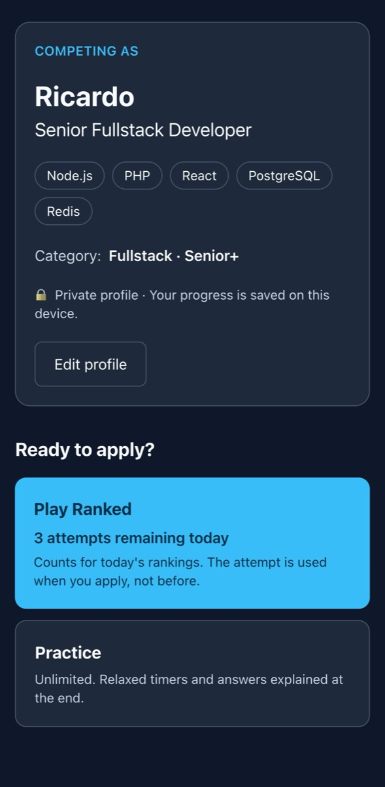
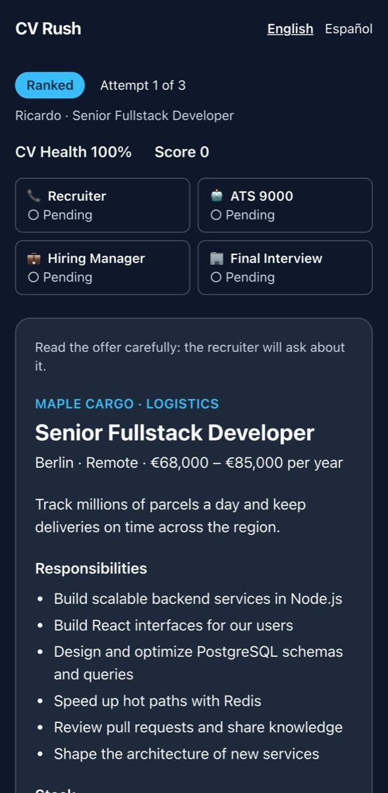
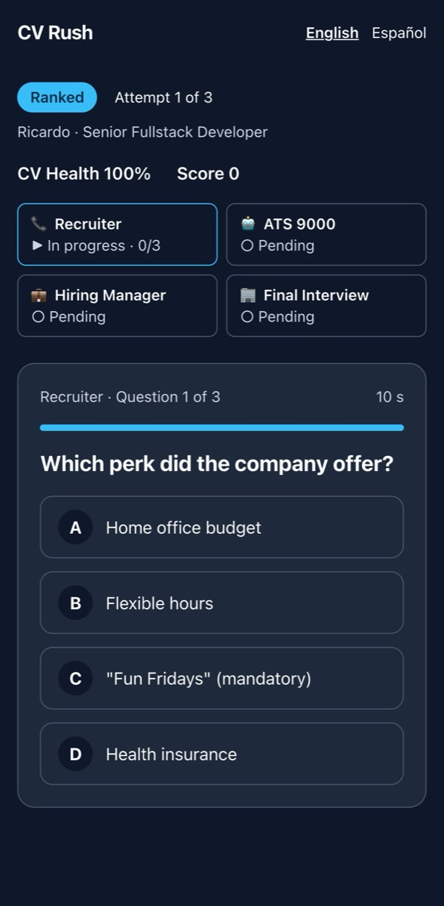
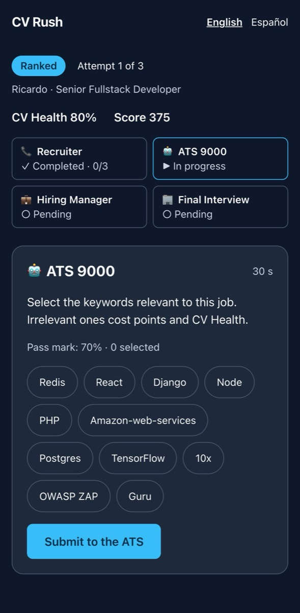
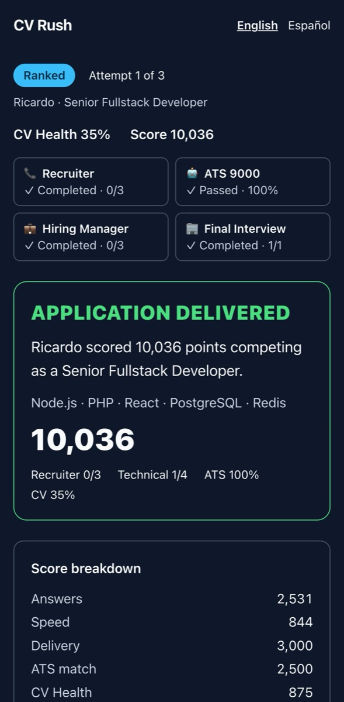
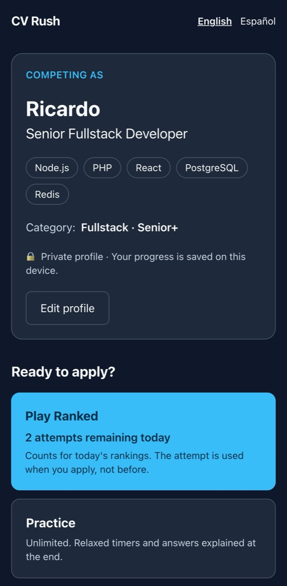
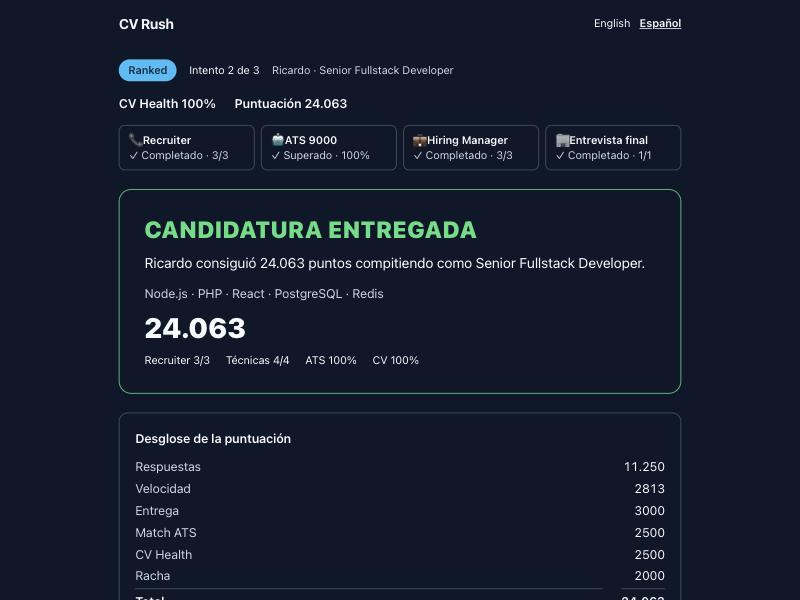

# 05 · Slice S2: the Job Challenge without the game engine

> Case-study notes · Recorded 2026-10-13, during slice S2. Working notes, not the article.

## Goal

Build the brain of a complete run before any graphics: choose Ranked or Practice, get a job offer adapted to the profile, apply, go through the Recruiter, the ATS, the Hiring Manager and the Final Interview, and end with an immutable result. The interface is plain HTML on purpose: if a run can be played end to end here, the rules of the game live on the server and Phaser (S3) only has to represent them.

## What we built

- **Ruleset v0:** every gameplay constant in one versioned file (attempts, windows, lifetimes, stages and levels, CV damage, the ATS rule, scoring weights). Sessions and results record the version they used.
- **Job Challenges:** a posting generated deterministically from the frozen profile snapshot and authored en/es content: Ricardo gets *Senior Fullstack Developer* with Node.js · PHP · React · PostgreSQL · Redis plus one technology recommended for fullstack roles, never Swift or Kotlin. The `source` (`generated`, `daily`, `job_posting`) keeps Play to Apply possible ([D-078](decision-log.md#d-078--generated-job-challenges-for-ranked-and-practice-in-s2)).
- **Question pools** filled through the provider-agnostic pipeline with an offline fake provider; the Question Engine serves one question per slot, just in time ([D-079](decision-log.md#d-079--question-content-for-s2)).
- **Game sessions:** the server-side state machine ([D-077](decision-log.md#d-077--session-states-as-designed-segments-kept-with-no-minimum-time-yet)), ranked attempts committed at apply, the daily ranked profile lock ([D-083](decision-log.md#d-083--ranked-profile-lock-implemented-with-ranked-attempts)), job-memory and salary questions built from the posting, pool questions for the technical stages, the ATS as keyword selection, scoring-v0 ([D-080](decision-log.md#d-080--scoring-v0)) and an immutable `GameResult` ([D-082](decision-log.md#d-082--history-protected-by-the-database)).
- **Concurrency:** PostgreSQL row locks and idempotent replays; Redis only for the worker's sweeper ([D-081](decision-log.md#d-081--concurrency-and-idempotency-without-redis-state)).
- **Web:** the run rendered from the server's state, so a refresh shows the same thing.
- **E2E:** one Playwright journey in CI, with the installed Chrome ([D-084](decision-log.md#d-084--end-to-end-tests-with-the-installed-chrome)).

## Screenshots

Mobile screenshots come from the E2E run (Pixel 7 viewport, production builds); it answers blindly, so its run ends rejected. The desktop screenshot is a run played by hand in Spanish.

| | | |
|---|---|---|
|  |  |  |
|  |  |  |

## Problems and decisions along the way

| Problem | What happened | Decision |
|---|---|---|
| **Apply on a finished run returned 500** | Found while trying to tamper with a finished run by hand: the ranked attempt was allocated before the state machine checked the transition, and the unique attempt per session failed | Transition first, then allocation, in the same transaction; a regression test. Lesson: tamper by hand too, not only from the test list |
| **"Resume your run" for an expired run** | Without the worker running, an applied run left overnight was still flagged active until someone opened it (then it was correctly closed as abandoned, attempt consumed) | The resume link only offers sessions still within their review window or lifetime |
| **"Passed · 0/3"** | A question stage completed with zero correct answers was labeled "Passed" | Question stages say "Completed"; only the ATS is passed or failed |
| **A blind E2E ends 0/7** | Worried the correct option was never "A" | 8,000 seeded shuffles: the correct option lands on each position about 2,000 times. Blind answers just lose |
| **An empty JSON body is a 400** | The E2E sent `content-type: application/json` without a body; Fastify rejected it before the state machine | The test sends what the real client sends (no content type without a body) |
| **Prisma join loading is still a preview feature** | `relationLoadStrategy: 'join'` would load a session in one query, but needs a preview flag | Not enabled; Prisma's per-relation queries are fine at this size |
| **A posting required a technology the player never chose** | At the S2 review, Ricardo's offer listed Laravel in its stack, added to reach six technologies | Required stack only from the player's selection; related extras appear as "Nice to have" and never count for questions, ATS, stats or identity ([D-086](decision-log.md#d-086--required-stack-only-from-the-players-selection)) |
| **A dependency advisory with no fix** | `braces` (via the Next.js lint plugin) has no patched version | A documented tooling exception with a review date ([dependency policy](../security/dependency-policy.md)) |

## Verification (actually run)

- Unit tests: 147 (API 75, contracts 35, content 18, web 7, i18n 6, simulation 6).
- API integration tests with real PostgreSQL and Redis: 51, including the complete ranked journey, the snapshot surviving profile edits, double and parallel applies, three attempts per day and the fourth refused, the ranked profile lock, review expiry without using the attempt, skipped stages, other developers' sessions, CSRF, only the current question with no answer key, replays and changed answers, late answers as timeouts, tampered payloads, the ATS failing a run, a destroyed CV, abandonment on access and by the sweeper, practice with relaxed windows and reviews, and content that can't be served.
- E2E (Playwright, Chrome): onboarding → Ranked → offer → Apply → every challenge → result → refresh → 2 attempts left, plus two tampering attempts.
- By hand in a browser (Spanish): a delivered ranked run with 24,063 points; refresh keeps the result; re-applying, restarting the final interview, forging an answer and skipping the client header are refused.

## To measure later

Time spent reading the offer before applying, answer times per slot (to tune windows), ATS pass rate, how often players abandon after applying.
