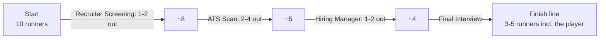

# Bots (rival candidates)

> Part 1 · Product & Game Design · Status: **Draft for review**

## 1. Purpose

Bots are **not** multiplayer. They exist to:

- create a feeling of **competition** ("237 candidates applied", a crowd at the start line);
- tell the **funnel story** of hiring (candidates drop out at each stage);
- give the run **pacing and drama** (overtakes, stumbles, eliminations);
- define **final position**, a component of the score.

They are clearly presented as rival candidates and **never appear on leaderboards**.

## 2. Field

- **9 bots + the player = 10 runners** at the start (configurable, 7–11 bots).
- The player's runner is labeled with their name ("ALEX"); bots show generated names from per-locale name pools.
- Every runner carries a CV; each bot's CV has a distinct color and pattern.

## 3. Archetypes (MVP: 5)

Stats are on a 0–1 scale (initial values, tunables).

| Archetype | Speed | Reaction | Technical | Memory | Mistake probability | Personality and lines |
|---|---|---|---|---|---|---|
| **The Sprinter** | 0.90 | 0.80 | 0.40 | 0.40 | 0.35 | Rushes everything. "Applied in 3 seconds!" |
| **The Veteran** | 0.50 | 0.50 | 0.85 | 0.70 | 0.10 | Calm, slow and accurate. "I've seen this question since 2009." |
| **The Wildcard** | 0.4–0.95 (varies by segment) | varies | 0.60 | 0.60 | varies | Lucky streaks and spectacular fails |
| **The Keyword Stuffer** | 0.70 | 0.70 | 0.35 | 0.50 | 0.25 | Aces the ATS, struggles in interviews. "Synergy. Agile. Blockchain." |
| **The Overthinker** | 0.60 | 0.30 | 0.80 | 0.80 | 0.15 | Accurate but often times out. "Well, it depends…" |

- **speed:** base running pace in segments.
- **reaction:** how quickly the bot answers (affects timeouts and its race time).
- **technicalSkill / memorySkill:** the chance of answering technical or job-memory slots correctly, adjusted by slot difficulty.
- **mistakeProbability:** extra noise (wrong path, obstacle hits).
- **personality:** lines and animations (localized). Lines are short, funny and never mean.

## 4. Outcome model (product level)

- For each stage, the server **simulates** each bot's outcome from its stats, the slot difficulties and a seed: correct or wrong per question, ATS match, obstacle hits, and therefore its **simulated race time**.
- Bot outcomes never depend on the player's actions. That keeps the player's position a pure function of their own performance.
- The client receives, **per segment**, only what it needs to animate the bots (positions, stumbles, eliminations), never the whole future of the race.

### Elimination funnel

Bots are eliminated by their simulated outcomes (a failed ATS, a destroyed CV), framed with the hiring-process voice: "We've decided to move forward with other candidates."

## 5. Position

- **Final position** = the player's rank by race time among the runners who **deliver** (the player plus surviving bots), e.g. "#2 of 4".
- Computed by the server from the player's server-computed race time and the bots' simulated times.
- Visual positions during the race are kept **consistent with the server state at each checkpoint**. Between checkpoints the client only interpolates.

## 6. Practice vs ranked

| | Practice | Ranked |
|---|---|---|
| Field | Randomly generated per run (archetype mix, names) | **One daily field per category** (the same archetypes, stats and seed for everyone in the category) |
| Strength | Scaled to the player's exact seniority to keep races close | Scaled to the category's band; fixed for the day |
| Drama tuning | Light rubber-banding of *visual* pacing for close races | None: what you see matches the simulation |
| Position | Personal context | Scored, comparable across all players of the category that day |

## 7. Content and i18n

- Name pools per locale, diverse and fictional; never famous people.
- About 30 localized lines in the MVP (start, overtake, stumble, elimination, finish), with jokes localized rather than literally translated.

## 8. Future

- **Ghost runs (V2 idea):** race against the recorded *timeline* of real top runs ("the ghost of today's champion"), built from server-side data, never from client claims.
- More archetypes ("The Referral", "The Job Hopper", "The Over-qualified").
- Real multiplayer remains an idea, not a plan.
