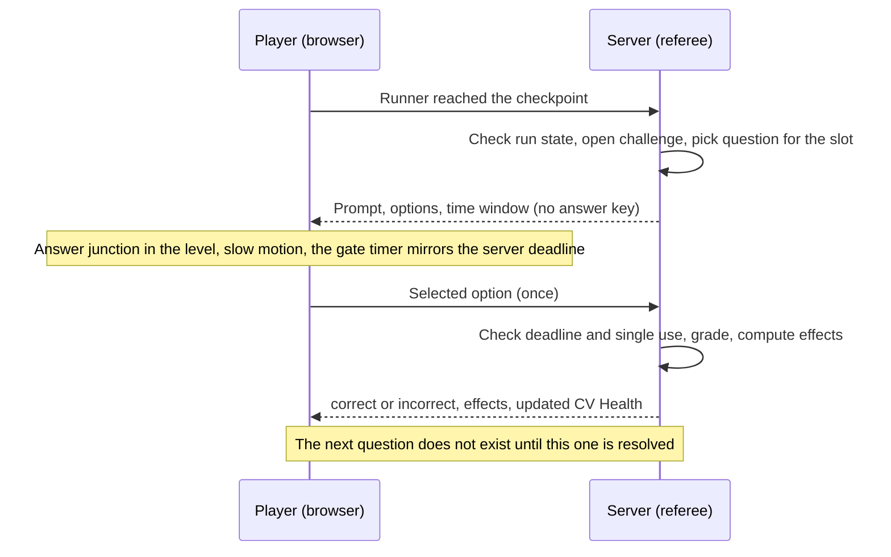

# Challenges: common anatomy and catalog

> Part 1 · Product & Game Design · Status: **Approved (revision 4)**
>
> The game-design anatomy that every challenge follows. Part 2 turns it into a technical contract (definition, state, start, action, result, renderer, server validation) so that new challenges can be added without modifying ten core modules.

## 1. Catalog

| Challenge | Fantasy | Mechanic | Status |
|---|---|---|---|
| [Recruiter Screening](recruiter-screening.md) | The first call with a recruiter | 3 gate questions (job memory, recruiter, salary) | **MVP** |
| [ATS Scan](ats-scan.md) | Being filtered by a robot | Collect relevant keywords on a conveyor; match threshold | **MVP** |
| [Hiring Manager](hiring-manager.md) | The technical interview | 3 harder gate questions | **MVP** |
| [Final Interview](final-interview.md) | The last round, the HQ in sight | 1 mixed gate question; Final Boost | **MVP** |
| [Salary Negotiation](salary-negotiation.md) | Talking money | MVP: a graded question inside Recruiter Screening. V1: its own multi-round stage | MVP (light), **V1** (stage) |
| Ghosting | The recruiter goes silent | A hazard: the track or the guide fades; keep going without feedback | V1 |
| Technical Assignment | The take-home | A short multi-step puzzle | V2 idea |
| Culture Fit | "Tell me about yourself" | Situational choices with graded outcomes | V2 idea |
| Referral Boost | Someone recommends you | An optional route with risk and reward | V2 idea |

## 2. Anatomy of a challenge

Every challenge is documented with these sections:

| Section | Question it answers |
|---|---|
| **Fantasy** | Which part of the hiring process does it represent, and what should it feel like? |
| **Trigger** | When does it appear in the run? Which modes? Which feature flag? |
| **Presentation** | What does the player see? Characters, world changes, UI. |
| **Input** | What can the player do? Desktop, mobile and accessible inputs. |
| **Time window** | How long? Always a server-side deadline. |
| **Resolution** | How does the server decide the outcome? What is verifiable, and what is client-reported and bounded? |
| **Effects** | Score, CV Health, speed, ATS bonus, Final Boost, eliminations, as semantic effect codes. |
| **Bots** | How do the bots fare, and how is that shown? |
| **Failure** | Can it end the run? With which reason code? |
| **Content** | Question categories, slots, sources. |
| **Telemetry** | Which domain events does it emit? |
| **i18n** | Which copy keys and localized content does it need? |
| **Accessibility** | Equivalent inputs, reduced motion, color independence. |
| **Tunables** | Every number, as configuration. |

## 3. Shared rules

1. **Just-in-time.** A challenge's content is created or selected by the server **only when the runner reaches it**. Nothing about future challenges exists on the client.
2. **Single-use and ephemeral.** Each challenge instance and question has its own ID, a deadline, and accepts **one** answer. Duplicates and late answers are rejected.
3. **The server decides outcomes.** The client sends *intents* ("selected option B"); the server replies with *results* ("correct: false; effects: CV_DAMAGE 10, SLOWDOWN").
4. **No answer keys on the client.** Neither before nor after answering. In practice runs, explanations and correct answers come only in the post-run review, and only for questions that are not in competitive rotation.
5. **Semantic codes, not sentences.** Results and effects use codes (`CV_DAMAGE`, `ATS_FAILED`); the client translates them.
6. **Order is enforced.** A challenge can only start when the run is in the right state (e.g. no Final Interview while in Recruiter Screening).
7. **Bounded client-reported events.** Anything only the browser can observe (collisions, pickups, ATS movement) has a capped effect.

### Effect vocabulary (initial)

| Effect | Meaning |
|---|---|
| `SPEED_BOOST` | Temporary speed increase (magnitude and duration in config) |
| `SLOWDOWN` | Temporary speed decrease |
| `CV_DAMAGE` | Lower CV Health by N |
| `CV_REPAIR` | Raise CV Health by N (max 100) |
| `ATS_BONUS` | Starting bonus for the ATS match |
| `FINAL_BOOST` | Large speed boost for the final sprint |
| `BOT_ELIMINATED` | A bot leaves the race (narrative) |
| `XP_GAIN` | "+XP" feedback after a correct answer (provisional; the authoritative XP is awarded with the result) |
| `COMBO_UP` / `COMBO_LOST` | The streak of correct answers grows or resets |
| `APPLICATION_REJECTED` | The run ends (with a reason code) |

## 4. A question gate, end to end (product view)

## 5. Proposing a new challenge (checklist for contributors)

A "Game Mechanic Proposal" should cover:

- [ ] Which hiring-process moment it represents (it must reinforce the [core fantasy](../../product/vision.md#2-core-fantasy)).
- [ ] Every section of the anatomy above.
- [ ] How it stays **fair in ranked** (or why it is practice-only).
- [ ] What the server can verify, and how client-reported events are bounded.
- [ ] Its impact on run duration (the pacing budget).
- [ ] Its humor, checked against the guardrails.
- [ ] Mobile, desktop and accessibility inputs.
- [ ] A feature flag name, so it can be rolled out gradually.
