# Run structure, level design and controls

> Part 1 · Product & Game Design · Status: **Approved (revision 4)**
>
> All numbers are **initial values** (tunables). In Part 2 they move into game configuration; none are hardcoded.

## 1. Run anatomy and pacing

A run is a side-scrolling race toward the company, interrupted by four stages of the hiring process.

```mermaid
flowchart LR
  review["Job review<br/>≤ 45-60 s, not scored"] --> lobby["Lobby<br/>3-2-1 GO"]
  lobby --> s1["Segment 1<br/>~20 s"] --> recruiter["Recruiter Screening<br/>3 questions"]
  recruiter --> s2["Segment 2<br/>~15 s"] --> ats["ATS Scan<br/>~25 s"]
  ats --> s3["Segment 3<br/>~15 s"] --> hm["Hiring Manager<br/>3 questions"]
  hm --> s4["Segment 4<br/>~10 s"] --> final["Final Interview<br/>1 question"]
  final --> sprint["Final sprint<br/>+ delivery"]
```

| Phase | Initial duration | Purpose |
|---|---|---|
| Job review | ≤ 45 s ranked, ≤ 60 s practice (apply anytime) | Read and understand the job; not part of race time; not scored |
| Lobby + countdown | ~5 s | "N candidates applied", introduce the field, 3-2-1-GO |
| Segment 1 | ~20 s | Warm-up; learn to jump and choose paths |
| Recruiter Screening | 3 junctions × 10 s windows (~35 s max) | Job memory, recruiter and salary questions |
| Segment 2 | ~15 s | Breathing room; boosts |
| ATS Scan | ~25 s | The keyword conveyor; pass or fail |
| Segment 3 | ~15 s | Tension builds; fewer runners |
| Hiring Manager | 3 junctions × 15 s windows (~50 s max) | Harder technical questions |
| Segment 4 | ~10 s | The HQ gets close |
| Final Interview | 1 junction × 20 s window (~25 s max) | The decisive question; Final Boost |
| Final sprint + delivery | ~10 s | Position is decided; the CV is handed over |

- **Maximum race time is about 3.5 minutes; typical is about 3 minutes.** With the job review and lobby, a run stays within 2–5 minutes.
- **7 questions per run by default**, configurable between 5 and 10 (adding junctions within the pacing budget).
- **Race time** is computed by the server from the segments' base durations, speed effects and server-measured answer times. It is never reported by the client.

## 2. Camera and perspective

**A 2D side-scrolling platformer/runner.** The runner moves left to right, holding the CV, toward the company HQ, which appears on the horizon and grows as the run progresses. A thin progress bar shows stage icons (📞 Recruiter · 🤖 ATS · 💼 Hiring Manager · 🏢 Final).

- **Landscape** (desktop, tablets, phones held sideways) shows more of the level ahead.
- **Portrait** (most phones, especially inside LinkedIn's in-app browser) works too: the camera frames a taller slice of the level and zooms out slightly. Answer paths are stacked vertically, which suits a tall screen.
- **Original identity.** Inspired by classic platformers in feel, never in assets: our own characters, tiles, obstacles, sounds and level art. No Nintendo/Mario assets, blocks, pipes, characters or lookalikes.

The camera details are validated with a prototype in the Phaser slice.

## 3. Movement and level design

- **Auto-run:** the runner advances on its own (a runner's simplicity, playable one-handed).
- **Jump** (with variable height by press duration), **drop** through thin platforms, and **choose paths** at forks.
- **Boosts and pickups** along upper and lower routes: risk/reward routing.
- **Speed** starts at a base pace and changes through effects: boosts from correct answers and pickups, the Final Boost; slowdowns from wrong answers and collisions.

### Obstacles (MVP: 2 types)

| Obstacle | Joke | Avoid by | Effect if hit |
|---|---|---|---|
| **"Retype your CV" portal** | The portal that asks you to retype the CV you just uploaded | Jump over | CV −5, short slowdown |
| **Unpaid take-home** | A huge box labeled "Small assignment (8 h)" | Take another path or jump | CV −5, short slowdown |

### Pickups (MVP: 2 types)

| Pickup | Effect |
|---|---|
| **Coffee** | Short speed boost |
| **Proofreading** | CV +5 (max 100) |

**Integrity note.** Collisions and pickups happen in the browser and can't be fully verified. They have a **bounded** effect: at most one hit per obstacle, damage capped per segment, pickups only claimable if the server spawned them. They are a small part of the score. The V1 target is for the server to recompute them from the input log. See [fairness](fairness.md#21-controls-at-a-glance).

## 4. Answer junctions: questions inside the world

Questions are part of the level, not a form on top of it.

1. **Approach:** a character (the recruiter on a billboard with a phone, the hiring manager at a whiteboard, the interview panel at the door) delivers the question in the world, as a speech bubble or a big sign. The game slows into **screening pace** (slow motion) and the question stays visible.
2. **The junction:** the level splits into **four paths, A to D**, stacked vertically (platforms, doors or tunnels). Each path has a **sign with its option text**.
   > Which Redis data structure is commonly used as a basic queue?
   > 🅰 List · 🅱 Set · 🅲 Sorted set · 🅳 HyperLogLog
3. **Choosing:** the developer **physically takes a path**: jump up or drop down to its level and run through its door. On touch screens, **tapping a sign** moves the runner to that path. With a keyboard, ↑/↓ or **1–4** do the same. The runner always walks in; it never feels like clicking a form button.
4. **Timer:** the junction's gate closes when the server-defined window ends (a visual countdown on the gate mirrors the server deadline).
5. **Lock-in:** the choice locks when the runner crosses the gate line; changing paths before that is allowed.
6. **Feedback (from the server):**
   - Correct: the gate opens with a ✓, **score** and **+XP** popups, a speed **boost**, the combo grows.
   - Incorrect: the gate jams with an ✗, **CV damage**, a **slowdown**, the **combo is lost**.
   - Feedback never relies on color alone (icons, shapes and sound).

## 5. Readability rules

- Prompt ≤ **140 characters**, option ≤ **40 characters** (enforced by content validation).
- Slow motion at every junction; no obstacles while a question is open.
- Minimum text size equivalent to 16 px on a 375 px wide screen; high contrast on every background.
- Technology names are never translated; code is styled as code.

## 6. Controls

| Action | Desktop | Mobile |
|---|---|---|
| Jump (hold for higher) | ↑, W or Space | Tap the jump area / swipe up |
| Drop down | ↓ or S | Swipe down |
| Choose answer path A–D | ↑/↓ to the path, or 1–4 | Tap a path sign, or jump/drop to it |
| Pause (practice only, between stages) | Esc / P | Pause button |
| Mute | M | Sound button |

Keyboard-only and touch-only play must both be complete. Remapping comes later (V1).

## 7. Accessibility

- **Equivalent inputs:** tapping a path sign or pressing 1–4 is never slower or worse than platforming to it.
- **Reduced motion:** respects `prefers-reduced-motion` and an in-game toggle (no screen shake or flashes, reduced parallax, simpler transitions). Timers are unchanged.
- **Color independence:** icons, shapes and labels accompany every color signal; the palette is checked for color-vision deficiencies.
- **Large targets:** path signs and buttons are at least 48 px tall.
- **Captions** for voice-like sounds; audio is never required.
- **Relaxed timers (practice only):** +50% windows. Not in ranked, where timers are identical within a category; ranked windows are generous for comfortable reading.
- Menus, onboarding, results, profile and rankings are accessible HTML, not canvas.

## 8. Pause and interruptions

- **Ranked:** no pause; the server clock always runs.
- **Practice:** pause between stages; an open question keeps its server deadline.
- A run not finished within its **maximum lifetime (10 min)** expires as `ABANDONED`.

## 9. Audio

Off by default on mobile; on by default on desktop with an obvious mute. MVP: a few sound effects (junction, correct, wrong, boost, XP, level up, ATS stamp, delivery). Music is a later polish item.

## 10. Performance targets (product level)

- Playable on mid-range Android phones (about 3 years old) inside in-app browsers.
- 60 fps target; 30 fps sustained minimum.
- First playable frame in < 5 s on 4G; landing content readable before the game loads.
- Lightweight assets (sprite atlases, compressed audio); the game bundle loads only when a run starts.
