# Run structure, race layer and controls

> Part 1 · Product & Game Design · Status: **Draft for review**
>
> All numbers are **initial values** (tunables). In Part 2 they move into game configuration; none are hardcoded.

## 1. Run anatomy and pacing

A run is a race toward the company, interrupted by four stages of the hiring process.

```mermaid
flowchart LR
  review["Job review<br/>≤ 45-60 s, not scored"] --> lobby["Lobby<br/>3-2-1 GO"]
  lobby --> s1["Segment 1<br/>~20 s"] --> recruiter["Recruiter Screening<br/>3 questions"]
  recruiter --> s2["Segment 2<br/>~15 s"] --> ats["ATS Scan<br/>~25 s"]
  ats --> s3["Segment 3<br/>~15 s"] --> hm["Hiring Manager<br/>3 questions"]
  hm --> s4["Segment 4<br/>~10 s"] --> final["Final Interview<br/>1 question"]
  final --> sprint["Final sprint<br/>+ delivery"]
```

| Phase | Initial duration | Purpose |
|---|---|---|
| Job review | ≤ 45 s ranked, ≤ 60 s casual (apply anytime) | Read and understand the job. Not part of race time; not scored. |
| Lobby + countdown | ~5 s | "N candidates applied", introduce the field, 3-2-1-GO |
| Segment 1 | ~20 s | Warm-up; learn the controls; first obstacles |
| Recruiter Screening | 3 × 10 s windows + transitions (~35 s max) | Job memory, recruiter and salary questions |
| Segment 2 | ~15 s | Breathing room; pickups |
| ATS Scan | ~25 s | Keyword-collecting minigame; pass or fail |
| Segment 3 | ~15 s | Tension builds; fewer runners |
| Hiring Manager | 3 × 15 s windows + transitions (~50 s max) | Harder technical questions |
| Segment 4 | ~10 s | The HQ gets close |
| Final Interview | 20 s window + transition (~25 s max) | The decisive question; Final Boost |
| Final sprint + delivery | ~10 s | Position is decided; the CV is handed over |

- **Maximum race time is about 3.5 minutes; typical is about 3 minutes.** With job review and lobby, a run stays within the 2–5 minute target.
- Time windows are **maximums**. Answering faster shortens the run and earns speed points.
- **Race time** shown on results is computed by the server from the segments' base durations, adjusted by speed effects and the server-measured answer times. It is never measured or reported by the client. (The exact model is in Part 2.)

## 2. Camera and perspective

**Requirement:** portrait-first on mobile (no forced rotation), landscape and desktop supported, the company always visible ahead as the progress anchor, and lanes that can carry answer options.

**Proposal (to validate with a prototype in the Phaser slice):** a 3/4 top-down track that scrolls toward a horizon where the company HQ stands. The HQ grows as the run progresses. Lanes converge slightly to fake depth (sprites scale with distance). The runners hold their CVs visibly. A thin progress bar at the top shows stage icons (📞 Recruiter · 🤖 ATS · 💼 Hiring Manager · 🏢 Final).

Alternatives kept open: a side-scrolling view (natural for landscape, weak in portrait); a full pseudo-3D road (more expensive to build). The decision is recorded after the prototype.

## 3. Race layer

- **Auto-run.** The runner moves forward on its own. The player controls **lane** (4 lanes) and **jump**.
- **4 lanes** map to answer options **A–D** at gates. 4 options is the standard question format.
- **Speed** starts at a base pace and changes through effects: boosts from correct answers, pickups and the Final Boost; slowdowns from wrong answers and collisions.

### Obstacles (MVP: 2 types)

| Obstacle | Joke | Avoid by | Effect if hit |
|---|---|---|---|
| **"Retype your CV" portal** | The application portal that asks you to retype the CV you just uploaded | Jump | CV −5, short slowdown |
| **Unpaid take-home** | A huge box labeled "Small assignment (8 h)" | Switch lanes | CV −5, short slowdown |

### Pickups (MVP: 2 types)

| Pickup | Effect |
|---|---|
| **Coffee** | Short speed boost |
| **Proofreading** | CV +5 (never above 100) |

**Integrity note.** Obstacle hits and pickups happen in the browser and cannot be fully verified. They have a **bounded** effect: at most one hit per obstacle, damage capped per segment, and pickups only claimable if the server spawned them for that segment. They are a small part of the score. The V1 target is for the server to recompute collisions from the player's input log. See [fairness](fairness.md#3-ranked-controls).

## 4. Gates: how questions appear in the world

1. **Approach:** a character (recruiter, hiring manager, interview panel) steps onto the track and the race slows to **screening pace** (slow motion). The question banner appears at the top.
2. **Options:** four doors labeled **A–D** appear across the lanes, each with its option text. The same options are mirrored as **large buttons** at the bottom of the screen.
3. **Timer:** a ring or bar shows the server-defined window (the display is only a mirror of the server deadline).
4. **Choose:** steer into a door **or** tap a button **or** press 1–4. All three inputs are equivalent and send the same action.
5. **Lock-in:** the choice locks when the runner crosses the gate line or the player taps or presses. Changing your mind before lock-in is allowed.
6. **Feedback (from the server):** correct = check icon, positive sound, boost; incorrect = cross icon, CV damage animation, slowdown. Feedback **never relies on color alone**.

## 5. Readability rules

- Prompt ≤ **140 characters**, option ≤ **40 characters** (enforced by content validation).
- Slow motion at every gate; no obstacles while a question is open.
- Minimum text size equivalent to 16 px on a 375 px wide screen; high contrast on every background.
- Technology names are never translated, and are styled as code where helpful.

## 6. Controls

| Action | Desktop | Mobile |
|---|---|---|
| Change lane | ← → or A / D | Swipe left or right |
| Jump | ↑, W or Space | Swipe up, or the jump button |
| Choose answer A–D | 1–4, or steer into a door | Tap an answer button, or steer |
| Pause (casual only, between stages) | Esc / P | Pause button |
| Mute | M | Sound button |

Controls are remappable later (V1). Keyboard-only and touch-only play must both be complete.

## 7. Accessibility

- **Equivalent inputs:** answering by tap or key is never slower or worse than steering.
- **Reduced motion:** respects `prefers-reduced-motion` and an in-game toggle. Removes screen shake and flashes, reduces parallax, and simplifies transitions. Gameplay timers are unchanged.
- **Color independence:** icons, shapes and labels accompany every color signal. The palette is checked for color-vision deficiencies.
- **Large targets:** answer buttons are at least 48 px tall and full width on mobile.
- **Captions:** every voice-like sound has a text equivalent; audio is never required.
- **Relaxed timers (casual only):** +50% time windows. Not available in ranked, where timers must be identical for everyone; ranked windows are set generously enough for comfortable reading.
- **Menus and forms** (landing, onboarding, results, leaderboards) are fully accessible HTML (keyboard, screen readers), not canvas.

## 8. Pause and interruptions

- **Ranked:** no pause; the server clock always runs. Leaving mid-question lets the question time out.
- **Casual:** pause allowed between stages; a question already open keeps its server deadline.
- A run that is not finished within its **maximum lifetime (10 min)** expires as `ABANDONED`.

## 9. Audio

- **Off by default on mobile** (in-app browsers, public places); on by default on desktop, with an obvious mute.
- MVP: a small set of sound effects (gate open, correct, wrong, boost, ATS stamp, delivery). Music is a later polish item.

## 10. Performance targets (product level)

- Playable on mid-range Android phones (about 3 years old) inside in-app browsers.
- Target 60 fps, minimum acceptable 30 fps sustained.
- First playable frame in < 5 s on 4G; the landing page's content is readable before the game loads.
- Assets are lightweight (sprite atlases, compressed audio). The game bundle loads only when a run starts.
