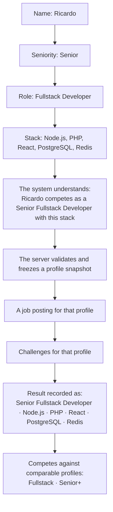
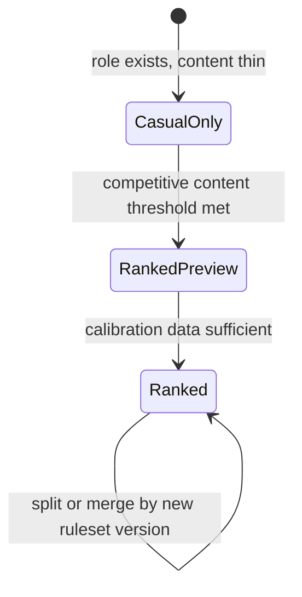

# Competitive identity: compete as who you are

> Part 1 · Product & Game Design · Status: **Draft for review (revision 2)**
>
> **Central principle of the product.** It replaces the first ranked design (one global daily job for everyone), which forced every player into the same position regardless of their profile. See the [decision log](../case-study/decision-log.md) (D-028 onwards) and the [case-study notes](../case-study/01-product-definition.md#11-revision-competing-as-who-you-are).

## 1. The principle

> **Every run is played *as* a professional profile: a seniority, a role and a stack. That profile shapes the job, the questions and the competition, is frozen by the server when the run starts, and stays attached to the result forever.**

The experience we want:

Three consequences:

1. **Personal:** a Junior Frontend developer gets a Junior Frontend job and questions; a Senior Fullstack developer gets a Senior Fullstack job and questions. Nobody plays someone else's job.
2. **Fair by comparison group:** players are ranked against **comparable profiles** (a *competitive category*), not against everyone.
3. **Context is part of the result:** a score never appears without the profile it was achieved with.

## 2. Taxonomy: role → track, seniority → band, category

### 2.1 Roles (catalog, extensible)

MVP catalog (13 roles): Frontend Developer · Backend Developer · Fullstack Developer · Mobile Developer · DevOps Engineer · Cloud Engineer · QA Engineer · QA Automation Engineer · Data Engineer · Data Scientist · Machine Learning Engineer · Cybersecurity Engineer · Software Architect.

Adding a role is a **content change**: the role, its track, its technology categories (core and allowed), its seniority constraints and its translations. No code changes. Engineering Manager, Product Manager and UX/UI Designer are candidates for later: they need non-technical content of a different kind.

### 2.2 Tracks (competitive families)

A **track** groups roles that are fairly compared with the same kind of content. The mapping is configuration.

| Track | Roles | MVP ranked status |
|---|---|---|
| **Frontend** | Frontend Developer | **Official** |
| **Backend** | Backend Developer | **Official** |
| **Fullstack** | Fullstack Developer | **Official** |
| **Platform** (DevOps & Cloud) | DevOps Engineer, Cloud Engineer | Preview → official when content is ready |
| Mobile | Mobile Developer | Casual only |
| Quality | QA Engineer, QA Automation Engineer | Casual only |
| Data Engineering | Data Engineer | Casual only |
| Data Science & ML | Data Scientist, Machine Learning Engineer | Casual only |
| Security | Cybersecurity Engineer | Casual only |
| Architecture | Software Architect (Senior and above, proposed) | Casual only |

**Why group these roles:** DevOps and Cloud engineers share most of their content (containers, CI/CD, IaC, cloud services), and so do QA and QA Automation. Data Engineering and Data Science are kept apart because pipelines and statistics are different skills.

### 2.3 Seniority bands

| Band | Seniorities |
|---|---|
| **Junior** | Trainee, Junior |
| **Mid** | Mid |
| **Senior+** | Senior, Lead, Staff, Principal |

The player always **declares and displays their exact seniority** ("Staff Fullstack Developer"). The band only decides the comparison group and the ranked difficulty curve.

### 2.4 Competitive category = track × band

Examples: **Fullstack · Senior+**, **Backend · Mid**, **Frontend · Junior**, **Platform · Mid**.

In the MVP, **9 official categories**: Frontend, Backend, Fullstack × Junior, Mid, Senior+. Platform's 3 categories start in preview. The model allows up to ~28 categories in the long run (10 tracks × 3 bands; Architecture is Senior+ only), activated progressively.

## 3. Choosing the grouping level

### 3.1 Bands

| Option | Categories (×10 tracks) | Fairness | Population per board | Verdict |
|---|---|---|---|---|
| 7 bands (one per seniority) | 70 | Best | Tiny (Trainee, Staff and Principal boards would be empty) | ❌ |
| 2 bands (Early career / Experienced) | 20 | A Mid and a Principal on the same curve | Large | ❌ |
| **3 bands (Junior, Mid, Senior+)** | **30** | Good: distinct difficulty curves; Trainee ≈ Junior content | Healthy | ✅ **Recommended** |
| 4 bands (Junior, Mid, Senior, Lead+) | 40 | Better for Lead/Staff/Principal | Thinner | ⏸ A future split |

Why Senior+ groups Senior, Lead, Staff and Principal: in a 3-minute run, the technical questions that separate a Senior from a Staff engineer are few. The difference is mostly scope and leadership, which this format barely measures. Staff and Principal fields would be too small for meaningful daily boards. When Senior+ fields are large, the band can be split.

### 3.2 Tracks

| Option | Count | Verdict |
|---|---|---|
| One track per role | 13+ | ❌ Too fragmented; near-identical content (DevOps vs Cloud) |
| **Professional families** | **10** | ✅ Recommended: fair content comparison, manageable count |
| Super-families (Engineering, Infra, Data, Quality) | 4 | ❌ Mixes Frontend and Backend content; unfair comparisons |

### 3.3 Progressive growth instead of empty boards

Categories have a lifecycle, managed as configuration:

- **Casual only:** playable in casual; the ranked option shows "Ranked coming soon for Mobile — help us unlock it", linking to the contribution guide. The content gap becomes a contributor funnel.
- **Ranked preview:** ranked runs are possible, with a leaderboard labeled **Preview**: no champions, no Weekly Top 7. The runs calibrate question difficulty.
- **Ranked (official):** leaderboards, Daily Champion, Weekly Top 7, Candidate of the Week.
- **Split or merge:** a band can be split (Senior+ → Senior | Lead+) or tracks split (Platform → DevOps | Cloud) when fields are consistently large, or merged if dead. Each change is a new **ruleset version**; history keeps the categories that existed when results were achieved.

Thresholds (initial proposals, all configuration): enter preview when every ranked slot of the band has eligible families (see [fairness › content equivalence](../game-design/fairness.md#4-content-equivalence)); become official after ~2 weeks of preview with calibrated families; consider a split when the median daily field stays above ~200 for 4 weeks.

**Rejected alternative: dynamic pooling** (merge small categories automatically each day). The meaning of a title would change from day to day ("Champion of… whatever got pooled today"), which is confusing and hard to explain publicly.

## 4. Profile validation (server-side)

The client *asks* to play as a profile. The server **validates** it before creating the run:

| Check | Rule (product level) |
|---|---|
| Role | Exists and is active in the catalog |
| Seniority | Exists, and is allowed for the role (e.g. Software Architect: Senior and above, proposed) |
| Technologies | Exist and are active; deduplicated; **1–12** selected |
| Stack compatibility | Each role defines **core** technology categories (at least one technology required from each) and **allowed** categories (anything else is rejected). Fullstack: core = Frontend + Backend; allowed = Databases, Caching/Search, Messaging, Cloud, Infrastructure, Testing. Frontend: core = Frontend (web). Mobile: core = Mobile. |
| Display name | Moderation rules (see [privacy](public-profile-and-privacy.md#6-display-names-and-moderation)) |
| Mode | Ranked requires the category to be in preview or official, attempts left today, and a profile consistent with today's ranked lock (section 6) |

Errors use semantic codes (`PROFILE_ROLE_UNKNOWN`, `PROFILE_TECHNOLOGY_INCOMPATIBLE`, `RANKED_PROFILE_LOCKED`…), translated by the client.

## 5. The profile snapshot

When the server creates a run, it stores an **immutable snapshot** of the competing profile:

| Field | Example |
|---|---|
| Display name at the time | Ricardo Vera (for audit; public display follows the current public profile) |
| Seniority + band | Senior · Senior+ |
| Role + track | Fullstack Developer · Fullstack |
| Category | Fullstack · Senior+ |
| Technologies (ordered) | Node.js, NestJS, PHP, React, PostgreSQL, Redis, Kafka, Docker |
| Mode | Ranked |
| Locale | es |
| Versions | Catalog, ruleset, blueprint, scoring |

Rules:

- **Frozen for the whole run.** No request after creation can change role, seniority or technologies. Profile fields sent later are ignored and logged as anomalies.
- **Every server decision uses the snapshot**: the job, question selection, difficulty, ATS relevance, bots, scoring and the leaderboard category. The client is never asked "who are you?" again.
- **Historical truth:** if Ricardo switches to Backend Developer tomorrow, yesterday's result still says *Senior Fullstack Developer · Node.js · PHP · React…*.
- **Identity vs context:** the *who* (display name, LinkedIn, public or anonymous) is current and revocable. The *as what* (seniority, role, stack) is historical and frozen.

## 6. Ranked profile lock

To prevent category hopping (farming several categories in a day) and stack shopping:

- **Daily lock:** the first ranked run of a UTC day locks the player's ranked profile (role, seniority, stack) **until the end of that day**. The 3 daily ranked attempts all use the same category and stack. Casual stays completely free.
- **Category cooldown (proposal):** changing track or band for ranked is allowed at most **once every 7 days**. Real promotions are fine; hopping between categories every day is not. A tunable.

The profile screen states it before a ranked run: "You'll compete today as **Senior Fullstack Developer** · Node.js · PHP · React… This ranked profile is locked until 00:00 UTC (19:00 your time)."

## 7. Context everywhere

The competing context travels with every result:

> **Ricardo scored 18,492 points competing as a Senior Fullstack Developer.**
> Node.js · PHP · React · PostgreSQL · Redis
>
> **Ricardo consiguió 18.492 puntos compitiendo como Senior Fullstack Developer.**
> Node.js · PHP · React · PostgreSQL · Redis

| Surface | What it shows |
|---|---|
| Results screen | The sentence above, the stack, the category and provisional rank ("#1 of 41 today in Fullstack · Senior+"), ATS, Recruiter, Technical, CV Health, position |
| Category leaderboard row | Name, exact seniority + role, stack chips, score, LinkedIn |
| Daily Champion, Weekly Top 7, Candidate of the Week | The same context |
| Share card and share page | The same context (respecting public or anonymous status) |
| Personal history | Every past run with its snapshot context |
| Public profile and future seasons, Skill Passport | Results always shown with their context |

Display rules:

- **Stack chips:** up to 5, prioritizing technologies that actually appeared in the run, then the declared order; "+N" for the rest.
- **Role titles** come from the catalog and are translatable; Spanish keeps the common English titles ("Senior Fullstack Developer"), which is how the industry speaks.
- **Numbers** follow the locale (18,492 in English, 18.492 in Spanish from Spain).
- **Anonymous players** show only "Anonymous Candidate" and the score. Their category is implied by the board they appear on; the exact seniority, role and stack are not shown, because a rare combination could identify someone in a small field.

## 8. What declaring a profile can and cannot do

| A player declares… | Effect |
|---|---|
| Their real profile | Personal job and questions; competes against comparable profiles |
| A **higher** seniority | Harder questions, stronger competitors. No advantage. |
| A **lower** seniority ("smurfing") | Moves them to a *different* competition (e.g. Junior). It does not make any competition easier. Mitigations: section 6 locks; the result is publicly labeled "competing as Junior…" next to their name and LinkedIn; reports. See [fairness](../game-design/fairness.md#3-smurfing-and-category-hopping). |
| A different role | A different track; the same mitigations |
| A different stack | Changes the topic of a **bounded** share of questions; it does not change their difficulty |

**The showcase is the reward, and the showcase is also the deterrent.** The value of ranking is being seen as a professional. A public "#1 competing as Junior Frontend" next to a LinkedIn profile that shows 10 years of experience costs more reputation than it earns.
