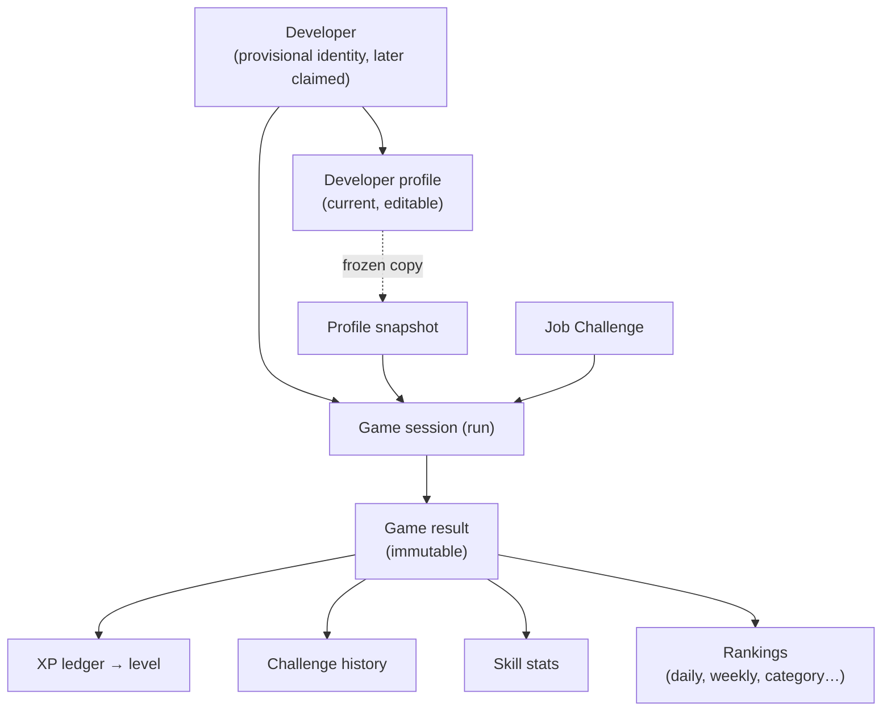
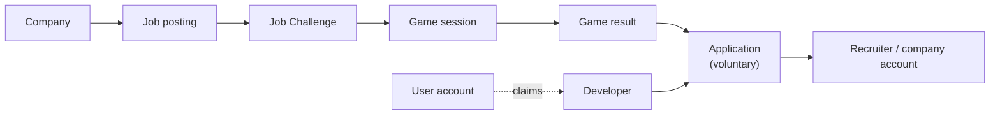

# Domain concepts and assumptions (product level)

> Part 1 · Product & Game Design · Status: **Approved (revision 4)**
>
> A conceptual map of the domain, written so that Part 2 (architecture) starts from the right center. These are **concepts**, not tables or classes. Part 2 decides aggregates, boundaries and persistence.

## 1. The center of the domain

The domain is built around the **developer and their persistent progress**, not around a daily challenge.

**Architectural north:** Developers → Games → Progress → Reputation inside CV Rush → Jobs → Applications → Recruiters. Today the domain implements the first three links (Developers → Games → Progress, with rankings as one view of progress); the rest must be addable without changing the center.

Later stages extend it without changing the center:

## 2. Concepts

### Stage 1 (MVP)

| Concept | Description |
|---|---|
| **Developer** | The person's identity in CV Rush: a server-generated ID, display name, optional contact identifiers (private `contactEmail`, `linkedinIdentifier`) with verification status, `linkedinVisibility`, `profileVisibility`, consents, `lastActiveAt`. Created at light onboarding, provisional until claimed. Owns everything else. |
| **Device credential / management link** | How a provisional developer is recognised without an account |
| **Consent** | A recorded decision per purpose (terms, public visibility, LinkedIn display, email communication) with its text version and timestamp |
| **Developer profile** | The current declared seniority, role, stack and links |
| **Catalog** | Roles, seniorities, seniority bands, tracks, technologies, technology categories, role compatibility rules |
| **Company** | The employer in a job posting. Fictional in the MVP (generated, or the Daily Company); a real company later |
| **Job posting** | A job description. Generated for the developer's profile in the MVP; published by a company later |
| **Job Challenge** | What a run is played against: the job posting + the challenge blueprint (stages, slots, difficulty) + its context. **Source-agnostic**: `generated` (per run), `daily` (Daily Company feature), later `job_posting` (Play to Apply) |
| **Game session (run)** | One playthrough of a Job Challenge, as a frozen **profile snapshot**, of an explicitly chosen run type (ranked or practice), with a state machine and server-side seed |
| **Ranked attempt** | One of the developer's 3 daily ranked attempts, committed server-side when a competitive session starts |
| **Challenge (stage instance)** | Recruiter Screening, ATS Scan, Hiring Manager, Final Interview inside a session, opened just in time |
| **Question attempt** | A served question version (with option order), the answer, the timings and the result |
| **Question** | Versioned content with source (AI-generated, curated, community, job-derived, template), verification tier, **lifecycle state** (competitive, retired, practice, invalidated…), generation metadata, technology/topic tags, difficulty, translations |
| **Question context / pool** | The set of questions available for a context (e.g. Redis × level 3), with rotation, exposure and regeneration data |
| **Game result** | The immutable outcome of a session: status, score breakdown, position, accuracy, the competing context, the season |
| **XP ledger entry** | An append-only XP award (or correction) referencing its source |
| **Progression** | Lifetime XP and level (derived), later season XP |
| **Challenge history** | The developer's list of results with context (a projection) |
| **Skill stats** | Per-technology and per-topic gameplay statistics (a projection) |
| **Ranking** | A projection of results over a **scope**: period (day, week, season, all-time) × dimension (category, technology, XP) |
| **Title** | A recorded award such as Daily Champion of a category on a date |
| **Season** | A competition period that results and XP are tagged with (Season 0 at launch) |
| **Question report** | Post-run feedback on a question version |
| **Analytics event** | A domain event with non-sensitive metadata |

### Later stages (designed for, not built)

| Concept | Stage |
|---|---|
| **User account**, verified identities, **account claim**, developer merge | 2 |
| **Public developer page** (slug, sections), badges, portfolio, **Open to Work** | 2 |
| **Real company**, **company account** | 3–4 |
| **Job posting** (published), **Play to Apply**, **Application** | 3 |
| **Recruiter account**, developer search, applicant views, messaging | 4 |

## 3. Domain assumptions (invariants)

1. **A Developer exists before any game** and before any account. Its ID is generated by the server and is never derived from email or name.
2. **Accounts attach to Developers** through a claim; the Developer remains the owner of all history. Claims require proof of control; unverified identifiers never trigger merges.
3. **Every game session has a frozen profile snapshot.** Nothing after its creation can change the role, seniority or stack it is played as.
4. **Game results are immutable.** Corrections (e.g. a disqualification) are new records, not edits.
5. **XP is derived from results through an append-only ledger**, awarded once per result.
6. **History, skill stats, rankings, titles and public profile views are projections** of results and attempts. They can be rebuilt and evolve without data migrations of the source facts.
7. **Daily Challenge, Daily Company and Seasons are features or scopes**, not the center of the model.
8. **Job Challenges are source-agnostic.** The game doesn't care whether a job was generated or published by a real company.
9. **The email is private** and has no public option: it is never a public identifier, a slug or a ranking label, and never appears in analytics. Contact identifiers are **optional** and never required to play.
10. **Every claim identifier has a verification status.** Nothing in the UI implies verification that didn't happen.
11. **Visibility levels are separate consents**: public on rankings, public page, Open to Work, discoverable by recruiters, per-application sharing.
12. **Questions are versioned**, with source and verification level, and served just in time. Answer keys never reach the client.
13. **Names are brand-agnostic.** "CV Rush" appears only in branding.
14. **Results are gameplay statistics**, never certifications. That shapes the wording, not just the UI.
15. **A question active in competitive rotation never appears in practice.**
16. **Ranked is always an explicit choice**, and a ranked attempt, once committed, is never returned.

## 4. Open questions for Part 2

- Aggregate boundaries (e.g. is Progression part of Developer, or its own module fed by result events?).
- How each projection is updated: in the same transaction as the result, through in-process domain events, or asynchronously with a queue. Decide per projection, and avoid eventual consistency where it isn't needed (e.g. XP shown on the result screen).
- How emails are stored for lookup without exposing them (e.g. encryption plus a keyed hash).
- How device credentials and management links are issued, rotated and revoked.
- How the AI question pipeline is isolated (asynchronous jobs, budgets, provider abstraction).
- How rankings are computed and stored (database views, Redis sorted sets, materialized tables).
