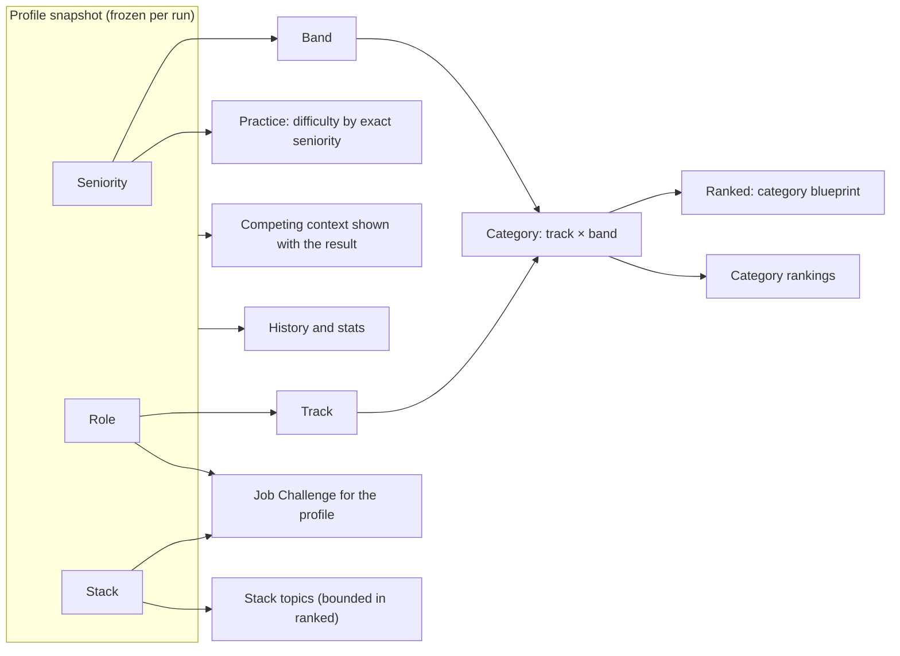

# Job Challenges, ranked runs and practice runs

> Part 1 · Product & Game Design · Status: **Draft for review (revision 3: developer network)**
>
> Every run is a **Job Challenge** played as the developer's frozen profile snapshot (see [competitive identity](competitive-identity.md)). Revision 3 keeps the profile-first design and makes the **Daily Challenge a feature**, not the center: the center is the developer and their persistent progress (see [domain concepts](domain-concepts.md)).

## 1. Every run is a Job Challenge for your profile

1. The developer has a profile (seniority, role, stack). The server freezes it into the run's **profile snapshot**.
2. The server builds a **Job Challenge**: a job posting for that profile plus the challenge blueprint (stages, question slots, difficulty, timers).
3. The developer plays it in the 2D runner.
4. The **game result** (score, position, accuracy, context) awards **XP**, joins the **history**, updates **stats** and, for ranked runs, feeds the **rankings**.

There are two **run types**:

| | **Ranked run** | **Practice run** |
|---|---|---|
| When | The first **3** runs a developer starts each UTC day (unless they choose practice) | Anytime; all runs after the 3 ranked ones |
| Purpose | Fair comparison with comparable profiles | Personalization, learning, fun |
| Job Challenge | At **today's company** (the Daily Challenge feature), generated for the profile | At a random fictional company, generated for the profile |
| Difficulty | The **category's band curve** (Junior, Mid, Senior+), identical within the category | The **exact seniority** curve (7 levels), with mild adaptivity |
| Questions | Ranked partition of the question pools | Practice partition of the pools; occasional humor questions |
| Rankings | ✅ Counts (best ranked score per day and week, per category) | ❌ |
| XP, level, history, stats | ✅ | ✅ (history labeled "Practice"; XP with daily diminishing returns) |
| Profile | **Locked for the rest of the UTC day** after the first ranked run | Free to change between runs |
| Pause | Never (the server clock runs) | Between stages |
| Timers | Standard, identical within the category | Standard; optional "relaxed timers" |
| Bots | The category's daily field | A random field |
| Post-run review | Results and topics; ranked answer keys stay hidden | Correct answers and explanations |

The "Play" button starts a ranked run while ranked runs are left ("Ranked · 2 of 3 left today"); a "Practice" option is always available.

**Why both run types share XP:** XP measures engagement and achievement over time ("Junior Backend, CV Rush Level 30 because they play a lot"). Rankings measure comparable performance. Keeping these separate lets the profile grow with every run while keeping rankings fair.

## 2. Practice runs

- **The job** is generated for the snapshot at a random fictional company (see [job generation](../game-design/job-generation.md)).
- **The difficulty follows the exact seniority**: a Trainee sees fundamentals, a Staff engineer sees distributed-systems trade-offs (see [levels](../questions/question-strategy.md#4-difficulty-scale-and-seniority-bands)).
- **Mild adaptivity:** after two consecutive technical misses, the next technical slot drops one level (never below the seniority's floor).
- **Learning:** the review shows correct answers and explanations. They come from the **practice partition** of each question pool, so revealing them doesn't expose ranked answers.
- **Unlimited**, with XP subject to daily diminishing returns (see [progression](../game-design/progression.md#2-xp)).

## 3. Ranked runs

### 3.1 Principle: a personal job, a comparable competition

> **You apply to a job that fits your profile, and you are ranked against people with a comparable profile.**

- Ricardo (Senior · Fullstack · Node.js, PHP, React, PostgreSQL, Redis) gets a **Senior Fullstack Developer** job and is ranked in **Fullstack · Senior+**.
- Andrea (Junior · Frontend · JavaScript, React, CSS) gets a **Junior Frontend Developer** job and is ranked in **Frontend · Junior**.

### 3.2 The Daily Challenge: a feature, not the center

The **Daily Challenge** is a layer on top of ranked runs:

> **"Today, Kestrel Pay (fintech, payments at scale) is hiring. Apply as who you are."**
> 237 candidates applied today · 41 in Fullstack · Senior+

- One fictional **Daily Company** per UTC day, with a domain theme, "hiring across every track and level". It is scheduled in advance and secret until 00:00 UTC.
- Ranked Job Challenges that day are generated **at that company**, for each developer's profile.
- It gives the community a shared story and share copy, and themes the shared scenario questions.
- The model doesn't depend on it. Without a Daily Company, ranked runs would still work with generated companies; rankings are scopes over results.

| Option considered | Verdict |
|---|---|
| A. One global daily job for everyone | ❌ Ignores the profile (rejected in revision 2) |
| B. A curated daily job per category | ❌ Ignores the individual stack; heavy curation |
| C. On-demand generation only | ✅ The base mechanism (it's how every Job Challenge is built) |
| **D. C + a Daily Company and category blueprints for ranked runs** | ✅ **Recommended**: personal jobs, fair categories, a shared daily story |

### 3.3 The Category Blueprint

Every ranked run in the same category on the same day follows the same blueprint. Difficulty per slot depends on the **band**:

| Stage | Slot | Content type | Source | Junior | Mid | Senior+ | Window |
|---|---|---|---|---|---|---|---|
| Recruiter Screening | R1 | Job memory | Template on the developer's job | 2 | 2 | 2 | 10 s |
| Recruiter Screening | R2 | Job memory or recruiter | Template on the developer's job | 2 | 2 | 2 | 10 s |
| Recruiter Screening | R3 | Salary (graded) | Template on the job's salary range | 2 | 2 | 2 | 10 s |
| ATS Scan | — | Keywords | The developer's job keywords; **composition fixed per category** | — | — | — | ~25 s |
| Hiring Manager | H1 | **Stack** | Pool for one of the developer's technologies | 1 | 2 | 3 | 15 s |
| Hiring Manager | H2 | **Track fundamentals** | The category's pool, the same daily selection for everyone | 2 | 3 | 3 | 15 s |
| Hiring Manager | H3 | **Seniority**: situational or architecture, themed by the company | The band's pool, the same daily selection | 2 | 3 | 4 | 15 s |
| Final Interview | F1 | **Mixed**: scenario + the developer's stack | Scenario template or the band's pool | 2 | 3 | 4 | 20 s |

That makes **7 questions per run** (configurable between 5 and 10), drawn from larger pools. All values are initial and tunable. Practice runs use the same structure with the exact-seniority levels.

### 3.4 Content mix and topic boundaries

Each run combines **job questions** (R1–R3), **stack questions** (H1, part of F1), **role fundamentals** (H2), **seniority questions** (H3, F1) and **shared fundamentals** (HTTP, Git, testing, security basics, inside the role and seniority pools).

**Topic boundaries:** technical questions only come from the developer's stack, their track's fundamentals and shared fundamentals. No Swift, Kotlin or machine learning for a Fullstack web profile unless it's in their stack. **Coverage fallback:** without a usable pool for any of the developer's technologies, H1 uses the track fundamentals pool at the same level.

### 3.5 Bounded personalization

In ranked, the stack changes **which topic** some questions are about, not **how hard** they are, and it affects a bounded share of the score:

| Band | Stack-influenced slots | Share of answer points | Share of the total score (answers = 45%) |
|---|---|---|---|
| Senior+ | H1 (weight 3) + F1 (weight 4, partly) | ≤ 35% | ≤ ~16% |
| Mid | H1 (2) + F1 (3, partly) | ≤ ~29% | ≤ ~13% |
| Junior | H1 (1) + F1 (2, partly) | ≤ ~23% | ≤ ~10% |

As data accumulates, question pools are calibrated per technology and level (see [fairness](../game-design/fairness.md#4-content-equivalence)).

### 3.6 What varies per run

The questions drawn from each pool, which job facts are asked, option order, question order among equal-difficulty slots, the ATS stream (with fixed composition and reachability constraints) and obstacle layouts. All of it comes from a **server-side seed** that is never sent to the client.

### 3.7 Attempts, lock and daily window

- **3 ranked runs per developer per UTC day**; the best counts for the daily ranking (and the best of the week for the weekly one). Abandoned ranked runs count.
- **The profile locks for the day** at the first ranked run, so all ranked runs are in the same category with the same stack. A cooldown on category changes is deferred to V1 (see [competitive identity](competitive-identity.md#6-ranked-profile-lock)).
- The day is UTC and displayed in local time ("Daily Challenge ends in 04:32:18").

### 3.8 What ranked deliberately does not do

No adaptivity, no scored humor, no pause, no profile changes during the day after the first ranked run, no revealing ranked answer keys, and no cross-category score comparisons.

## 4. Job Challenge sources

| Source | Company | Job posting | Stage |
|---|---|---|---|
| `generated` | A random fictional company | Generated for the profile | MVP (practice) |
| `daily` | The Daily Company | Generated for the profile at that company | MVP (ranked) |
| `job_posting` | A real company | Published by the company; the challenge is derived from it | Stage 3: **Play to Apply** |

The game session, results, XP and history work the same way whatever the source. That is what lets "Play to Apply" arrive later without redesigning the game.

## 5. What the profile affects

## 6. Alternatives considered

| # | Alternative | Verdict | Why |
|---|---|---|---|
| 1 | One global ranking with difficulty by declared seniority | ❌ | Declaring a low seniority beats everyone |
| 2 | Difficulty by seniority + a score multiplier | ❌ | Exploitable in the other direction |
| 3 | One global daily job for everyone (revision 1) | ❌ Rejected by the maintainer | Ignores the profile |
| 4 | Daily Challenge as the center of the domain (revision 2) | ❌ Reframed in revision 3 | The center is the developer and their progress; the Daily Challenge is a feature |
| 5 | Elo-like rating with adaptive difficulty | ⏸ V2+ idea | Needs accounts, volume and calibrated content |
| 6 | Exactly the same questions for everyone | ❌ | Shared in minutes |
| 7 | Every run counts for rankings (no ranked limit) | ❌ | With pools of ~20 questions per context, grinding means memorizing |
| 8 | **Profile-first Job Challenges; ranked runs (3/day, category blueprint) + practice runs; Daily Challenge as a feature** | ✅ **Chosen** | Personal, fair within comparable groups, progression for everyone |

## 7. Open questions for review

1. Should the first 3 runs of the day be ranked **by default**, or should the developer explicitly choose ranked each time?
2. Is the **ranked/practice partition** of question pools acceptable (fewer ranked questions per context, but practice can reveal answers)?
3. Should practice XP be equal to ranked XP, or slightly lower?
4. Category cooldown: deferred to V1. Is the daily lock enough for the MVP?
