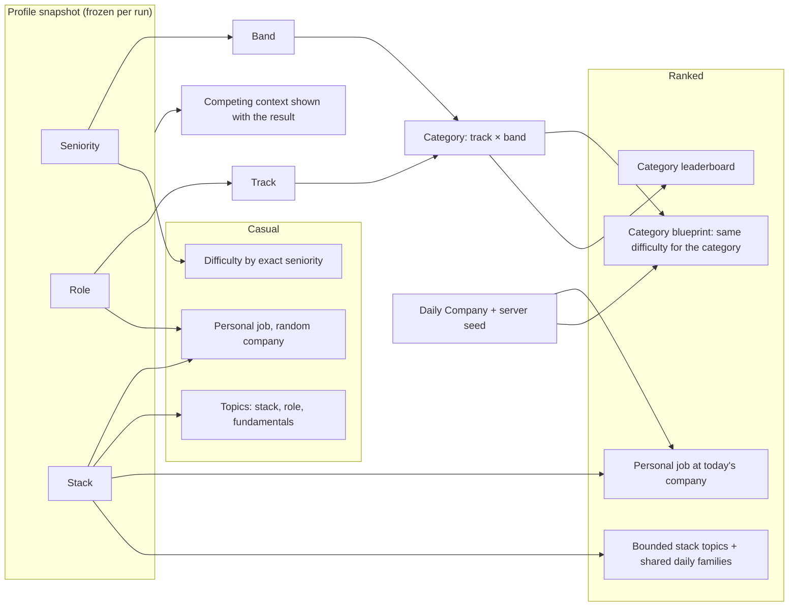

# Game modes: Casual (Personalized) and Ranked (Daily Challenge)

> Part 1 · Product & Game Design · Status: **Draft for review (revision 2)**. One of the product's main decisions.
>
> Revision 2 makes both modes **profile-first**: every run is played as the player's declared seniority, role and stack, frozen in a server-side snapshot. See [competitive identity](competitive-identity.md), the central principle. The first design (one global daily job for everyone) was rejected; see [section 6](#6-alternatives-considered).

## 1. Both modes start from the profile

Every run, casual or ranked, starts from the player's profile (name, seniority, role, stack). The server validates it and freezes it into the run's **profile snapshot**. Both modes generate a job posting **for that profile**, and the questions correspond to what the player declared.

The modes differ in **what they optimize**:

| | **Casual / Personalized** | **Ranked / Daily Challenge** |
|---|---|---|
| Optimizes for | Maximum personalization, fun, learning | Fair competition among comparable profiles |
| Job posting | Generated for the profile; random fictional company | Generated for the profile, at **today's company** (shared by everyone that day) |
| Difficulty | Follows the **exact** seniority (7 levels) | Follows the **category's band curve** (Junior, Mid, Senior+), the same for everyone in the category |
| Question topics | The player's stack ∩ the job, role fundamentals, shared fundamentals | The same boundaries, with a **fixed, bounded share** of stack-specific questions |
| Question sources | Community packs + job-derived + templates | Competitive pool (shared daily families for the category + stack families) + job-derived + templates |
| Adaptivity | Mild (eases after repeated misses) | None |
| Humor questions | Occasional, low stakes | Not scored |
| Attempts | Unlimited | **3 per day**, best counts; the ranked profile is locked for the day |
| Pause | Between stages | Never (the server clock runs) |
| Timers | Standard, with optional "relaxed timers" | Standard, identical within the category |
| Bots | Random field per run | **Same daily field for the whole category** |
| Post-run review | Correct answers, explanations, attribution | Results and topics; competitive answer keys stay hidden |
| Competes against | Your own personal best | Your **category**: track × band (e.g. Fullstack · Senior+) |
| Leaderboards | Personal bests only (MVP) | Category leaderboards, Daily Champion, Weekly Top 7, Candidate of the Week |

## 2. Casual / Personalized mode

**Purpose:** "This is *my* hiring process", with no competitive constraints.

- **Job:** generated from the snapshot (role, exact seniority, stack) at a random fictional company (see [job generation](../game-design/job-generation.md)).
- **Difficulty follows the exact seniority.** A Trainee and a Junior get different curves; a Staff engineer gets distributed-systems trade-offs (see the [bands](../questions/question-strategy.md#4-difficulty-scale-and-seniority-bands)).
- **Mild adaptivity:** after two consecutive technical misses, the next technical slot drops one level (never below the seniority floor).
- **Content:** community packs (public answers, fine here), job-derived questions and templates. Questions stay within the player's stack, role and shared fundamentals.
- **Learning:** a full post-run review with correct answers, explanations and author attribution.
- **Unlimited runs**, personal bests per profile, a shareable result with context ("played as Senior Fullstack Developer").
- **No ranked constraints:** the profile can be changed freely between runs.

## 3. Ranked / Daily Challenge mode

### 3.1 Principle: a personal job, a comparable competition

> **You apply to a job that fits your profile, and you compete against people with a comparable profile.**

- Ricardo (Senior · Fullstack · Node.js, PHP, React, PostgreSQL, Redis) gets a **Senior Fullstack Developer** job and competes in **Fullstack · Senior+**.
- Andrea (Junior · Frontend · JavaScript, React, CSS) gets a **Junior Frontend Developer** job and competes in **Frontend · Junior**.
- Nobody is forced into "today's global job".

### 3.2 What "Daily Challenge" means now

| Option | Description | Pros | Cons | Verdict |
|---|---|---|---|---|
| A. One global daily job | Everyone plays the same position | Perfectly comparable | Ignores the profile; Andrea would play Senior Backend | ❌ Rejected (revision 1) |
| B. A scheduled daily job per category | One curated job per track × band per day | Very fair within the category; strong daily ritual | Curating 9–28 jobs per day; **ignores the individual stack** | ❌ As the main model |
| C. On-demand generation only | Each run generates a job and challenges from verified templates and the profile | Fully personal; scales to any category | No daily element; fairness relies entirely on calibration | ⚠️ Good for casual; too loose for ranked alone |
| **D. Hybrid: Daily Company + Category Blueprint + personal job** | Every UTC day, one fictional **company** with a **domain theme** is hiring across every track and level. Each category gets a **daily blueprint** (structure, difficulty curve, shared question families, ATS composition, bots). Each player's **job** is generated on demand from their snapshot, at that company, inside that blueprint. | Personal job and stack; comparable within the category; a shared daily story for the whole community; no manual daily curation; new categories come from content, not curation | Stack-specific questions vary between players (bounded and calibrated); depends on generator quality | ✅ **Recommended** |

The Daily Challenge is therefore:

> **"Today, Kestrel Pay (fintech, payments at scale) is hiring. Apply as who you are."**
> 237 candidates applied today · 41 in Fullstack · Senior+

- The **Daily Company** (name, sector, domain theme, culture quirks) is picked from a reviewed pool, scheduled in advance, and **secret until 00:00 UTC**.
- It gives everyone a shared topic of conversation and share copy ("I applied to Kestrel Pay today as a Senior Fullstack Developer…") without forcing a shared position.
- Themed scenario questions (e.g. idempotent payments for a fintech, flash sales for e-commerce) are shared within each category that day.

### 3.3 The Category Blueprint

Every ranked run in the same category on the same day follows the same blueprint. Difficulty per slot depends on the **band**:

| Stage | Slot | Content type | Source | Junior | Mid | Senior+ | Window |
|---|---|---|---|---|---|---|---|
| Recruiter Screening | R1 | Job memory | Template on the player's job | 2 | 2 | 2 | 10 s |
| Recruiter Screening | R2 | Job memory or recruiter | Template on the player's job | 2 | 2 | 2 | 10 s |
| Recruiter Screening | R3 | Salary (graded) | Template on the band's salary range | 2 | 2 | 2 | 10 s |
| ATS Scan | — | Keywords | The player's job keywords; **composition fixed per category** | — | — | — | ~25 s |
| Hiring Manager | H1 | **Stack** | A competitive family for one of the player's technologies | 1 | 2 | 3 | 15 s |
| Hiring Manager | H2 | **Track fundamentals** | The category's **shared daily family** | 2 | 3 | 3 | 15 s |
| Hiring Manager | H3 | **Seniority**: situational or architecture, themed by the Daily Company | The band's **shared daily family** | 2 | 3 | 4 | 15 s |
| Final Interview | F1 | **Mixed**: daily scenario + the player's stack | Scenario template or shared daily family | 2 | 3 | 4 | 20 s |

All values are initial and tunable.

### 3.4 Content mix: personal, but not arbitrary

Each ranked run combines:

| Ingredient | Where | Shared within the category today? |
|---|---|---|
| **Job questions** (memory, recruiter, salary) | R1–R3, part of F1 | The same templates; facts from each player's own posting |
| **Stack questions** | H1, part of F1 | Personal topic, **same difficulty level** |
| **Role (track) fundamentals** | H2 | ✅ Shared family |
| **Seniority questions** (situational, architecture, trade-offs) | H3 | ✅ Shared family (per band) |
| **Shared fundamentals** (HTTP, Git, testing, security basics) | Inside track and band families | ✅ |

**Topic boundaries:** technical questions only come from the player's stack (∩ the technologies with eligible content), their track's fundamentals and shared fundamentals. **Never an unrelated technology:** no Swift, Kotlin or machine learning for a Fullstack web profile. The job posting may mention 1–2 role-typical technologies the player didn't select (for realism and memory distractors), but technical questions never target them.

**Coverage fallback:** if none of the player's technologies has an eligible ranked family at the band's level, H1 uses the track fundamentals pool at the same difficulty. That is fairness-neutral. The results screen says "Some of your technologies don't have ranked questions yet", with a contribution link.

### 3.5 Bounded personalization

The stack changes **which topic** some questions are about, never **how hard** they are, and it only affects a bounded share of the score:

| Band | Stack-influenced slots | Share of answer points | Share of the total score (answers = 45%) |
|---|---|---|---|
| Senior+ | H1 (weight 3) + F1 (weight 4, partly) | ≤ 35% | ≤ ~16% |
| Mid | H1 (2) + F1 (3, partly) | ≤ ~29% | ≤ ~13% |
| Junior | H1 (1) + F1 (2, partly) | ≤ ~23% | ≤ ~10% |

Stack families are **calibrated per technology and difficulty**, so a Senior+ choosing PHP and another choosing Go face comparable observed difficulty. Families that fail calibration are excluded from ranked. See [fairness](../game-design/fairness.md#4-content-equivalence).

### 3.6 What varies per run (within the blueprint)

The variant drawn from each family, which job facts are asked, option order, question order among equal-difficulty slots, the ATS stream (with fixed composition and reachability constraints) and obstacle layouts. All of it comes from a **server-side seed** that is never sent to the client.

### 3.7 Attempts, lock and daily window

- **3 ranked attempts per player per UTC day**, best counts; abandoned runs count.
- **The ranked profile locks for the day** at the first ranked run, so all attempts are in the same category with the same stack. Track or band changes for ranked: at most once every 7 days (proposal). See [competitive identity › lock](competitive-identity.md#6-ranked-profile-lock).
- The day is UTC and is displayed in local time ("Daily Challenge ends in 04:32:18"); see [leaderboards › time model](leaderboards.md#1-time-model).

### 3.8 What ranked deliberately does not do

- No adaptivity: a hard run stays hard for everyone in the category.
- No scored humor questions.
- No pause.
- No changes to the profile once the run exists (it's frozen), and no profile changes during the day after the first ranked run.
- No revealing competitive answer keys during or after the run until the question retires (see [content lifecycle](../questions/content-strategy.md#5-content-lifecycle)).
- No cross-category score comparisons (see [leaderboards](leaderboards.md#2-structure-category-first)).

## 4. What the profile affects

In ranked, seniority and role decide **which competition** you are in, the stack decides **some topics**, and **difficulty comes from the category, not from the individual**.

## 5. Fairness against answer sharing

- **Job questions** are open-book: every player reads their own posting. Sharing them gives nothing.
- **Shared daily families** (H2, H3, F1) have several equivalent variants. A cheater would need the whole family, for every slot, on the same day, in the same category.
- **Stack families** are spread across many technologies and variants.
- **3 attempts**, no revealed competitive answer keys, retiring exposed questions, and templates raise the cost of harvesting by replaying.
- **The residual risk is accepted and monitored.** See [risks](risks.md#2-abuse-and-cheating-risks-game-design-perspective).

## 6. Alternatives considered

| # | Alternative | Verdict | Why |
|---|---|---|---|
| 1 | One global ranking with difficulty by declared seniority | ❌ | Declaring a low seniority beats everyone |
| 2 | Difficulty by seniority + a score multiplier | ❌ | Exploitable in the other direction |
| 3 | **One global daily job for everyone** (revision 1 of this document) | ❌ **Rejected by the maintainer** | Ignores the profile: a Junior Frontend developer would play a Senior Backend job. Contradicts the core of the product. |
| 4 | Elo-like rating with adaptive difficulty | ⏸ V2 idea | Needs accounts, volume and calibrated content |
| 5 | Exactly the same questions for everyone | ❌ | Shared in minutes |
| 6 | Ranked without categories, normalized global score | ⏸ Later, as an *additional* view | Needs data to normalize across different challenges (see [leaderboards](leaderboards.md#3-global-comparison-alternatives)) |
| 7 | **Profile-first categories (track × band) + Daily Company + Category Blueprint** | ✅ **Chosen** | Personal, fair within comparable groups, explainable, grows progressively |

## 7. Open questions for review

1. Is a **7-day cooldown** for ranked track or band changes acceptable, or is the daily lock enough?
2. Should the **Daily Company** be one for everyone (a shared story, recommended), or one per track?
3. Should **Software Architect** be restricted to Senior and above?
4. Should casual mode get public "personal bests by profile" boards in V1, clearly separated from ranked?
