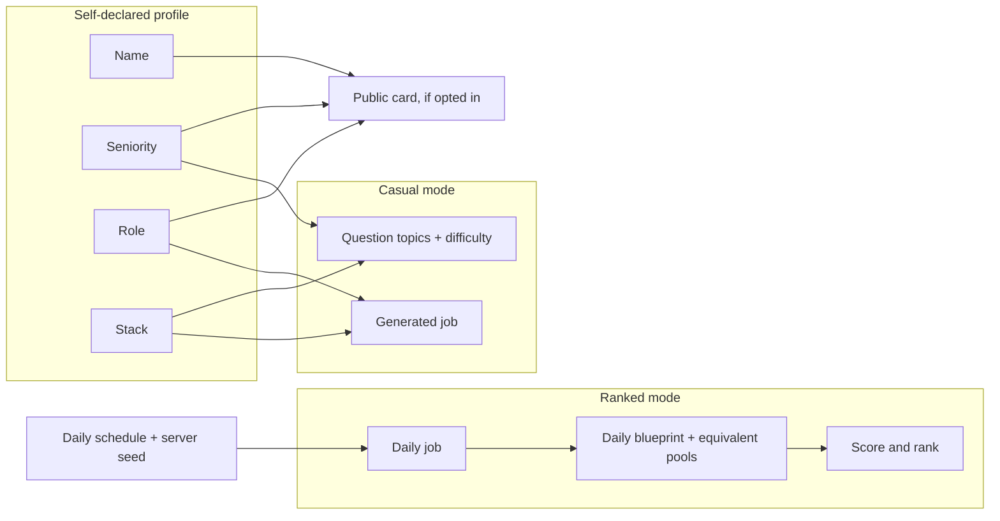

# Game modes: Casual (Personalized) and Ranked (Daily Challenge)

> Part 1 · Product & Game Design · Status: **Draft for review**. This is one of the product's main decisions.

## 1. Why two modes

The brief asks for two things that pull in opposite directions:

- **Personalization:** the job, the questions and the difficulty adapt to who you are (role, seniority, stack).
- **A fair public ranking:** one Daily Champion for everyone.

They cannot share one ruleset. If difficulty follows a **self-declared** seniority, the ranking can be gamed in both directions:

- If seniors get harder questions, the winning move is to declare yourself a **Trainee** and answer easy ones.
- If seniors get a score multiplier to compensate, the winning move is to declare yourself a **Principal**.
- We cannot verify seniority. Neither can LinkedIn, a CV or a login.

So we split the product into two modes with explicit priorities:

| | **Casual / Personalized** | **Ranked / Daily Challenge** |
|---|---|---|
| Priority | Personalization, fun, learning | Fairness, competition, daily habit |
| The job posting | Generated for the player's profile | **One job per UTC day, the same for everyone** |
| Difficulty | Follows the declared seniority | **Set by the job, identical for everyone** |
| Question topics | The player's stack ∩ the generated job | The daily job's stack |
| Question sources | Community packs + job-derived + templates | Competitive pool + job-derived + templates |
| Adaptivity | Mild (eases after repeated misses) | None |
| Humor questions | Occasional (low stakes) | Not scored (humor lives in dialogue and screens) |
| Attempts | Unlimited | **3 per day** (best counts), initial value |
| Pause | Between stages | Never (the server clock runs) |
| Timers | Standard, optional "relaxed timers" | Standard, identical for everyone |
| Bots | Random field per run, light drama tuning | **Same daily field for everyone**, no rubber-banding |
| Post-run review | Full: correct answers, explanations, attribution | Results and topics; answer keys of competitive questions stay hidden (job-derived explanations are shown) |
| Leaderboards | Personal bests only | Daily leaderboard, Daily Champion, Weekly Top 7 |
| Share card | "Senior Fullstack run · 18,492 pts" | "#1 today · 19,430 pts · Can you beat me?" |

## 2. Casual / Personalized mode

**Purpose:** "This is *my* hiring process." It is the best expression of the onboarding and the place to learn.

- The player's **role, seniority and stack** shape the generated job posting (see [job generation](../game-design/job-generation.md)).
- **Difficulty follows seniority** with the bands defined in [question strategy](../questions/question-strategy.md#4-difficulty-scale-and-seniority-bands): a Trainee sees fundamentals, a Staff engineer sees distributed systems trade-offs.
- **Mild adaptivity:** after two consecutive technical misses, the next technical slot drops one difficulty level (never below the band floor). It never raises difficulty above the band ceiling.
- **Content** comes from the open community question packs, from questions generated from the job posting, and from templates. Answers in community packs are public, which is fine here because nothing competitive is at stake.
- **Learning:** the post-run review shows correct answers, explanations and the author attribution of community questions.
- **Unlimited runs**, with personal bests per role track.
- **Not on public leaderboards** in the MVP. A casual run can still be shared as a personal result.

## 3. Ranked / Daily Challenge mode

**Purpose:** a fair daily competition, and the source of the Daily Champion and the Weekly Top 7.

### 3.1 Core principle: "the job sets the bar, not your title"

> **Self-declared data is identity, never an input to competitive difficulty or score.**

This is also realistic: in real hiring, the job's requirements define the interview. A candidate's title does not change the questions. Everyone applies to the **same job**, so everyone faces the **same bar**.

The player keeps their name, seniority, role and stack. They are shown on the public card (if the player opts in), they are used for aggregated analytics, and they appear as flavor ("Your stack matches 6 of 8 technologies in today's job"). They never change which questions you get, how hard they are, or how much they are worth.

### 3.2 The Daily Job

- **One job posting per UTC day**, identical for every ranked player: company, title, location, salary range, responsibilities, stack.
- **The track rotates by schedule** (configured as content, not code). Example MVP schedule: Mon Frontend · Tue Backend · Wed Fullstack · Thu DevOps & Cloud · Fri Backend · Sat Frontend · Sun Fullstack.
- **The level is fixed at "Mid–Senior" in the MVP**, so that scores stay comparable across days (needed for Candidate of the Week; see [leaderboards](leaderboards.md#5-candidate-of-the-week)).
- **Future daily jobs are never exposed** before they open at 00:00 UTC.
- The rotation is also good for the product mission: different disciplines win on different days, so the **Weekly Top 7 naturally showcases diverse professional profiles**.

### 3.3 The Daily Blueprint: same structure, equivalent content

Every ranked run on a given day follows the same **blueprint**: the same stages, the same question slots, the same difficulty per slot, the same timers, the same ATS stream composition, the same bot field and the same scoring rules. What changes per run is the **specific content** filling each slot.

| Stage | Slot | Source | Category | Difficulty (1–5) | Time window |
|---|---|---|---|---|---|
| Recruiter Screening | R1 | Job-derived generator | Job memory | 2 | 10 s |
| Recruiter Screening | R2 | Job-derived generator | Job memory or recruiter | 2 | 10 s |
| Recruiter Screening | R3 | Salary template (graded options) | Recruiter / salary | 2 | 10 s |
| ATS Scan | — | Stream generator with a fixed composition | Keywords | fixed | ~25 s |
| Hiring Manager | H1 | Competitive pool, daily-track topics | Stack | 2 | 15 s |
| Hiring Manager | H2 | Competitive pool | Technical or situational | 3 | 15 s |
| Hiring Manager | H3 | Competitive pool | Architecture or trade-off | 4 | 15 s |
| Final Interview | F1 | Competitive pool or scenario template | Mixed (job + stack + architecture) | 4 | 20 s |

All values are initial and tunable.

**What varies per run, within the blueprint:**

- **Equivalent questions:** each technical slot draws from a **question family**, a set of variants on the same topic, at the same difficulty, in the same format and of similar length. See [fairness](../game-design/fairness.md#4-content-equivalence).
- **Job-derived questions** ask about different facts of the same job, with generated distractors.
- **Option order** is shuffled per run, and correct positions are balanced.
- **Question order inside a stage** can be shuffled when slots share a difficulty.
- **ATS streams** are generated per run under fairness constraints: the same counts, density and maximum lane-change demands.
- **Obstacle layouts** vary per run under equivalent density.
- All of it is derived from a **server-side seed** that is never sent to the client.

### 3.4 Attempts and the daily window

- **3 ranked attempts per player per day; the best delivered run counts.** Scarcity makes each attempt matter, limits luck farming and content harvesting, and creates a daily return habit. Abandoned runs count as attempts.
- The day is defined in **UTC** and displayed in local time ("Daily Challenge ends in 04:32:18"). Details are in [leaderboards › time model](leaderboards.md#1-time-model).

### 3.5 What ranked deliberately does not do

- No adaptivity: a hard run stays hard and an easy run stays easy, for everyone.
- No scored humor questions, because a joke with a "correct" answer is a fairness liability. Humor stays in recruiter lines, bot banter and rejection screens.
- No pause.
- No difficulty or score effect from seniority, role or stack.
- No revealing competitive answer keys during or after the run. They stay private until a question is retired from the pool (see [content lifecycle](../questions/content-strategy.md#5-content-lifecycle)).

## 4. What the profile affects

There is deliberately **no arrow** from the profile into the ranked mode.

## 5. Alternatives considered

| # | Alternative | Verdict | Why |
|---|---|---|---|
| 1 | One global ranking where difficulty follows the declared seniority | ❌ Rejected | Exploitable by declaring a low seniority |
| 2 | Difficulty by seniority plus a score multiplier for harder bands | ❌ Rejected | Exploitable in the other direction, and impossible to balance without verified identity |
| 3 | Leagues by seniority (Early-career league, Open league) | ⏸ Postponed | Eligibility cannot be verified; it multiplies champions and fragments a small early audience |
| 4 | Skill rating (Elo-like) with adaptive difficulty | ⏸ Postponed (V2 idea) | Needs accounts, volume and calibrated content; opaque to players |
| 5 | **Same job, same blueprint, equivalent content** | ✅ **Chosen** | Fair by construction, explainable, resistant to sharing answers |
| 6 | Exactly the same questions for everyone (Wordle-style) | ❌ Rejected | Answers would be shared within minutes |
| 7 | Daily Challenge only, no personalized mode | ❌ Rejected | Loses the "my hiring process" magic and the learning space |

## 6. Fairness against answer sharing

The tension: identical questions are perfectly fair but trivial to share; fully different questions resist sharing but are hard to keep equally difficult. The proposal sits in the middle:

- **Open-book parts** (facts from the job posting) are the same for everyone, but the job is visible to everyone anyway. Sharing them gives nothing beyond reading carefully. That is the skill being tested.
- **Technical parts** draw from families of equivalent variants. To profit from sharing, a cheater needs the whole family, in time, for every slot.
- **Limited attempts**, no revealed answer keys, retiring exposed questions, and template-generated variants raise the cost of harvesting the pool by replaying.
- **The residual risk is accepted and monitored.** The goal is to make cheating cost more than it is worth, not to make it impossible. See [risks](risks.md#2-abuse-and-cheating-risks-game-design-perspective).

## 7. Open questions for review

1. Is a fixed **Mid–Senior** level for every Daily Job acceptable? It favors experienced players. Juniors still compete on memory, ATS and speed, and casual mode is their home. A "Junior Day" or leagues could come later.
2. Are **3 attempts per day** right? 1 attempt maximizes tension (Wordle); unlimited attempts maximize engagement but invite grinding.
3. Should the casual mode get its own public "personal track" leaderboards in V1 (e.g. "Best Senior Backend runs this week"), clearly separated from the champion?
