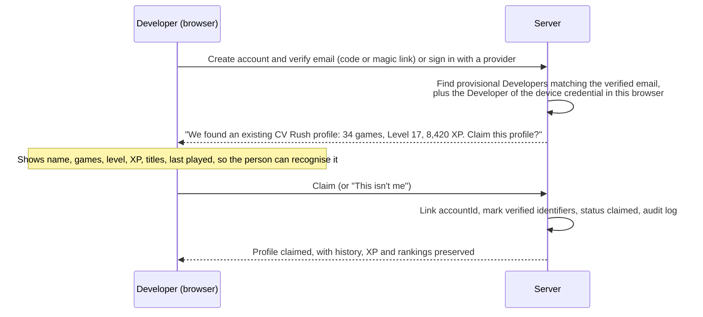

# Identity and account migration strategy

> Part 1 · Product & Game Design · Status: **Approved (revision 4)**
>
> How a developer without an account can build progress today and claim it later when accounts exist, without losing or duplicating anything. Product-level design; credentials, storage and cryptography are specified in Part 2.

## 1. The problem

- The MVP must let anyone **start fast**: no passwords, no OAuth, no account creation.
- But progress (XP, levels, history, rankings, stats) must **persist** and later be attachable to a real account.
- Typed identifiers prove nothing: writing `ricardo@example.com` doesn't prove that the person owns that inbox, and writing `linkedin.com/in/ricardovera` doesn't prove that the person is Ricardo.

## 2. The model: a Developer that exists before any account

> **`Developer` is the anchor of all history.** An account, when it exists, *attaches* to a Developer. It never replaces it.

| Concept | Description |
|---|---|
| **Developer** | Created by the server at onboarding, with a **server-generated ID** (never derived from email or name). Status: `provisional` → `claimed` (later `merged` or `deleted`). Owns the profile, game sessions, results, XP, history and rankings. |
| **Device credential** | A long random secret, stored in a secure, HTTP-only cookie, that proves "this browser is this Developer". The Developer ID itself is never a credential. A Developer can have several (devices) and they can be revoked. |
| **Management link** | A private, regenerable link that grants the same access from another device (and lets the developer edit visibility or delete data). |
| **Contact and claim identifiers** | `contactEmail` and `linkedinIdentifier`, both **optional**, each with a **verification status** (`unverified` in the MVP). Added after the first game ("Save your progress") or anytime from My Profile. They are hints for future recovery and claiming, **never proof**. |
| **Account** *(future)* | Login credentials (email verification, Google, GitHub; LinkedIn sign-in if appropriate). Linked to a Developer through `accountId` when the developer claims it. |

Conceptual fields:

```
Developer
  id                          server-generated
  status                      provisional | claimed | merged | deleted
  displayName
  role, seniority, technologies     (current professional profile)
  contactEmail                optional; private, never public, no public option exists
  emailVerificationStatus     unverified | verified
  linkedinIdentifier          optional; normalized /in/ username
  linkedinVerificationStatus  unverified | verified
  linkedinVisibility          hidden (default) | shown_on_public_profile
  profileVisibility           private (default) | public   (more levels later)
  consents[]                  purpose, granted/withdrawn, text version, timestamp
  createdAt, lastActiveAt
  claimedAt                   nullable
  accountId                   nullable
  mergedIntoDeveloperId       nullable
```

Exact names and storage are decided in Part 2.

## 3. Onboarding and "Save your progress" (MVP)

1. **Light onboarding:** name, seniority, role, stack (plus a one-line acknowledgement of terms and privacy). No email, no LinkedIn.
2. The server validates the profile, creates the **provisional Developer** and sets the **device credential**. Progress is saved from the first run.
3. The developer plays (Ranked or Practice, chosen explicitly).
4. After the **first completed game**: **"Save your progress"**, with optional email and/or LinkedIn. The developer now has something worth saving (XP, level, result, position, a first history entry).
5. If they add identifiers, both attach to **the same Developer**. If they add LinkedIn, they're asked separately whether to show it publicly (default: no).
6. If they skip, nothing is lost: the Developer stays tied to the device credential, with an honest notice that progress lives on this device until an email is added.

| Identifier | Required to play? | Purpose | Public? |
|---|---|---|---|
| **Email** | No | The **most important identifier**: recovery, future account claim, merges, future authentication, and communication only with separate consent | **Never.** There is no option to make it public. |
| **LinkedIn** | No | Professional identity; ranking display with consent; a future public profile; future recruiter visibility (Stage 4, separate consent) | Only if `linkedinVisibility` is explicitly enabled |

Writing a LinkedIn URL **does not prove** ownership of that profile. It is never treated as an authenticated credential. The UI never shows a "verified" badge for unverified identifiers.

## 4. Rules for unverified identifiers

- **No uniqueness on unverified emails.** Two provisional Developers may carry the same email (a typo, a shared device, or someone typing another person's email). We never block or merge on an unverified match.
- **No automatic merges** on unverified data, ever.
- An unverified LinkedIn is shown publicly only with consent, links to the profile URL we build, and can be reported (impersonation).
- The **email is never public**: not on leaderboards, public pages, HTML, share cards, the public API, analytics events or logs (logs mask it).
- The email can later be used for account claiming, recovery and, **only with separate consent**, communication.

## 5. The future claim flow



**Proof of control** (any of these):

| Proof | Claims |
|---|---|
| Verified email (one-time code or magic link) | Provisional Developers whose `contactEmail` matches |
| The device credential present in the browser during sign-up | That browser's Developer, even without an email match |
| The management link | Its Developer |
| Verified OAuth email (Google, GitHub; LinkedIn OIDC) | Developers with that email |

LinkedIn sign-in (OIDC) confirms a LinkedIn account and email, but **not** the public profile URL (vanity username). After a LinkedIn sign-in we can mark "LinkedIn account connected", but the typed profile URL may stay "self-declared" unless a reliable verification method exists.

**"This isn't me":** if a profile matches the verified email but the person doesn't recognise it (someone else typed their email), they can decline. The email is then detached from that profile. Nobody can claim a profile without proving control of one of its identifiers.

## 6. Merging several provisional profiles

A developer may have played on their phone and their laptop without accounts and ended up with two provisional Developers. When both are claimed by the same account:

| Data | Merge rule |
|---|---|
| Survivor | The oldest Developer (or the one chosen by the user); the others become `merged` and point to it |
| Game sessions and results | Re-associated to the survivor; never duplicated |
| XP | Ledger entries move to the survivor; the level is recomputed. The ledger is append-only and each result awards XP once, so nothing is counted twice. |
| History, stats | Rebuilt from the merged results (they are projections) |
| Rankings | If both profiles have entries for the same day and category, the best one is kept and the other is marked as merged, so the same person never holds two positions |
| Public settings, LinkedIn | The user chooses |
| Old links (share pages, public slug) | Keep working through aliases that redirect to the survivor |

Every merge is audited and reversible by an admin.

## 7. Before and after accounts

| | MVP (no accounts) | With accounts |
|---|---|---|
| Start playing | Seconds: name, seniority, role, stack | The same; signing up stays optional |
| Same device | Recognised by the device credential | The same, plus login |
| Another device | Management link | Login |
| Lost device and link | Contact process (manual, verified by email later) | Account recovery |
| Public profile | Allowed with consent, **not indexed by search engines** while provisional | Indexable with consent once claimed |
| Verified badges | None | Email/provider verified; "claimed profile" |

**Why provisional public pages are not indexed:** an unverified profile might impersonate someone. Keeping it out of search engines until it's claimed limits harm while still allowing sharing.

## 8. Privacy obligations this creates

Collecting email makes CV Rush a holder of personal contact data:

- Data minimization: email is optional when LinkedIn is given; nothing else is collected.
- Protection at rest and in logs, access restricted (details in Part 2).
- Deletion: the management link (and later the account) can delete the Developer. Results are anonymized for aggregates and ranking integrity.
- Retention for inactive provisional Developers is defined in Part 2 (for example, anonymize after a long inactivity period, with notice if communication consent exists).
- Separate consents: terms/privacy (required), public visibility, LinkedIn display, email communication.

## 9. Abuse cases

| Abuse | Response |
|---|---|
| Typing someone else's email | Nothing is merged or shown; the real owner can decline the match when claiming |
| Typing someone else's LinkedIn | Reports, takedown, no indexing while provisional, "self-declared" labeling |
| Creating many provisional Developers to farm attempts or XP | Rate limits, bot protection, verification heuristics; XP and ranking rules (see [progression](../game-design/progression.md)) |
| Stealing a device credential | HTTP-only secure cookie, revocation, credential rotation; the management link is regenerable |
| Claiming someone else's history | Only possible with proof of control of an identifier attached to it |

## 10. The claim experience (future, preserved by design)

Ricardo plays for months as a provisional Developer and accumulates XP, a level, games, stats, titles and ranking history. When accounts arrive:

```
We found an existing CV Rush profile
Ricardo Vera · Senior Fullstack Developer
34 games · CV Rush Level 17 · 8,420 XP · 2 Daily Champion titles
Last played: 3 days ago
[ Claim this profile ]   This isn't me
```

After ownership is verified, everything becomes associated with his `UserAccount`: game sessions, results, the XP ledger, titles, ranking entries, stats and history. **Nothing is duplicated**, because all of it already belongs to one Developer, and the account only attaches to it. (With the documented level curve, 8,420 XP is CV Rush Level 17.)
