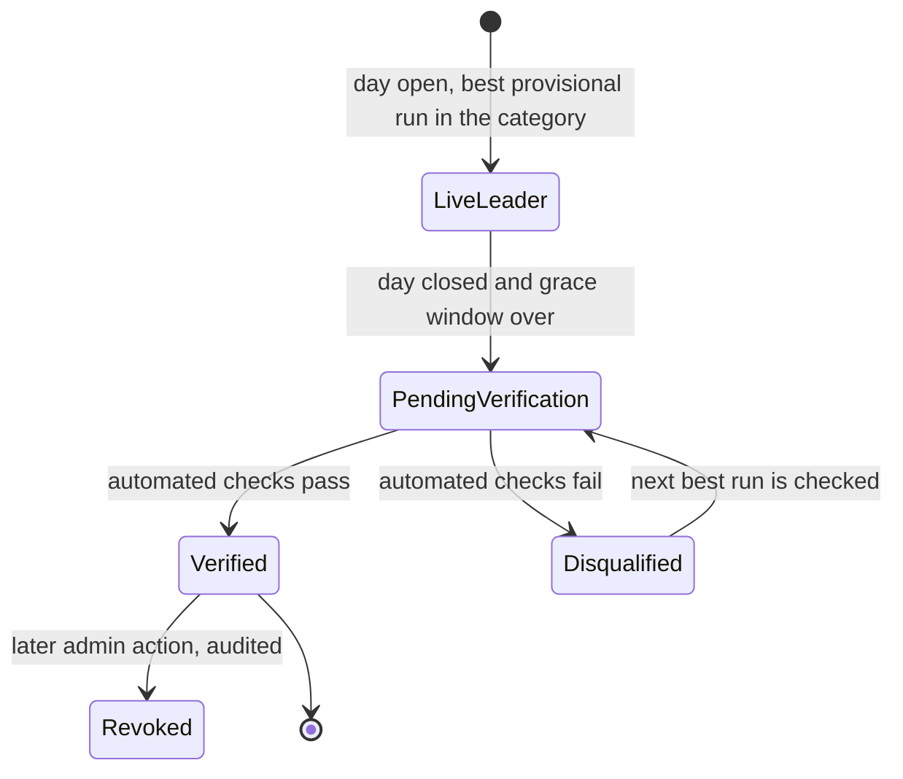
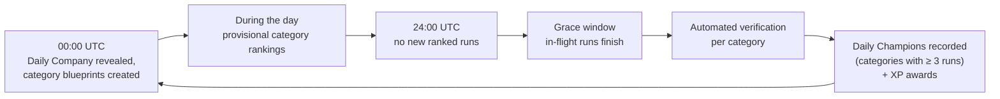

# Rankings

> Part 1 · Product & Game Design · Status: **Draft for review (revision 3: developer network)**
>
> Rankings are a **progression feature built on top of game results**, not the center of the model. They are projections over immutable results, with scopes (period × dimension) that can be added over time: daily, weekly, category, technology, season. Only **ranked runs** feed competitive rankings (see [run types](game-modes.md#1-every-run-is-a-job-challenge-for-your-profile)).

## 1. Time model

**Server canonical time is UTC; player display time is local.**

| Concept | Definition (canonical, UTC) | What the developer sees (local) |
|---|---|---|
| Day | `00:00:00.000` to `23:59:59.999` UTC | "Daily Challenge ends in 04:32:18", plus the local closing time ("closes today at 19:00, your time") |
| Run ownership | A run belongs to the UTC day in which it **started** | — |
| Grace window | Runs started before close may finish within their maximum lifetime (10 min, initial value) | "Finishing runs… results soon" |
| Verification | Runs after the grace window | "Verifying today's results" |
| Week | ISO week, Monday 00:00 UTC to Sunday 23:59:59.999 UTC | Day names in local language, with UTC dates |
| Season | A longer competition period; **Season 0 (Beta)** at launch | "Season 0 · Beta" |

The same 00:00 UTC close is 19:00 in Lima (UTC−5), 18:00 in Mexico City (UTC−6), 01:00/02:00 the next day in Madrid (winter/summer) and 00:00/01:00 the next day in London. Countdowns are computed from server time; the client only formats them. **"How ranking works"** documents exactly when each period ends.

## 2. Structure: category first

**Competitive rankings compare comparable profiles.** The base dimension is the **category** (track × band, e.g. Fullstack · Senior+). Scores from different categories are never compared directly.

### Ranking scopes

| Scope | Ranks by | Stage |
|---|---|---|
| **Category · daily** | Best ranked score of the day | **MVP** |
| **Category · weekly** | Best ranked score of the week | **MVP** |
| **Daily Champion** (per category) | A title for the verified #1 of the day | **MVP** |
| Weekly Top 7 (per category) | The category's 7 Daily Champions | V1 |
| Candidate of the Week (per category) | The best of those champions | V1 |
| **Technology** (e.g. "Redis · weekly") | Accuracy and speed on a technology's questions, minimum sample | V1 |
| **XP / level** (all-time, by category or global) | Lifetime XP: engagement, clearly labeled as such | V1 |
| Normalized global view | Percentile within category | V1, experimental |
| **Season** | Season score or season XP | V2 (Season 0 tagging from day one) |

Because rankings are projections over results, adding a scope later is a new view over existing data, not a domain change.

### Example: category daily ranking

```
FULLSTACK · SENIOR+ · Tue 13 Oct (UTC) · 41 developers · provisional · Season 0 (Beta)

#1  Ricardo Vera — Senior Fullstack Developer · CV Rush Level 17
    Node.js · PHP · React                       18,492 pts   [View LinkedIn]
#2  Andrea Gómez — Senior Fullstack Developer · CV Rush Level 9
    Java · React · PostgreSQL                   18,210 pts   [View LinkedIn]
#3  Anonymous Candidate                         17,950 pts
#4  Sam Lee — Staff Fullstack Developer
    Go · Vue · PostgreSQL · Kafka               17,402 pts
…
#12 You — Senior Fullstack Developer            15,880 pts
```

- Each row shows the **competing context** from the run's snapshot: exact declared seniority + role, stack chips (up to 5, "+N"), and optionally the CV Rush Level. The level is shown as progression, never as seniority.
- Anonymous entries show only "Anonymous Candidate" and the score.
- **One entry per developer per period**: their best ranked result.
- **Ranking key:** score (desc), then accuracy (desc), then race time (asc), then delivery timestamp (asc).
- Field size is always shown. Failed and abandoned runs, practice runs and bots are never listed.
- The ranking opens on **the developer's category**. A switcher lists active categories plus their own; empty categories are not listed. Preview categories show a **Preview** badge, with no titles.

## 3. Global comparison: alternatives

| Option | Description | Pros | Cons | Verdict |
|---|---|---|---|---|
| G1. Raw global ranking | The highest score across categories | Simple | Compares different challenges: unfair and misleading | ❌ Never |
| G2. Normalized index | Percentile within the category (minimum field, e.g. 20) | "How dominant in your field" is comparable | Noisy for small fields; harder to explain | ⏸ V1, experimental, never a title |
| G3. Long-term rating (Elo/Glicko-like) | A rating per developer over many runs | Robust | Needs volume, accounts, calibrated content | ⏸ V2+ |
| G4. Global XP / level ranking | Lifetime XP | Simple, motivating | Measures engagement, not skill; must be labeled as such | ⏸ V1 |
| **G5. No global competitive ranking; a spotlight** | Category champions side by side, ordered by field size | Honest; good for discovering developers | No single "best of the day" | ✅ **MVP** |

## 4. Rules shared by all competitive scopes

- Only **ranked** runs in **official** categories count toward titles; preview categories have boards but no titles.
- Developers see their provisional rank on the results screen: "#1 of 41 today in Fullstack · Senior+ (provisional)".
- Every result keeps its **season** (Season 0 at launch), so a future reset never deletes history.

## 5. Daily Champion (per category)

**Definition:** the best **verified** ranked result of a UTC day in a category, with a field of **at least 3 verified runs** (below that, "Category leader (small field)").



- **Verification (MVP, automated rules):** a valid and complete run; legal state transitions; answers within their windows; no duplicate submissions; timings above human plausibility floors; plausible ATS inputs; wall-clock duration not shorter than the minimum possible; ranked attempt limits and the profile lock respected; a validated snapshot; a moderated display name. Thresholds are not public.
- A Daily Champion title is a **recorded award** on the developer's profile and history (+250 XP; see [progression](../game-design/progression.md)).
- **Disqualified:** the next best run is checked. **Revoked:** an audited admin action; history keeps a neutral note.

```
DAILY CHAMPION · FULLSTACK · SENIOR+ · Tue 13 Oct (UTC)
Ricardo Vera
Senior Fullstack Developer · CV Rush Level 17
Node.js · PHP · React · PostgreSQL · Redis
18,492 pts · #1 of 41 developers · Kestrel Pay challenge
[ View LinkedIn ]
```

## 6. Weekly Top 7 (per category) · V1

The seven Daily Champions of a category in an ISO week, Monday to Sunday (not the seven highest scores). Card states: upcoming, live, verifying, champion, small field, no champion. Repeat winners are allowed ("2× champion this week"). In the MVP, the **weekly category ranking** (best score of the week) covers the weekly view.

## 7. Candidate of the Week (per category) · V1

Among a category's verified Daily Champions of the week, the **highest score** (ties: accuracy, then race time, then the earlier date). Raw scores are comparable within a category across days because the category blueprint is the same every day. If one Daily Company theme proves systematically easier or harder, we switch to a field-relative index (score ÷ the day's 90th percentile in the category) through an ADR.

## 8. Spotlight: discovering developers across categories

The landing page and a "Champions" page show:

- **Today's company:** "Kestrel Pay is hiring today · 237 candidates applied".
- **Today's leaders and champions by category**, ordered by field size, never by score: "Champions by category — scores are not comparable between categories."
- **Your status:** "You're #3 of 41 in Fullstack · Senior+ · the day closes in 04:32:18 · CV Rush Level 17".

## 9. A day



## 10. Ranking integrity

- Rankings use only server-side results and the run's **server-side snapshot**. The client never sends scores, times, positions, XP or "who it is" after the run starts.
- **Season 0 (Beta):** at launch, questions come mostly from AI-generated, automatically validated pools (see [content strategy](../questions/content-strategy.md)). Rankings are labeled "Beta" until curated content and anti-cheat mature. A new season can then start without deleting any history.
- **Sponsors can never influence** rankings, categories, positions, questions or eligibility.
- Every admin action is audited.
- **"How ranking works"** explains categories, ranked vs practice runs, what influences the score, and what the ranking does **not** mean: it is not a measure of professional ability, and declared seniority is not verified.

## 11. Future extensions

Weekly Top 7 and Candidate of the Week (V1) · technology rankings (V1) · XP/level rankings (V1) · normalized global view (V1, experimental) · Seasons with season XP and resets (V2) · category splits when fields grow · archives and public champion pages.
