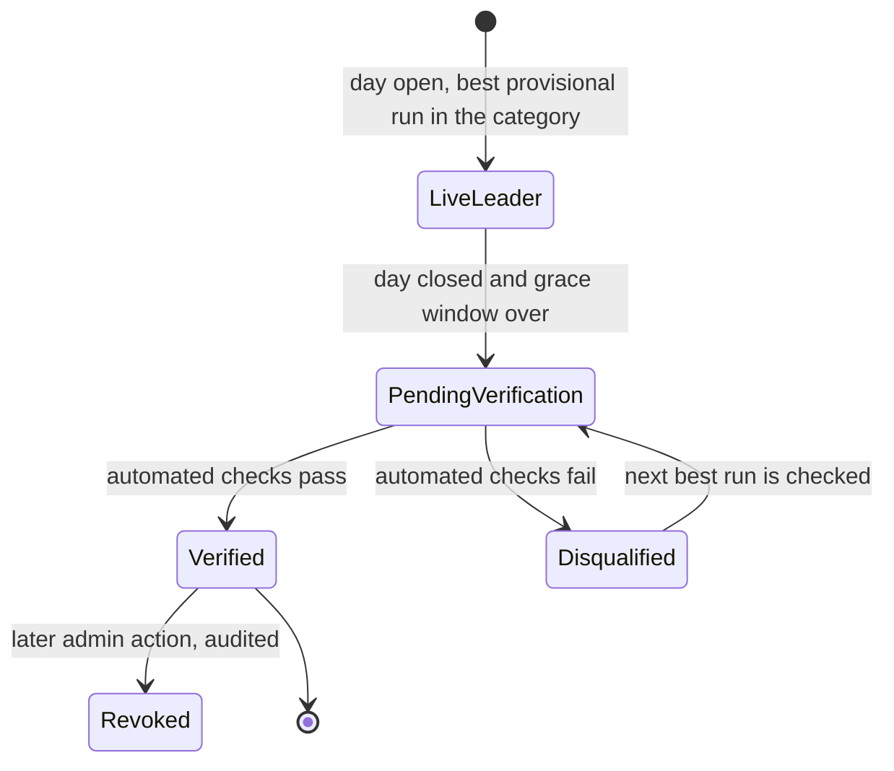
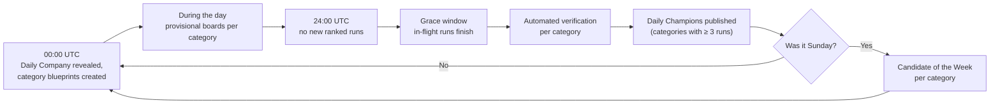

# Leaderboards: categories, Daily Champions, Weekly Top 7 and Candidate of the Week

> Part 1 · Product & Game Design · Status: **Draft for review (revision 2)**
>
> Only **ranked** runs feed these leaderboards. Casual runs produce personal bests. Revision 2 makes leaderboards **category-first** (track × band), following [competitive identity](competitive-identity.md).

## 1. Time model

**Server canonical time is UTC; player display time is local.**

| Concept | Definition (canonical, UTC) | What the player sees (local) |
|---|---|---|
| Daily Challenge window | `00:00:00.000` to `23:59:59.999` UTC | "Daily Challenge ends in 04:32:18", plus the local closing time ("closes today at 19:00, your time") |
| Run ownership | A run belongs to the UTC day in which it **started** | — |
| Grace window | Runs started before close may finish within their maximum lifetime (10 min, initial value) | "Finishing runs… champions will be announced shortly" |
| Verification | Runs after the grace window | "Verifying today's results" |
| Week | ISO week, Monday 00:00 UTC to Sunday 23:59:59.999 UTC | Day names in local language; each card shows its UTC date |

The same 00:00 UTC close is 19:00 in Lima (UTC−5), 18:00 in Mexico City (UTC−6), 01:00/02:00 the next day in Madrid (winter/summer) and 00:00/01:00 the next day in London. Countdowns are computed from server time; the client only formats them. The public **"How ranking works"** page documents exactly when a Daily Challenge ends.

## 2. Structure: category first

**The unit of competition is the category** (track × band, e.g. Fullstack · Senior+). Players are only ranked against comparable profiles; scores from different categories are **never compared** in the MVP.

| Board | Scope | Content |
|---|---|---|
| **Category daily leaderboard** | One category, one UTC day | Provisional ranking during the day; top 20 + your position |
| **Daily Champion** | One category, one UTC day | The best verified run |
| **Weekly Top 7** | One category, one ISO week | The 7 Daily Champions of that category |
| **Candidate of the Week** | One category, one ISO week | The best of those 7 champions |
| **Spotlight** (not a ranking) | All active categories | Today's champions and the Candidates of the Week, side by side, **without comparing their scores** |

### Example: category daily leaderboard

```
FULLSTACK · SENIOR+ · Tue 13 Oct (UTC) · 41 candidates · provisional

#1  Ricardo Vera — Senior Fullstack Developer
    Node.js · PHP · React                       18,492 pts   [View LinkedIn]
#2  Andrea Gómez — Senior Fullstack Developer
    Java · React · PostgreSQL                   18,210 pts   [View LinkedIn]
#3  Anonymous Candidate                         17,950 pts
#4  Sam Lee — Staff Fullstack Developer
    Go · Vue · PostgreSQL · Kafka               17,402 pts
…
#12 You — Senior Fullstack Developer            15,880 pts
```

- Each row shows the **competing context from the run's snapshot**: exact seniority + role, and stack chips (up to 5, "+N"). Stacks don't have to be identical; the category blueprint keeps difficulty comparable.
- A "Staff" player appears in **Senior+** with their real title.
- Anonymous entries show only "Anonymous Candidate" and the score.
- **One entry per player per day**: their best delivered run (the daily lock means all their attempts are in the same category).
- **Ranking key:** score (desc), then accuracy (desc), then race time (asc), then delivery timestamp (asc).
- Field size is always shown. Failed and abandoned runs and bots are never listed.

### Navigation

- The leaderboard opens on **the player's own category** (from their last ranked run or their current profile).
- A category switcher lists **active categories** (with runs today) plus the player's own. Empty categories are not listed, so we never show a wall of empty boards.
- Preview categories (see [category lifecycle](competitive-identity.md#33-progressive-growth-instead-of-empty-boards)) show a **Preview** badge, with no champions.

## 3. Global comparison: alternatives

Should there be a single "best of the day" across all categories? The challenges differ (different bands, tracks, topics), so raw scores are not comparable.

| Option | Description | Pros | Cons | Verdict |
|---|---|---|---|---|
| G1. Raw global ranking | The highest score across all categories | Simple | Compares different challenges: unfair and misleading | ❌ Never |
| G2. Normalized index | Each run's **percentile within its category** that day (minimum field size, e.g. 20); a global view sorted by percentile | "How dominant were you in your field?" is comparable | Noisy for small fields; field strength differs between categories; harder to explain | ⏸ **V1, experimental**, labeled "Top performers (normalized)", never a "champion" title |
| G3. Long-term rating (Elo/Glicko-like) | A rating per player across runs | Robust over time | Needs identity, volume and calibrated content | ⏸ V2+ |
| **G4. No global ranking; a global spotlight** | Show every category's champion side by side, ordered by field size, not by score | Honest, simple; best for discovering professionals | No single "best of the day" | ✅ **MVP** |

**Recommendation:** G4 for the MVP. Collect per-category distributions from day one. Introduce G2 as an experimental, clearly explained view once several categories regularly reach the minimum field size.

## 4. Category daily leaderboard rules

- Live and **provisional** during the day.
- Only delivered ranked runs in an **official** category count toward champions. Preview categories have boards but no titles.
- Players see their own provisional rank on the results screen: "#1 of 41 today in Fullstack · Senior+ (provisional)".

## 5. Daily Champion (per category)

**Definition:** the best **verified** ranked run of a UTC day **in a category**.



- **Verification (MVP, automated rules):** a valid and complete run; legal state transitions; answers within their windows; no duplicate submissions; timings above human plausibility floors; plausible ATS inputs; wall-clock duration not shorter than the minimum possible; attempt limits and the ranked profile lock respected; a snapshot that passed profile validation; a display name that passes moderation. Thresholds are not public.
- **Minimum field for the title:** a category needs **at least 3 verified runs** that day (tunable) to award "Daily Champion". Below that, the top run is shown as "Category leader (small field)". This reduces the incentive to hop into empty categories.
- **Disqualified:** the next best run is checked and promoted. **Revoked:** an admin action after review; history keeps a neutral note.
- Results are archived forever with their **snapshot context**; if the player later withdraws consent, they appear as "Anonymous Candidate".

### Champion card

```
DAILY CHAMPION · FULLSTACK · SENIOR+ · Tue 13 Oct (UTC)
Ricardo Vera
Senior Fullstack Developer
Node.js · PHP · React · PostgreSQL · Redis
18,492 pts · #1 of 41 candidates · Kestrel Pay challenge
[ View LinkedIn ]
```

## 6. Weekly Top 7 (per category)

**The seven Daily Champions of a category in an ISO week**, Monday to Sunday. Not the seven highest scores.

| Card state | When | Shows |
|---|---|---|
| Upcoming | The day has not started | Day, date |
| Live | The day is open | The current live leader (provisional) |
| Verifying | Closed; grace or verification running | "Verifying…" |
| Champion | Verified | Name, exact seniority + role, stack, score, LinkedIn (per consent), the day's company |
| Small field | Fewer than 3 verified runs | "Category leader (small field)" |
| No champion | No verified runs that day | "No champion this day" |

Repeat winners are allowed ("2× champion this week"). The Weekly Top 7 page opens on the player's category, with the same category switcher.

## 7. Candidate of the Week (per category)

**Definition (MVP):** among a category's verified Daily Champions of the week, the **highest score**. Ties: accuracy, then race time, then the earlier date.

Raw scores are comparable **within a category** across days, because the category blueprint (structure, band difficulty curve, maximum score) is the same every day. The remaining variance comes from the Daily Company's themed families and is monitored. If one day's theme turns out systematically easier or harder, we switch to a field-relative index (champion score ÷ the day's 90th percentile in the category, with a minimum field size) through an ADR, announced on "How ranking works".

```
CANDIDATE OF THE WEEK · FULLSTACK · SENIOR+ · Week 42
Ricardo Vera
Senior Fullstack Developer · Node.js · PHP · React
Monday Champion · 18,492 pts
[ View LinkedIn ]
```

## 8. Spotlight: discovering professionals across categories

The landing page and a "Champions" page show:

- **Today's company:** "Kestrel Pay is hiring today · 237 candidates applied".
- **Today's champions:** one card per official category (the live leader during the day, the verified champion after close), **ordered by field size**, never by score. The copy makes it explicit: "Champions by category — scores are not comparable between categories."
- **Candidates of the Week:** one per category.
- **Your status:** "You're #3 of 41 in Fullstack · Senior+ · the day closes in 04:32:18".

This keeps the product's mission (discovering professionals of many profiles) without pretending that a Junior Frontend score and a Senior+ Backend score can be compared.

## 9. A day and a week



## 10. Ranking integrity

- Rankings use only server-side data and the run's **server-side snapshot**. The client never sends scores, times, positions, or "who it is" after the run starts.
- **Sponsors can never influence** rankings, categories, positions, questions or eligibility (see [community](community.md#7-sponsorship-and-integrity)).
- Every admin action (disqualify, revoke, hide a name, exclude a run for profile misrepresentation) is audited.
- **"How ranking works"** explains categories, what influences the score, what the ranking means and what it does **not** mean (it is not a measure of professional ability, and declared seniority is not verified). Verification thresholds are not published.

## 11. Future extensions (not MVP)

- **Normalized global view** (G2): experimental in V1.
- **Seasons:** category leaderboards per season, without destroying history. Leaderboards are defined over **competition periods** (day, week, later season). See [future platform](future-platform.md#4-seasons).
- **Category splits** (e.g. Senior+ → Senior | Lead+) when fields are large; old results keep their original category.
- **Archive** of past weeks and **public champion pages** (opt-in, indexable).
