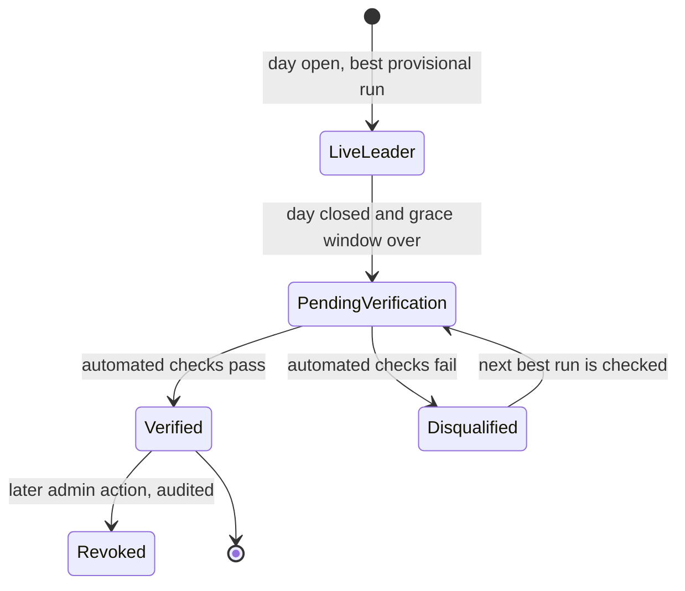
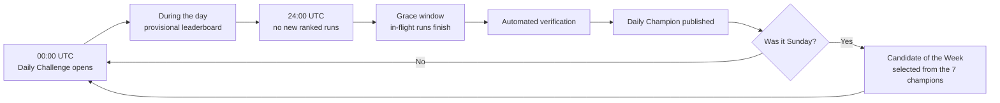

# Leaderboards: Daily Champion, Weekly Top 7 and Candidate of the Week

> Part 1 · Product & Game Design · Status: **Draft for review**
>
> Only **ranked (Daily Challenge)** runs feed these leaderboards. Casual runs only produce personal bests.

## 1. Time model

**Server canonical time is UTC; player display time is local.**

| Concept | Definition (canonical, UTC) | What the player sees (local) |
|---|---|---|
| Daily Challenge window | `00:00:00.000` to `23:59:59.999` UTC | "Daily Challenge ends in 04:32:18", with the local closing time, e.g. "closes today at 19:00 (your time)" |
| Run ownership | A run belongs to the UTC day in which it **started** | — |
| Grace window | Runs started before close may finish within their maximum lifetime (10 min, initial value) | "Finishing runs… the champion will be announced shortly" |
| Verification | Runs after the grace window | "Verifying today's results" |
| Week | ISO week, Monday 00:00 UTC to Sunday 23:59:59.999 UTC | Day names in local language; each card notes its UTC date |

Examples for the same close at 00:00 UTC:

| Player in | Local closing time |
|---|---|
| Lima (UTC−5) | 19:00 the same day |
| Mexico City (UTC−6) | 18:00 the same day |
| Madrid (UTC+1 winter / UTC+2 summer) | 01:00 / 02:00 the next day |
| London (UTC+0 / UTC+1) | 00:00 / 01:00 the next day |

Rules:

- All countdowns are computed from server time. The client only formats them.
- Every date shown on leaderboards is unambiguous: day names come with their date, and a tooltip says "UTC day".
- The **"How ranking works"** page documents exactly when a Daily Challenge ends.

## 2. Daily leaderboard

- A **live, provisional** ranking during the day.
- **One entry per player**: their best delivered ranked run of the day.
- It shows the **top 20** plus **the player's own position** if they are outside it.
- Each entry shows the display name (or "Anonymous Candidate"), role and seniority (if public), score and race time.
- **Ranking key:** score (desc), then accuracy (desc), then race time (asc), then delivery timestamp (asc, earlier wins).
- **Field size** is shown ("#3 of 214 candidates") for context and transparency.
- Failed and abandoned runs are never listed. Bots never appear on leaderboards.

## 3. Daily Champion

**Definition:** the player with the best **verified** ranked run of a UTC day.

### 3.1 Lifecycle



- **Live leader:** shown on the landing page as "Today's leader (live)".
- **Verification (MVP: automated rules):** a valid and complete run; only legal state transitions; every answer within its time window; no duplicate submissions; response timings above human plausibility floors; plausible ATS inputs; wall-clock duration not shorter than the minimum possible; attempt limits respected; a display name that passes moderation. Exact thresholds are deliberately not public (see [risks](risks.md)).
- **Verified:** becomes the **Daily Champion** and is archived forever (with an anonymized display if the player later withdraws consent).
- **Disqualified:** the next best run is verified and promoted. No public shaming; the run is simply not ranked.
- **Revoked:** an admin can revoke a champion after a manual review. History keeps a neutral note ("Result withdrawn after review").
- **Minimum field size:** none in the MVP. A day with three players still has a champion. The card shows the field size.

### 3.2 Champion card

```
TODAY'S CHAMPION · Tue 13 Oct (UTC)
Alex Morgan
Senior Fullstack Developer
19,430 pts · #1 of 214 candidates
Backend Daily Challenge
[ View LinkedIn ]
```

- If the champion chose to stay anonymous: "Anonymous Candidate · 19,430 pts · #1 of 214". No role, seniority or LinkedIn.
- The landing page shows **Today's leader (live)** and **Yesterday's champion (verified)**.
- The results screen tells a provisional #1 when the day closes in their local time, and invites them to come back and check. This is an intentional return driver.

## 4. Weekly Top 7

**Not the seven highest scores of the week.** It is the **seven Daily Champions** of the ISO week, one per day, in order from Monday to Sunday.

| Card state | When | Shows |
|---|---|---|
| Upcoming | The day has not started | Day, track ("Thursday · DevOps & Cloud") |
| Live | The day is open | The current live leader (provisional) |
| Verifying | Closed, grace window or verification running | "Verifying…" |
| Champion | Verified | Name, role, seniority, score, LinkedIn (per consent) |
| No champion | Nobody delivered a ranked run that day | "No champion this day" |

- **Repeat winners are allowed.** A player who wins two days appears twice, with a "2× champion this week" badge.
- Because the daily track rotates, the Top 7 is a **showcase of different disciplines**, which supports the mission of discovering professional profiles.
- Each card shows its daily track and field size.

## 5. Candidate of the Week

**Definition (MVP proposal):** among the seven verified Daily Champions of the week, the one with the **highest score**. Ties are resolved by accuracy, then race time, then the earlier date.

### 5.1 The comparability problem

Different days use different jobs and question families, so raw scores across days are only comparable if the days are equally hard. Options:

| Option | Description | Pros | Cons |
|---|---|---|---|
| A. Raw score | Highest raw score among the 7 champions | Simple, understandable, matches the brief | Biased towards easier days |
| B. Field-relative index | Champion score ÷ that day's 90th percentile score | Corrects for each day's difficulty | Noisy with small fields; harder to explain |
| C. Margin of victory | Distance between #1 and #2 | Rewards dominance | Punishes champions of competitive days |
| D. Fixed blueprint (enabler) | Every day uses the same blueprint, the same Mid–Senior level and the same maximum score | Makes A largely fair by construction | The track topic can still vary in difficulty |

**Recommendation:** **D + A for the MVP.** Every ranked day has the same blueprint, level and maximum score, so raw scores are broadly comparable, and the rule is easy to explain. We record each day's score distribution from day one. If the data shows systematic differences between tracks, we switch to **B** with a minimum field size (fallback to A below it). That change would be documented in an ADR and announced on the "How ranking works" page.

### 5.2 Display

```
CANDIDATE OF THE WEEK · Week 42
Alex Morgan
Senior Backend Engineer
Monday Champion · 21,938 pts
[ View LinkedIn ]
```

Selected after Sunday's verification and shown through the following week.

## 6. A day and a week



## 7. Ranking integrity

- Rankings are computed only from server-side data. The client never sends scores, times or positions.
- **Sponsors can never influence rankings, positions, questions or eligibility.** Sponsorship and game integrity are separate concerns (see [community](community.md#7-sponsorship-and-integrity)).
- Every admin action on rankings (disqualify, revoke, hide a name) is audited.
- The public **"How ranking works"** page explains what influences the score, what the ranking means and what it does **not** mean (it is not a measure of professional ability). It does not publish verification thresholds.

## 8. Future extensions (not MVP)

- **Seasons:** longer competition periods (e.g. "Season 1") with their own leaderboards, without destroying history. The data model treats "day", "week" and "season" as competition periods. See [future platform](future-platform.md#4-seasons).
- **Archive:** browsable past weeks and champions.
- **Public champion pages:** indexable pages for verified champions who opted in (V1).
- **Leagues:** postponed until eligibility can be verified (see [game modes](game-modes.md#5-alternatives-considered)).
