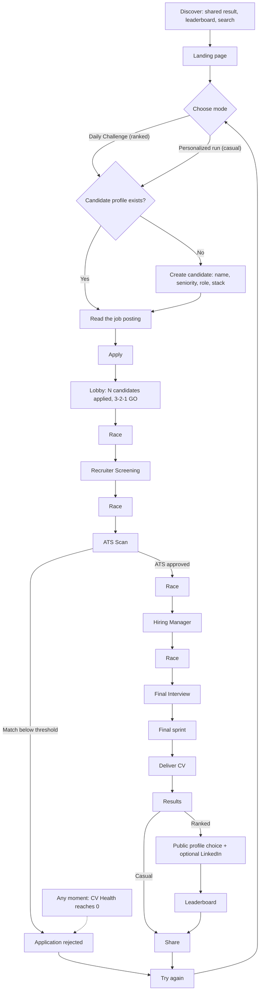
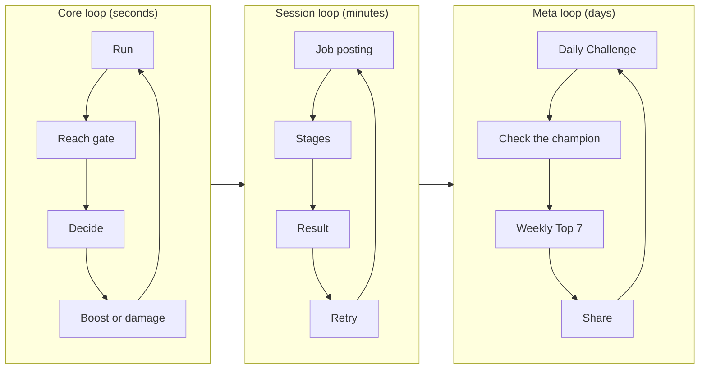

# Player journey and game loop

> Part 1 · Product & Game Design · Status: **Draft for review**

This document describes the complete experience from discovery to "play again", including the failure, return and interruption paths. Stage mechanics are described in [game design](../game-design/README.md).

## 1. Complete journey

## 2. Step by step

| # | Step | What the player sees | What the player does | Rules and notes |
|---|---|---|---|---|
| 1 | **Discover** | A shared result card, a leaderboard link or a search result | Taps the link | Most traffic is expected to come from LinkedIn on mobile, inside the in-app browser |
| 2 | **Landing** | Server-rendered page: pitch, today's live leader, yesterday's verified champion, "Daily Challenge ends in 04:32:18" (in local time), language switch | Picks a mode | Indexable HTML, works without JavaScript for reading; the game itself needs JavaScript |
| 3 | **Mode** | Two clear options: **Daily Challenge** (ranked, primary) and **Personalized run** (casual) | Chooses | Ranked attempts left today are visible (e.g. "2 of 3 attempts left") |
| 4 | **Candidate profile** | "Who are you?": name → seniority → role → stack | Fills in once; later prefilled with an "Edit" option | See section 2.1; the profile is remembered on the device |
| 5 | **Job posting** | A full posting: company, title, location, work mode, salary range, responsibilities, stack, experience | Reads, then taps **APPLY** | Ranked: today's job, same for everyone. Casual: generated for the profile. A reading timer shows the time left (ranked 45 s, casual 60 s, initial values); applying early is allowed. Reading time is not scored. |
| 6 | **Lobby** | "237 candidates applied", the runners holding CVs, the player's name above their runner, the company on the horizon | Waits for 3-2-1-GO | Ranked: the real number of players who started today's challenge (or "Be one of the first candidates today" while the number is small). Casual: a fictional number. |
| 7 | **Run** | Four race segments and four stages: Recruiter → ATS → Hiring Manager → Final | Steers, dodges, answers | See [run structure](../game-design/run-structure.md) |
| 8 | **Delivery** | The runner hands the CV over at reception: "APPLICATION DELIVERED" | Watches (about 3 s) | — |
| 9 | **Results** | Time, Recruiter x/3, ATS %, Technical x/4, CV Health, position, score, and an explained breakdown | Reads; can open the review | Ranked: "#2 today (provisional) · the day closes in 04:32:18". Casual: personal best per track. |
| 10 | **Public profile** (ranked, delivered runs only) | "You made it. Now let people discover you." | Chooses **Show my profile** or **Stay anonymous**; optionally adds LinkedIn | Off by default. See [public profile and privacy](public-profile-and-privacy.md). |
| 11 | **Leaderboard** | Daily ranking with the player's entry, Weekly Top 7, Candidate of the Week | Browses; can open public LinkedIn profiles | LinkedIn clicks are counted in aggregate |
| 12 | **Share** | A result card preview with LinkedIn, X, WhatsApp and Copy link | Shares or skips | The card respects public/anonymous status |
| 13 | **Play again** | One-tap retry | Retries, switches mode, or leaves | Restart in ≤ 2 taps and < 3 s; the profile and the mode are kept |
| 14 | **Review and report** (post-run) | The questions seen in the run, with the player's results | Can report a question | Reporting is only possible after the run; see [question strategy](../questions/question-strategy.md#10-reporting-questions) |

### 2.1 Candidate profile (onboarding)

The goal is to ask little, react a lot, and never show 200 technologies at once.

1. **Name**: free text, 2–32 characters, moderated (see [privacy](public-profile-and-privacy.md#6-display-names-and-moderation)). Nicknames are fine.
2. **Seniority**: Trainee · Junior · Mid · Senior · Lead · Staff · Principal, as large tappable chips.
3. **Role**: 16 roles at launch, grouped (Engineering, Data & AI, Infrastructure, Quality, Product & Design, Security). Roles without full content coverage show an "Early access" badge.
4. **Stack**: "Which technologies do you work with?"
   - Starts with **recommended chips for the selected role** (about 12).
   - **Categories** relevant to the role, collapsed by default (e.g. Fullstack: Frontend, Backend, Data, Messaging, Cloud, Infrastructure).
   - **Search** across the whole catalog, with aliases ("postgres" finds PostgreSQL).
   - **Progressive suggestions:** selecting NestJS suggests Node.js and TypeScript; selecting Laravel suggests PHP.
   - A **selected tray** with remove buttons. Minimum 1, maximum 15 (initial values).
5. **Summary card**, "Your candidate": name, seniority, role, the top stack chips. Then continue.

The profile is stored server-side against an anonymous player identity (no login required) and prefilled next time.

## 3. Failure journey

A run fails in exactly two ways:

| Failure | Reason code | Trigger |
|---|---|---|
| Rejected by the ATS | `ATS_FAILED` | ATS match below the threshold at the end of the ATS Scan |
| CV destroyed | `CV_DESTROYED` | CV Health reaches 0 at any moment |

The failure screen parodies a template rejection email ("Thank you for your interest… we've decided to move forward with other candidates"). It shows how far the player got and the stats so far, and offers **Try again** as the primary action. Ranked: the attempt is consumed. Failed runs are never ranked.

Abandoning (closing the tab, losing the connection for good) is a third outcome, `ABANDONED`. The run expires after its maximum lifetime and, in ranked, still counts as an attempt.

## 4. Returning player journey

1. The landing page recognises the device (anonymous player cookie): "Welcome back, Andrea".
2. It highlights today's challenge with context: today's job track, attempts left, current best and current position if one exists today.
3. If they played yesterday: "Yesterday you finished #4 of 212" or "You are yesterday's champion".
4. Starting a run goes straight to the job posting, with the profile prefilled and an edit option.

## 5. Interruptions and edge cases

| Situation | Behavior |
|---|---|
| Page refresh or app switch mid-run | The run resumes from the server state. An open question keeps its server-side deadline, so refreshing never re-rolls a question or stops its clock. |
| Connection lost | The client retries. If the deadline passes, the question resolves as a timeout. |
| Tab hidden (ranked) | The server clock never pauses in ranked. Casual allows a pause between stages. |
| Two tabs on the same run | Only the first valid action for a challenge counts; the other tab sees the updated state. |
| Language switch mid-run | The UI language can change; the run's question language is fixed at the start of the run. |
| Different device | No cross-device continuity in the MVP (no accounts). The private management link lets a player manage their public profile from another device. |
| Ranked attempts used up | Ranked shows the best result of the day and suggests a casual run. |

## 6. Game loop

The game works on three nested loops.

| Loop | Time scale | Cycle |
|---|---|---|
| **Core loop** | Seconds | Run → steer or dodge → reach a gate → decide → feedback (boost or damage) → run |
| **Session loop** | Minutes | Job posting → stages → result → retry with a new job or new questions |
| **Meta loop** | Days and weeks | Daily Challenge → "did I hold #1?" → Weekly Top 7 → share → return tomorrow |

Replay levers for each loop are described in [replayability](../game-design/replayability.md).
