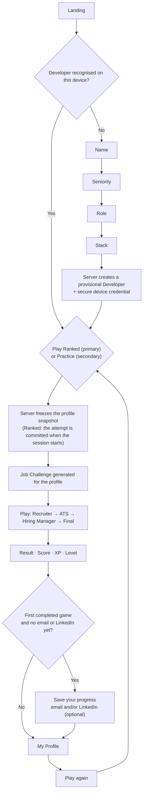
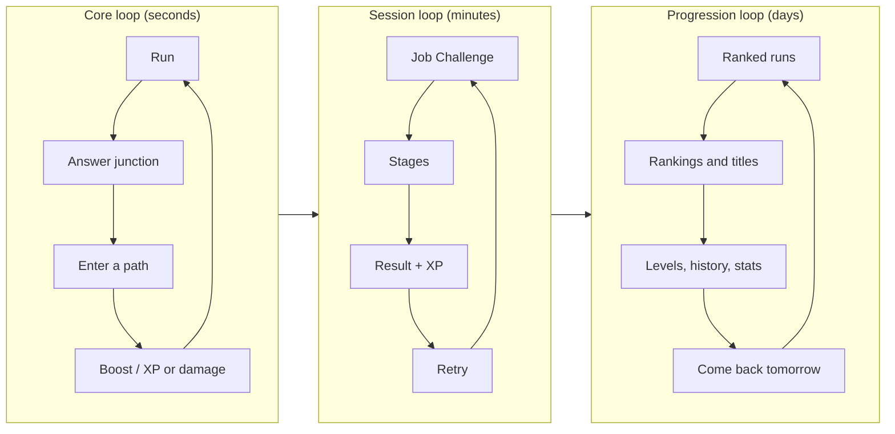

# Player journey and game loop

> Part 1 · Product & Game Design · Status: **Approved (revision 4)**

This document describes the experience from discovery to "play again" and back, including the failure, return and interruption paths. Every run starts from the developer's profile ([competitive identity](competitive-identity.md)) and every run grows their persistent progress ([progression](../game-design/progression.md)).

## 1. Main journey

The first onboarding is **light**: name, seniority, role and stack. Contact details are asked **after the first game**, once there is something worth saving.



Condensed:

**Landing → Name → Seniority → Role → Stack → provisional Developer created → choose Ranked or Practice → Job Challenge → play → result → score → XP → level → Save your progress (optional email/LinkedIn) → My Profile → play again.**

## 2. Step by step

| # | Step | What the developer sees | What they do | Rules and notes |
|---|---|---|---|---|
| 1 | **Discover** | A shared result, a ranking or a search result | Taps the link | Most traffic is expected from LinkedIn on mobile, inside the in-app browser |
| 2 | **Landing** | Server-rendered page: pitch, today's company, leaders by category, the countdown, language switch | Taps **Play** | Indexable HTML, readable without JavaScript |
| 3 | **Who are you?** | Name → seniority → role → stack | Fills in | Nothing else. No email, no LinkedIn, no consent wall beyond terms acknowledgement (see section 2.1) |
| 4 | **Developer created** | — (invisible) | — | The server validates the profile, creates a **provisional Developer** with a server-generated ID and sets a **secure device credential**. Progress is saved from this moment. |
| 5 | **Competing as** | "You'll play as **Senior Fullstack Developer** · Node.js · PHP · React · PostgreSQL · Redis · Fullstack · Senior+" | Confirms or edits | Makes the context explicit before every run |
| 6 | **Choose: Ranked or Practice** | **Play Ranked** (primary CTA) — "3 attempts remaining today" · affects daily and category rankings, Daily Champion and competitive stats. **Practice** (secondary CTA) — "Unlimited · doesn't affect rankings" | Chooses explicitly | Ranked is **never** chosen implicitly. Before a first-ever ranked run, a short explainer ("Ranked attempts count for today's ranking; practice first if you want to learn the controls"). If the category isn't ranked yet: Practice only, with "Help us unlock ranked for Mobile". |
| 7 | **Snapshot (and ranked commitment)** | Ranked: "Attempt 1 of 3 starts now" | — | The server freezes the profile snapshot. In ranked, the attempt is **committed server-side when the competitive session starts**; leaving afterwards doesn't give it back. The exact commitment point is designed in Part 2 (anti-cheat). |
| 8 | **Job Challenge** | A posting **for this profile** (today's company in ranked, a random company in practice) | Reads, taps **APPLY** | Reading timer (ranked 45 s, practice 60 s); reading time isn't scored |
| 9 | **Lobby** | "237 candidates applied to Kestrel Pay today · 41 in Fullstack · Senior+", runners holding CVs | Waits for 3-2-1-GO | Real counts in ranked |
| 10 | **Run** | A side-scrolling level with four stages; questions appear **in the world** as A/B/C/D paths | Runs, jumps, avoids obstacles, enters the answer path | See [run structure](../game-design/run-structure.md) |
| 11 | **Result** | "**Ricardo scored 18,492 points competing as a Senior Fullstack Developer.**" Stack chips · Recruiter 3/3 · ATS 91% · Technical 3/4 · CV Health 75% · position · ranked: "#1 of 41 today in Fullstack · Senior+ (provisional)" | Reads; opens the breakdown or review | Practice: "Practice run — not ranked" |
| 12 | **XP and level** | "+460 XP", the level bar, a level-up animation if any | — | See [progression](../game-design/progression.md) |
| 13 | **Save your progress** (after the first completed game, and later until done) | "You earned 460 XP · CV Rush Level 2. Save your progress." Email (optional) · LinkedIn (optional) · "Not now" | Adds one, both, or skips | See section 2.2 |
| 14 | **My Profile** | Level, XP, games, best ranks, history, initial technology stats, last active, visibility, contact details | Reviews progress; edits | Private; see [developer profile](developer-profile.md) |
| 15 | **Rankings** | The developer's category ranking (daily, weekly), the spotlight | Browses; opens public LinkedIn profiles | LinkedIn clicks counted in aggregate |
| 16 | **Share** | A result card with the context (and optionally the level) | Shares or skips | Respects visibility; **never includes the email** |
| 17 | **Play again** | One-tap retry with the same choice (Ranked if attempts remain, otherwise Practice is suggested) | Retries or leaves | ≤ 2 taps, < 3 s |
| 18 | **Review and report** | The questions seen, with results (practice: correct answers and explanations) | Can report a question | Only after the run; see [question strategy](../questions/question-strategy.md#10-reporting-questions) |

### 2.1 Profile (light onboarding)

Ask little, react a lot, never show 200 technologies at once.

1. **Name**: 2–32 characters, moderated (see [privacy](public-profile-and-privacy.md#6-display-names-and-moderation)). Nicknames are fine. It's the display name, never the email.
2. **Seniority**: Trainee · Junior · Mid · Senior · Lead · Staff · Principal, as large chips.
3. **Role**: 13 roles at launch, grouped. Roles whose track isn't ranked yet show "Practice only for now".
4. **Stack**: recommended chips for the role (~12), role-specific categories (e.g. Fullstack: Frontend, Backend, Databases, Caching/Search, Messaging, Cloud, Infrastructure), search with aliases, progressive suggestions (NestJS → Node.js, TypeScript), role rules shown inline ("Fullstack needs at least one Frontend and one Backend technology"). 1–12 technologies.
5. **Continue** includes a one-line acknowledgement of the terms and privacy policy (with links). Visibility starts **private**; nothing is public until the developer chooses it.

### 2.2 Save your progress

Shown after the **first completed game** (delivered or failed), when XP, a level, a result and a first history entry already exist:

```
You earned 460 XP · CV Rush Level 2
Save your progress
  Email      [ ............ ]   Private. Used to recover your profile and, later, to claim it with an account.
  LinkedIn   [ ............ ]   Optional. Not public unless you choose to show it.
[ Save ]   Not now
```

- **Both are optional.** Adding one or both attaches them to **the same provisional Developer**; no separate identities are created.
- Both are stored as **unverified**. The email is private, always. LinkedIn is not public until the developer explicitly enables "Show my LinkedIn on public rankings" (asked right after adding it, default **No**).
- **"Not now" never loses progress.** The Developer stays tied to the device credential. A calm, honest notice is shown:
  - EN: "Your progress is saved on this device for now. Add an email to keep it safe if you switch devices or clear your browser."
  - ES: "Tu progreso está guardado en este dispositivo por ahora. Añade un email para no perderlo si cambias de dispositivo o borras los datos del navegador."
- The prompt can reappear at meaningful moments (a level-up, a first ranked result, the first Daily Champion title), at most once per day, and is always available in My Profile. No nagging.
- Measured as **`first_game_completed` → `identity_contact_added`** (see [success metrics](success-metrics.md)).

## 3. Failure journey

| Failure | Reason code | Trigger |
|---|---|---|
| Rejected by the ATS | `ATS_FAILED` | ATS match below the threshold at the end of the ATS Scan |
| CV destroyed | `CV_DESTROYED` | CV Health reaches 0 at any moment |

The failure screen parodies a template rejection email, shows how far the developer got, the partial score ("not ranked") and the **XP still earned** (failed runs give a small amount), and offers **Try again**. Ranked: the attempt is consumed.

Abandoning is `ABANDONED`: the run expires after its maximum lifetime, earns no XP and, in ranked, counts as an attempt.

## 4. Returning developer journey

1. The device credential recognises the developer: "Welcome back, Andrea · CV Rush Level 9 · 120 XP to Level 10".
2. The landing page shows today's company, their category status ("Frontend · Junior: you're #4 of 27 today"), **ranked attempts remaining** and their best result today.
3. Yesterday's outcome: "Yesterday you finished #4 of 212 in Frontend · Junior" or "You were yesterday's Daily Champion in Frontend · Junior (+250 XP)".
4. **Play Ranked** / **Practice** after the "Competing as" card.
5. On a new device: the management link, or (later) an account; with an email saved, future recovery and claiming become possible.

## 5. Interruptions and edge cases

| Situation | Behavior |
|---|---|
| Page refresh or app switch mid-run | The run resumes from the server state; an open question keeps its server-side deadline |
| Connection lost | The client retries; past the deadline, the question resolves as a timeout |
| Tab hidden (ranked) | The server clock never pauses in ranked; practice allows a pause between stages |
| Two tabs on the same run | Only the first valid action counts |
| Profile edited mid-run | It doesn't affect the running run (the snapshot is frozen); in ranked, edits wait until the daily lock ends |
| Language switch mid-run | The UI language changes; the run's question language is fixed at the start |
| Different device | The management link (MVP); accounts later |
| Cookies blocked or cleared | Without the device credential, a new provisional Developer would be created. The management link restores the original; a saved email enables future recovery and claiming, which merges duplicates (see [identity and accounts](identity-and-accounts.md#6-merging-several-provisional-profiles)). |
| Ranked attempts used up | Play Ranked shows "0 attempts remaining today · resets in 04:32:18"; Practice stays available (XP, history, stats) |
| Category not ranked yet | Practice runs only, with a "help us unlock ranked" call to action |

## 6. Game loop

| Loop | Time scale | Cycle |
|---|---|---|
| **Core loop** | Seconds | Run → jump or avoid → reach an answer junction → enter a path → feedback (boost, XP popup, or damage) → run |
| **Session loop** | Minutes | Job Challenge → stages → result → XP → retry |
| **Progression loop** | Days and weeks | Ranked runs → rankings and titles → XP and levels → history and stats → come back tomorrow |
| **Network loop** *(Stage 2+)* | Months | A public profile → visibility → (later) jobs and recruiters |



Replay levers are described in [replayability](../game-design/replayability.md).
