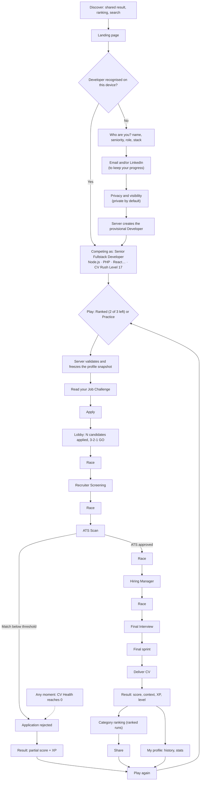
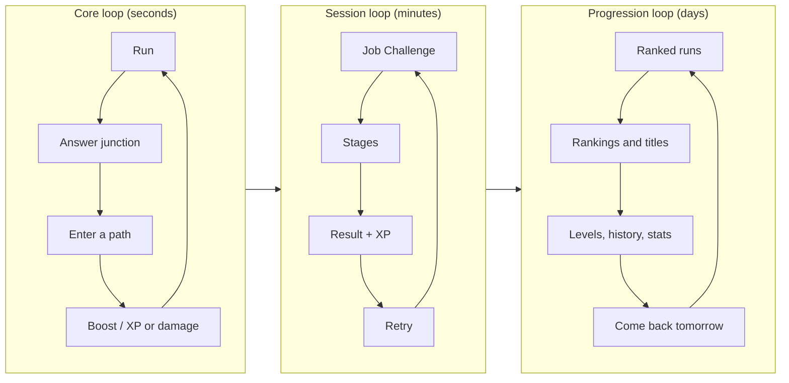

# Player journey and game loop

> Part 1 · Product & Game Design · Status: **Draft for review (revision 3: developer network)**

This document describes the experience from discovery to "play again" and back, including the failure, return and interruption paths. Every run starts from the developer's profile ([competitive identity](competitive-identity.md)) and every run grows their persistent progress ([progression](../game-design/progression.md)).

## 1. Complete journey

## 2. Step by step

| # | Step | What the developer sees | What they do | Rules and notes |
|---|---|---|---|---|
| 1 | **Discover** | A shared result, a ranking or a search result | Taps the link | Most traffic is expected from LinkedIn on mobile, inside the in-app browser |
| 2 | **Landing** | Server-rendered page: pitch, today's company, leaders by category, the countdown, language switch | Taps **Play** | Indexable HTML, readable without JavaScript |
| 3 | **Who are you?** | Name → seniority → role → stack | Fills in (first time) | See section 2.1 |
| 4 | **Keep your progress** | "Email and/or LinkedIn, so you can keep your progress and claim it when accounts arrive" | Enters at least one | Email is private and never shown. LinkedIn is public only with consent. Both are stored as **unverified**. See [identity and accounts](identity-and-accounts.md). |
| 5 | **Privacy and visibility** | Accept terms and privacy (required); "Show me on public rankings" (off by default, with a live preview); "Email me about CV Rush" (off by default) | Chooses | Separate consents, recorded with text version and timestamp. See [privacy](public-profile-and-privacy.md). |
| 6 | **Developer created** | — (invisible) | — | The server validates everything, creates a **provisional Developer** with a server-generated ID and sets the device credential |
| 7 | **Competing as** | "You'll play as **Senior Fullstack Developer** · Node.js · PHP · React · PostgreSQL · Redis · Fullstack · Senior+ · CV Rush Level 17" | Confirms or edits | Makes the context explicit before every run |
| 8 | **Run type** | **Play: Ranked (2 of 3 left today)** and **Practice** | Chooses (ranked by default while ranked runs are left) | Ranked: "Your profile stays locked until 00:00 UTC (19:00 your time)". If the category isn't ranked yet: practice only, with "Help us unlock ranked for Mobile". |
| 9 | **Snapshot** | — | — | The server freezes the profile into the run's snapshot. From here on, the client never says "who it is". |
| 10 | **Job Challenge** | A posting **for this profile**: company (today's company in ranked), title, location, salary range, responsibilities, stack, experience | Reads, taps **APPLY** | Reading timer (ranked 45 s, practice 60 s); applying early is allowed; reading time isn't scored |
| 11 | **Lobby** | "237 candidates applied to Kestrel Pay today · 41 in Fullstack · Senior+", runners holding CVs, the company on the horizon | Waits for 3-2-1-GO | Real counts in ranked; small numbers become "Be one of the first candidates today" |
| 12 | **Run** | A side-scrolling level with four stages; questions appear **in the world** as A/B/C/D paths | Runs, jumps, avoids obstacles, enters the answer path | See [run structure](../game-design/run-structure.md) |
| 13 | **Delivery** | "APPLICATION DELIVERED" at reception | Watches (~3 s) | — |
| 14 | **Result** | "**Ricardo scored 18,492 points competing as a Senior Fullstack Developer.**" Stack chips; then Recruiter 3/3 · ATS 91% · Technical 3/4 · CV Health 75% · position; **+460 XP**, the level bar, a level-up animation if any; for ranked runs, "#1 of 41 today in Fullstack · Senior+ (provisional)" | Reads; opens the breakdown or review | Practice: "Practice run, not ranked". See [progression](../game-design/progression.md). |
| 15 | **Visibility nudge** (if private) | "Want to appear on the ranking with your name and LinkedIn?" with a preview | Chooses, or skips | Never pre-checked; it's easy to say no |
| 16 | **Ranking** | The developer's category ranking (daily, weekly), the spotlight of other categories | Browses; opens public LinkedIn profiles | LinkedIn clicks counted in aggregate |
| 17 | **My profile** | Level, XP, games played, best ranks, history, initial technology stats, last active, visibility settings | Reviews progress; edits profile | Private in the MVP; see [developer profile](developer-profile.md) |
| 18 | **Share** | A result card with the context (and optionally the level), plus LinkedIn, X, WhatsApp and Copy link | Shares or skips | Respects visibility; **never includes the email** |
| 19 | **Play again** | One-tap retry | Retries or leaves | ≤ 2 taps, < 3 s; after 3 ranked runs, Play becomes Practice |
| 20 | **Review and report** | The questions seen, with results (practice: correct answers and explanations) | Can report a question | Only after the run; see [question strategy](../questions/question-strategy.md#10-reporting-questions) |

### 2.1 Profile (onboarding)

Ask little, react a lot, never show 200 technologies at once.

1. **Name**: 2–32 characters, moderated (see [privacy](public-profile-and-privacy.md#6-display-names-and-moderation)). Nicknames are fine. It is the public name, so it's never the email.
2. **Seniority**: Trainee · Junior · Mid · Senior · Lead · Staff · Principal, as large chips.
3. **Role**: 13 roles at launch, grouped. Roles whose track isn't ranked yet show "Practice only for now".
4. **Stack**: recommended chips for the role (~12), role-specific categories (e.g. Fullstack: Frontend, Backend, Databases, Caching/Search, Messaging, Cloud, Infrastructure), search with aliases, progressive suggestions (NestJS → Node.js, TypeScript), role rules shown inline ("Fullstack needs at least one Frontend and one Backend technology"). 1–12 technologies.
5. **Email and/or LinkedIn**: at least one. Email is recommended ("the identifier we'll be able to verify when accounts arrive"). LinkedIn is accepted in any common format and normalized.
6. **Privacy and visibility**: as in step 5 above.

**Friction note:** asking for email or LinkedIn before the first run is a deliberate trade-off for persistent identity. If playtests show a large drop at this step, the alternative is to ask right after the first result ("Save your 460 XP"); see [open questions](mvp-scope.md#6-open-questions).

## 3. Failure journey

| Failure | Reason code | Trigger |
|---|---|---|
| Rejected by the ATS | `ATS_FAILED` | ATS match below the threshold at the end of the ATS Scan |
| CV destroyed | `CV_DESTROYED` | CV Health reaches 0 at any moment |

The failure screen parodies a template rejection email, shows how far the developer got, the partial score ("not ranked") and the **XP still earned** (failed runs give a small amount), and offers **Try again**. Ranked: the attempt is consumed.

Abandoning is `ABANDONED`: the run expires after its maximum lifetime, earns no XP and, in ranked, counts as an attempt.

## 4. Returning developer journey

1. The device credential recognises the developer: "Welcome back, Andrea · CV Rush Level 9 · 120 XP to Level 10".
2. The landing page shows today's company, their category status ("Frontend · Junior: you're #4 of 27 today"), ranked runs left and their best result today.
3. Yesterday's outcome: "Yesterday you finished #4 of 212 in Frontend · Junior" or "You were yesterday's Daily Champion in Frontend · Junior (+250 XP)".
4. **Play** goes to the "Competing as" card (prefilled), then to the Job Challenge.
5. On a new device: the management link (MVP) or, later, an account login.

## 5. Interruptions and edge cases

| Situation | Behavior |
|---|---|
| Page refresh or app switch mid-run | The run resumes from the server state; an open question keeps its server-side deadline |
| Connection lost | The client retries; past the deadline, the question resolves as a timeout |
| Tab hidden (ranked) | The server clock never pauses in ranked; practice allows a pause between stages |
| Two tabs on the same run | Only the first valid action counts |
| Profile edited mid-run | It doesn't affect the running run (the snapshot is frozen); in ranked, edits wait until the daily lock ends |
| Language switch mid-run | The UI language changes; the run's question language is fixed at the start |
| Different device | The management link (MVP); accounts later |
| Cookies blocked or cleared | A new provisional Developer would be created; the management link restores the original. Claiming merges duplicates later (see [identity and accounts](identity-and-accounts.md#6-merging-several-provisional-profiles)). |
| Ranked runs used up | Practice runs continue (XP, history, stats) |
| Category not ranked yet | Practice runs only, with a "help us unlock ranked" call to action |

## 6. Game loop

| Loop | Time scale | Cycle |
|---|---|---|
| **Core loop** | Seconds | Run → jump or avoid → reach an answer junction → enter a path → feedback (boost, XP popup, or damage) → run |
| **Session loop** | Minutes | Job Challenge → stages → result → XP → retry |
| **Progression loop** | Days and weeks | Ranked runs → rankings and titles → XP and levels → history and stats → come back tomorrow |
| **Network loop** *(Stage 2+)* | Months | A public profile → visibility → (later) jobs and recruiters |

Replay levers are described in [replayability](../game-design/replayability.md).
