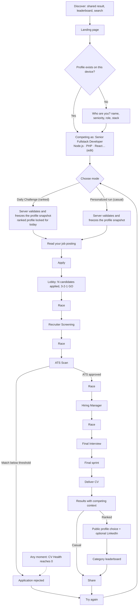
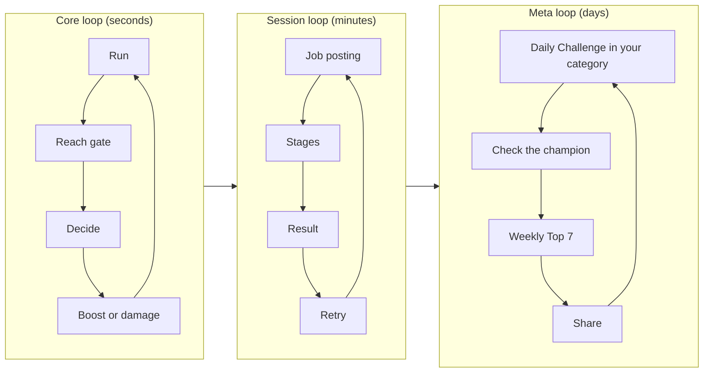

# Player journey and game loop

> Part 1 · Product & Game Design · Status: **Draft for review (revision 2: profile-first)**

This document describes the complete experience from discovery to "play again", including the failure, return and interruption paths. Every run starts from the player's profile; see [competitive identity](competitive-identity.md). Stage mechanics are described in [game design](../game-design/README.md).

## 1. Complete journey

## 2. Step by step

| # | Step | What the player sees | What the player does | Rules and notes |
|---|---|---|---|---|
| 1 | **Discover** | A shared result card, a leaderboard link or a search result | Taps the link | Most traffic is expected from LinkedIn on mobile, inside the in-app browser |
| 2 | **Landing** | Server-rendered page: pitch, today's company ("Kestrel Pay is hiring today"), today's champions by category, "Daily Challenge ends in 04:32:18" (local time), language switch | Taps **Play** | Indexable HTML, readable without JavaScript; the game itself needs JavaScript |
| 3 | **Profile** | "Who are you?": name → seniority → role → stack (first time), or a summary card (returning) | Fills in or confirms; can edit | See section 2.1. The profile is remembered against the anonymous player identity. |
| 4 | **Competing as** | "You'll compete as **Senior Fullstack Developer** · Node.js · PHP · React · PostgreSQL · Redis", with the category ("Fullstack · Senior+") | Confirms or edits | Makes the competing context explicit before any run |
| 5 | **Mode** | **Daily Challenge** (ranked, primary) and **Personalized run** (casual) | Chooses | Ranked shows attempts left ("2 of 3 today") and the lock notice ("Your ranked profile is locked until 00:00 UTC, 19:00 your time"). If the category is casual-only: "Ranked coming soon for Mobile — help us unlock it". |
| 6 | **Snapshot** | — (invisible) | — | The server validates the profile and freezes it in the run's snapshot. From here on, the client never says "who it is" again. |
| 7 | **Job posting** | A posting **for this profile**: company, title, location, work mode, salary range, responsibilities, stack, experience | Reads, then taps **APPLY** | Ranked: at today's company, generated from the snapshot. Casual: random company. A reading timer shows the time left (ranked 45 s, casual 60 s, initial values); applying early is allowed; reading time is not scored. |
| 8 | **Lobby** | "237 candidates applied to Kestrel Pay today · 41 in Fullstack · Senior+", runners holding CVs, the player's name above their runner, the company on the horizon | Waits for 3-2-1-GO | Ranked: real counts (small numbers are replaced by "Be one of the first candidates today"). Casual: a fictional number. |
| 9 | **Run** | Four race segments and four stages: Recruiter → ATS → Hiring Manager → Final | Steers, dodges, answers | See [run structure](../game-design/run-structure.md) |
| 10 | **Delivery** | The runner hands the CV over at reception: "APPLICATION DELIVERED" | Watches (about 3 s) | — |
| 11 | **Results** | "**Ricardo scored 18,492 points competing as a Senior Fullstack Developer.**" Stack chips, then category rank, ATS %, Recruiter x/3, Technical x/4, CV Health, position, and an explained breakdown | Reads; can open the review | Ranked: "#1 of 41 today in Fullstack · Senior+ (provisional) · the day closes in 04:32:18". Casual: "played as…", personal best for this profile. |
| 12 | **Public profile** (ranked, delivered runs only) | "You made it. Now let people discover you." with a preview card that includes the competing context | Chooses **Show my profile** or **Stay anonymous**; optionally adds LinkedIn | Off by default. See [public profile and privacy](public-profile-and-privacy.md). |
| 13 | **Leaderboard** | The player's **category** board with their entry, the Weekly Top 7 and the Candidate of the Week for that category; a category switcher; the spotlight of all categories | Browses; opens public LinkedIn profiles | LinkedIn clicks are counted in aggregate |
| 14 | **Share** | A result card with the competing context, plus LinkedIn, X, WhatsApp and Copy link | Shares or skips | The card respects public/anonymous status |
| 15 | **Play again** | One-tap retry | Retries, switches mode, or leaves | Restart in ≤ 2 taps and < 3 s. The profile and mode are kept. In ranked, the profile stays locked for the day. |
| 16 | **Review and report** (post-run) | The questions seen in the run, with the player's results | Can report a question | Only after the run; see [question strategy](../questions/question-strategy.md#10-reporting-questions) |

### 2.1 Profile (onboarding)

The goal is to ask little, react a lot, and never show 200 technologies at once.

1. **Name**: free text, 2–32 characters, moderated (see [privacy](public-profile-and-privacy.md#6-display-names-and-moderation)). Nicknames are fine.
2. **Seniority**: Trainee · Junior · Mid · Senior · Lead · Staff · Principal, as large tappable chips.
3. **Role**: 13 roles at launch (extensible), grouped (Engineering, Infrastructure, Quality, Data & AI, Security, Architecture). Roles whose track is not yet ranked show a "Casual only for now" badge.
4. **Stack**: "Which technologies do you work with?"
   - Starts with **recommended chips for the selected role** (about 12).
   - **Categories adapted to the role**, collapsed by default. For example, Fullstack shows Frontend, Backend, Databases, Caching/Search, Messaging, Cloud and Infrastructure.
   - **Search** within the role's allowed categories, with aliases ("postgres" finds PostgreSQL).
   - **Progressive suggestions:** selecting NestJS suggests Node.js and TypeScript; selecting Laravel suggests PHP.
   - **Role rules shown inline:** "Fullstack needs at least one Frontend and one Backend technology".
   - A **selected tray** with remove buttons. 1–12 technologies (initial values).
5. **"Competing as" card**: name, seniority, role, the top stack chips, and the resulting category. Then continue.

The profile is the player's *current* profile and can be edited at any time (with the ranked daily lock and category cooldown; see [competitive identity](competitive-identity.md#6-ranked-profile-lock)). Each run stores its own frozen **snapshot**, so editing the profile never rewrites past results.

## 3. Failure journey

A run fails in exactly two ways:

| Failure | Reason code | Trigger |
|---|---|---|
| Rejected by the ATS | `ATS_FAILED` | ATS match below the threshold at the end of the ATS Scan |
| CV destroyed | `CV_DESTROYED` | CV Health reaches 0 at any moment |

The failure screen parodies a template rejection email ("Thank you for your interest… we've decided to move forward with other candidates"). It shows how far the player got and the stats so far, and offers **Try again** as the primary action. Ranked: the attempt is consumed. Failed runs are never ranked.

Abandoning (closing the tab, losing the connection for good) is a third outcome, `ABANDONED`. The run expires after its maximum lifetime and, in ranked, still counts as an attempt.

## 4. Returning player journey

1. The landing page recognises the device (anonymous player cookie): "Welcome back, Andrea".
2. It shows today's company, the player's category status ("Frontend · Junior: you're #4 of 27 today"), attempts left and their best result today.
3. If they played yesterday: "Yesterday you finished #4 of 212 in Frontend · Junior", or "You are yesterday's champion in Frontend · Junior".
4. **Play** goes to the "Competing as" card (prefilled), then straight to the job posting.

## 5. Interruptions and edge cases

| Situation | Behavior |
|---|---|
| Page refresh or app switch mid-run | The run resumes from the server state. An open question keeps its server-side deadline, so refreshing never re-rolls a question or stops its clock. |
| Connection lost | The client retries. If the deadline passes, the question resolves as a timeout. |
| Tab hidden (ranked) | The server clock never pauses in ranked. Casual allows a pause between stages. |
| Two tabs on the same run | Only the first valid action for a challenge counts; the other tab sees the updated state. |
| Profile edited mid-run (another tab) | It doesn't affect the running run: its snapshot is frozen. In ranked, the edit is rejected until the daily lock ends. |
| Language switch mid-run | The UI language can change; the run's question language is fixed at the start of the run. |
| Different device | No cross-device continuity in the MVP (no accounts). The private management link lets a player manage their public profile from another device. |
| Ranked attempts used up | Ranked shows the best result of the day and suggests a casual run. |
| Category not ranked yet | Casual runs only; a "help us unlock ranked" call to action. |

## 6. Game loop

The game works on three nested loops.

| Loop | Time scale | Cycle |
|---|---|---|
| **Core loop** | Seconds | Run → steer or dodge → reach a gate → decide → feedback (boost or damage) → run |
| **Session loop** | Minutes | Job posting → stages → result → retry with a new job or new questions |
| **Meta loop** | Days and weeks | Daily Challenge in your category → "did I hold #1?" → Weekly Top 7 → share → return tomorrow |

Replay levers for each loop are described in [replayability](../game-design/replayability.md).
