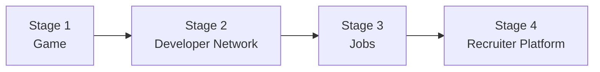
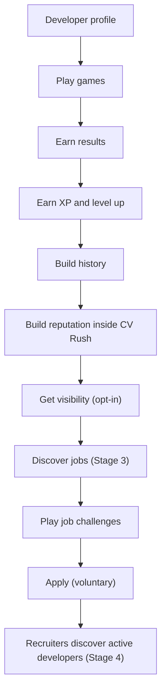

# Long-term product evolution

> Part 1 · Product & Game Design · Status: **Approved (revision 4)**
>
> Replaces the former "future platform" document. Revision 3 changes the product's north star: the game is the entry point to a **developer network**, which can later grow into **jobs** and **recruiter** features.

## 1. Principle

> **The game creates engagement.**
> **The profile accumulates value.**
> **Jobs create opportunity.**
>
> Today we build mainly the first two lines.

> **First build a fun developer game. Then build a developer network. Then jobs. Then recruiter features.**

**Architectural north:** Developers → Games → Progress → Reputation inside CV Rush → Jobs → Applications → Recruiters.

Each stage has to work on its own before the next one starts. The game is the **engagement and playful evaluation mechanism**. The **persistent developer profile** is the asset that grows over time. Jobs and recruiters only make sense once there are enough active developers with meaningful, voluntary profiles.



The developer's journey across the stages:



## 2. The four stages

### Stage 1 · Game (MVP → V1)

| | |
|---|---|
| **Goal** | A fun, fast, fair game that developers replay and share |
| **Core features** | Developer profile (provisional identity), Job Challenge runs, the 2D runner with hiring-process stages, score, **XP and levels**, **history**, basic personal stats, category rankings, optional public LinkedIn, sharing |
| **What it proves** | People play, come back, build progress, and opt into visibility |
| **Gate to Stage 2** (indicative) | Healthy 4-week retention; a meaningful share of developers with ≥ 5 games; a meaningful share leaving a claim identifier (email); public opt-in rate validated |

### Stage 2 · Developer Network (V1 → V2)

| | |
|---|---|
| **Goal** | A persistent, voluntary developer profile worth keeping and showing |
| **Core features** | Accounts + **claiming provisional profiles** (see [identity and accounts](identity-and-accounts.md)), public developer pages (`/developers/ricardo-vera`), challenge history, technology stats, badges, Seasons, portfolio link, voluntary **Open to Work** |
| **What it proves** | Developers value their CV Rush profile as part of their professional presence |
| **Gate to Stage 3** (indicative) | Enough active public profiles in key categories; claimed accounts; trust and safety basics (moderation, reports, impersonation handling) |

### Stage 3 · Jobs

| | |
|---|---|
| **Goal** | Companies publish jobs; developers discover them and can **Play to Apply** |
| **Core features** | `Company`, `JobPosting` (real), `JobChallenge` built from the posting, **PLAY TO APPLY**, `Application` (explicit, per application consent; the developer chooses what is shared) |
| **What it proves** | Developers apply through challenges; companies find value in the signal |
| **Gate to Stage 4** (indicative) | Verified companies; applications flowing; legal review of recruitment use (see section 4) |

Example:

```
KESTREL PAY · Senior Backend Engineer
Node.js · PostgreSQL · Redis · Kafka
[ PLAY TO APPLY ]
```

The run is a normal game session whose Job Challenge comes from a real posting. After playing, the developer **may** apply using that result. Playing never applies automatically.

### Stage 4 · Recruiter Platform

| | |
|---|---|
| **Goal** | Recruiters and companies discover **active developers who chose to be discoverable** |
| **Core features** | `CompanyAccount`, `RecruiterAccount`, recruiter dashboard, developer search over **discoverable** public profiles (e.g. "Senior Backend · Node.js, Redis, PostgreSQL · active in the last 30 days · completed Backend challenges"), job applicants view, opt-in messaging, possibly paid plans |
| **What it proves** | A sustainable business that doesn't betray players |

## 3. Separate, voluntary visibility levels

Visibility grows only by the developer's explicit choice, and each level is a separate switch:

| Level | What it means | Stage |
|---|---|---|
| **Private** (default) | Plays, keeps history, XP and stats privately; appears in rankings as "Anonymous Candidate" | 1 |
| **Public on rankings** | Name, declared role and seniority, stack and LinkedIn shown next to results | 1 |
| **Public developer page** | `/developers/{slug}` with the sections the developer enables | 2 |
| **Open to Work** | A voluntary status on the public page; never inferred from activity | 2 |
| **Discoverable by recruiters** | The profile can appear in recruiter search | 4 |
| **Application** | Shares a specific result with a specific company for a specific job | 3 |

"Last active" does **not** mean "looking for a job".

## 4. Guardrails (apply to every stage)

- CV Rush results are **gameplay statistics, never a certification** of professional ability.
  - ✅ "Redis challenges: 87% accuracy (34 answers)"
  - ❌ "Ricardo is 87% good at Redis"
  - ❌ "This candidate is 87% better"
- Never sell or share individual data. Recruiters only see what the developer made public or explicitly shared in an application.
- Never rank people *for hiring purposes* by default; rankings are game results with their context.
- Never infer or store protected characteristics.
- No automated rejection or hiring decision based on CV Rush results. Signals are complementary to interviews, experience, the CV and human judgment, and recruiter-facing UIs must say so.
- Public aggregates only above minimum group sizes.
- **Regulatory work before Stages 3–4:** using game results in recruitment may fall under employment, anti-discrimination, GDPR (including automated decision-making) and AI regulation; the EU AI Act treats AI used to evaluate candidates as high-risk. A legal review is a hard prerequisite, not an afterthought.
- Anti-scraping: public profiles and search must be rate-limited and protected, so the network isn't harvested by third parties.

## 5. What the MVP must already preserve

The MVP builds only Stage 1, but its domain must not block the next stages:

| Future capability | Enabler in the MVP domain |
|---|---|
| Accounts and profile claiming | A server-generated `Developer` identity that owns all history; claim identifiers (email, LinkedIn) with verification status; an optional account link |
| Public developer pages | Profile visibility; a stable developer ID; a future public slug; public vs private field classification |
| Reputation over time | Immutable game results with profile snapshots; an append-only XP ledger; history and stats as rebuildable projections |
| Technology stats | Per-question attempts with technology and topic tags |
| Seasons | Results and XP entries tagged with a season (Season 0 at launch) |
| Play to Apply | **Job Challenge as a source-agnostic concept**: generated today, from a real `JobPosting` tomorrow |
| Applications | Results referencing the Job Challenge, so an application can later reference a result |
| Companies | `Company` as an entity (fictional today, real later), with an owner/kind |
| Recruiter search | Last activity, declared role/seniority/stack and stats stored in queryable form; visibility levels separated from day one |
| Analytics for every stage | Domain events with non-sensitive metadata |

## 6. What the MVP must not do

Recruiter dashboard, real jobs, company accounts, real applications, messaging, paid plans, advanced skill certification. All of these belong to later stages.
