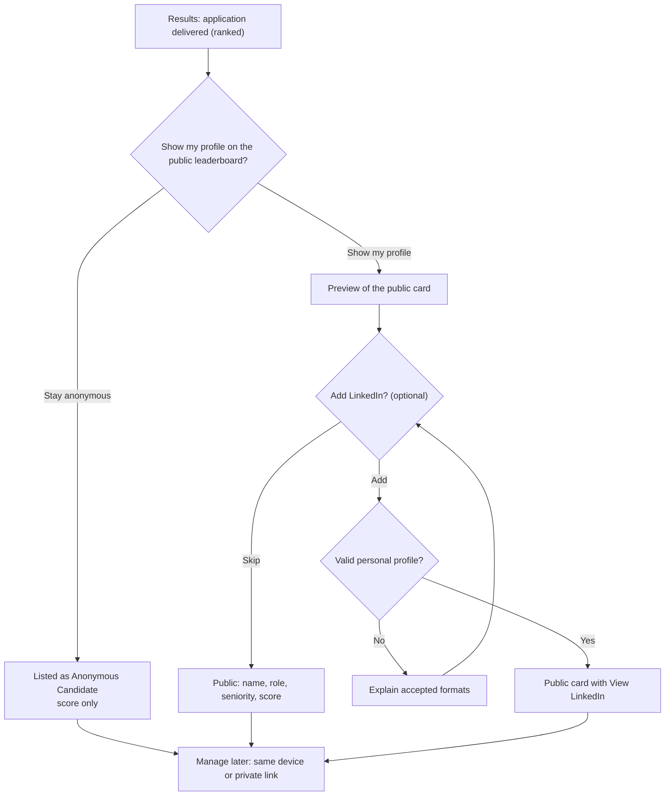

# Public profile, LinkedIn exposure and privacy UX

> Part 1 · Product & Game Design · Status: **Draft for review**
>
> Product-level rules. Technical enforcement (validation, storage, retention, security) is defined in Part 2.

## 1. Principles

1. **Data minimization.** We ask only for what the game needs: a name, a seniority, a role and a stack. No email, phone, CV file, location, age or gender.
2. **Public by choice.** Finishing a run never implies public exposure. The public profile is **off by default**.
3. **Preview before publishing.** The player sees exactly what will be public before confirming.
4. **Easy to undo.** Hiding the public profile is one action and takes effect immediately everywhere.
5. **No dark patterns.** "Stay anonymous" is as visible and as easy as "Show my profile". No pre-checked boxes, guilt copy or nagging.
6. **One consent per purpose.** Appearing on leaderboards and adding a LinkedIn link are separate choices. Each consent is recorded with its purpose, its timestamp and the version of the text shown.
7. **Transparency.** A plain-language **"What is public"** page (es/en) explains what we store, what is public, and how to hide or delete it.

## 2. What we ask, store and publish

| Data | Asked when | Required | Stored | Public |
|---|---|---|---|---|
| Display name | Onboarding | Yes (nicknames OK) | Yes | Only with the public profile on |
| Seniority, role | Onboarding | Yes | Yes (with a snapshot per run) | Only with the public profile on |
| Stack | Onboarding | Yes (min 1) | Yes (with a snapshot per run) | No (MVP); possibly in a future Skill Passport, by opt-in |
| Anonymous player identity | Automatically (essential cookie) | Yes | Yes | Never |
| Runs, answers, timings | During play | — | Yes (for scoring, audit and anti-cheat) | Only score, race time, position and date, on leaderboards |
| LinkedIn username | After a delivered ranked run | No | Yes, only if given | Only with the public profile on |
| Consent records | When choosing | — | Yes | Never |
| IP address, user agent | Each request | — | Transient, for rate limiting and abuse prevention (retention defined in Part 2) | Never |
| Question reports | Post-run, optional | No | Yes | Never (aggregated counts may be published) |

## 3. LinkedIn exposure flow

**When:** only after a **delivered ranked run**. Casual results are not on public leaderboards in the MVP, so LinkedIn is not offered there. Casual results screens invite the player to try the Daily Challenge instead.

**Copy (draft):**

| | English | Español |
|---|---|---|
| Title | You made it. Now let people discover you. | Lo lograste. Ahora deja que te descubran. |
| Toggle | Show my profile on the public leaderboard | Mostrar mi perfil en el ranking público |
| Alternative | Stay anonymous | Seguir como anónimo |
| LinkedIn field | LinkedIn profile (optional) | Perfil de LinkedIn (opcional) |
| Helper | Your profile URL or just your username, e.g. `linkedin.com/in/your-name` | La URL de tu perfil o solo tu usuario, p. ej. `linkedin.com/in/tu-nombre` |

### 3.1 Accepted LinkedIn input (product rules)

Accepted, all normalized to `https://www.linkedin.com/in/<username>`:

- `your-name`
- `linkedin.com/in/your-name`
- `www.linkedin.com/in/your-name/`
- `https://linkedin.com/in/your-name`
- `https://www.linkedin.com/in/your-name`
- Country subdomains, e.g. `pe.linkedin.com/in/your-name`

Rejected, each with a friendly explanation:

- Non-profile paths: `/company/`, `/jobs/`, `/posts/`, `/feed/`, `/pub/`, `/school/`, anything that is not `/in/<username>`.
- Other domains, lookalike domains, URL shorteners and redirects.
- Any scheme other than http(s): `javascript:`, `data:`, etc.
- Query strings and fragments are dropped rather than stored.

**Only the username is stored.** The link is always built by us from a fixed template. Links open in a new tab and are marked as user-generated and nofollow. The exact validation rules are specified in Part 2.

### 3.2 What we cannot verify

We cannot verify that a LinkedIn profile belongs to the player. Mitigations:

- Every public card has a **"Report this profile"** action (impersonation, offensive content, spam).
- Admins can hide a public profile immediately; hiding is audited.
- The "What is public" page states that links are self-declared.
- A future optional login (V1) can make a "verified" status possible. LinkedIn sign-in is not planned, because it does not give us the public profile URL and it raises privacy expectations.

## 4. Consent UX details

- The **toggle is off by default.** Both choices have equal visual weight.
- **Live preview:** as the player toggles or edits, the card renders exactly as it will appear publicly.
- **Anonymous listing:** "Anonymous Candidate" plus score and race time. No role, seniority or link.
- **Scope:** the choice applies to the player's public presence (all their leaderboard entries), not to a single run. It can be changed at any time.
- **Recording:** each change stores a consent record (purpose, granted or withdrawn, timestamp, text version).

## 5. Managing a profile without accounts

There is no login in the MVP, so two mechanisms let players manage their public presence:

1. **Same device:** the anonymous player cookie identifies the player. "Edit public profile" is available from results and leaderboard screens.
2. **Private management link:** the first time a player makes their profile public, they get a private link ("Save this link to edit or remove your public profile from any device"). It can be regenerated, which invalidates the old one.

Actions:

| Action | Effect |
|---|---|
| Hide public profile | All entries immediately show as "Anonymous Candidate". Share pages and images update. |
| Edit | Change the display name, role, seniority or LinkedIn. Display names are re-moderated. |
| Delete my data | Deletes the profile and the LinkedIn username. Game records are anonymized and kept for aggregated statistics and leaderboard integrity. A champion slot becomes "Anonymous Candidate". |

If both the device and the link are lost, a documented contact process handles requests (the exact channel is defined before launch).

## 6. Display names and moderation

- 2–32 characters. Unicode letters, spaces, apostrophes, hyphens and dots.
- No URLs, emails, @handles or phone numbers. The leaderboard is not an advertising space.
- Profanity and slur filters for **es** and **en**, plus a curated blocklist, including impersonation of well-known people.
- Admins can hide names. Reports go to a review queue.
- A rejected name gets a neutral message ("Please choose a different name") and never the matched term.

## 7. Sharing and privacy

- Share cards and share pages **respect the current public status**. With the profile public: "Alex Morgan · #1 today · 19,430 pts". Otherwise: "A Senior candidate scored 19,430 pts… Can you beat it?". Role and seniority appear only if public.
- If a player hides their profile later, existing share pages update to the anonymous version (cached images are invalidated).
- Share buttons use plain share URLs (LinkedIn, X, WhatsApp, copy link). **No third-party share SDKs or tracking pixels.**

## 8. Analytics and privacy

- **First-party analytics only** in the MVP: no third-party trackers, no ads, no fingerprinting.
- Events carry non-sensitive metadata (role, seniority, technology IDs, challenge type, durations, success) and a pseudonymous player ID, never names or LinkedIn usernames.
- Public or shared aggregates use **minimum group sizes**, so small groups are never reported.
- LinkedIn clicks are counted per public profile **in aggregate**, without recording who clicked.
- The event catalog and pipeline are defined in Part 2.

## 9. Age and legal

- Intended for people **16 and older**. The age of digital consent varies by country; this needs legal validation.
- The MVP ships a **privacy policy**, **terms of use** and the **"What is public"** page in es/en.
- **A legal review (GDPR, ePrivacy/cookies) is required before the public launch.** In particular, we must confirm whether using the essential anonymous cookie for first-party analytics needs consent in target countries. These documents are product intent, not legal advice.
