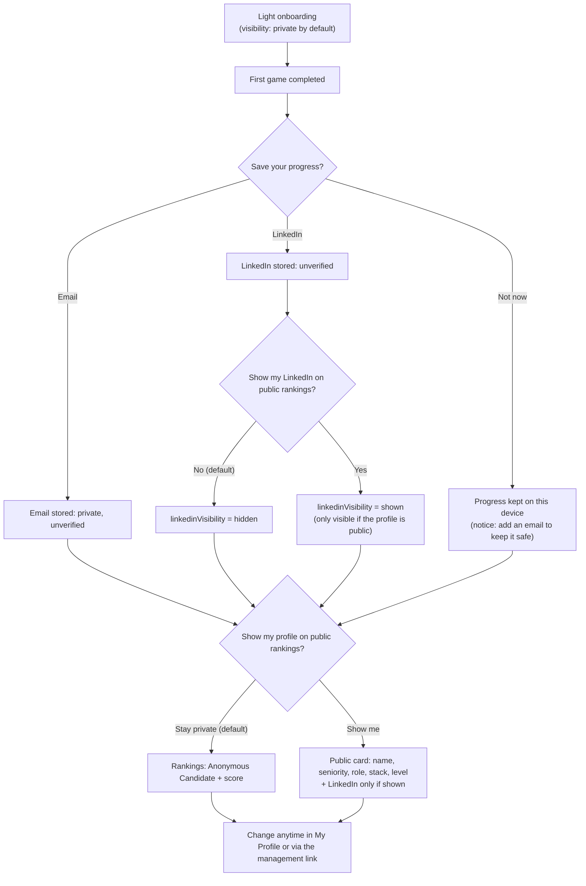

# Privacy, visibility and LinkedIn

> Part 1 · Product & Game Design · Status: **Approved (revision 4)**
>
> Product-level rules. Technical enforcement (storage, encryption, retention, logging) is defined in Part 2. Identity and claiming are in [identity and accounts](identity-and-accounts.md); profile contents are in [developer profile](developer-profile.md).

## 1. Principles

1. **Data minimization.** To play: name, seniority, role, stack. Optionally, after the first game: email and/or LinkedIn. No CV files, phone, location, age or gender.
2. **Separate things:** `contactEmail` (private, always, with no public option), `linkedinIdentifier` (stored, unverified), `linkedinVisibility` (hidden by default) and `profileVisibility` (private by default). Adding LinkedIn never makes it public; going public never exposes the email. One never implies another.
3. **Private by default.** Playing, even finishing #1, never makes anyone public.
4. **Preview before publishing.** The developer sees exactly what will be public.
5. **Easy to undo.** Hiding the public profile takes effect everywhere, immediately.
6. **No dark patterns.** "Stay private" is as visible as "Show me". No pre-checked boxes, guilt copy or nagging.
7. **One consent per purpose**, recorded with its text version and timestamp: terms and privacy (required), public visibility, LinkedIn display, email communication.
8. **Verification is never implied.** Unverified identifiers are labeled as such internally and never shown as "verified".
9. **Transparency:** a plain-language **"What is public"** page (es/en).

## 2. What we ask, store and publish

| Data | Asked when | Required | Stored | Public |
|---|---|---|---|---|
| Display name | Onboarding | Yes (nicknames OK) | Yes | Only when public |
| Seniority, role, stack | Onboarding | Yes | Current profile + a **frozen snapshot per run** | Only when public, as the competing context of each result |
| **Email** (`contactEmail`) | "Save your progress" after the first game, or My Profile | No | Yes, **protected**, with `emailVerificationStatus = unverified` | **Never** (no public option exists) |
| **LinkedIn** (`linkedinIdentifier`) | "Save your progress" after the first game, or My Profile | No | Username only, with `linkedinVerificationStatus = unverified` | Only when the profile is public **and** `linkedinVisibility` is explicitly enabled (default: hidden) |
| Profile visibility | Private by default; changeable anytime | — | Yes | — |
| Developer ID, device credentials, management link | Automatic | — | Yes | Never |
| Runs, answers, timings, XP, level, history, stats | During play | — | Yes (scoring, progression, audit, anti-cheat) | Ranking rows show score, race time, position and date (+ level optionally) when public. History and stats are private in the MVP. |
| Last active | Automatic | — | Exact timestamp | Coarse only ("Active this week"), and only where the developer is public |
| Consent records | When choosing | — | Yes | Never |
| IP address, user agent | Each request | — | Transient, for rate limiting and abuse prevention | Never |
| Question reports | Post-run, optional | No | Yes | Never (aggregated counts may be published) |

## 3. The email: private, always

The email serves **only**:

- **future account claiming** (once verified; see [identity and accounts](identity-and-accounts.md));
- **recovery** of a provisional profile (later, through verification);
- **communication**, **only** with its own consent (off by default).

It is **never** used as a public username, slug or label, and **never** appears in:

leaderboards · public pages · HTML (including hidden fields or metadata) · share cards and share pages · the public API · analytics events · logs (masked) · error messages shown to other users.

In the developer's own profile it is shown masked (`r••••@example.com`), with "change" and "delete" actions.

## 4. LinkedIn

### 4.1 When and how it is shown

- Collected in "Save your progress" after the first game, or anytime in My Profile. Optional.
- Right after adding it: **"Show my LinkedIn on public rankings?"** Yes / **No (default)**. This is `linkedinVisibility`, separate from the identifier.
- **Shown publicly only if** the developer is public **and** `linkedinVisibility` is enabled.
- Always shown as a link we build: `https://www.linkedin.com/in/{username}`, opening in a new tab, marked as user-generated and nofollow.

### 4.2 Accepted input (product rules)

Accepted, all normalized to `https://www.linkedin.com/in/<username>`:

- `ricardovera`
- `linkedin.com/in/ricardovera`
- `www.linkedin.com/in/ricardovera/`
- `https://linkedin.com/in/ricardovera`
- `https://www.linkedin.com/in/ricardovera`
- Country subdomains: `pe.linkedin.com/in/ricardovera`

Rejected, with a friendly explanation:

- Non-profile paths: `/company/`, `/jobs/`, `/posts/`, `/feed/`, `/pub/`, `/school/`, anything that is not `/in/<username>`.
- Other domains, lookalike domains, URL shorteners, redirects.
- Any scheme other than http(s): `javascript:`, `data:`, etc.
- Query strings and fragments are dropped, not stored.

**Only the username is stored**, with `linkedinVerificationStatus = unverified`. Exact validation rules are in Part 2.

### 4.3 What we cannot verify

We cannot verify that a LinkedIn profile belongs to the developer, and even a future LinkedIn sign-in doesn't confirm the public profile URL. Mitigations: "Report this profile" on every public surface; immediate admin hiding (audited); public pages of **provisional** developers are **not indexed** by search engines; the "What is public" page explains that links are self-declared.

### 4.4 Visibility flow

**Copy (draft):**

| | English | Español |
|---|---|---|
| Save step | You earned 460 XP. Save your progress. | Ganaste 460 XP. Guarda tu progreso. |
| Skip notice | Your progress is saved on this device for now. Add an email to keep it safe if you switch devices or clear your browser. | Tu progreso está guardado en este dispositivo por ahora. Añade un email para no perderlo si cambias de dispositivo o borras los datos del navegador. |
| LinkedIn visibility | Show my LinkedIn on public rankings | Mostrar mi LinkedIn en los rankings públicos |
| Email helper | Private. Never shown to anyone. | Privado. Nunca se muestra a nadie. |
| Visibility toggle | Show my profile on public rankings | Mostrar mi perfil en los rankings públicos |
| Alternative | Stay private | Mantenerme privado |
| Results nudge | You made it. Want people to discover you? | Lo lograste. ¿Quieres que te descubran? |

## 5. Managing your data without an account

- **Same device:** the device credential gives access to "My profile" (edit, visibility, delete).
- **Other devices:** the private **management link** (regenerable). It is shown after onboarding, with "Save this link" and "copy" actions.

| Action | Effect |
|---|---|
| Hide public profile | All entries immediately show "Anonymous Candidate"; share pages and images update |
| Edit profile | Name (re-moderated), seniority, role, stack (except during the ranked daily lock), email, LinkedIn, LinkedIn visibility |
| Delete my data | Deletes the profile, email and LinkedIn. Game results are anonymized and kept for aggregates and ranking integrity (a title becomes "Anonymous Candidate"). |

If both the device and the link are lost, a documented contact process handles requests (manual in the MVP).

## 6. Display names and moderation

- 2–32 characters; Unicode letters, spaces, apostrophes, hyphens and dots.
- No URLs, emails, @handles or phone numbers. Rankings are not an advertising space.
- Profanity and slur filters for es/en, plus a blocklist that includes impersonation of well-known people.
- Admins can hide names; reports go to a review queue. A rejected name gets a neutral message ("Please choose a different name") that never shows the matched term.

## 7. Sharing and privacy

- Share cards carry the competing context and respect current visibility. Public: "Ricardo Vera scored 18,492 points competing as a Senior Fullstack Developer · Node.js · PHP · React · #1 today in Fullstack · Senior+ · CV Rush Level 17". Private: "A candidate scored 18,492 points in Fullstack · Senior+… Can you beat it?".
- Hiding a profile later updates existing share pages (cached images are invalidated).
- Plain share URLs; no third-party SDKs or tracking pixels. **Never the email.**

## 8. Analytics and privacy

- **First-party analytics only** in the MVP: no third-party trackers, ads or fingerprinting.
- Events carry non-sensitive metadata (role, seniority, technology IDs, challenge type, durations, success, XP buckets, levels) and a **pseudonymous developer ID**. **Never** the name, email or LinkedIn username.
- Public or shared aggregates use minimum group sizes.
- LinkedIn clicks are counted per public profile **in aggregate**, without recording who clicked.

## 9. Future visibility levels (designed now)

Public developer page (per-section toggles) · Open to Work · discoverable by recruiters · per-application sharing. Each is a **separate, reversible consent** (see [product evolution](product-evolution.md#3-separate-voluntary-visibility-levels)).

## 10. Age and legal

- Intended for people **16 and older** (to be validated legally per country).
- MVP ships a privacy policy, terms and "What is public" in es/en.
- **A legal review is required before launch**, now including **email processing** (lawful basis, retention, deletion, security), cookies and first-party analytics. **Stages 3–4** (jobs and recruiters) need a dedicated review: employment law, anti-discrimination, automated decision-making, and AI regulation for recruitment uses. These documents state product intent and are not legal advice.
