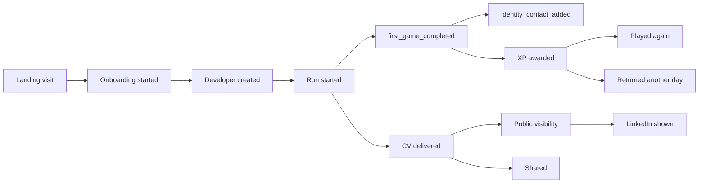

# Success metrics and analytics

> Part 1 · Product & Game Design · Status: **Approved (revision 4)**
>
> Targets are **hypotheses** to calibrate after launch. The event catalog and pipeline are defined in Part 2.

## 1. Philosophy

CV Rush succeeds when developers **enjoy it, come back, build a profile they care about, share it, contribute to it, and discover other developers through it**. Later stages add jobs and recruiters. Measurement is privacy-preserving, first-party and aggregated.

- **North Star (Stage 1): Weekly Active Developers (WAD)**, distinct developers who complete at least one run in a week.
- **Health metric: 4-week retention**, the share of new developers still active in their 4th week. Persistent progress only matters if people return.
- **Mission metric: profile discoveries**, the outbound clicks from CV Rush to public developer profiles (LinkedIn, later public pages) per week.
- **Network readiness (toward Stage 2):** the share of active developers with a claim identifier (email) and the share with a public profile.

## 2. Metric tree

| Area | Metric | Definition | Initial hypothesis |
|---|---|---|---|
| Acquisition | Visitors; share-driven visits | Unique visitors; visits from share links | Share-driven ≥ 30% after month 1 |
| Activation | Onboarding completion | Developers created ÷ onboarding started (name, seniority, role, stack) | ≥ 85% |
| Activation | First game completed | Developers with a completed first game ÷ developers created | ≥ 70% |
| **Identity** | **Save-progress conversion** | **`first_game_completed` → `identity_contact_added`**: share of developers who add an email or LinkedIn after their first completed game | ≥ 35% (hypothesis) |
| Identity | Eventual contact rate | Active developers with an email (any time) | Growing |
| Activation | First run start rate | Developers who start a run ÷ developers created | ≥ 90% |
| Engagement | Completion rate | Delivered or failed (not abandoned) ÷ started | ≥ 80% |
| Engagement | Delivery rate | Delivered ÷ started | 50–70% |
| Engagement | Games per developer | Per session, per week | ≥ 2 per session |
| Engagement | Run duration | p50 / p90 | p50 2.5–4 min; p90 ≤ 5 min |
| Engagement | Ranked vs practice mix | Share of practice runs after ranked runs are used | Signals appetite beyond rankings |
| **Progression** | XP distribution | XP per developer (percentiles) | — |
| **Progression** | Level distribution | Developers per level band | A healthy long tail |
| **Progression** | Time to level 5 / 10 | Days from creation | — |
| **Progression** | Profile page views | Developers opening "My profile" | ≥ 40% of returning developers |
| Retention | New vs returning developers | Per day and week | — |
| Retention | D1 / D7 / 4-week retention | Cohorts by creation week | D1 ≥ 15%; D7 ≥ 8% |
| Retention | Last-active distribution | Active today / this week / this month / dormant | — |
| Retention | Replay rate | Developers with ≥ 2 runs in a session | ≥ 50% |
| Virality | Share rate; share conversion | Shares ÷ delivered runs; runs from share visits | ≥ 5%; ≥ 25% |
| Showcase | Public visibility rate | Public developers ÷ active developers | ≥ 30% |
| Showcase | LinkedIn displayed | Public developers showing LinkedIn | ≥ 50% of public |
| Showcase | Profile discoveries | LinkedIn clicks from CV Rush per week | Growing |
| Network readiness | Email provided | Active developers with an email (the claimable base) | Growing |
| Competition | Ranked adoption | Developers who choose Play Ranked ÷ active developers; attempts used per day | — |
| Competition | Active categories | Categories with ≥ 3 verified ranked runs per day | All 9 launch categories most days |
| Game balance | Failure distribution | Failures by stage and reason | No stage > 50% of failures |
| Game balance | ATS pass rate (first run) | — | ~80% |
| Content quality | Technical accuracy | Correct ÷ answered, by technology, level, band, locale | Within expected bands |
| Content quality | Question report rate | Reports ÷ questions served | < 1% |
| Content quality | AI question rejection rate | Generated questions failing validation | Tracked (pipeline quality) |
| Content quality | Pool exposure | Share of a context's pool already seen by its active players | Triggers pool refills |
| Content quality | Repeat rate | Questions a developer has already seen | < 10% in the first 10 runs |
| Performance | First playable; fps; API p95 | — | < 5 s on 4G; ≥ 30 fps in 95% of sessions; < 300 ms |
| Integrity | Flagged runs; voided XP; disqualifications | — | Investigate spikes |
| Community | Contributors; content PRs; translations | — | Growing |
| Cost | Cost per 1,000 runs; AI generation cost per validated question | — | Tracked |
| *Stage 3 (future)* | Job views; Play to Apply starts; applications | — | — |

## 3. Guardrail metrics

Privacy complaints and takedowns · any email exposure (target: zero, alert) · rejected-name and report rates · accessibility feedback · error rate by browser · mobile vs desktop score gap in ranked · es vs en accuracy gap on the same questions · score gap by declared stack within a category · XP farming signals (runs per developer per day, voided XP).

## 4. Funnels

## 5. Questions we want to answer

| Question | Metric or analysis |
|---|---|
| How many new and returning developers? | New vs returning, cohorts |
| How many games per developer? | Games per developer |
| When were developers last active? | Last-active distribution |
| What share replays? | Replay rate |
| How are XP and levels distributed? | XP and level distributions |
| What share finishes? Where do they abandon? | Completion, abandonment by stage |
| Which challenge eliminates the most? | Failure distribution |
| How accurate are developers technically, and where do they struggle? | Accuracy by technology, topic, level (aggregated) |
| Which stacks, roles and declared seniorities are most common? | Aggregated snapshots |
| How many share and how many visit LinkedIn profiles? | Share rate, profile discoveries |
| How many developers are ready to claim an account? | Email provided |
| *(Stage 3)* How many play to apply and apply? | Job funnel |

The answers feed balancing, UX, difficulty and content quality, through people reviewing data, not automatic adjustment.

## 6. Measurement principles

- First-party **domain events** (e.g. `developer_created`, `game_finished`, `xp_awarded`, `level_up`, `ats_failed`), independent of any provider. PostHog, Plausible or OpenTelemetry can be plugged in later.
- **Analytics never influence game logic**, and game logic never depends on analytics being available. Progression (XP, levels) is domain data, not analytics.
- Events carry a pseudonymous developer ID and non-sensitive metadata. **Never** names, emails or LinkedIn usernames.
- Aggregates are published only above a minimum group size.
