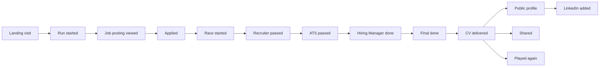

# Success metrics

> Part 1 · Product & Game Design · Status: **Draft for review (revision 2: profile-first)**
>
> Targets are **hypotheses** to calibrate after launch, not promises. The event catalog and analytics pipeline are defined in Part 2.

## 1. Philosophy

Success is not just "number of runs". CV Rush succeeds when people **enjoy it, come back, share it, contribute to it, and discover other professionals through it**. The metrics reflect all of that, with privacy-preserving, first-party, aggregated measurement.

- **North Star metric:** **Weekly Delivering Players**, the number of distinct players who deliver at least one CV in a week (any mode). It captures fun (they finished), reach and health better than raw runs.
- **Mission metric:** **Weekly profile discoveries**, the outbound clicks from CV Rush to public player profiles (LinkedIn) per week. It measures the "help professionals get discovered" promise.

## 2. Metric tree

| Area | Metric | Definition | Initial hypothesis |
|---|---|---|---|
| Acquisition | Landing visitors | Unique visitors per day | — |
| Acquisition | Share-driven visits | Visits arriving via share links | ≥ 30% of visits after month 1 |
| Activation | Start rate | Visitors who start a run ÷ visitors | ≥ 40% |
| Activation | Onboarding completion | Profiles completed ÷ onboarding started | ≥ 85% |
| Engagement | Completion rate | Runs ending as delivered or failed (not abandoned) ÷ runs started | ≥ 80% |
| Engagement | Delivery rate | Delivered ÷ runs started | 50–70% (too high means too easy) |
| Engagement | Runs per player per session | — | ≥ 2 |
| Engagement | Run duration | p50 / p90 | p50 2.5–4 min; p90 ≤ 5 min |
| Retention | D1 / D7 return | Players returning the next day or week | D1 ≥ 15%; D7 ≥ 8% |
| Retention | Ranked habit | Players with ranked runs on ≥ 3 days per week | — |
| Virality | Share rate | Shares ÷ delivered runs | ≥ 5% |
| Virality | Share conversion | Runs started from share visits ÷ share visits | ≥ 25% |
| Showcase | Public opt-in rate | Public profiles ÷ delivered ranked runs | ≥ 30% |
| Showcase | LinkedIn added | Public profiles with LinkedIn ÷ public profiles | ≥ 50% |
| Showcase | Profile discoveries | LinkedIn clicks from leaderboards per week (mission metric) | Growing week over week |
| Game balance | Failure distribution | Share of failures by stage (`ATS_FAILED`, `CV_DESTROYED` by stage) | No single stage > 50% of failures |
| Game balance | ATS pass rate (first run) | — | ~80% |
| Content quality | Question report rate | Reports ÷ questions served | < 1% |
| Content quality | Difficulty deviation | Observed vs expected difficulty per question | Flag outliers for review |
| Content quality | Repeat rate | Share of questions a player has already seen (casual) | < 10% in a player's first 10 runs |
| Performance | First playable | Time to an interactive game on 4G mid-range Android | < 5 s |
| Performance | Frame rate | Share of sessions with sustained ≥ 30 fps | ≥ 95% |
| Performance | API latency | p95 for challenge start and answer endpoints | < 300 ms |
| Competition | Active categories | Categories reaching the minimum field (3 verified runs) per day | All 9 launch categories most days |
| Competition | Runs per category | Daily ranked runs per category (median, p10) | Informs category splits or merges |
| Integrity | Flagged runs | Runs failing verification ÷ ranked runs | Monitor; investigate spikes |
| Integrity | Champion disqualifications | Per month | Ideally 0 |
| Community | Contributors | Unique contributors per month (code, content, translations) | Growing |
| Community | Content PRs | Merged question, technology and translation PRs | Growing |
| Community | Stars, forks | GitHub stars and forks | Context only |
| Sustainability | Cost per 1,000 runs | Hosting cost ÷ runs × 1,000 | Tracked |

## 3. Guardrail metrics

These must not get worse while we optimize the metrics above:

- Privacy complaints and takedown requests.
- Rejected display name rate and offensive content reports.
- Accessibility feedback.
- Error and crash rate by browser (especially in-app browsers).
- Mobile vs desktop score gap in ranked (device fairness).
- Score gap by declared stack within a category (stack fairness).
- Category change frequency and near-perfect runs in Junior boards (smurfing signals).
- es vs en accuracy gap on the same questions (language fairness).

## 4. Funnel

## 5. Questions we want to be able to answer

| Question | Metric or analysis |
|---|---|
| What share of visitors start a run? | Start rate |
| What share finish? | Completion and delivery rate |
| Where do players abandon? | Abandonment by stage |
| Which challenge eliminates the most players? | Failure distribution |
| Which profiles play the most? | Runs by role, seniority and category (aggregated) |
| Which stacks are most common per role? | Stack combinations from run snapshots (aggregated) |
| Which technologies are most popular? | Stack selections (aggregated) |
| Which seniority has the highest completion rate? | Completion rate by declared seniority |
| How long does a run take? | Run duration |
| How many players come back? | D1/D7 return, ranked habit |
| How many share their result? | Share rate |
| How many visit LinkedIn profiles from the leaderboard? | Profile discoveries |
| Which questions are hardest, ambiguous or broken? | Question stats + reports |
| Which topics do players fail most? | Accuracy by topic and technology (aggregated) |

These answers feed game balancing, UX, difficulty and question quality. Changes are made by people reviewing data, not by automatic adjustment, at least initially.

## 6. Measurement principles

- First-party events defined in the domain (e.g. `game_finished`, `ats_failed`), independent of any provider. Providers like PostHog, Plausible or OpenTelemetry can be plugged in later.
- Analytics never influence game logic, and game logic never depends on analytics being available.
- Aggregates are published only above a minimum group size.
- Personal data (names, LinkedIn usernames) never travels in analytics events.
