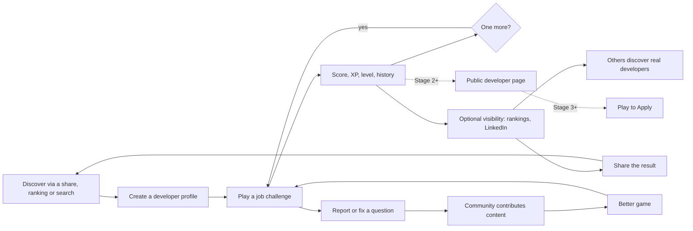

# Product vision, core fantasy and target users

> Part 1 · Product & Game Design · Status: **Approved (revision 4)**
>
> "CV Rush" is the provisional public name. Everything below describes the product in brand-agnostic terms, so a rename is a branding change, not a redesign.

## 1. Vision

**Build a developer network powered by games.** It starts as a fast, funny 2D game about getting your CV through a hiring process. Every run builds a persistent developer profile: results, XP, levels, history and gameplay stats. Over time, that profile can make developers visible, and later connect them with jobs and recruiters, always by their own choice.

### Product principle

> **The game creates engagement.**
> **The profile accumulates value.**
> **Jobs create opportunity.**
>
> Today we build mainly the first two lines.

**Architectural north:** Developers → Games → Progress → Reputation inside CV Rush → Jobs → Applications → Recruiters.

The game is the entry point and the engagement mechanism. The persistent developer profile is the asset that grows over time.

Elevator pitch:

> Tell us who you are: your seniority, your role, your stack. You'll get a job challenge built for you. Grab your CV and race through recruiters, an ATS machine and interviews to deliver it at the company. Every run earns XP, levels you up and builds your developer profile. Climb the rankings, show your profile if you want, and one day, play to apply to real jobs.

### Long-term evolution

**Game → Developer Network → Jobs → Recruiter Platform.** Each stage only starts when the previous one works. See [product evolution](product-evolution.md).

### Why this can work

| Reason | What it means for the product |
|---|---|
| **Universal and relatable** | Almost every developer has a ghosting, ATS or "10 years of experience in a 2-year-old framework" story. Shared pain is shareable humor. |
| **Personal** | Every run is built for the player's seniority, role and stack, and every result says *as what* it was achieved |
| **Short, competitive and progressive** | 2–5 minute runs, rankings, and XP and levels that accumulate: a reason to come back tomorrow, not just today |
| **A real reason to keep a profile** | Visibility (rankings, later a public developer page), and eventually jobs |
| **Open and transparent** | Public rules, open-source code and contributable content build trust |

## 2. Core fantasy

> **"I am living a hiring process while trying to get my CV all the way to the company."**

- The protagonist is **the candidate**, the developer.
- The object to protect is **the CV**, which the runner carries.
- The destination is **the company**, always visible ahead.
- The rivals are **other candidates**.
- The obstacles are **the hiring process itself**.
- The reward is **getting in, and leaving with a stronger profile**: score, XP, levels, history, visibility.

And across runs:

> **"Every application I survive makes my developer profile stronger."**

Every UX, game-design and architecture decision should reinforce these sentences. If a feature makes the game feel like "a quiz with a skin", or the network feel like a cold assessment platform, it is wrong for this product.

### Emotional arc of a run

| Moment | Real-life analogue | Feeling we design for |
|---|---|---|
| Job posting | "This one is for me." | Curiosity, anticipation |
| Apply → lobby ("237 candidates applied") | Realising how many people applied | Adrenaline, competition |
| Race segments | Waiting between stages | Momentum, flow |
| Recruiter Screening | The first quick call | Light pressure, quick judgment, humor |
| ATS Scan | Being filtered by a robot | Absurdity, frantic fun, "beat the machine" |
| Hiring Manager | The technical interview | Focused pressure, competence |
| Final Interview with the HQ in sight | The last round | Climax |
| Deliver the CV | Getting the offer | Relief, pride |
| Results, XP and level up | A career milestone | Progress, "one more" |
| Rejection (failure) | The template rejection email | A laugh and "one more try", **never humiliation** |
| Rankings and share | Being recognised | Status, visibility |

### Fantasy mapping

| Hiring reality | In-game element | Mechanic |
|---|---|---|
| Job posting | The Job Challenge briefing | Read and understand; tested later by job questions |
| Hundreds of applicants | Field of runners; real applicant counts in ranked | Final position |
| Recruiter screening | A recruiter on the track | In-world answer paths A/B/C/D |
| ATS keyword filters | The **ATS 9000** machine and its conveyor | Collect relevant keywords, reach a threshold |
| Salary conversation | Recruiter salary question (MVP), negotiation stage (V1) | Graded answer |
| Hiring manager | Technical interview zone | Harder questions |
| Final round | Panel at the company entrance | Final question and Final Boost |
| Your CV | The CV the runner carries | CV Health |
| Rejection email | Game-over screen | "Thank you for your interest…" |
| Getting in | Delivering the CV at reception | Finish |
| A growing career | XP, CV Rush Level, history | Progression |
| Ghosting (V1) | A fading hazard | The path or the recruiter disappears |
| Portals asking you to retype your CV, unpaid take-homes | Obstacles | Jump or avoid |

## 3. Product pillars

1. **Satirize the process, respect the people.** The jokes target systems, not recruiters, candidates or any identity.
2. **Fast, readable, replayable.** A run fits in a coffee break and is playable on a phone.
3. **The server is the referee.** Results, XP and rankings are computed server-side and are explainable.
4. **Compete as who you are.** Every run is played as the developer's declared seniority, role and stack, frozen when the run starts; rankings compare comparable profiles (see [competitive identity](competitive-identity.md)).
5. **Progress that persists.** XP, levels, history and stats belong to the developer and survive profile changes, seasons and future account creation (see [identity and accounts](identity-and-accounts.md)).
6. **Visibility by choice.** Private by default; every level of exposure (rankings, public page, Open to Work, recruiters) is a separate, reversible opt-in. The email is never public.
7. **Gameplay statistics, not certifications.** "Redis challenges: 87% accuracy", never "87% good at Redis".
8. **Built in the open.** Rules are documented, code is open source, content is contributable.

## 4. Tone and identity

**Visual direction: "corporate arcade".** The clean UI language of professional software combined with arcade energy: bold type, punchy feedback, quick transitions. **A 2D side-scrolling platformer/runner** with an original visual identity. We take conceptual inspiration from classic platformers and runners but **never copy** their assets, characters, blocks, sounds, levels or layouts (no Nintendo or Mario assets or lookalikes), and we never use LinkedIn's branding beyond its guidelines for share links.

**Humor guardrails**

- Punch at **systems**, not at people: ATS robots, ghosting, unpaid take-homes, "rockstar ninja" job ads, retyping your CV into a portal.
- Recruiters and hiring managers are caricatured **with affection**. They are also trapped in the process, and they are future users of the platform.
- Never joke about nationality, gender, age, accent, disability, religion or seniority shaming.
- Failure is funny, not humiliating.
- Jokes are **localized, not translated**.
- No real companies or real people. All game companies are fictional until real companies join (Stage 3), and real companies are never mocked.
- Professional enough that a senior engineer would share it on LinkedIn and keep it on their profile.

**Brand independence.** The name, logo and visual brand live in brand configuration and assets. Domain language (developer, run, job challenge, result…) never contains the brand name.

## 5. Target users

| Segment | Why they come | What they need | Stage |
|---|---|---|---|
| Developers **actively job hunting** | Catharsis, practice, visibility, later jobs | Fun runs, a profile worth showing, later Play to Apply | 1 → 3 |
| **Employed** developers | Fun, competition, progression, bragging rights | Fair rankings, XP and levels, history | 1–2 |
| Students, bootcamp grads, juniors | Practice, learning, a first visible profile | Practice runs, explanations, progress | 1–2 |
| Recruiters and hiring managers (as players) | Laughing at the process, sharing | Respectful humor | 1 (amplifiers) |
| Open-source contributors | Portfolio, community | A contribution path that doesn't require knowing everything | 1+ |
| Companies with jobs | Reaching active developers | Job postings, Play to Apply, applications | 3 |
| Recruiters (as customers) | Finding active, discoverable developers | Search over voluntary profiles, honest signals | 4 |

Roles covered at launch: 13 engineering, infrastructure, quality, data, security and architecture roles, grouped into 10 tracks (extensible).

### Personas (fictional)

- **Andrea**, Junior Frontend Developer, Lima. Job hunting. Opens the game from a LinkedIn post on her phone, plays in Spanish, and wants practice plus a profile she can show.
- **Marco**, Senior Backend Engineer, Barcelona. Employed and competitive. Plays at lunch and chases his category's #1 and his next level.
- **Priya**, Tech Recruiter, London. Shares the game today; might search discoverable developers in Stage 4. Expects fairness to candidates and to recruiters.
- **Tomás**, Mid Fullstack Developer, Buenos Aires. Wants to contribute Laravel questions without learning the whole architecture.

### Play context (a design constraint)

- **The primary entry point is a LinkedIn post opened on a phone, inside LinkedIn's in-app browser.** That implies one-handed play, no install, a fast first load, possible storage and cookie restrictions, audio off by default and frequent interruptions. Portrait must work; landscape gives a wider view of the side-scrolling level.
- **The secondary context is desktop at work.** Keyboard controls and an easy mute.
- **Languages:** Spanish and English from day one, in neutral Spanish.

## 6. Product loop

## 7. What this product is not

- **Not a certification or an assessment.** Results are CV Rush gameplay statistics, not a measure of professional ability.
- **Not a recruiter SaaS (yet).** Jobs and recruiter features are later stages with their own guardrails.
- **Not a quiz app with a skin.** Questions are part of the game world.

See [MVP scope › explicit non-goals](mvp-scope.md#5-explicit-non-goals).
