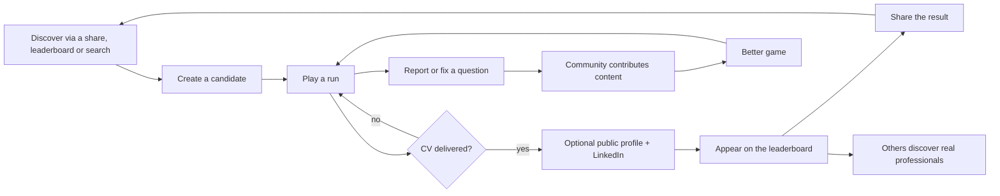

# Product vision, core fantasy and target users

> Part 1 · Product & Game Design · Status: **Draft for review**
>
> "CV Rush" is the provisional public name. Everything below describes the product in brand-agnostic terms so that a rename is a branding change, not a redesign.

## 1. Vision

**Turn the most universally frustrating professional ritual, the hiring process, into a three-minute arcade race that people want to replay, share and compete in, and use the leaderboard to help real professionals get discovered.**

Elevator pitch:

> You found a job you want. Grab your CV and race through recruiters, an ATS machine and interviews to deliver it at the company before the other candidates. Win the day and your profile becomes the Daily Champion.

### Why this can work

| Reason | What it means for the product |
|---|---|
| **Universal and relatable** | Almost everyone in tech has a ghosting, ATS or "10 years of experience in a 2-year-old framework" story. Shared pain is shareable humor. |
| **Personal** | The job posting is built around the player's role and stack. It is *their* hiring process. |
| **Short and competitive** | 2–5 minute runs, a daily ranking, and a one-tap retry create the "one more try" loop. |
| **A real reason to share** | The leaderboard is a professional showcase. Sharing a result is also a way to be discovered on LinkedIn. |
| **Open and transparent** | Public rules, open-source code and community content build trust and grow the question supply. |

## 2. Core fantasy

> **"I am living a hiring process while trying to get my CV all the way to the company."**

- The protagonist is **the candidate**.
- The object to protect is **the CV**, which the runner physically carries.
- The destination is **the company**, always visible ahead.
- The rivals are **other candidates**.
- The obstacles are **the hiring process itself**.
- The reward is **getting in, entering the leaderboard and being discovered**.

Every UX, game-design and architecture decision should reinforce this sentence. If a feature makes the game feel like "a quiz with a skin", it is wrong for this product.

### Emotional arc of a run

| Moment | Real-life analogue | Feeling we design for |
|---|---|---|
| Job posting | "This one is for me." | Curiosity, anticipation |
| Apply → lobby ("237 candidates applied") | Realising how many people applied | Adrenaline, competition |
| Race segments | Waiting between stages | Momentum, flow |
| Recruiter Screening | The first quick call | Light pressure, quick judgment, humor |
| ATS Scan | Being filtered by a robot | Absurdity, frantic fun, "beat the machine" |
| Hiring Manager | The technical interview | Focused pressure, competence |
| Final Interview with the HQ in sight | The last round | Climax |
| Deliver the CV | Getting the offer | Relief, pride |
| Rejection (failure) | The template rejection email | A laugh and "one more try", **never humiliation** |
| Leaderboard and share | Being recognised | Status, visibility |

### Fantasy mapping

| Hiring reality | In-game element | Mechanic |
|---|---|---|
| Job posting | Briefing screen before the race | Read and understand; tested later by memory questions |
| Hundreds of applicants | Field of runners; real applicant count in ranked | Final position |
| Recruiter screening | A recruiter steps onto the track | Answer gates (lanes/doors) |
| ATS keyword filters | The **ATS 9000** machine and its conveyor belt | Collect relevant keywords, reach a match threshold |
| Salary conversation | Recruiter salary question (MVP), negotiation stage (V1) | Graded answer |
| Hiring manager | Technical interview zone | Harder questions |
| Final round | Panel at the company entrance | Final question and Final Boost |
| Your CV | The CV the runner carries | CV Health |
| Rejection email | Game-over screen | "Thank you for your interest…" |
| Getting in | Delivering the CV at reception | Finish |
| Ghosting (V1) | A fading hazard | The track or the recruiter disappears |
| Portals asking you to retype your CV, unpaid take-homes | Obstacles | Jump or dodge |

## 3. Product pillars

1. **Satirize the process, respect the people.** The jokes target systems (ATS filters, ghosting, absurd requirements), not recruiters, candidates or any identity.
2. **Fast, readable, replayable.** A run fits in a coffee break and is playable one-handed on a phone.
3. **The server is the referee.** Results are computed server-side, are explainable, and do not depend on trusting the browser.
4. **Personal in casual, fair in ranked.** Personalization drives fun; fairness drives competition. The two do not mix (see [game modes](game-modes.md)).
5. **Visibility by choice.** Nobody becomes public by finishing a run. Showcasing is an explicit, reversible opt-in.
6. **Built in the open.** Rules are documented, code is open source, and content is contributable without touching game code.

## 4. Tone and identity

**Visual direction: "corporate arcade".** The crisp, clean UI language of professional software, combined with arcade energy: bold type, punchy feedback and quick transitions. Modern 2D, cartoon or modern pixel art. Original assets only. We take inspiration from runners and arcade games, but never copy their assets, characters or layouts, and never use LinkedIn's branding beyond what its brand guidelines allow for share links.

**Humor guardrails**

- Punch at **systems**, not at people: ATS robots, ghosting, unpaid take-homes, "rockstar ninja" job ads, retyping your CV into a portal.
- Recruiters and hiring managers are caricatured **with affection**. They are also trapped in the process.
- Never joke about nationality, gender, age, accent, disability, religion or seniority shaming.
- Failure is funny, not humiliating. The rejection screen mocks the template email, not the player.
- Jokes are **localized, not translated**. Spanish and English copy can use different jokes with the same intent.
- No real companies, products presented as employers, or real people. All companies are fictional.
- Professional enough that a senior engineer would share it on LinkedIn without embarrassment.

**Brand independence.** The name, logo and visual brand live in brand configuration and assets. Domain language (run, challenge, candidate, job posting…) never contains the brand name. Renaming the product must not require renaming tables, classes or events.

## 5. Target users

| Segment | Why they play | What they need | Priority |
|---|---|---|---|
| Tech professionals **actively job hunting** | Catharsis, practice, visibility | A fast run, a shareable result, a chance to be discovered | Primary |
| **Employed** tech professionals | Fun, bragging rights, competing with peers | A fair daily ranking, a reason to come back | Primary |
| Students, bootcamp grads, juniors | Low-stakes practice, learning | Casual mode at their level, explanations after the run | Secondary |
| Recruiters, talent acquisition, hiring managers | Laughing at the process, sharing with their network | Humor that is respectful to them | Secondary (amplifiers) |
| Open-source contributors | Portfolio, learning, community | A contribution path that does not require knowing the whole system | Secondary (supply side) |
| Companies and communities | Sponsorship, employer branding | Rules that protect game integrity | Future |

Covered roles: engineering, data, design, product and security roles (16 at launch, extensible). See [MVP scope](mvp-scope.md) for which roles have full content coverage at launch.

### Personas (fictional)

- **Andrea**, Junior Frontend Developer, Lima. Job hunting. Opens the game from a LinkedIn post on her phone. Plays in Spanish. Wants practice and a result she can share.
- **Marco**, Senior Backend Engineer, Barcelona. Employed and competitive. Plays the Daily Challenge on desktop at lunch and checks whether he held the #1 spot.
- **Priya**, Tech Recruiter, London. Shares the game with candidates and colleagues. Plays in English. Expects the satire to be fair to recruiters.
- **Tomás**, Mid Fullstack Developer, Buenos Aires. Wants to contribute Laravel questions without learning the whole architecture.

### Play context (a design constraint)

- **The primary entry point is a LinkedIn post opened on a phone, inside LinkedIn's in-app browser.** That implies portrait orientation, one-handed play, no install, a fast first load, possible restrictions on cookies and storage, audio off by default, and frequent interruptions (notifications, app switching).
- **The secondary context is desktop at work** (lunch break). Keyboard controls and an easy mute.
- **Languages:** Spanish and English from day one. Spanish copy uses neutral Spanish that works for Spain and Latin America.

## 6. Product loop

The product, the architecture and the open-source setup should all strengthen this cycle: easy to start, fair to compete, worth sharing, and easy to contribute to.

## 7. What this product is not

- **Not a hiring assessment or a certification.** Results are CV Rush results, not a measure of professional ability.
- **Not a recruitment tool** (at least not now; see [future platform](future-platform.md)).
- **Not a quiz app with a skin.** Questions are a mechanic inside the race, not the product.

The full list is in [MVP scope › explicit non-goals](mvp-scope.md#5-explicit-non-goals).
