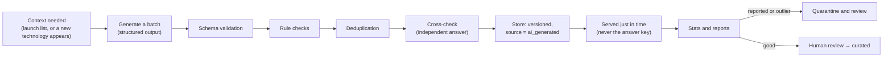
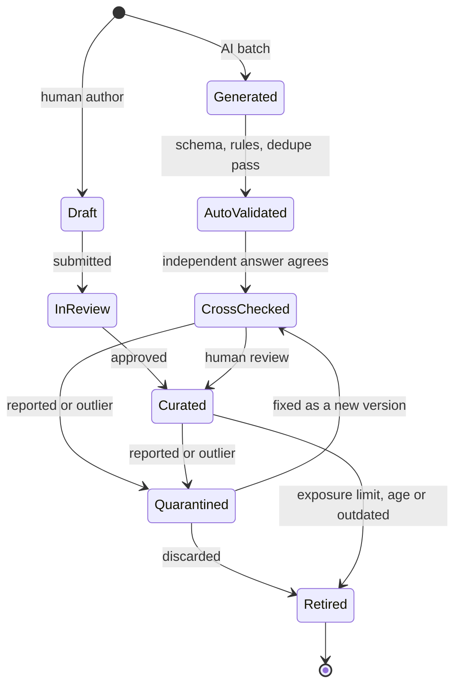

# Content strategy

> Part 1 · Product & Game Design · Status: **Draft for review (revision 3: simplified MVP content)**
>
> Revision 3 simplifies the MVP: instead of hand-writing hundreds of questions before launch, the MVP uses **AI-generated, validated and stored question pools** (~20 per context) plus job-derived templates. The large open-source question-pack system and the curated competitive pool come later, and gradually **replace** AI content. Schemas, the generation pipeline and tooling are designed in Part 2.

## 1. Content types

| Type | Examples | Where it lives | Contributable |
|---|---|---|---|
| **Catalogs** | Roles, seniorities, bands, tracks, technologies, categories, aliases, role compatibility and recommendations | Repository (open) | ✅ |
| **Job content** | Title patterns, summaries, responsibility fragments, perks, company name parts, locations, salary bands | Repository (open) | ✅ |
| **Question pools (MVP)** | AI-generated, validated questions per context, with ranked and practice partitions | **Private database** (answer keys never in the repository or on the client) | ❌ (reports only) |
| **Question templates** | Job-memory generators, salary template, scenario templates | Repository (logic, open) | ✅ (reviewed carefully) |
| **Sample pool** | A small, clearly fake question set for local development and tests | Repository (open) | ✅ |
| **Community question packs** (later) | Curated questions per technology, with answers and explanations | Repository (open) | ✅ |
| **Curated competitive pool** (later) | Reviewed, calibrated question families for ranked | Private | Trusted reviewers |
| **Daily Company schedule** | Upcoming Daily Companies and themes | Private until published | ❌ |
| **Bot content, humor content, UI copy** | Archetypes, lines, rejection emails, interface text | Repository (open) | ✅ |

## 2. Question contexts and pools (MVP)

A **question context** is a combination the game needs to fill a slot:

| Context kind | Example | Fills |
|---|---|---|
| Technology × level | Redis · level 3 | H1 (stack), part of F1 |
| Track fundamentals × level | Fullstack fundamentals · level 3 | H2 |
| Seniority × band | Senior+ situational / architecture · level 4 | H3, F1 |

Each context has a **pool of ~20 validated questions** (or enough to demonstrate the system), bilingual (es/en), split into a **ranked partition** (answers never revealed) and a **practice partition** (answers and explanations shown in practice reviews).

Job questions (memory, recruiter, salary) come from **templates** applied to the run's posting. They don't need pools.

## 3. AI-generated questions: the MVP pipeline



**Structured output (one item):**

```
question, optionA, optionB, optionC, optionD, correctOption, explanation,
technology, difficulty, seniority, role, (topic), translations es + en
```

**Rules:**

- **Never on the request path.** Pools are generated **before launch** for the launch contexts, and **asynchronously** when a new context appears (e.g. someone selects Elixir) or when a pool runs low. A run never waits for an LLM; without a usable pool, the slot falls back to track fundamentals.
- **Never trusted blindly.** Every generated question goes through:
  - schema validation;
  - rule checks: 4 distinct options, exactly one correct, length limits (prompt ≤ 140, options ≤ 40), known technology, valid difficulty and seniority, both languages present with the same correct option, no answer leaked in the prompt, no "all of the above";
  - deduplication against existing questions;
  - a **cross-check**: the item is answered independently (without the key) and discarded on disagreement.
- **Stored and reused**, with `source = ai_generated` and a **verification level**: `auto_validated` → `cross_checked` → `human_reviewed` → `curated`. Selection prefers higher levels; ranked uses at least `cross_checked`.
- **Answer keys never reach the client.** Pools live in the private database, not in the repository.
- **Reports and outlier stats quarantine** a question until it's reviewed.
- **Pool refill:** when the active players of a context have seen most of its pool (exposure threshold), a new batch is generated asynchronously.
- **Cost controls:** batch generation, caching, budgets and a feature flag (`aiQuestions`). Generation happens per context, never per run or per frame.
- **Gradual replacement:** curated and community questions are added to the same pools with higher verification levels. AI questions with poor stats retire first.
- **Rankings during this phase are Season 0 (Beta)** (see [rankings](../product/leaderboards.md#10-ranking-integrity)).

## 4. Open and private content (long term)

The repository is public, so **anything in it is known to attackers, including answers**. Hiding questions from the browser doesn't protect a ranking if the answers are on GitHub. The long-term model:

| | **Community Question Packs** (later) | **Private pools** (MVP: AI-generated; later: curated competitive) |
|---|---|---|
| Visibility | Public, open-source (with answers) | Private: never in the repository; answer keys never sent to clients |
| Purpose | Practice, learning, contributors, local development, tests | Ranked slots (and practice partitions) |
| Authors | Anyone, via PR | AI generation + validation (MVP); maintainer and trusted reviewers (later) |
| Post-run review | Correct answer and explanation, with attribution | Ranked: results only; practice partition: answers and explanations |
| End of life | Deprecated when outdated | Retired; curated competitive questions can later **graduate** into open packs |

## 5. Content lifecycle



- **Edits create a new version.** Runs keep referencing the exact version they served, so past runs stay auditable (see [versioning](question-strategy.md#12-versioning-and-audit)).
- **Deactivating never deletes.**

## 6. Coverage plan (MVP)

- **Launch contexts pre-generated** for the 4 tracks with full coverage (Frontend, Backend, Fullstack, Platform): track fundamentals at levels 1–5, seniority pools per band, and technology pools for the ~22 priority technologies at the levels the bands and practice need.
- **Priority technologies:** JavaScript, TypeScript, React, Vue, Angular, Next.js, Node.js, NestJS, PHP, Laravel, Java, Spring Boot, Python, Go, PostgreSQL, MySQL, MongoDB, Redis, Kafka, Docker, Kubernetes, AWS.
- **Long tail** (any other catalog technology): generated asynchronously on first need; fallback to track fundamentals until ready.
- **Practice-only tracks** (Mobile, Quality, Data, Security, Architecture): generated pools for practice; they become ranked when their pools reach quality and size thresholds.

## 7. Quality bar (all sources)

- One unambiguous correct answer (or explicit graded options).
- Prompt ≤ 140 characters, options ≤ 40: readable while running.
- Plausible distractors; no joke options outside humor questions; no "all/none of the above".
- Concepts over version trivia; version-sensitive questions are tagged.
- Honest difficulty, an explanation for every question, neutral and respectful language.
- Original content: no copying from certification exams, books or paid banks. AI output is checked for verbatim reproduction of known sources.

## 8. Localization of content

- Every question exists in **es** and **en** with **the same option IDs and the same correct option**.
- Technical meaning is preserved exactly; tech terms stay in English when that's how the industry speaks.
- Neutral Spanish for Spain and Latin America.
- Ranked requires both locales validated.

## 9. Attribution and licensing

- Repository content (catalogs, templates, sample pool, future community packs) follows the licensing decided in the Part 2 ADR (direction: CC BY 4.0 for content, Apache-2.0 for code).
- AI-generated pools are private operational data, not distributed. Whether and how they are ever published is part of the same ADR.
- Community questions (later) show "Question by @handle" in practice reviews.
