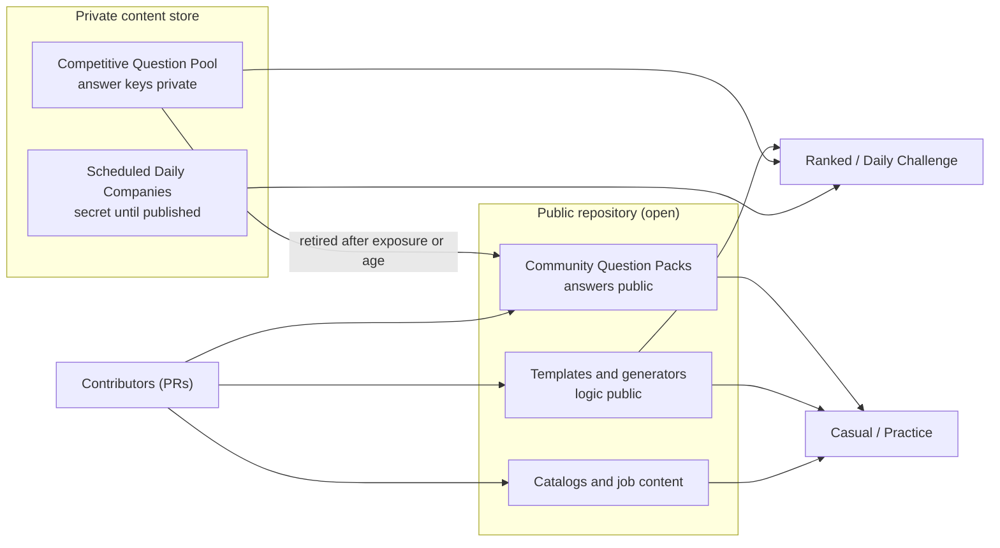
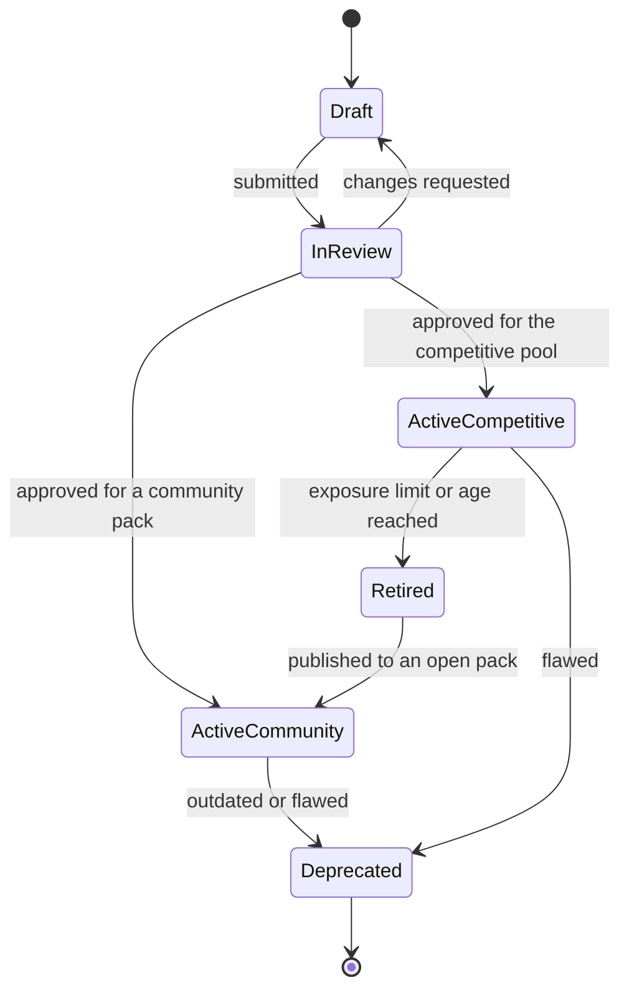

# Content strategy

> Part 1 · Product & Game Design · Status: **Draft for review (revision 2: profile-first)**
>
> **Content is the real bottleneck of this product, not code.** This document defines what content exists, where it comes from, how it flows between the open and private worlds, and the quality bar. Storage formats, schemas and tooling are designed in Part 2; contributor guides come in Part 3.

## 1. Content types

| Type | Examples | Open or private | Contributable |
|---|---|---|---|
| **Catalogs** | Roles, seniorities, technologies, technology categories, aliases, role → technology recommendations | Open | ✅ |
| **Job content** | Title patterns, summaries, responsibility fragments, perks, company name parts, locations, salary bands | Open | ✅ |
| **Community Question Packs** | Questions per technology or topic, with answers and explanations | Open | ✅ |
| **Question templates** | Job-memory generators, salary template, parameterized technical templates, scenario templates | Open (logic) | ✅ (reviewed carefully) |
| **Competitive Question Pool** | Verified questions grouped in families for ranked slots | **Private** | Via a private path (V1) |
| **Daily Company schedule** | Upcoming Daily Companies and their domain themes | **Private until published** | ❌ |
| **Bot content** | Archetypes, name pools, lines | Open | ✅ |
| **Humor content** | Rejection emails, recruiter lines, satirical perks, humor questions | Open | ✅ (humor guardrails apply) |
| **UI copy** | All interface text, by namespace | Open | ✅ (translations) |

## 2. Sources

1. **Maintainer-authored**: the seed of every content type and the whole competitive pool at launch.
2. **Community contributions**: pull requests to open content (packs, catalogs, job fragments, translations).
3. **Templates and generators**: job-derived questions and parameterized variants produced at runtime from authored templates.
4. **AI-assisted drafting (authoring time only)**: a maintainer or contributor may use AI to draft questions, which then go through the same validation and human review as any other content. Never trusted blindly, and never a runtime dependency. A structured AI generation pipeline is V2 (see [question strategy](question-strategy.md#13-ai-generated-questions-future)).

## 3. Two pools: Community Packs and the Competitive Pool

The repository is public, so **anything in it is known to attackers, including answers**. Hiding questions from the browser does not protect a ranking if the answers are on GitHub. So we separate:

| | **Community Question Packs** | **Competitive Question Pool** |
|---|---|---|
| Visibility | Public, open-source (with answers) | Private: never in the repository, never sent to clients with answer keys |
| Purpose | Casual mode, practice, learning, contributors, local development, tests | Ranked technical slots: **shared daily families** per category/band (role fundamentals, seniority, scenarios) and **stack families** per technology and level |
| Authors | Anyone, via PR | Maintainer and trusted reviewers |
| Review | CI validation + maintainer review | Validation + review + calibration |
| Post-run review | Correct answer and explanation shown, with author attribution | Results only, until retirement |
| Lifecycle end | Deprecated when outdated or flawed | **Retired → published into community packs** |

Ranked also uses **job-derived** and **template** questions. Their logic is public, which is fine. Job-derived answers come from the posting the player has just read (open-book by design), and templates compute answers from per-run parameters, so a lookup table doesn't help.

## 4. How content flows

The open bank grows with **battle-tested questions** when they retire from the competitive pool, and the competitive pool stays fresh.

## 5. Content lifecycle

- **Edits create a new version.** Runs keep referencing the exact version they served, so past runs stay auditable (see [question strategy › versioning](question-strategy.md#12-versioning-and-audit)).
- **Deactivating never deletes.** Deprecated content remains for audit.
- **Exposure limits** for competitive questions (e.g. served N times, or live for M weeks) are tunables.

## 6. Coverage plan (MVP)

Coverage is organized by **track** (role family) and **band**, because ranked categories are track × band (see [competitive identity](../product/competitive-identity.md)).

**Casual coverage (community packs):** full for Frontend, Backend, Fullstack and Platform (DevOps & Cloud). Other tracks (Mobile, Quality, Data Engineering, Data Science & ML, Security, Architecture) are playable in casual with job-derived, recruiter and shared-fundamentals questions plus whatever packs exist. They show a "Help us write questions for {role}" link. **The content gap becomes a contributor funnel.**

**Ranked coverage (competitive pool)** gates category activation:

| Content | Per | Purpose |
|---|---|---|
| Track fundamentals families (H2) | track × band | Shared daily slot |
| Seniority families (H3) | band (shared across tracks, themed) | Shared daily slot |
| Scenario templates (F1) | band | Daily scenario themed by the company + the player's stack |
| Stack families (H1) | technology × level | Personal slot, calibrated |

- **Official at launch:** Frontend, Backend, Fullstack × Junior, Mid, Senior+ (9 categories). **Platform** starts as a preview.
- **Content reuse:** Fullstack fundamentals reuse the Frontend and Backend fundamentals pools at the same level; seniority families (H3) are shared across tracks within a band; shared fundamentals (HTTP, Git, testing, security basics) feed every track.
- **Rotation:** each shared slot needs several families so that the daily family rotates; a family can return after a cooldown (e.g. 14 days), and heavily exposed variants retire.
- **Initial stack priorities:** JavaScript, TypeScript, React, Vue, Angular, Next.js, Node.js, NestJS, PHP, Laravel, Java, Spring Boot, Python, Go, PostgreSQL, MySQL, MongoDB, Redis, Kafka, Docker, Kubernetes, AWS.
- **Volume targets** are in [MVP scope](../product/mvp-scope.md#content).

## 7. Quality bar (summary of the future style guide)

- **One unambiguous correct answer** (or explicit graded options). If experts could argue, rewrite it.
- **Prompt ≤ 140 characters, options ≤ 40 characters**: readable while running.
- **Plausible distractors.** No joke options outside humor questions, no "all of the above" or "none of the above".
- **Concepts over trivia.** Avoid version-specific trivia that ages quickly; tag version-sensitive questions.
- **Difficulty honestly declared** using the [scale](question-strategy.md#4-difficulty-scale-and-seniority-bands).
- **Explanation required**: 1–2 sentences on why the answer is right.
- **Neutral, respectful language.** No cultural assumptions; gender-neutral where possible.
- **Original content**: no copying from certification exams, books or paid question banks.

## 8. Localization of content

- Every question is authored with **es** and **en** translations sharing **the same option IDs and the same correct option**.
- Translation preserves **technical meaning exactly**. When a term has no good translation, keep the English term.
- **Neutral Spanish** for Spain and Latin America.
- A question is active in a locale only when that translation is validated. **Ranked requires both.**
- UI copy, job fragments and humor are localized per language (different jokes are fine; different facts are not).

## 9. Freshness

- "Outdated technology" is a report reason; reports feed the review queue.
- Version-sensitive questions carry a tag and a review-by date.
- Periodic review of the most-served questions per track.

## 10. Attribution and licensing

- Community content is planned under **CC BY 4.0** (to be confirmed by the Part 2 license ADR, including how PR contributions are licensed and how attribution is shown).
- In-game attribution ("Question by @handle") on casual review screens.
- The competitive pool's licensing and contributor terms are part of the same ADR.

## 11. Storage options (to be decided in Part 2)

| Option | Pros | Cons |
|---|---|---|
| Versioned files in the repository (YAML/JSON per pack), imported into the database | PR-friendly, reviewable diffs, CI validation, history in git | Needs an import or sync step; not suitable for private content |
| Database only (with a future admin panel) | Easy to edit at runtime; works for private content | Not PR-friendly; harder for open contribution |
| **Hybrid** (likely) | Open content as files → validated → imported; private content in a private store, same schema | Two sources to keep consistent |

Part 2 decides, with an ADR covering versioning, import, IDs and validation tooling (`pnpm questions:validate`, `pnpm questions:test`).
