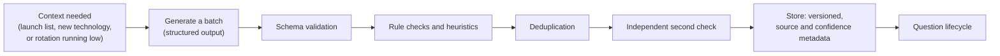
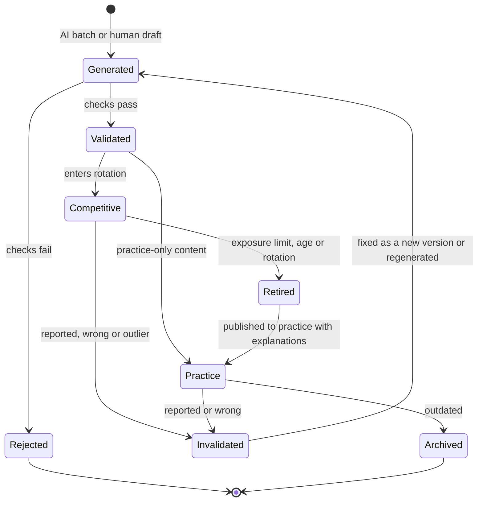

# Content strategy

> Part 1 · Product & Game Design · Status: **Approved (revision 4)**
>
> The MVP uses **AI-generated, validated, stored question pools** (~20 per context when a context is first needed) plus job-derived templates. Questions follow a **lifecycle**: they rotate through competitive use, retire into practice and can be invalidated or regenerated. Curated and community content gradually replaces AI content later. Schemas, the generation pipeline and storage are designed in Part 2.

## 1. Content types

| Type | Examples | Where it lives | Contributable |
|---|---|---|---|
| **Catalogs** | Roles, seniorities, bands, tracks, technologies, categories, aliases, role compatibility and recommendations | Repository (open) | ✅ |
| **Job content** | Title patterns, summaries, responsibility fragments, perks, company name parts, locations, salary bands | Repository (open) | ✅ |
| **Question pools** | AI-generated, validated questions per context, moving through the lifecycle | **Private database** (answer keys never in the repository or on the client) | ❌ (reports only) |
| **Question templates** | Job-memory generators, salary template, scenario templates | Repository (logic, open) | ✅ (reviewed carefully) |
| **Sample pool** | A small, clearly fake question set for local development and tests | Repository (open) | ✅ |
| **Community question packs** (later) | Curated questions per technology, with answers and explanations | Repository (open), practice only | ✅ |
| **Daily Company schedule** | Upcoming Daily Companies and themes | Private until published | ❌ |
| **Bot content, humor content, UI copy** | Archetypes, lines, rejection emails, interface text | Repository (open) | ✅ |

## 2. Question contexts and pools

A **question context** is a combination the game needs to fill a slot:

| Context kind | Example | Fills |
|---|---|---|
| Technology × level | Redis · level 3 | H1 (stack), part of F1 |
| Track fundamentals × level | Fullstack fundamentals · level 3 | H2 |
| Seniority × band | Senior+ situational / architecture · level 4 | H3, F1 |

When a context is first needed, about **20 questions** are generated, validated and stored (bilingual es/en). The pool then evolves through the lifecycle: questions enter competitive rotation, retire into practice, and new batches are generated when needed.

Job questions (memory, recruiter, salary) come from **templates** applied to the run's posting; they don't need pools.

## 3. AI-generated questions: the pipeline

**Structured output (one item):** question, optionA–D, correctOption, explanation, technology, difficulty, seniority, role, topic, translations (es + en, same correct option).

**Checks:**

- **Schema validation** of the structured output.
- **Rules and heuristics:** 4 distinct options; exactly one correct; prompt ≤ 140 and options ≤ 40 characters; known technology; valid difficulty, seniority and role; both languages present with the same correct option; no answer leaked in the prompt; no "all/none of the above"; option-length balance (the correct answer is not systematically the longest); no version trivia without a tag.
- **Deduplication** against existing questions.
- **An independent second check:** another model answers without seeing the key. A disagreement discards or flags the item.

> **Important limitation:** the second check **detects problems; it does not prove technical correctness.** Two models can agree on a wrong answer. That's why AI-only content is labeled by its verification tier, why rankings run as **Season 0 (Beta)** while content is being calibrated, and why every question can be invalidated.

**Metadata stored with every question:** source (`ai_generated`, `curated`, `community`), generator and prompt version, second-check result, a confidence signal, verification tier, the generation batch, timestamps. This lets us find and invalidate a whole bad batch.

**Operational rules:**

- **Never on the request path.** Generation happens before launch for launch contexts, and **asynchronously** afterwards (a new context appears, or competitive rotation runs low). A run never waits for an LLM; without a usable pool, the slot falls back to track fundamentals.
- **Answer keys never reach the client.** Pools live in the private database, not in the repository.
- **Cost controls:** batches per context, caching, budgets, a feature flag (`aiQuestions`). Never one generation per run, challenge or frame.

## 4. Verification tiers

| Tier | Meaning | Allowed in |
|---|---|---|
| **AI generated** | Passed schema, rules and deduplication | Practice only |
| **AI validated** | Also passed the independent second check | Competitive rotation in **Season 0 (Beta)**, and practice |
| **Human reviewed** | Reviewed by a person with domain knowledge | Competitive rotation (preferred), practice |
| **Curated** *(later)* | Reviewed and calibrated with real attempt data | Competitive rotation in official seasons |

Selection prefers higher tiers. Later seasons can require **Human reviewed** or **Curated** for competitive slots. The Beta label on rankings says explicitly: "Season 0 · Beta: we're still calibrating questions."

## 5. Question lifecycle

The goal: **a question active in ranked never appears in practice**, and practice can still teach (correct answers, explanations, learning material) with questions that left competition.

| Capability | How |
|---|---|
| **Rotation** | Each context keeps a target number of questions in competitive rotation; retired ones are replaced by validated ones |
| **Retirement** | After an exposure limit (times served in ranked) or an age, a question leaves competition |
| **Expiration** | Version-sensitive questions carry a review-by date |
| **Controlled reuse** | Retired questions serve practice. They never return to competition while their answers are visible in practice. |
| **Regeneration** | When rotation runs low or a batch is invalidated, a new batch is generated asynchronously |
| **Invalidation** | A report, an outlier statistic or a manual decision removes a question (or a whole batch) immediately; runs that already used it keep their audit trail |

These are conceptual states. The exact model (states vs flags, pool tables, exposure counters) is designed in Part 2.

**Edits create a new version**; runs reference the exact version they served. **Nothing is deleted**; invalidated questions remain for audit.

## 6. Coverage plan (MVP)

- **Launch contexts pre-generated** for the 4 tracks with full coverage (Frontend, Backend, Fullstack, Platform): track fundamentals at levels 1–5, seniority pools per band, and technology pools for the ~22 priority technologies at the levels the bands and practice need.
- **Priority technologies:** JavaScript, TypeScript, React, Vue, Angular, Next.js, Node.js, NestJS, PHP, Laravel, Java, Spring Boot, Python, Go, PostgreSQL, MySQL, MongoDB, Redis, Kafka, Docker, Kubernetes, AWS.
- **Long tail:** generated asynchronously on first need, with a fallback to track fundamentals until ready.
- **Practice-only tracks** (Mobile, Quality, Data, Security, Architecture): pools exist for practice; the track becomes ranked when its pools reach size and quality thresholds.

## 7. Open and private content (long term)

The repository is public, so **anything in it is known to attackers, including answers**. Therefore:

- **Competitive questions live only in the private database.** The repository holds catalogs, templates, a fake sample pool and, later, community packs that feed **practice only**.
- Retired competitive questions may eventually be published (for example into open practice packs); licensing is part of the Part 2 license ADR.

## 8. Quality bar (all sources)

One unambiguous correct answer (or explicit graded options) · prompt ≤ 140, options ≤ 40 · plausible distractors, no "all/none of the above" · concepts over version trivia · honest difficulty · an explanation for every question · neutral, respectful language · original content (AI output is checked against verbatim reproduction of known sources).

## 9. Localization

Every question exists in **es** and **en** with the same option IDs and the same correct option; technical meaning is preserved exactly; tech terms stay in English where the industry does; neutral Spanish. Ranked requires both locales validated.

## 10. Attribution and licensing

Repository content follows the Part 2 license ADR (direction: CC BY 4.0 for content, Apache-2.0 for code). AI-generated pools are private operational data. Community questions (later) show "Question by @handle" in practice reviews.
